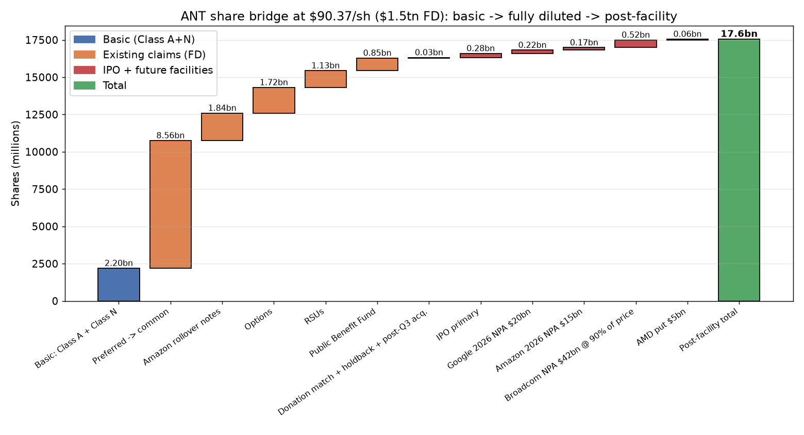
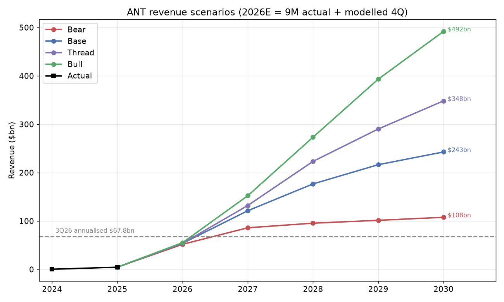
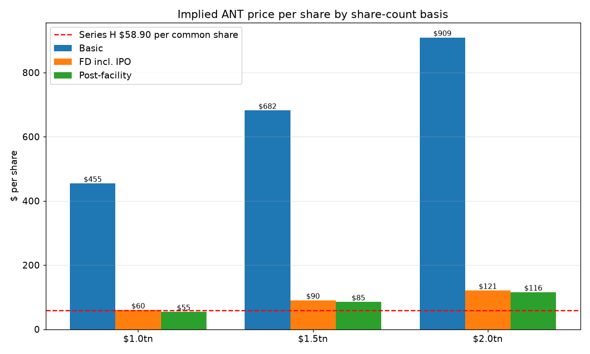

# Anthropic (ANT) — IPO notes

Status: not held. IPO pending. Started 29 Oct 2026.

## Filings (SEC EDGAR, CIK 2130357)

| Date | Form | Link |
|---|---|---|
| 2026-06-01 | DRS (confidential draft) | — |
| 2026-07-13 to 2026-10-09 | DRS/A ×5 | — |
| 2026-10-26 | S-1 (public) | [anthropicpbc-sx1.htm](https://www.sec.gov/Archives/edgar/data/2130357/000162828026067168/anthropicpbc-sx1.htm) |
| pending | S-1/A with price range and share count | expected before the roadshow |

Filing index: https://www.sec.gov/cgi-bin/browse-edgar?action=getcompany&CIK=2130357

## Ownership (from the S-1, 26 Oct 2026)

- Ownership percentages are left blank in the S-1; expected to be filled in by the S-1/A.
- After the Preferred Stock Conversion and Convertible Notes Conversion, "Amazon and Google will each hold greater than five percent of our outstanding capital stock", held as non-voting Class N common stock (converts to Class A on transfer to an unaffiliated party).
- Google 2026 NPA ownership cap: issuances are limited so that Google's ownership doesn't "exceed 14.99% of our outstanding capitalization on a post-money, as-converted basis", unless Google elects otherwise. Amazon's notes have their own ownership cap, which Amazon can waive.
- Google investments disclosed: 2023 NPA convertible notes up to $2.0B ($500M Sep 2023, $750M Sep 2024, $750M Sep 2025, 10% interest, none outstanding at 30 Jun 2026); 2024 NPA note of about $1.3B (8.5%); Mar 2026 NPA with a commitment to sell 38.6M Series G-2 preferred at $259.1364 per share; $10.0B in the Series H in May 2026, which cut the amount available under the 2026 NPA to $20.0B (none drawn at 30 Jun 2026).

## Views and guesses (29 Oct 2026, not data)

- Charlie's guess at Google's stake: about 12–14%, since the 14.99% cap only matters if Google is near it. Amazon probably similar. Unverified until the S-1/A.
- Luke's guess at valuation: about $1.5T, more likely $2T on the S-1 and growth, then doubling on day one.
- Charlie's counterpoint: IPOs priced in the trillions rarely double on day one; underwriters price for a pop.
- The bull framing: investors are valuing a share of the global knowledge-work wage bill, not a software company. Counterweights: Catalini's "verification last mile" argument (value accrues to whoever owns verification and data) and open-weight models trailing close behind.
- John Feeley (ex-colleague of Luke) asked "What will you sell to buy ANT?" and answered GOOG. Charlie's view: don't sell GOOG into a record post-earnings drop to buy an IPO at an unknown price; Google already owns a big ANT stake. Revisit when the price range is out.

## To do

- When the S-1/A lands: record the price range, share count, implied valuation, Google and Amazon percentages, and the compute commitments total.
- S-1/A No. 1 (2 Nov 2026) filled in commitment totals; ARR, price range and share count still blank — recheck on next amendment.

## Python model (9 Nov 2026)

S-1/A-based dilution and valuation workbook: [model/README.md](model/README.md) · script [model/ant_model.py](model/ant_model.py) · [model/output.md](model/output.md) (run the script to refresh). **Summary:** about **2.2bn** basic shares become about **16.3bn** fully diluted (**+642%**), and about **17.6bn** after the facilities are drawn; **$1.5tn** is about **$90** a share fully diluted, against **$58.90** for Series H.

## TechFundies thread check (9 Nov 2026)

**Sources:** [@TechFundies $ANT IPO thread, 8 Nov 2026](https://x.com/TechFundies/status/2119235577321267365) · [S-1, filed 26 Oct 2026](https://www.sec.gov/Archives/edgar/data/2130357/000162828026067168/anthropicpbc-sx1.htm) · [S-1/A No. 1, filed 2 Nov 2026](https://www.sec.gov/Archives/edgar/data/2130357/000162828026068676/anthropicpbc-sx1ax1.htm) (CIK 2130357; the latest amendment as of 9 Nov). The original S-1 left the commitment totals blank, and the S-1/A fills them in. Page numbers below refer to the S-1/A. The price range, share count offered and Run-Rate Revenue (ARR) are still blank in both filings.

### Claim check

| # | Thread claim | Verdict | What the S-1/A says |
|---|---|---|---|
| 1 | Price cuts cost ~5% in 4Q25 and 3Q26; ~$2.6bn ARR headwind in Q3 | **Confirmed on %; the $2.6bn is his own number** | p.162: revenue growth was "partially offset by a decrease of approximately $70 million" (3Q25→4Q25) and "approximately $600 million" (2Q26→3Q26) "from price reductions introduced as part of new model versions and contractual discounts". Measured against the prior quarter's revenue ($1,382m and $11,555m), that is ~5.1% and ~5.2%. $600m × 4 ≈ $2.4bn a year. The filing gives no ARR figure for the headwind. |
| 2 | Top 5 customers ~21% of Q3 revenue and slowing; net new revenue slightly down QoQ | **21% confirmed. "Slowing" only as a share. Net-new is DIFFERENT: down ~21%, not slightly** | p.145: "Approximately 79% of our revenue came from customers outside of our top five customers for the three months ended September 30, 2026, up from approximately 64%" in 1Q26. But "our revenue from each of our top five customers reached a record high." So their share fell, not their dollars. The top 5 were ~25% of 9M revenue (risk factors). Net new revenue was +$6,824m in 2Q26 and +$5,401m in 3Q26 (p.161), down ~21%. The filing makes no mention of Meta insourcing, Cursor or xAI. |
| 3 | Compute commitments ~$100bn/yr | **Confirmed as an average through 2030; near-term is lower** | p.140: "aggregate committed spend of approximately $895.4 billion… approximately $447.5 billion expected to be incurred before December 31, 2030… Approximately $69.8 billion… due in the 12 months following September 30, 2026." $447.5bn over ~4.25 years ≈ $105bn/yr. Another ~$150–175bn of uncapped deals sits outside these totals (p.175). |
| 4 | Compute ~74% of revenue this year | **DIFFERENT** | Compute and infrastructure was $18,808m on $33,242m revenue in 9M26, or **57%**. It was 48% in 2Q26 and **58%** in 3Q26, up because of "$5.0 billion of compute under short-term commitments" (p.162). It was 160% in FY25. Customer-serving **cost of revenue** was only $4,812m in 9M26, or 14.5%, which implies a ~85% gross margin (F-40). A full-year 74% would need a huge Q4. Treat it as his own estimate. |
| 5 | ~2–3bn shares nominally plus ~14bn convertible; venture holders heavily diluted; funded largely by supplier/partner deals | **Share counts confirmed. "Largely supplier-funded" is DIFFERENT for the past, but true of the future capacity** | 2,169m Class A + 31m Class N were outstanding at 30 Sep 26 (balance sheet). Securities left out of EPS as anti-dilutive come to 12.2bn: 8.56bn preferred (as converted), 1.84bn Amazon note shares and 1.77bn options (F-59). On top of that are 1.13bn performance RSUs. 846.8m Public Benefit Fund shares = "5% of our fully diluted shares as of June 30, 2026" (p.146), which implies ~16.9bn fully diluted. The $110.7bn raised in 9M26 came from preferred stock (p.174). Of that, Google and Amazon put in ~$30bn (Series G-2 $15bn plus $10bn and $5bn in Series H), and the rest came mostly from Series G-1 and H-1 investors. All the undrawn capacity is partner money: $77bn of NPAs (Google $20bn, Amazon $15bn, Broadcom $42bn) plus the AMD $5bn put (p.168–169). |
| 6 | "Adjusted income" excludes losses on supplier shares | **Confirmed (net income only)** | p.159: Adjusted Net Income excludes "the change in fair value of convertible notes, derivative liabilities, and SAFEs" ($94.3bn in 9M26) and "certain mark-to-market financial instruments" ($10.3bn), i.e. the Google/Amazon NPAs and the AMD put (F-32). Adjusted Operating Income excludes only SBC ($3.3bn), donation-match charges ($2.1bn) and the Bartz settlement. |
| 7 | AVGO rate 15% (him) vs 13% (@edwin_mccallum); SPCX ~$5.27/hr | **15% DIFFERENT. 13% is only the penalty rate. $5.27/hr NOT IN S-1** | p.171: the Broadcom NPA notes carry "9.00% per annum" PIK. Notes issued while "certain revenue performance conditions are not met bear interest at 13.00% per annum and convert at 85%". None had been issued. The finance-lease discount rate is 6.6% (F-35). SpaceXAI: "up to $120.5 billion over terms extending into 2029… approximately $3.1 billion in the aggregate per month once all capacity has been delivered", expected Dec 2026, cancellable on 90 days' notice after Jan/Mar 2027 (p.176). No hourly rate is given. |
| 8 | Cash is fine | **Confirmed** | 30 Sep 26: cash and short-term investments $131.8bn ($95.6bn cash, $36.3bn STI). Liquidity is $146.6bn including the $14.8bn revolver, before IPO proceeds (p.140). Operating cash flow was +$6.6bn in 9M26. |

### S-1/A headline figures

- **Revenue:** 3Q26 $16,956m, which annualises to ~$68bn. 9M26 $33,242m, against $2,545m in 9M25. TTM to Sep-26 is ~$35.3bn (sum of quarters). FY25 $4,585m.
- **QoQ growth:** 1Q26 +132%, 2Q26 +144%, 3Q26 +47%. YoY growth in 3Q26 was +1,127%.
- **Run-Rate Revenue (ARR):** left blank ("$ as of October 31, 2026"). Net Revenue Retention is ~900%.
- **Margins:** the S-1 has no gross-margin line. Expenses are presented by nature. The functional note implies ~85% in 9M26 (39.5% in FY25). Operating loss was $(1,260)m in 9M26 (–4%) and $(567)m in 3Q26. Adjusted operating income was $4,081m in 9M26 (12%) and $2.5bn in 3Q26 (15%).
- **Net loss:** $(104,039)m in 9M26, driven by a $94.3bn non-cash fair-value loss on the convertible notes and $10.4bn of other expense. Adjusted net income was $5,591m.
- **Cash:** $131.8bn cash and short-term investments, $146.6bn liquidity. Total assets $154.3bn.
- **Commitments:** $895.4bn in total, $447.5bn of it by end-2030 and $69.8bn in the next 12 months. Of the total, $213.8bn is subject to termination rights or contingent conditions. Large deals: Google $121.3bn, SpaceXAI up to $120.5bn, Amazon $110bn, Microsoft $44.9bn, Nscale $44.6bn, Lambda $41.3bn, Broadcom leases $161.2bn.

### His projections (not in the S-1)

The ARR growth of +85% and +46%, revenue growth of +145% and +69%, $130bn+ of 2027 revenue, GAAP profit in 2028, compute at 80% and then 69% of revenue, and the bull case of 45% compute and a 22% net margin are all his own estimates. Against the run-rate they are **plausible but demanding**. FY26 lands around $55bn if Q4 grows ~25%. Getting from there to $130bn+ in 2027 needs about 20% QoQ growth for five straight quarters. Growth has already slowed from +144% to +47%, net new revenue fell in Q3, and the S-1 says it expects growth to decline. Compute at 80% of 2027 revenue does fit the ~$105bn/yr commitment schedule. GAAP profit in 2028 is credible operationally, since the 9M26 operating loss is only 4%. The big fair-value losses also stop once the notes convert at IPO. The $1.5tn valuation is not in the filing. As a rough cross-check, Series H at $589.01 per preferred share (10:1, so ~$58.90 per common share) × ~16.9bn fully diluted ≈ $1.0tn.

### Charlie's view (opinion, not data)

- **Use GAAP and the fully converted share count, not adjusted net income.** Adjusted NI removes ~$105bn of fair-value losses, plus SBC of $3.3bn and the $2.1bn donation match. Those are real transfers of value to Amazon, Google and staff. Value it per share on ~17bn-plus shares, then add post-IPO NPA draws that are settled in stock at VWAP.
- **"Compute is 70–80% of revenue, so it's a utility" needs refining.** The cost of serving customers is only ~15% of revenue, a software-like ~85% gross margin. The heavy cost is training and research compute (R&D $19.2bn, 58% of 9M revenue), plus a pile of $895bn of fixed commitments that don't flex if prices keep falling 5% a quarter. The risk is operating leverage on fixed capacity, not thin unit margins.
- **$1.5tn still prices in the bull case.** It is ~22x the 3Q26 annualised revenue and ~50% above the Series H mark, so buying at the IPO leaves little cushion if growth keeps decelerating.
- **Concentration is falling but worth watching.** The top-5 share fell from ~36% to ~21% while their dollars hit records, so the "slowing big customers" story is weaker than the thread says. The bigger tell is that net new revenue fell ~21% QoQ with $600m of price cuts in the same quarter.
