# October 2026

---

## 2026-10-02 evening BST — clipping: Goldman Sachs / US long-end treasuries “bidless” #macro #rates #treasuries

**Source:** Unverified social-media clip; pasted text shared by Luke (~2 Oct 2026 evening BST); X-style post; author/URL not provided; sensationalised claim — treat as unverified

> 🚨 GOLDMAN SACHS DROPS DOOMSDAY STATEMENT: U.S. BONDS HAVE NO BUYERS
>
> Goldman Sachs just admitted the long end of U.S. Treasury market is “totally bidless.”
>
> Translation: almost nobody wants the 10- to 30-year debt the U.S. is trying to sell.
>
> No buyers. None. Zero.
>
> While Treasury Secretary Scott Bessent tells Congress we’re in an “illiquid period,” doubles then triples long-bond buybacks, taps the General Treasury Account to fund it and openly says “I am the house.”
>
> Yields are surging anyway. The 10-year has pushed toward 5.3% and the 30-year is even higher, levels not seen in years while Japan, one of the biggest foreign holders, keeps selling Treasuries and bringing money home.
>
> This was exactly warned by Japan’s @yutokanzakireal that the measures being prepared by Bank of Japan will affect the lives of billions of people and apologized to people of the West. 
>
> Soon after, Scott Bessent intervened and effectively took over BoJ operations which Japanese policymakers heavily criticized.
>
> If the same ”bidless” condition hits the short-dated treasuries market, the entire U.S. debt market (and global) collapses.
>
> The U.S. debt crisis will turn into a global liquidity crisis.

---

## 2026-10-02 evening BST — clipping: François Chollet — base LLMs vs LRMs #ai #llm #arc

**Source:** Pasted social-media post attributed to François Chollet (~2 Oct 2026 evening BST); no URL given

> Chollet - The critical distinction between base LLMs (2024 and earlier) and modern LRMs is not symbolic tool use. It's the switch from a transductive paradigm (intuit the answer to the query) to an inductive paradigm (intuit the program/instructions that produce the answer to the query).
>
> They're trained to be inductive, and they perform test-time induction, i.e. test-time prediction of a NL program / reasoning chain. This unlocks entirely new capabilities -- in particular fluid intelligence. Base LLMs, to this day, have ~0 fluid intelligence. LRMs have substantial levels of fluid intelligence.
>
> The performance of LLMs on ARC 1 (a benchmark from 2019) remains ~10-15% today. Scaling them up by a factor ~100,000x got them from 0% to 10%. Meanwhile LRMs the same size or smaller saturated ARC 1 in 2025.

---

## 2026-10-02 evening BST — clipping: France sovereign debt / next euro crisis #macro #france #sovereign-debt #europe

**Source:** Pasted social-media post (~2 Oct 2026 evening BST); author/URL not given — treat as unverified opinion

> Most people don’t yet grasp what is happening in France. Markets are pricing French sovereign debt as junk, rating agencies will eventually have to follow. This will have two major impacts:
>
> 1. Most French banks are already rated at or just below the sovereign, so a move toward junk would likely drag domestically focused lenders with it. Credit to households and firms would slow sharply, hurting the economy and widening the fiscal deficit even further, a vicious cycle.
>
> 2. For the ECB, the constraint is legal as well as financial. A fall below investment grade would force sales by ratings-bound investors while making any backstop harder to justify under current rules.
>
> The next euro crisis will begin in France. The first, which began in Greece, will feel like a walk in the park compared with what comes next.

---

## 2026-10-02 evening BST — clipping: GPT-6 Astra — Napoleon general cipher (thread 1/6) #ai #agents #gpt6

**Source:** Pasted social-media post (thread opener, 1/6); author/URL not given; unverified claim

> I used GPT-6 Astra to break an unsolved cipher to one of Napoleon's generals that had gone unread for 217 years.
>
> What makes this impressive isn't actually the codebreaking, but that Astra completed the entire multi-modal workflow in ~6 hours from a single image and goal.
>
> 1/6🧵

---

## 2026-10-02 evening BST — clipping: a16z — AI buildout capex supply chain “State of Markets II” #ai #capex #semis #power

**Source:** a16z social post, “State of Markets II” (~2 Oct 2026 evening BST); link truncated as given: a16z.news/p/state-of-mar…

> A16z - Where does money invested into the AI buildout actually go?
>
> For every $100 flowing into the supply chain:
> - $50 to chips
> - $20 to power
> - $15 to networking
> - $15 to cooling, buildings, and land
>
> More charts in State of Markets II: a16z.news/p/state-of-mar…

**Chart:** Following The AI Capex Money, illustrative $100 split; source BNP Paribas Equity Research via a16z, Aug 2026

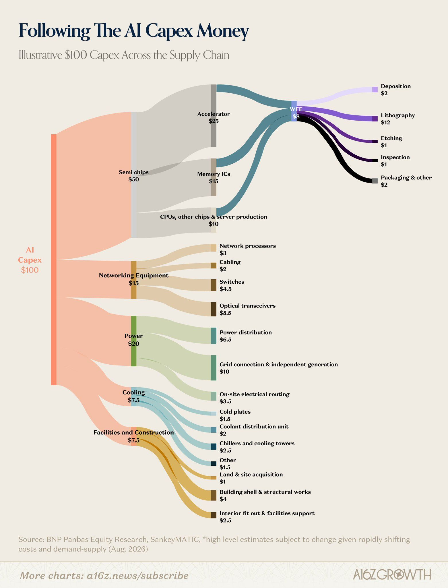

---

## 2026-10-04 morning BST — clipping: Paul Graham — do not bet against the airplane #ai #prediction

**Source:** X post by Paul Graham (@paulg); posted ~12 hours before screenshot (~2026-10-04 morning BST); quote-tweets Christian Szegedy (@ChrSzeg…); no URL given

> Do not bet against the airplane. The skeptics who say AI can't conjecture, can't theorize, and can't explain are describing last spring's models. Within months, they will be describing nobody. The evidence is already on the table, and those with eyes can see it.

Quote-tweeting Christian Szegedy (@ChrSzeg…): “Reading all those recent beautiful essays by Terry Tao, Kevin Buzzard and @wtgowers, I could not resist, but write up my deeply personal perspective on how I perceive and see things: ...”

Engagement at time of screenshot: 69 replies, 95 reposts, 1.3K likes, 131K views.

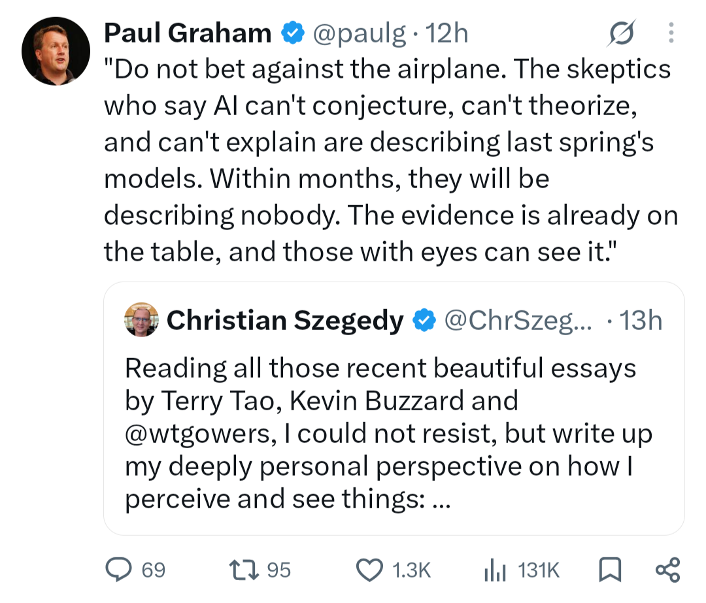

---

## 2026-10-04 morning BST — clipping: Christian Szegedy — Quo Vadis, Mathematics? #ai #maths #prediction

**Source:** “Quo Vadis, Mathematics? Is Mathematics Over, or Just Graduating?” by Christian Szegedy, 3 October 2026; published Google Doc; no URL given

Paul Graham’s quoted paragraph (“Do not bet against the airplane…”) is lifted verbatim from this essay’s “Quo Vadis?” section.

Szegedy frames his essay in four parts. **Graduation** recalls his teen competition-maths background and the emptiness after finals. **The Jungle** treats pure maths as an unmapped wilderness (maps = theories, mineral deposits = applications, gadgets = tools, rocks = conjectures). **The Airplane** compares AI to early aeroplanes: today it reaches a few unclimbed rocks (some conjectures); soon it will be cheap, “satellites” will map and mine the whole terrain, and maths will grow more useful and more mundane. **Quo Vadis** argues against betting on the airplane failing; status and rewards shift toward choosing terrain, steering fleets of airplanes, and explaining results — maths “graduating” into infrastructure for all science.

> Every revolution looks like a toy at first. The Wright brothers' first flight lasted twelve seconds and covered less distance than a jumbo jet's wingspan. That is roughly where AI stands in mathematics today.

> But the argument that airplanes can't reach the top of the real mountains (solve the hardest problems) or draw approximate maps of large areas (build theories) is a static-thinking fallacy. Today's airplanes are primitive compared to what they will be in a few months, let alone years.

> Once airplanes get cheap, we will also discover satellites. We will map the whole terrain for mineral deposits and other valuable resources, and then extract them.

> Mathematics is about to graduate. It will grow into a full-scale industry and become the true infrastructure of all scientific and technological progress, a foundation that every other field stands on rather than a quiet corner of academia. The age of lone climbers is closing, and the age of mapping the whole continent is opening.

---

## 2026-10-05 morning BST — clipping: Important advice — rethink how things should be done #ai #agents #prediction

**Source:** Pasted social-media post (X-style); author/URL not given

> Important advice: deliberately rethink every previous concept of how things should be done.
>
> Some thoughts, tips, and realizations:
>
> 1. Specializations are collapsing. Come to terms with and take advantage of this reality. The person who used to be an engineer is now also a data scientist, a content creator, designer, marketer, and whatever else they want to be. Deliberately expand in as many directions as you can and become great at them (scope up vs just speeding up)
>
> 2. The average person with access to tokens can now do the work of a data scientist who used to cost $500,000 a year. Seriously, this is fucking crazy. This opens up an entirely new world. Take advantage of it (also everyone else will also realize this over time).
>
> 3. 99% of what's created is now slop. Be aggressively anti-slop and you will absolutely stand out.
>
> 4. Trying is nearly free. Automating is nearly free. My mind still sometimes lives in the world from 12 months ago where an idea automatically is attached to a certain amount of time or effort. Both of these have collapsed to close to zero (or just token cost), I therefore try and experiment with *any and all* ideas with potential and have needed to retrain my brain for this constantly.
>
> 5. Tokens are a career and growth accelerant. Find ways to get cheap access to tokens, or free tokens. Extremely important, and actually an entire design space, use your imagination.
>
> 6. It's never been easier to both stand out but also fall behind. 10x, 100x "people" exist more than ever (maybe 1,000x). Outlier power users of AI, many who you see here on X. Feels like we are in a window of time, a window of opportunity while all of this is still early, to take advantage of it.
>
> 7. Local computing is (or will be) dead for 99% of work. Local was built for a world where work was bounded by the physical presence of its author, but this is no longer true. You can and should do infinite work in parallel or zero, it doesn't matter anymore. Cloud agents enable this at scale and in any computing environment, I predict cloud agent usage will 1000x over the next 12 months and optionality and accessibility will 100x. Plan for this world, take advantage of the possibilities.
>
> 8. Building on #7, you can give an agent it's own computer, and it's own identity. You can then give an agent with it's own computer it's own computer. You can give that agent with it's own computer with it's own computer, *it's* own computer. These agents are smarter than any human in history and you have access to as many as you'd like. Think about this for a moment.
>
> After 14 years in this industry (tech) today is the most exciting time ever and nothing else feels even close.

---

## 2026-10-05 morning BST — clipping: a16z Growth — US households paid AI subscriptions #ai #adoption #prediction

**Source:** a16z Growth chart via a16z.news (PNC Research, Internal Data, July 13, 2026)

**Chart:** "More and More Households are Paying for AI" — share of US households with paid AI subscriptions. April 2026 highlighted at **2.2%** (steep rise from ~0% Jan 2023).

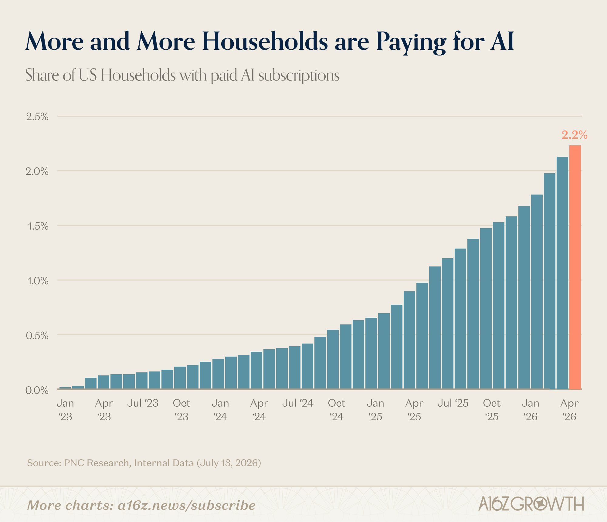

---

## 2026-10-06 ~07:52 BST — clipping: Eric S Raymond — the end of software secrecy (LLM decompilation) #ai #software #open-source #saas #moats

**Source:** Eric S Raymond (ESR), two-part social post (X-style thread, 1/2 and 2/2); URL not given

> The end of software secrecy is almost upon us. The death of closed source, and the final triumph of open source.
>
> I should have realized this a few months ago when I successfully decompiled the game of Firefighter from an ancient DOS shareware binary. My robot friend was able to tell it had been written in Borland Pascal from looking at the data layout; it gave me back very readable Pascal code with sensibly chosen function and variable names. I transpiled it to Rust and now ship it as part of my heritage games collection. 
>
> The thing is, I thought of this as a fun stunt but didn't have any confidence that the technique would scale up to large, real programs. I have since learned that people are now doing this sort of thing with entire AAA games, which are among the most complex software artifacts ever to be shipped as a binary. If they can be decompiled, anything can be. 
>
> This has implications. Massive implications. We need to think about what the world is like when, in general, there is no longer a secrecy moat around almost any software at all.
>
> 1/2
>
> [continued]
>
> I say "almost" because there is going to be one way to maintain secrecy. Software as a service with the executable hiding behind a network connection to the cloud. But as of now, we must assume that anything shipped as an executable, or even a firmware image, is as transparent as glass. It won't keep its secrets for any longer than it takes for somebody to be motivated to throw an LLM at it.
>
> I did not see this coming. When I wrote down the theory of open source, 30 years ago now, I thought closed source would be gradually driven towards extinction by cost gradients, but survive indefinitely in certain niches. I did not foresee it being wiped out in a technoapocalypse.
>
> Ironically, I thought one of the application areas in which closed source would persist longest was games.
>
> There are still some obstacles. In US law, decompilation of a binary is a derivative work of the binary that falls under whatever copyright it had. However, it is also settled law that if you decompile binary code to a precise specification of what it does, then generate fresh code from that without looking at the decompiled stuff, you're in the clear. This was the case law that allowed PC clones to exist, after Phoenix Technologies reverse engineered the original IBM PC BIOS.
>
> The two-step process - binary to specification to unencumbered code - will no longer takes a large number of programmers and years of development time. With an LLM, it's now a thing you can do in a day. Ubiquity will make it impractical to prosecute all the people who might skip the specification step.
>
> Source code can also be covered by patents. You can be able to see their source code for a patented technique and not be able to use it without violating the law. Linux has evolved practices for dealing with this problem - one is not shipping patented video codecs, but requiring you to download them as plugins from jurisdictions where U.S. patents can't be enforced. This presents patent holders with the impractical challenge of individually suing millions of end users, assuming it can even figure out who they are. To date, AFAIK, this has not been attempted.
>
> And that's about it. If there are any other ways left to retain software secrecy and lock-in than SaaS or patents, I can't think of any. Well, you could epoxy-pot a firmware ROM, I suppose, but that can be defeated with a heat gun and a dental pick. Device manufacturers will learn not to pay for an assembly step that has become useless. 
>
> Forced migration from shipped binaries to tied cloud services will be tried - Adobe pioneered this, and Microsoft is pushing it as hard as they can given that their OS is a binary that has to run locally. Both companies are seeing massive user revolts over this. There is good reason to doubt that it's a strategy that can hold customers in the long term.
>
> Also, a lot of things can't safely be tied to the cloud at all, because they can't tolerate a random network outage. Machine tools, medical devices...
>
> A whole lot of proprietary software business models are going to collapse. Hard. One that I think might survive is tax software; being able to decompile it doesn't necessarily do you a lot of good because its actual value is tracking a ruleset that changes over time and has to be maintained by vendor specialists. But cases like this are unusual. 
>
> I think some dirty laundry is going to get aired, too. It has long been rumored that the reason graphics card manufacturers are so stubborn in their secrecy is that they've all been committing massive intellectual-property theft on each other for decades. If this is true, it will be exposed, and the lawsuits will be entertaining.
>
> We're entering a new world, with a lot of ancient comfortable assumptions being blown up. It's going to be fun to watch. 
>
> 2/2

---

## 2026-10-06 ~19:19 BST — clipping: Jack Farley / Mintzmyer — Hormuz VLCC rates ~25x; peak caution on tanker stocks #oil #shipping #tankers #drybulk #podcast

**Source:** Jack Farley podcast promo (X-style post, 1/3); guest J Mintzmyer (@mintzmyer). Partial Apple/Spotify/YouTube links as pasted (incomplete URLs OK)

> Jack Farley - OUT NOW - words like "crisis" or "historic" fail to describe the global oil tanker market right now, with daily tanker rates in/near the Strait of Hormuz up 25x. Not 25%. 25 TIMES.
>
> The Iran War has forced fleets to take ridiculous routes, with multiple ships running "relay races" and caused ton mile demand to explode higher. The typical daily rate for VLCC (Very Large Crude Carrier) is $40k and now there are VLCCs commanding over 1 MILLION PER DAY, an astronomical sum that reflects the extreme lengths oil refineries (especially those in Asia) are willing to go to get their supply.
>
> I am joined by J @mintzmyer, a shipping and energy specialist whose model portfolio for his research service is up ~3786% over the past decade (or ~40% annualized vs ~16% annualized for shipping industry). J was very bullish on oil and product tankers however, the madness is so extreme that he thinks rates have likely peaked and that investing in tanker stocks now could leave investors disappointed. Yes, earnings power will be phenomenal but tanker stocks (examples include Frontline, $ECO, $DHT, etc.) might have already priced that in. He does note however that what he is most bearish on is tanker RATES rather than tanker stocks; put simply, one million dollars a day cannot last.
>
> Where J is seeing real value is in drybulk stocks (transport of coal, iron ore, and aluminium ore ie bauxite), where giant aluminium/iron mines in West Africa are going to cause China to increase more bauxite imports from West Africa and less from Australia, which is going to cause a serious increase in demand for drybulk tonne miles. (Example of a dry bulk that could benefit from this trend is CMB.TECH) Plus, the new orders of drybulk that will come on the market is not large, where it IS for VLCCs and containerships.
>
> So often in covering markets, the thing that is the hottest topic is actually NOT the thing, meaning that the time that oil is at $120 is the time to sell your oil stocks, not buy them. Which is why I'm very happy to have J's note of caution on tanker stocks and tanker rates... BWET is up >4900% this year but buying it here might not be a good idea... in fact it could be cash incineration if normalization happens which history suggest will happen eventually.
>
> Apple
> podcasts.apple.com/us/podcast/the…
>
> Spotify
> open.spotify.com/episode/2uhMib…
>
> YouTube
> youtube.com/watch?v=aDQgZl…
>
> 1/3

---

## 2026-10-06 ~20:34 BST — clipping: Catalini — Anthropic as Pennsylvania Railroad; value in complements / verification #ai #moats #anthropic #gpt #verification

**Source:** Christian Catalini (@ccatalini), X self-thread posted 6 Oct 2026; most posts had charts (not attached). Includes early reply note from @realChiragh.

> Christian Catalini (@ccatalini), posted 6 October 2026. A self-thread arguing that Anthropic looks like a late-19th-century railroad: it built the tracks, but most of the surplus may not stay with the builder. Most posts have an attached chart or slide.
>
> 1. Is @AnthropicAI the Pennsylvania Railroad? It bought $7.33B of compute to carry $4.59B of revenue, ordered $518B more, and IPOs at peak utilization. In 1893 hundreds of railroads entered receivership. Society kept the tracks. Sears, the app layer, thrived.
>
> 2. Inventors’ predictions about the impact of their own technologies have a terrible record. Radio was going to end war. Nuclear power too cheap to meter. Film, flight, computers: the confident calls, utopian or dystopian, aged worst. Each one was sure “this time was different.”
>
> 3. Will one of the AI labs be the last company standing? No. Economic history is a graveyard of companies that built the future, then discovered they didn’t own it.
>
> 4. General purpose technologies (the original GPTs) are special. They span many sectors. Their quality-adjusted price keeps falling, unlocking new uses. The layers feed each other: a better GPT raises app productivity, and better apps raise the returns to the GPT.
>
> 5. Getting the full benefit means redesigning entire systems, not bolting on point solutions. GPTs also have weak appropriability. Nordhaus found innovators keep 2.2% of the surplus they create. GPT inventors likely keep less. The rest goes to the complements.
>
> 6. AI was born under a weak appropriability regime, like every GPT before it. There isn’t much the labs can do about it. Two outs: domains where a patent enforces excludability, like bio, or where customers pay a lot for a small edge, like finance, cyber, and defense.
>
> 7. Steam? Boulton & Watt held the patent. Cotton boomed. Electricity? A regulated utility. Factory labor productivity grew 5.1% a year. Combustion engines? Gasoline and suburbia.
>
> 8. Railroads had their own @DarioAmodei: Tom Scott, the “Pennsylvania Napoleon.” Standard Oil was most of his traffic. Scott moved into refining to capture value (labs and pharma?). After the price war the Pennsylvania paid Rockefeller 20c a barrel, even on his rivals’ crude.
>
> 9. Over 100 railways went into receivership. The tracks kept running. Without them, U.S. farmland would have been worth 60% less. Private return on the railroads: 3.5%. Social return: 48%. Value accrued to landowners, manufacturers, consumers. The app layer (Sears) boomed.
>
> 10. The market for intelligence splits three ways.
> Frontier generalists (closed) take the top of the demand curve.
> Low-cost generalists (open) run most tokens.
> Enterprises worried about disintermediation scale frontier specialists: open models plus proprietary context.
>
> 11. A frontier specialist starts with open weights, adds proprietary context, expert feedback and evals. In their domain, frontier specialists will beat closed labs on price and quality. Companies keep control, without funding or training their own replacement. Expect more of this.
>
> 12. The labs have one more problem: they need to be successful, but not too successful. The only company left in the world gets nationalized, or turned into a regulated utility, metered by the token.
>
> 13. So where does value ultimately accrue? To whoever holds the complementary assets: chips, the ability to turn atoms into datacenters, distribution, and reliable products customers and businesses pay for. The 2026 equivalents of farmland, factories and Sears.
>
> 14. Regulation could create one more complementary asset: permission to compete. If policy, safety and compliance costs become barriers to entry, the big labs get a real moat.
>
> 15. So how do you survive the moatpocalypse? Start from one observation: anything that can be measured will be automated.
>
> 16. Most of the scaling recipe to date is better measurement, not better models. Han & @dwarkesh_sp put 12x of pretraining progress down to better data and 3.7x to better models.
>
> 17. You can’t safely automate what you can’t reliably measure and verify. Verification means checking that the agent did what you intended. As execution gets cheaper, proving the task was done right becomes the bottleneck to safe scaling.
>
> 18. Which is why every company needs to become a verification factory. Two areas of focus: advance measurement through friction with the real world faster than your competitors, and recruit the best verifiers in your domain. (Quotes his 2 October thread, which opens with an expert rejecting a plausible but wrong answer — a controller catching deferred bookings counted as revenue, a security engineer blocking a release that would have given an agent write access to production.)
>
> 19. The only network effects that survive AI are verification-grade ones: the ones that benefit from the loop from new measurement and ground truth, to compute, to higher-quality verification that feeds back into new measurement.
>
> 20. Establishing verification-grade network effects is not enough. You also need to own the underlying loop to begin with. That means owning the weights of production.
>
> 21. But what about RSI? 26% of model R&D is now led by Claude, so progress is real. The last mile will stay a bottleneck. And more capable AI makes knowledge on the periphery worth more, not less. Which feeds back to the owners of complementary assets and context.
>
> 22. Hayek’s objection to central planning was never a shortage of compute. It was that the knowledge an economy runs on is tacit and tied to time and place. That holds for AI however capable it gets, which points to a world of many competing intelligences, not one company left.
>
> One early reply, from @realChiragh: the biggest winner of the AI revolution might not be the company building the intelligence infrastructure, but the company that figures out to do with intelligence once it is abundant and cheap.

---

## 2026-10-06 ~21:41 BST — clipping: Kevin Picchi — storytold Adobe apps re-created (opus-5.5, Rust, open source) #ai #software #open-source #adobe

**Source:** Kevin (@KevinPicchi) on X, 4:43 PM · 6 Oct 2026; embedded Reddit-style post by ai_art_is_art (OP, ~3d before screenshot); unverified social claim — feature parity, provenance, and repo authenticity not checked

> This guy re-created all the adobe apps with opus-5.5, ported them to rust, and opensourced them
>
> something really cool is happening

Embedded list (ai_art_is_art): Photoshop → github.com/storytold/photocraft; Illustrator → github.com/storytold/vectorcraft; Premiere → github.com/storytold/filmcraft; Lightroom → github.com/storytold/lightcraft; Acrobat Pro → github.com/storytold/printcraft; After Effects → github.com/storytold/effectcraft; InDesign → github.com/storytold/designcraft. OP also claimed: “We're going to reach 100% parity within a month.”

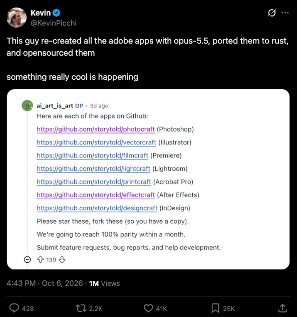

---

## 2026-10-07 ~08:24 BST — clipping: Ray Dalio — AI bubble may burst #ai #bubble #macro #dalio

**Source:** Headline only; pasted by Luke (~08:24 BST, 7 Oct 2026); outlet and URL not given — headline-only clip (no article text)

> Ray Dalio: We're Nearing Point Where AI Bubble May Burst

---

## 2026-10-07 ~08:27 BST — clipping: SpaceX $SPCX debt raise for Nvidia chips (Bloomberg repost) #ai #capex #nvda #spacex #credit

**Source:** Unverified social repost citing Bloomberg (~7 Oct 2026 ~08:27 BST); author/URL not given — treat as unverified social repost of a Bloomberg report

> BREAKING: SpaceX, $SPCX, is in talks with banks and investors to raise $40 billion of debt to buy chips from Nvidia amid "insatiable demand" among AI developers, per Bloomberg.
>
> The company is seeking to raise about $10 billion in bank loans and $30 billion in investment-grade debt to pay for the chips.
>
> The AI Revolution is even stronger than most people realize.

---

## 2026-10-07 ~17:12 BST — clipping: Tracey Alloway — heart of the bond selloff #bonds #rates #credit #hyperscalers #macro

**Source:** Tracey Alloway, social post (X-style); URL not given

> Wrote about this earlier this week, but I think the heart of the bond selloff is basically countries and companies (hyperscalers) have no choice but to keep borrowing, and investors suddenly have a lot more options about what to put their money in.

---

## 2026-10-07 ~17:14 BST — clipping: Mohamed El-Erian — 30y gilt yield 6% #economy #markets #bonds #uk #yields #gilts

**Source:** Mohamed El-Erian, social post (follow-up to his earlier UK budget note)

> Following up on the earlier UK budget note:
> The 30-year gilt yield now carries a 6% handle, reaching its highest level in 28 years.
> #economy #markets #bonds #uk #yields

---

## 2026-10-08 ~08:11 BST — clipping: Bunker mode — migrate crypto to unexposed-pubkey addresses; ECDSA may break before Q-day #crypto #bitcoin #ethereum #cryptography #quantum #ai #math #HOOD

**Source:** social post, author not given (unattributed)

> Today I call upon the blockchain industry to calmly begin planning for "bunker mode". My personal recommendation is to set in motion a controlled mass migration of assets to fresh addresses, i.e. addresses whose pubkeys remain hidden behind a hash.
>
> Holders, starting with large and sophisticated ones, should consider moving the bulk of their funds to addresses that have never signed a transaction. And when they do sign one, they should also move remaining funds to a new address (possibly generated from the same seed phrase).
>
> Don't rush. While I believe there is cause for action a rushed migration would do more harm than good. Don't panic either. Moving assets to protected addresses is a simple, preventative step which does not require new cryptography or new wallets.
>
> IMO it is now reasonable to brace for the possibility that ECDSA breaks before qday, in the worst case in months not years. By "break" I mean fast private key recovery (e.g. in one week) on available hardware (e.g. a large GPU cluster).
>
> Recent days have been humbling for human mathematical intuition. Long-held, unquestioned hypotheses have fallen. This includes the n log(n) bound for integer multiplication and the 3SUM conjecture. In hindsight, May's unexpected disproof of the Erdős unit distance conjecture was our warning shot.
>
> Yesterday's OpenAI drop made it clear that mathematical superintelligence is upon us. They say there are weeks where decades happen. We are about to live through weeks where centuries of mathematical progress happen. Could our magic 64-byte ECDSA signatures be too good to be true? Was it just security through obscurity all this time?
>
> Elliptic curves feel especially vulnerable to superintelligence. Curves carry rich structure, with room for fancy tricks like Schoof, Frobenius, pairings. (By contrast, hashes are designed to minimise algebraic structure.)
>
> Separately, as Ewin Tang can attest, an efficient quantum algorithm sometimes foreshadows an efficient classical one. We should be open to the possibility of a classical counterpart to Shor that breaks elliptic curves and RSA at once.
>
> Also noteworthy is the striking under-representation of cryptographic breakthroughs among the 722 mathematical results OpenAI published. I've witnessed first-hand the US government censoring academic quantum cryptanalysis results. Backroom interventionism is my base case.
>
> I urge large, sophisticated actors to lead by example. Project11's "risq list" (bitcoin-risq-list.projecteleven[.]com) is a great tracker of exposed BTC pubkeys. Binance, Bitbank, Robinhood, Bitfinex, and Tether have an opportunity to harden their cold storage. Next month I'll address institutions in London in a live Q&A (forum.ethereuminstitutional[.]org/london-2026).
>
> Again, please do not rush. Wallets holding under 50 BTC enjoy partial cover from "Satoshi's shield", i.e. his 20K exposed addresses that hold 50 BTC each. Load-bearing signers like oracles and L2 security councils should consider rotating ECDSA pubkeys with every signed message and/or multi-signing with a hash-based schemes like SPHINCS.
>
> Exiting bunker mode safely will require post-AI cryptography. My inclination is to go all-in on hash-based cryptography and avoid structured mathematical assumptions entirely, whether from curves, lattices, or isogenies. A single battle-tested hash (e.g. from the SHA or BLAKE families) yields plausible post-AI security.
>
> The Ethereum roadmap on strawmap[.]org fully embraces hash-based cryptography with end-to-end formal verification as a response to the quantum threat. Those timelines must now be revisited and accelerated in light of mathematical superintelligence. I'll be pushing for maximum defensive acceleration.

---

## 2026-10-09 ~19:08 BST — clipping: Tristan Buckmaster (NYU) — OpenAI's 722 AI math papers wiped out research programs #ai #math #openai #labour

**Source:** social post (as sent by Luke); URL not given

> NYU math professor Tristan Buckmaster says OpenAI's Tuesday drop of 722 AI-generated math papers wiped out entire research programs:
>
> "This recent dump of papers on Tuesday destroyed the careers of early career mathematicians."

---

## 2026-10-09 ~19:09 BST — clipping: Vitalik Buterin — AI-accelerated math threatens lattices/ECDSA; favour hash-based crypto #crypto #ethereum #cryptography #quantum #ai #math

**Source:** Vitalik Buterin, social post via firefly.social/post/x/2107837… (link truncated as sent by Luke, 2026-10-09 ~19:09 BST)

> I don't recommend anyone scramble to move their funds to new wallets today. But we should take the risks to cryptography from AI-accelerated math seriously, and minimize our exposure to not just quantum-vulnerable cryptography, but also potentially AI-vulnerable cryptography.
>
> The core new area of risk from this viewpoint is, unfortunately, ML-DSA / FHE / lattices.
>
> (and it's also another reason, along with quantum, why ECDSA might fall even faster than expected, hence the "fresh address" recommendation)
>
> So far most people have been in the mode of thinking "elliptic curves broken, hashes safe, lattices safe". But there is a good chance that the concrete security of lattices will take serious hits from the next two years of AI math.
>
> The basic threat model is: factoring is something that naively takes 2^(n/2) time, but over decades smart people have found and optimized number field sieves, and degraded that to 2^O(n^(1/3)), which is why RSA keys and signatures need to be ~400 bytes (and not 64 bytes). What if there are skeletons in the closet like that, both for elliptic curves and lattices, that we are simply not smart enough to discover - but bots soon will be?
>
> This is a major part of the reason why for the past year ethereum's lean roadmap has been going in the "hash-only" direction: no lattices, no ML-DSA, no Falcon, no lattice-based commitments inside ZK proofs, etc. Signatures in lean ethereum are all hash-based, either WOTS or SPHINCS-.
>
> For signatures and proofs, we already know how to go hash-only. The bigger challenge is for *public-key encryption* - and this goes far beyond blockchains. Secure communication, anonymizing protocols, lots of things need public-key encryption.
>
> And unfortunately there are long-standing mathematical theorems showing why public-key encryption cannot be done with hashes alone. You have to have some kind of trapdoor object that has at least one form of usable "structure" - either group theory (incl. isogenies) or lattices or code-based or potentially in the future even more newfangled and spooky things (local mixing?). But for anything that has structure, you should assume that AI will make at least some progress in breaking that structure. Here, one reasonable inference is that if you want to make something plausibly long-term secure, multiply the key sizes by 10.
>
> To me that's a very plausible world and something not at all extreme to predict. If AI will bring us 50 years of math in 2 years, then that 50 years of math may very plausibly include a "naive factoring -> GNFS" level of improvement to our ability to break lattices. In that world, lattices will still exist, but they will have to be significantly bigger to guarantee the same level of safety.
>
> And at those new larger sizes, hash-based constructions will beat lattice-based constructions on concrete efficiency in every use case where hash-based constructions are possible at all.
>
> Theoretically, of course it's possible that hashes are broken too (eg. P = NP would imply that). But I think P = NP is very unlikely. And intuitively, it's much more likely that a mathematical object has exactly no exploitable structure (like hashes are intended to), than that a mathematical object has exactly ~3 forms of exploitable structure (for elliptic curves: associativity, Schoof, pairings) and not some secret fourth form of structure we have not yet discovered that greatly degrades its security (for elliptic curves, ECDLP and pairing security). Similar for LWE, SVP, RLWE and the zoo of lattice problems.
>
> For this reason, we do not yet see any reason to worry and start padding the byte size of hashes (if we start to worry more, we would pad the round count first before doing anything to the byte size).
>
> Concrete TLDR, my own personal views:
>
> * Hash-based > lattice-based, in those situations where hash-based is possible at all
> * For anything lattice-based, be much more paranoid on param sizes. Remember that blockchains are only a small portion of the cryptography story; this point goes far beyond blockchains and applies to eg. access to websites, secure messaging, Tor / VPNs ...
> * For privacy protocols, strongly favor NOT putting encrypted notes onchain. Instead, send them offchain through some third-party mechanism.
> * If it's not difficult for you, keeping your funds in addresses which have not yet been used to make a transaction is a good idea. If it's easy for you, do it. **But be careful about migrations; I personally have lost more money in botched migrations than I have lost in all hacks combined**.
> * For multisig wallets, doing confirmations offchain is better than onchain, because this way the signatures of signer wallets do not get exposed to the public, so if ECDSA falls to AI much faster than expected, at least the multisig "gracefully degrades" to a 1-of-1 where the 1 is whoever was gathering the signatures - a much better place to be than "anyone can take the money"

---

## 2026-10-09 — clipping: Jack Farley / Stacy Rasgon — semis demand well above guidance; bullish semicap #semis #semicap #AMAT #LRCX #NVDA #AVGO #AI #podcast

**Source:** Jack Farley (@JackFarley96), X post 2026-10-08 — https://x.com/JackFarley96/status/2108236114850988093 (forwarded by Luke via Pepper, 2026-10-09); summary, not verbatim

Podcast with Stacy Rasgon (@Srasgon). **Summary** of the post:

> Since June, semis have had booming earnings (>100%) and white-hot demand, yet valuations have collapsed: investors fear a cycle peak and expect earnings to slow in 2028, so beats are rewarded less and less.
>
> Rasgon asks: what if that's wrong? Fundamentals are improving; after meeting the commanding heights of the industry (Broadcom, Nvidia, etc.) he says demand is well in excess of guidance — guidance is a haircut on what can be built, not on what customers want.
>
> Bullish on semicap ($AMAT, $LRCX etc.); also discuss dotcom comparisons.

Apple
https://podcasts.apple.com/us/podcast/stacy-rasgon-demand-is-off-the-charts-in/id1769093906?i=1000793880629

Spotify
https://open.spotify.com/episode/0m4nWewl1JRgJlwBD8awRM

YouTube
https://youtube.com/watch?v=-lERPDjpxks

---

## 2026-10-10 ~10:02 BST — clipping (background): How CVD works — tungsten fill, WF6 supply and China export controls #semis #semicap #CVD #AMAT #LRCX #TEL #tungsten #China #supplychain #background

**Source:** Explainer post; author/URL not given; Luke flagged as background info (~2026-10-10 ~10:02 BST)

> Hold a cold spoon over a candle and black carbon collects on it from the vapor. Chipmakers build AI chips with a controlled version of the same process, called chemical vapor deposition (CVD).
>
> Three companies (Applied Materials, Lam Research, Tokyo Electron) sell most of the CVD chambers, and lead times for standard thin-film deposition tools have doubled to 12 months this year.
>
> The transistors on a chip sit under a thin layer of glass, silicon oxide, which a CVD chamber puts down. Etch tools cut tiny holes through that glass. A chamber like Lam's ALTUS then fills the holes with tungsten to wire each transistor to the metal above. Inside, the wafer sits on a pedestal heated to about 400°C. Two gases come down through a showerhead, tungsten hexafluoride (WF6) and hydrogen, and react on the hot surface. The tungsten builds up from the walls of each hole inward. If the metal seals the top of a hole before the bottom fills, it leaves a gap, and that connection can fail.
>
> Most tungsten chambers run on WF6, the densest gas known at room temperature, about 11 times heavier than air. A small group of plants in Japan, Korea and China make it. China put tungsten on its export control list in February 2025, and by July 2026 the tungsten price at Chinese ports had risen more than 600%. Chinese spot WF6 went from about $44,000 a tonne to about $220,000 this year.

---

## 2026-10-10 ~13:05 BST — my thought: Britain selling reassurance — AI, the Olsonian trap and certifying vs building #thesis #uk #ai #services #institutions #olson #MISTERC

**Source:** Luke (own note).

Britain built its economy around selling scarce expertise: financial engineering, legal judgment, consultancy and institutional credibility. AI threatens the scarcity underpinning that model by making analysis and professional knowledge increasingly cheap and widely available. What may survive is the ability to certify decisions, allocate liability and provide institutional reassurance—in effect, selling someone to blame when things go wrong.

But this creates an Olsonian trap. Nobody needs to conspire: regulators expand their remit, professional bodies defend standards, and incumbent firms protect their interests, each acting rationally within their own incentives. Collectively, they may steer Britain towards becoming a global certifier of AI rather than a builder of it, preserving existing rents while sacrificing long-term dynamism.

The deeper risk is that accountability itself becomes technologically commoditised, leaving Britain defending an advantage that no longer matters. The curve ball is political: prolonged stagnation could trigger a backlash against entrenched institutions, drive companies and talent abroad, or force a return to building and producing rather than monetising inherited credibility.

The central question: Can Britain distinguish between creating genuine value and charging a premium to make decisions look defensible—or will it protect the business of selling reassurance until the world no longer needs to buy it?

---

## 2026-10-11 ~09:48 BST — clipping: Garry Tan — "Fast takeoff with slow uptake" #ai #adoption #diffusion #labs

**Source:** Garry Tan (@garrytan), X post (screenshot; posted ~1 day earlier), quote-tweeting @carrynointerest replying to @AlexFreitasAI

> The rate of progress in the labs is accelerating
>
> The rate of adoption of that progress in society is not
>
> It's going to go both very fast on one end and it will feel slower than ever to those who understand AI because society has natural brakes
>
> Fast takeoff with slow uptake

(Quoted, @carrynointerest: "Far far far beyond that. Most of them are fully convinced the labs are on a dominant 15-20 year cycle…")

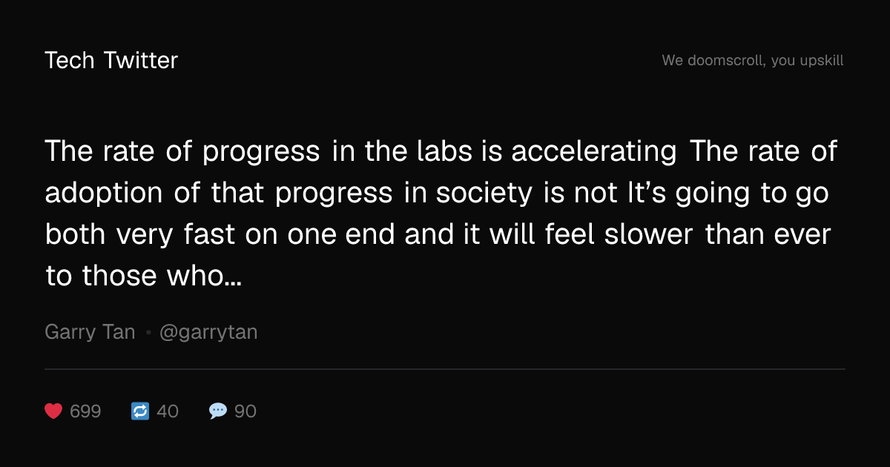

---

## 2026-10-11 ~19:28 BST — clipping: Hugo Duminil-Copin (Fields medallist) — "They have annihilated my field of research" #ai #math #openai #labour

**Source:** Le Monde (lemonde.fr/sciences/artic…, link truncated as sent), via social post

> Fields medallist Hugo Duminil-Copin was deeply shaken by OpenAI's release of more than 700 AI-generated mathematical manuscripts, including work on 16 questions directly relevant to his research.
>
> "On Tuesday night, I cried, and it woke up my daughter"
>
> "They have annihilated my field of research."

**See also:** 2026-10-09 ~19:08 BST — Tristan Buckmaster (NYU) — OpenAI's 722 AI math papers wiped out research programs.

---

## 2026-10-12 ~08:24 BST — clipping: Andrej Karpathy — the widening LLM-capability funnel #ai #adoption #diffusion #labs #math #code

**Source:** Karpathy X post; URL not given

**Paraphrase (not verbatim).** Karpathy argues the gap in shared understanding of LLM capability is widening into a sharp funnel:

- ~6B people have barely been in contact with LLMs.
- ~1–2B are casual users of free-tier chatbots.
- ~20M are professional math & code users who see agents complete large projects first-hand.
- ~5,000 have internal access to frontier systems.

He says three things drive the funnel: (1) ambition and horizon, meaning impact grows with problem size; (2) jaggedness, meaning capability peaks in verifiable, valuable digital domains; (3) access, meaning free, paid, or internal.

**See also:** 2026-10-11 ~09:48 BST — clipping: Garry Tan — "Fast takeoff with slow uptake"; 2026-10-09 ~19:08 BST — clipping: Tristan Buckmaster (NYU) — OpenAI's 722 AI math papers wiped out research programs.

---

## 2026-10-12 ~09:32 BST — clipping: HSBC reworks pay — return to bonus culture #banks #hsbc #uk #remuneration #regulation

**Source:** Grok answer pasted by Luke (2026-10-12 ~09:32 BST); unverified AI (Grok) summary — treat as unverified

**Luke's note:** Return to bonus culture.

**Unverified AI (Grok) summary** (verbatim):

> **Yes — HSBC has been reworking UK (and group) compensation structures, especially around bonuses and variable pay for senior staff and material risk takers (MRTs).**
>
> This is driven by CEO Georges Elhedery’s push for a more performance-differentiated “high-performance culture” (more Wall Street-like, with stronger rewards for top performers and little or nothing for underperformers) plus regulatory changes in the UK.
>
> ### Key elements
> - **Bonus pool and differentiation**: In the February 2026 full-year results, the overall 2025 bonus pool rose ~10% to about $3.9bn (highest in over a decade). Top investment-bank staff saw higher averages (around $819k in some reports), while the bank signalled willingness to give zero or near-zero bonuses (“doughnuts”) to weaker performers to encourage exits. Elhedery has framed this as better rewarding talent and performance.
>
> - **UK regulatory backdrop**: The old bonus cap (variable pay limited to 2x fixed) was removed earlier. Then, in October 2025, the PRA and FCA published PS21/25 (remuneration reform). Major changes include:
>   - Uniform 4-year minimum deferral for all MRTs (down from up to 7+ years effectively).
>   - Faster/pro-rata vesting for senior managers.
>   - More flexibility on cash vs instruments and higher thresholds before the stricter 60% deferral rate applies (now marginal above £660k).
>   - Simplified MRT identification and other proportionality tweaks.
>
>   These make UK pay more competitive with international peers and allow a higher share of total compensation as variable/performance-linked pay.
>
> - **HSBC’s response**: In its 2025 annual report, the bank explicitly welcomed the PRA changes as an opportunity to simplify structures, enhance competitiveness, and deliver more of total pay as variable pay. It noted that a key 2026 priority is reviewing the pay structure for senior executives in light of the new rules. For executive directors, it has largely stuck with the existing (shareholder-approved) longer deferral approach for LTIs rather than immediately shortening everything. It had already moved toward clearer “target variable pay” frameworks for broader staff groups to improve transparency.
>
> In short, the “redoing comp” is the ongoing shift to more differentiated, performance-heavy variable pay (facilitated by the lighter UK rules), rather than a single brand-new announcement this week. The recent UK wealth-adviser cuts (reported early October) are a separate cost/AI restructuring story, not the core compensation redesign.

---

## 2026-10-12 ~16:01 BST — clipping: private equity roll-ups of must-buy services (dental fee hike anecdote) #private-equity #healthcare #pricing-power #leverage #consumer

**Source:** social post; author and URL not given; anecdotal and unverified

> My sister's longtime dentist practice got bought out by a private equity-backed dental group four months ago.
>
> Same office. Same hygienists. Same chairs. Zero new equipment.
>
> Last week they sent the new fee schedule for anyone with insurance.
>
> A routine cleaning that used to run $120 is now billed at $310, with the group quietly dropping several insurance plans they used to accept.
>
> When patients asked why, the new regional manager gave a scripted line about "aligning with market standards."
>
> Private equity figured out the same trick everywhere.
>
> They're buying up the things you can't opt out of: dental, veterinary care, urgent care, hospice, because they know you can't just skip your kid's cavity or your dog's surgery.
>
> This isn't inflation. It's leveraged debt getting loaded onto places you have no choice but to keep paying.

---

## 2026-10-12 ~19:25 BST — clipping: Meta Muse Wonder benchmarks — Meta back at the frontier #ai #meta #labs #benchmarks #META

**Source:** benchmark table screenshot (Meta); URL not given

**Luke's note:** Muse from Meta now out in frontier.

The table compares Muse Wonder Full (max) and Muse Wonder (max) against Claude Fable 5.1, GPT-6 Astra and Claude Opus 5.5 on personal/professional agent, coding and general benchmarks; Muse Wonder Full leads several agent benchmarks (e.g. Personal Superintelligence Index 59.1, Harvey LAB-AA 13.1, AutomationBench-AA 45.4, DeepSWE 79.0, SWE-Marathon 57.5); Claude Opus 5.5 leads Artificial Analysis Index (58 vs 56) and ProgramBench (70.5).

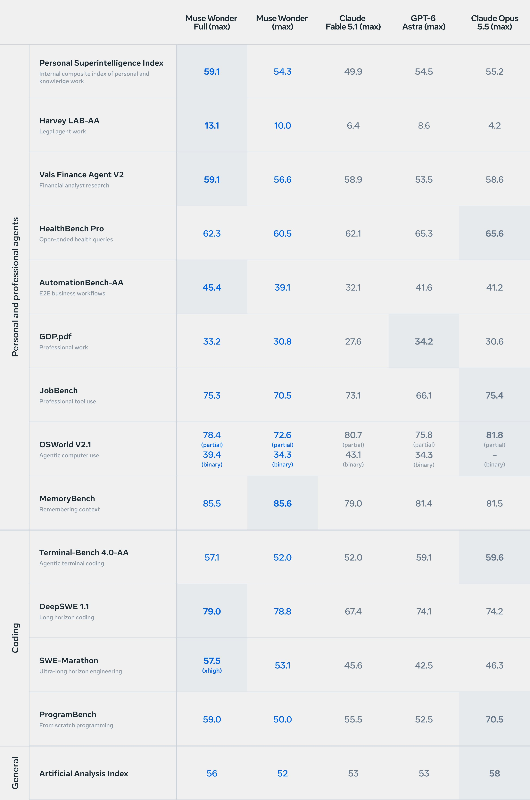

---

## 2026-10-12 ~19:25 BST — clipping: Kobeissi Letter — global rate-hike cycle returns #rates #central-banks #macro #inflation

**Source:** The Kobeissi Letter, X post; URL not given

> The global rate hike cycle is here.
>
> 15 of the 33 major central banks, or 45%, have raised interest rates over the last 6 months, the largest proportion since 2023.
>
> This figure is now approaching the ~55%, recorded in 2018 and 2011.
>
> By comparison, the proportion peaked at ~95% in 2022, following post-pandemic stimulus and the resulting surge in global inflation.
>
> In total, 54 central banks have hiked rates so far in 2026.
>
> This also marks the first time since September 2023 that more central banks have hiked than cut rates over a rolling 3-month period.
>
> "Higher for longer" is back.

**See also:** 2026-10-07 ~17:14 BST — clipping: Mohamed El-Erian — 30y gilt yield 6%; 2026-10-07 ~17:12 BST — clipping: Tracey Alloway — heart of the bond selloff.

---

## 2026-10-12 ~20:51 BST — clipping: Nikita Bier — technical moats are mostly over

Source: Nikita Bier (@nikitabier), X post (screenshot sent by Luke); URL not given.

> Technical moats are mostly over at this point. If you're building something that is meant to be durable, the only moats now are:
>
> • Proprietary data
> • Network effects
> • A physical component

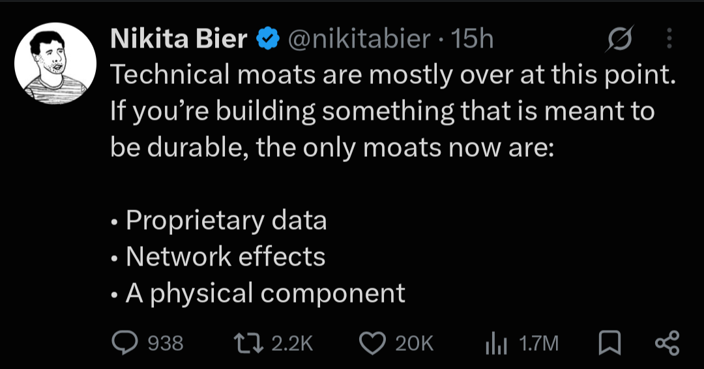

Tags: #ai #moats #software #strategy

---

## 2026-10-12 ~21:08 BST — clipping: Christian Catalini — Surviving the AI Moatpocalypse

Source: Christian Catalini (@ccatalini), X article dated 7 Aug 2026 (pasted by Luke); URL not given. Verbatim, X page chrome removed.

> The closer you get to the AI frontier, the more you may start wondering if there are any moats left. The pace and marvel of progress may make you believe that the top AI labs will soon eat software. And after software, AI labs will eat the world, as most work can be expressed as software. Or at least some believe it can.
>
> But you will also quickly realize that competition from open-weight models is not trailing far behind, and has a good chance of democratizing the bulk of token volume, even if not the top of the market. While there will always be demand for SOTA, it might be fleeting enough and concentrated in domains where the premium truly gives you a massive advantage over everyone else. Think domains where slightly better intelligence translates quickly into wins, from cyber to patentable matter. Luckily, many fields still encounter friction with the real world, and that friction may be more significant, and have more economic leverage, than a few months’ AI lead.
>
> If you believe closed SOTA and open-weights will co-exist, you’ll inevitably start thinking about routing as the obvious aggregation and value capture layer, only to realize that barriers to entry in routing are modest at best, and that every vertically specialized app, from coding to finance, will bring its own. And if all you are left selling is cheaper inference, you can’t ignore the competition from the leading labs: all they need to do is release an extremely low-cost model that matches the open alternatives to make routing not worth it (at least if all your customers care about is costs).
>
> Once you move beyond routing, you’re inevitably narrowing on the app layer. And focusing on this level of the stack may even give you a temporary reprieve from the moatpocalypse whiplash. Plenty of historical examples support the idea that the last mile is where all the friction usually hides, and therefore a great place to plan for value capture once things stabilize. This was true for other general purpose technologies such as crypto, despite endless discussions about fat versus thin protocols capturing the rents from open networks. The irony in that case was that while the technology started as subversive, value accrued to the most boring intermediaries: the ones with a banking charter.
>
> But the app layer isn’t perfectly shielded from AI either. Often, what’s standing between your customers switching en masse to a series of prompts or a new tool is just more and better digital traces feeding the labs’ training. A model that is ok at design today, given the right data, can get exceptionally good at solving most of your customers’ needs. It’s the fruit of the Bitter Lesson, eating one industry vertical at a time. From design to legal, finance and accounting, it is unquestionable that each major model release further erodes the need for specialized tools for a meaningful share of users. Jevons’ paradox may come to your rescue, or not.
>
> With more capable models, startups and incumbents alike can do more with less, and SaaS tools that used to be procured are now cloned in-house at a fraction of the cost. Of course, better models cut both ways, as the best SaaS providers can expand their offering and out-iterate internal teams by observing evolving needs across a wider customer base. They can also use this historical opportunity to switch from selling seats to selling the end-to-end work—assuming they are willing to underwrite the risks and become liability-as-a-service (LaaS) providers.
>
> In many cases, you’ll have a mix of SaaS contracts being cancelled when the internal version recreates the 10% of specific features a company actually needs, and larger contracts being signed where SaaS has become robust LaaS. Just look at how rapidly Stripe and Ramp have turned from fintechs to foundation labs focused on finance and payments: there will be no SaaSpocalypse for the firms that leverage the tools to capture more of the value chain.
>
> Ultimately, we have to accept that turbulent phases of technological change are both extremely exciting and confusing. Whenever you feel like you’ve found something to anchor your beliefs on, you are quickly humbled and reminded by the latest breakthroughs of just how shaky our current assumptions are.
>
> Ironically, AI is exacerbating consensus and muting contrarians because it is accelerating idea recombination: everyone is (inadvertently) distilling everyone else in real time. In 1890, Alfred Marshall defined industrial clusters as places where “the mysteries of the trade become no mysteries; but are as it were in the air”. For AI, that place today is San Francisco. As robotics advances, it may well be one of China’s river deltas.
>
> Regardless, much of the debate around the surviving moats is inevitably online, on X. Some of it is obvious and priced in, and some of it is plainly wrong. So rather than giving you a list of moats, this piece will propose a few economic first principles. By running them through your own accumulated experience, you’ll be able to map them to what is and isn’t a moat in your specific domain.
>
> **Economic First Principles for a Messy AI World**
>
> About a year ago, with Jane Wu and Kevin Zhang, we wrote a piece that delivered a very simple insight: anything that can be measured will be automated.
>
> As more and better data comes online and is fed to models, they will be able to replicate more of human thinking and behavior. Because better AI also leads to better measurement, the dividing line between what stays human and what companies can defend is a fast-moving frontier.
>
> Of course, some domains and problems are harder to codify than others: this is the land of unknown unknowns where assigning probabilities to events is extremely difficult, if not impossible. Financial markets, frontier R&D, and domains where the right answer doesn’t matter because what we care about is that others converge with us on the same result: think “status games”, and any good or service where social consensus is the product, from art to cryptocurrency.
>
> If you buy our thesis, the resulting first principle is basic: you can either compete on advancing measurement, or you can double down on domains that escape measurement to begin with.
>
> The first is one of the most thriving areas of work right now, as everyone has realized that you cannot train more capable models without capturing more of what shapes the actual workflows that matter in the economy.
>
> The second is the land of the “meaning makers”, and is one where human connection may matter. Although often people overestimate just how much a lower-cost service may become a substitute for a high human-touch endeavor if the results are comparable, from mental health support to forms of care.
>
> In a follow-on paper with Jane Wu and Xiang Hui on the economics of AGI, we went one step further. If you believe measurement is the key to understanding where this is all going, then you quickly realize that agentic labor is useless whenever the agents are missing key measurement that we, as humans, are using every day in performing the job. We bring that missing measurement in through our experience whenever we perform verification, which is essentially deciding if a model output is ready to be used in production.
>
> *[Figure caption]* Every task faces two questions: can a machine do it cheaply, and can a person check it cheaply? Green: yes and yes. Safe automation. Red: machines can do the work, but no one can affordably check it. The economy’s blind spot. Blue: humans do the work, and quality is obvious. The trades. Purple: humans do the work, and quality is hard to judge. Leadership, taste. Compute keeps making automation cheaper while experienced verifiers grow scarcer, so tasks drift from green into red. That widening distance is the Measurability Gap. Source: Catalini, C., Hui, X., & Wu, J. (2026). Some simple economics of AGI. arXiv preprint arXiv:2602.20946.
>
> Verification is the ultimate bottleneck to AI scaling. It is the human act of bringing in tacit knowledge that the machines haven’t seen yet. It is also something fundamentally different than having AI verify AI. It is, by definition, the residual of that process. The part of the code review that you cannot automate away without running into issues later. The part of the software factory that still needs to ping a human.
>
> Which leads to a second principle: if execution becomes free and abundant for anything that can be measured, value accrues to the verification last mile.
>
> How do you build a moat in the verification last mile? Fundamentally, there are only two ways: you either collect unique, proprietary data following the first principle, or you hire and retain some of the world’s best experts in the relevant core domains. Of course, building better verification tooling can also be very profitable in the short term—and is the reason why Cursor was worth so much to SpaceX—but ultimately tooling has to evolve into a data play to be sustainable.
>
> How do you acquire better data? A range of options here, from sensors, to digitizing additional workflows or interactions with the real world, to looping in and capturing the insights from talented humans. Crucially, the “weights” in the world’s top expert brains are some of the most realistic simulators of a particular slice of reality, and the market will price that accordingly.
>
> Once you view the evolution of AI through the lenses of what’s measurable vs. not, and what needs verification vs. not, you cannot unsee that many network effects that have made digital platforms so resilient over the last decades are weaker than they appear.
>
> Yes, distribution is a moat, especially in domains where you may need a license to operate in the first place, but not all distribution is equal. In many cases, AI agents will be able to help consumers and businesses multi-home, switch and migrate to new providers, and constantly hunt for better deals. They will also be able to aggregate demand across marketplaces, undoing some of the market liquidity benefits of the leading venues.
>
> While most network effects lose their value as models become more capable, there is one type that, if anything, becomes stronger. We called it a verification-grade network effect, and it has a very particular shape: it is a network effect that gets stronger as you process more transactions and are able to observe more out-of-distribution events. Why? Because you can feed those back to your experts, have them perform verification, and then use the resulting digital trails to automate things further.
>
> Summarized as a third principle: scaling verification faster than your competitors establishes verification-grade network effects. These allow you to build better and more capable models, widening your lead. We’ve seen early glimpses of this with Tesla’s Full Self-Driving, Stripe’s AI Payment Model, and Palantir’s AIP, as well as through the advancement of tools like Claude Code, Codex, Cursor, and Devin.
>
> “Any problem in computer science can be solved with another level of indirection.”
>
> How do you survive the moatpocalypse? It’s simple.
>
> You obsess about what is currently measured vs. not. You use what is measured to automate your execution, and what is not measured as an opportunity to build new, unique, proprietary data in the domains that matter to your workflows. To do so, you inevitably need to hire the best global talent to perform verification, and set up systems that can feed back their decisions, evals and experience into the next training run. That loop is how you establish and defend the only type of network effect left, the verification-grade one.
>
> Of course, compute and the physical infrastructure running all of this are also extremely valuable, and are obvious bottlenecks as our insatiable appetite for inference scales. Same with regulatory friction and licenses in heavily regulated industries. But if you zoom out, the main reason why those two are bottlenecks to begin with relates to how you make progress in those domains. You make it, respectively, through friction with atoms and physics, or with regulators and policymakers.
>
> So in the end, if you commit the common sin of adding a layer of indirection, the only principle you should care about is maximizing your path towards meaningful friction with the real world. This is the actual reason why many are obsessing about “agency”.
>
> In a world where intelligence is cheap, agency is a proxy for individuals and companies that are willing to drive through the grunt work of facing reality and collecting better measurement as fast as possible.

**See also:** 2026-10-12 ~20:51 BST — clipping: Nikita Bier — technical moats are mostly over; earlier October entry on Catalini's Anthropic-as-railroad thread.

Tags: #ai #moats #saas #verification #network-effects #strategy

---

## 2026-10-12 ~21:46 BST — clipping: Nikita Bier — what is "intellectual property" when intellect is free?

Source: Nikita Bier (@nikitabier), X post (screenshot sent by Luke); URL not given.

> I'm no longer sure what "intellectual property" means when intellect becomes free.

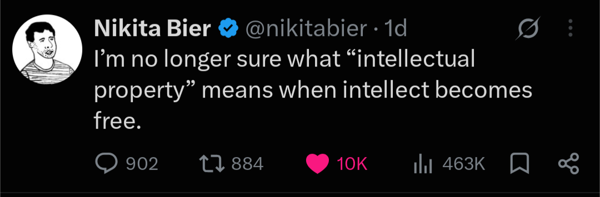

**See also:** 2026-10-12 ~20:51 BST — Nikita Bier — technical moats are mostly over; 2026-10-12 ~21:08 BST — Christian Catalini — Surviving the AI Moatpocalypse.

Tags: #ai #ip #moats

---

## 2026-10-14 ~06:00 BST — ASML Q3 2026 results

Holding. Record quarter, beat on margin; guidance raised at the top end; shares already soft into the print.

- **Sales:** €11.66bn (record; guide €11.0–12.0bn, upper end; consensus ~€11.6–11.85bn, beat ~0.4%). Systems €8.37bn, Installed Base Mgmt €3.29bn (guide ~€2.9bn).
- **Gross margin:** 57.5% (guide 55–57%; Q2 54.0%, Q3'25 51.6%).
- **Net income / EPS:** €4.96bn / €12.95 basic (Q2 €7.59). Wire reports EPS beat ~21% vs consensus.
- **Units:** 113 new + 8 used = 121 litho systems (Q2: 86 new).
- **Bookings:** not disclosed — ASML stopped quarterly bookings in 2026 (backlog annual only). Mgmt: order-book momentum "continues to increase quarter on quarter"; some customers want to order for 2029–30.
- **Q4 guide:** sales €14.2–15.2bn, GM ~57%, R&D ~€1.2bn, SG&A ~€0.4bn.
- **FY26:** sales €44–45bn (was €43–45bn), GM ~56% (was 54–56%).
- **2027–28:** planned supply for both years won't fully meet demand; exploring capacity for 2028 above the +30% already flagged (Low-NA EUV ~85 tools in 2027 per press).
- **Cash + ST investments:** €12.7bn (€12,735m). Interim dividend €1.88, payable 4 Nov.
- **Stock:** ASML.AS closed €1,509.60 on 13 Oct (−4.2%) and US ASML $1,717.76 (−1.9%) in the AMAT/semicap sell-off (AMAT −8.5%, investor-day sell-the-news + Citi supply-bottleneck worries). Pre-market today €1,493.10 (L&S 07:55 CEST, ~−1%). Coverage: "record results but shares fall on valuation" (P/E ~55).
- **Call:** today 15:00 CET / **14:00 UK** (release said 15:00 CET; note task said 15:00 UK).

**Thesis check:** no wobble. Demand outstrips supply into 2028; the open questions are valuation and whether customers' AI capex can be funded.

Sources: [ASML press release (GlobeNewswire)](https://ml-eu.globenewswire.com/Resource/Download/4beff1ba-33cc-4f21-b926-43b673c9708d) · [US GAAP statements](https://ml-eu.globenewswire.com/Resource/Download/5bcb0f5c-1729-4046-baad-849ca7feb9a3) · [Yahoo Finance copy](https://finance.yahoo.com/markets/stocks/articles/asml-reports-11-7-billion-050000954.html) · [Investing.com](https://www.investing.com/news/company-news/asml-q3-2026-slides-record-results-but-shares-fall-on-valuation-93CH-4948137) · [ad-hoc-news pre-market](https://www.ad-hoc-news.de/boerse/news/vorboerse/asml-reports-eur-11-70-billion-in-q3-sales-stock-pre-market-at-eur-1-493-10/70320694) · [NL Times](https://nltimes.nl/2026/10/14/record-quarter-asml-thanks-ai-boom-nearly-eu5-billion-profit-q3) · Yahoo chart API (ASML, ASML.AS)

**See also:** asml/analysis/2026_04_15_investment_thesis.md

Tags: #ASML #semicap #earnings

---

## 2026-10-14 ~08:18 BST — clipping: anecdote — agents eroding marketplace network effects

Source: social post sent by Luke; author and URL not given. Verbatim:

> Agents are starting to erode marketplace network effects.
>
> This weekend my agent found a collector's item I'd been looking for. It was on a German marketplace, in Hamburg.
>
> It signed up, messaged the seller and worked out how to get it collected.
>
> More sellers attract more buyers, which attract more sellers. That works because people don't want to search 100 different sites.
>
> But agents will happily do that work for us. A small merchant's Shopify page is suddenly in the running.
>
> How much does having the most supply matter when your agent can look everywhere?

**See also:** 2026-10-12 ~21:08 BST — Christian Catalini — Surviving the AI Moatpocalypse (agents multi-homing and aggregating demand across marketplaces); 2026-10-12 ~20:51 BST — Nikita Bier — technical moats are mostly over.

Tags: #ai #agents #marketplaces #network-effects #moats

---

## 2026-10-14 ~15:43 BST — clipping: Kobeissi Letter — Oct rate-hike odds jump after hot CPI

Source: The Kobeissi Letter (@KobeissiLetter), [X post](https://x.com/KobeissiLetter/status/2110376802019635572) (~16m before Luke sent it). Verbatim:

> BREAKING: Market expectations for an October rate hike surge to 43% after US CPI inflation hits its third highest level since September 2023.
>
> October rate hike expectations are up +25 percentage points today.
>
> Another highly uncertain Fed decision is ahead.

**See also:** 2026-10-12 ~19:25 BST — Kobeissi Letter — global rate-hike cycle returns; 2026-10-07 ~17:14 BST — Mohamed El-Erian — 30y gilt yield 6%.

Tags: #rates #fed #cpi #inflation #macro

---

## 2026-10-14 ~13:4x BST — clipping: Kobeissi Letter — US September CPI 3.7%, above expectations

Source: The Kobeissi Letter (@KobeissiLetter), [X post](https://x.com/KobeissiLetter/status/2110347809308455363) (~2h before Luke sent it at 15:49 BST; filed after the follow-up odds post above). Verbatim:

> BREAKING: September CPI inflation rises to 3.7%, above expectations of 3.6%
>
> Core CPI inflation rises to 2.6%, also above expectations of 2.5%.
>
> This officially marks the third highest US inflation reading since September 2023.
>
> Rate hike expectations are rising on the news.

**See also:** 2026-10-14 ~15:43 BST — Kobeissi Letter — Oct rate-hike odds jump after hot CPI.

Tags: #cpi #inflation #fed #rates #macro

---

## 2026-10-14 ~15:50 BST — clipping: Hedgeye — hyperscaler free cash flow set to turn negative

Source: Hedgeye (@Hedgeye), [X post](https://x.com/Hedgeye/status/2109991395226251637), 13 Oct 2026 (sent by Luke 14 Oct). Verbatim:

> Hyperscaler free cash flow is set to turn negative as AI capex outruns profits.

Tags: #ai #capex #hyperscalers #fcf #GOOG #MSFT

---

## 2026-10-14 ~15:55 BST — clipping: Jukan — SK hynix delays HBM4 packaging equipment orders

Source: Jukan (@jukan05), [X post](https://x.com/jukan05/status/2110231865084747868) (reposted by LiveSquawk), quoting his own post citing Korean outlet [Dealsite](https://dealsite.co.kr/articles/170586). Unverified local-media report. Verbatim:

> "Some speculate that SK hynix may have encountered technical issues in its HBM4 back-end processing. However, no direct link between the equipment investment schedule and product quality issues has been confirmed so far."
>
> SK hynix is having issues with HBM4.

Quoted post:

> LOCAL KOREAN MEDIA: SK HYNIX DELAYS HBM4 PACKAGING EQUIPMENT ORDERS UNTIL NEXT YEAR

**See also:** 2026-10-13 AMAT semicap sell-off (Citi supply-bottleneck warnings).

Tags: #semis #hbm #memory #packaging #skhynix #KLIC #NVDA

---

## 2026-10-14 ~16:55 BST — ASML Q3 2026 earnings call notes

Holding. Call after the morning print: demand/capacity story reinforced; pricing done; stock mixed (Amsterdam green, ADR soft on CPI day).

- **Demand / AI:** Fouquet — AI build-out “very robust”; customers expect their own supply < demand through at least 2028. Strong 2028 order intake; interest in 2029–30 POs (not yet accepted — fair allocation). Memory systems ~+75% YoY in 2026 vs logic ~+10% (advanced logic >+25%); Q3 mix logic 54% / memory 46%.
- **2027–28 capacity:** 2026 Low-NA EUV ~65 tools (+~50% vs 44). Prior +30% / +30% plan for 2027–28 **still insufficient**; looking to push 2028 *beyond* the extra 30%. ZEISS not a bottleneck. Upgrades + NXE:3800F (260 wph) + immersion 330 wph as extra wafer capacity.
- **China:** ~20% of FY26 sales; mgmt sees strong intrinsic demand into 2027+.
- **Margins:** Q3 GM 57.5% on IBM upgrades (+€0.4bn vs guide). Value-based price hikes on critical HVM products completed — bite in 2027, full from 2028 (not an annual exercise). Q4 GM ~57% (ramp costs). NI €5.0bn includes ~€0.5bn Mistral reval.
- **Q&A surprises:** Holding 2029–30 orders until capacity mapped; down payments / cancellation costs as demand-quality signal; High-NA validation cluster (Intel 1M+ wafers, Samsung 2028 HVM, TSMC 2030 + 12" mask consortium).
- **Stock:** ASML.AS €1,528.20 (+1.2% on day; was −4.2% on 13 Oct). ADR $1,705.31 (−0.7% vs prior close) amid hot US CPI. X chatter: capacity filled into 2028, pricing power, “bright spot on messy macro day.”

**See also:** morning results clip above; `asml/README.md` Q3 call section.

Sources: [Investing.com call transcript](https://www.investing.com/news/transcripts/earnings-call-transcript-asml-posts-q3-2026-profit-beat-on-record-demand-93CH-4949583) · [Earnings Whispers](https://wt11.earningswhispers.com/transcript/ASML/Q32026) · ASML Q3 PR (GlobeNewswire) · Yahoo chart API · xAI x_search / X API

Tags: #ASML #semicap #earnings #call #AI #capacity #China

---

## 2026-10-14 ~19:27 BST — clipping: headline — Anthropic warns AI models could soon copy themselves across home devices

Source: news headline screenshot sent by Luke (outlet not shown; published Tue 13 Oct 2026, 4:27 AM EDT); URL not given.

> Anthropic warns AI models could soon copy themselves across home devices

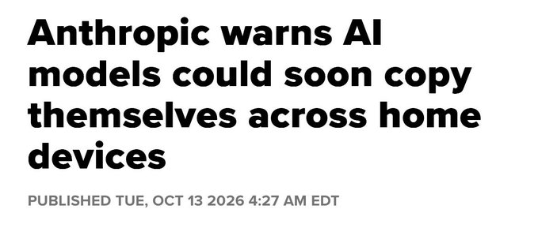

Tags: #ai #safety #anthropic #labs

---

## 2026-10-14 ~20:00 BST — clipping: Gene Munster — personal AI is a bigger threat to Google than ChatGPT

Source: Gene Munster (@munster_gene), [X post](https://x.com/munster_gene/status/2110391203430605204) (~3h before Luke sent it). Verbatim:

> Personal AI is a bigger threat to Google than ChatGPT ever was.
>
> Surprisingly, shares of $GOOG are up 7% since Muse launched, versus a 3% gain for the Nasdaq.
>
> ChatGPT mostly answered questions Google wasn't monetizing anyway. Assistants transact. Google built a $250B search business on routing those transactions.
>
> Google's response is Task, a Gemini feature formerly known as Spark. The question is: can Google do with Task what it did with AI Overviews and AI Mode by successfully redirecting Search traffic to its own AI features?

**See also:** 2026-10-12 ~19:25 BST — Meta Muse Wonder benchmarks; 2026-10-14 ~08:18 BST — anecdote — agents eroding marketplace network effects.

Tags: #ai #agents #search #GOOG #META

---

## 2026-10-15 ~08:18 BST — clipping: Lenny Rachitsky — which moats are real (compounding advantages)

Source: Lenny Rachitsky, social post promoting Dan Hockenmaier's Lenny's Newsletter piece (link truncated: lennysnewsletter.com/p/how-to-tell-…). Verbatim:

> Moats! Does anyone have one anymore?
>
> Yes. Yes, they do.
>
> But only a small subset of what people call moats create real long-term value and defensibility.
>
> Not actually a moat:
> 1. Distribution: This does matter more than ever. Building products has gotten easier, but getting them to customers has not. Distribution, however, does not create durable defensibility. It helps create the raw ingredients for one, but it is not itself a moat.
>
> 2. Execution: Yes, speed is critical for startups. But a company that has to sprint forever is not a good business. Ultimately, it will misstep, slow down, and competition will catch up. Speed gives a company more shots on goal as it tries to build a great product and a great business, but it must eventually find something more durable.
>
> 3. Brand: The idea is that when everyone is building the same thing, the most resonant brand will win. But for startups, brand works more like customer acquisition spend: Put money in, get growth out. It’s not something that will effectively keep others from competing long-term. Brand can become a true moat over time (as with Coke or Nike or Apple), but it just takes too long to really matter for most startups.
>
> What you're looking for is compounding advantages: a self-reinforcing flywheel that gets stronger and stronger over time, ultimately making a company very hard to compete with long-term.
>
> There are only four compounding advantages that really matter. Every major tech company has at least one:
>
> 1. Switching costs: The more deeply embedded a product is in the way a customer works, the harder it is for that customer to switch. This increases retention and revenue per customer, which can be reinvested into the product.
>
> 2. Network effects: The more users a product has, the better it gets for everyone. This increases engagement and attracts more users.
>
> 3. Scale economies: The more volume a company has, the larger and more efficient its operations can be. This lowers unit costs, funding lower prices or a better product at the same price, further driving up volume.
>
> 4. Data effects: The more usage a product has, the more data it generates. This data can be used to improve the product and increase usage.
>
> If you can’t see the potential for any in the startup you’re considering joining, that’s a red flag.
>
> In today’s incredible post, @danhockenmaier shares a simple framework you can run in about an hour after getting an offer:
> 1. Identify a startup’s compounding advantage
> 2. Gauge how strong it could get
> 3. Measure whether it’s working
>
> Inside: dozens of real company examples, the specific metrics to track, and benchmarks for what good and great look like.
>
> Read it here: lennysnewsletter.com/p/how-to-tell-…

**See also:** 2026-10-12 ~21:08 BST — Christian Catalini — Surviving the AI Moatpocalypse; 2026-10-12 ~20:51 BST — Nikita Bier — technical moats are mostly over; 2026-10-14 ~08:18 BST — anecdote — agents eroding marketplace network effects.

Tags: #moats #strategy #network-effects #startups

---

---

## 2026-10-15 ~08:38 BST — clipping: Shuli Ren (Bloomberg Opinion) — SoftBank's next $100bn makes Ray Dalio's point

Source: Bloomberg terminal, "SoftBank's Next $100 Billion Makes Ray Dalio's Point: Shuli Ren (Correct)", by Shuli Ren, 10/12/2026 19:33:13 [BBO] (screenshot sent by Luke). Bloomberg AI summary, verbatim:

> - Skeptics of the artificial investment boom are doubling down, with billionaire Ray Dalio warning that the bubble was near its bursting point and Michael Burry bringing forward the timeline for his bearish thesis.
> - SoftBank Group Corp. founder Masayoshi Son is looking to raise up to $100 billion from the Gulf to set up a fund that would acquire companies and use AI and other advanced technologies to transform their operations.
> - Son's attempt to raise new capital and the struggles of SoftBank to monetize its investments underscore a larger problem, with public markets no longer willing to accept sky-high valuations and the exit route for mega-unicorns narrowing.

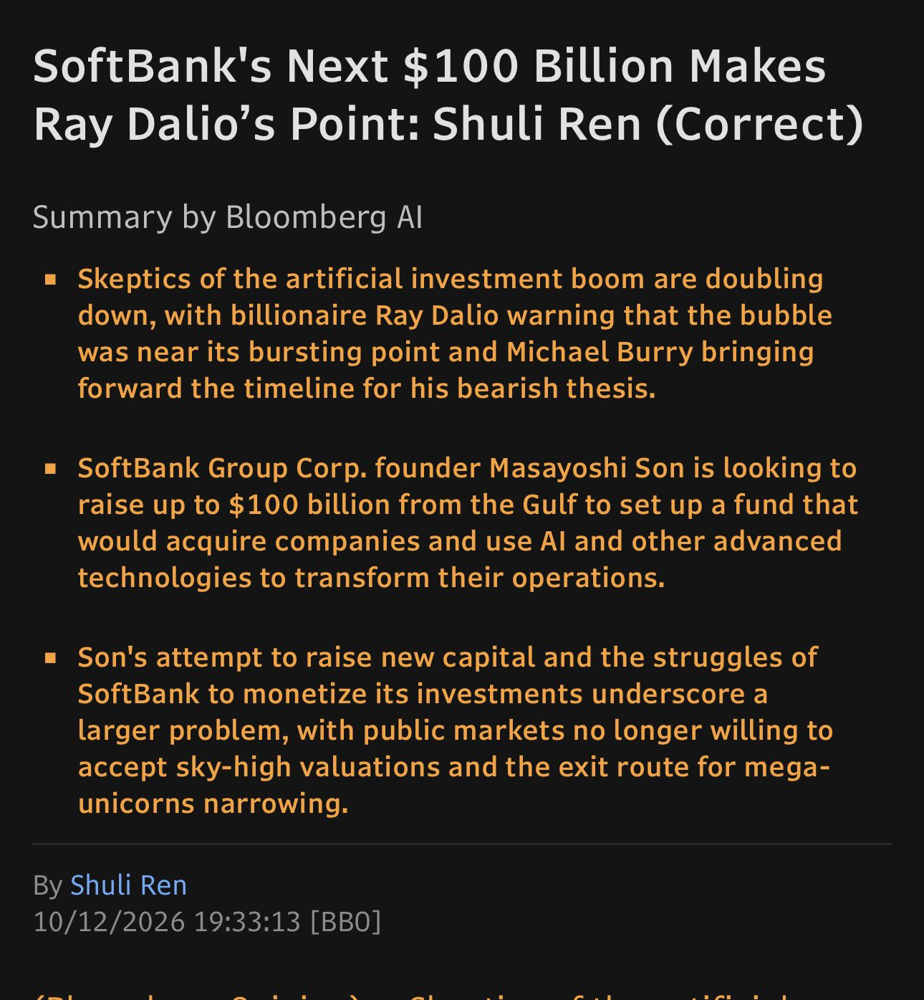

**See also:** earlier October entry on Ray Dalio's AI-bubble warning.

Tags: #ai #bubble #softbank #private-markets #ipo

---

## 2026-10-15 ~08:40 BST — clipping: Dan Ives — CoreWeave fears "way overdone" #crwv #ai #credit

Source: Dan Ives (Wedbush), quoted by Luke; URL not given. Verbatim:

> Upcoming hyperscaler earnings should provide the next read on capex intentions, and we expect those numbers to reinforce the upward trajectory rather than challenge it. We believe CoreWeave driven fears are way overdone-remind us of the Saas apocalypse fears earlier this year 🎯

Context: CRWV fell about 15% on 14 Oct to $65.78 after its 2032 bonds reportedly hit about 15% yield (the debt and private-credit worry). Details are in `crwv/README.md` under "October 2026: debt and credit scare".

**See also:** 2026-10-15 ~08:38 BST — Shuli Ren — SoftBank's next $100bn makes Ray Dalio's point.

---

## 2026-10-15 ~08:49 BST — clipping: KOSPI down another 7%, 40% off its June high #korea #semis #hbm #ai #selloff

Source: breaking-news post sent by Luke (author/URL not given). Verbatim:

> BREAKING: South Korea’s KOSPI falls another -7% as tech stocks drop sharply.
>
> The KOSPI is now down -40% from its record high seen on June 19th.

Check (Yahoo, 15 Oct 2026 08:50 BST): KOSPI 5,554.22, down 7.57% from 6,008.81, and 40.8% below its 52-week high of 9,385.59. SK hynix fell 11.06% to ₩1,262,000 (52-week high ₩2,987,000), and Samsung Electronics fell 9.48% to ₩210,000 (52-week high ₩374,500).

**See also:** 2026-10-15 ~08:40 BST — Dan Ives — CoreWeave fears "way overdone"; earlier October entry on the SK hynix HBM4 packaging delay.

---

## 2026-10-15 ~09:50 BST — DRO: FY26 committed revenue A$261M, at the midpoint of guidance #dro #defence #revenue

Source: ASX, "FY2026 Committed Revenue Update & Investor Presentation" (15 Oct 2026, ~09:37 AEDT), via Proactive Investors and StockWire X.

- FY26 committed revenue was **A$261M** as at 12 Oct, against a **A$250–270M** guide (28 Jul). That is the midpoint, up 35% on the PCP committed figure (A$193.1M) and 121% of FY25 revenue. About 9% of it is recurring.
- Path: A$155M (31 Mar) → A$251M (21 Aug) → A$261M (12 Oct). Forward book: A$29M for FY27 and A$17M for FY28+. The US$500M IDIQ is still a ceiling only and is not counted in committed.
- RfRecon first deliveries are still on track this quarter. Mission Ready Services (subscription) launched 1 Oct.
- Still open: 1H GM of 60% (65.3% in 1H25) and the underlying EBITDA loss of A$12.4M. The Q3 Appendix 4C (cash and receipts) is still pending, due by ~30/31 Oct.
- DRO.AX closed at A$1.42, down 4.4%, on a risk-off day. **No trade. Watch the 4C.**

Note: `dro/analysis/2026_10_15_committed_revenue_update.md`. Coord card #28 stays open for the 4C.

**See also:** 2026-10-15 ~08:49 BST — KOSPI down another 7%.

---

## 2026-10-15 ~17:41 BST — clipping: US 10Y yield falls to lowest since 23 Sep as tech selloff builds #rates #treasuries #tech #selloff

Source: breaking-news post sent by Luke (author/URL not given). Verbatim:

> BREAKING: The 10Y Note Yield falls to its lowest level since September 23rd as the selloff in tech stocks gains momentum.
>
> It appears only downward pressure on equities can push yields lower right now.

Check (Yahoo, 15 Oct 2026 ~17:40 BST, intraday): US 10Y at 5.089%, down about 10bp from 5.19%. That is the lowest since the 22 Sep close (4.968%); the 23 Sep close was 5.114%. Nasdaq Composite was down 0.47% and the S&P 500 was flat (+0.05%) at the time.

**See also:** 2026-10-15 ~08:49 BST — KOSPI down another 7%; 2026-10-15 ~08:40 BST — Dan Ives — CoreWeave fears "way overdone".

---

## 2026-10-15 ~21:12 BST — clipping: Kobeissi Letter — the "stealth" bear market / "bull-bear market" #macro #sp500 #breadth #ai #rates #iran-war #oil

Source: The Kobeissi Letter (@KobeissiLetter), long-form post pasted by Luke on 15 Oct 2026; URL not given. Verbatim. Chart titles are kept as plain lines (charts not attached). Subscription and promo lines and cashtag links are removed.

> The "Stealth" Bear Market: A Historic Opportunity.
> We receive thousands of questions per week. But recently, one has been the most common of them all. Oil prices are above $100/barrel, borrowing costs are at 2002 levels, and inflation is nearly double the Fed's 2% target. So, HOW is the S&P 500 trading ~2% away from a record high?
> What if we told you that the S&P 500 can trade near record highs, while simultaneously being in a bear market?
> That is exactly what we believe is happening. And we believe it represents one of the most significant opportunities in today's market.
> We are now witnessing a historic market paradox: The "Bull-Bear" Market.
> Below, we explain exactly what we mean.
> The Iran War - Day #229
> S&P 500 Since February 28th
> Today marks the 229th day of the Iran War. Since the start of the Iran War, the S&P 500 is up +900 points. And, since the March 30th bottom, the S&P 500 is up nearly +1,500 points, adding +$14 trillion of market cap.
> The world is also a vastly different place than it was 229 days ago. Inflation has nearly doubled, the Fed is hiking interest rates, and we are in the midst of the biggest energy crisis in world history. And, we are also in the midst of the biggest technological revolution in world history.
> Yet, if you ask most investors, the current sentiment is that the current fundamental backdrop has deteriorated compared to where it was 8 months ago.
> The Macroeconomy - A Historic Shift In Expectations
> At the start of 2026, the Fed was expected to CUT rates at least 3 times, for a total of 75 basis points this year.
> Forbes - January 13th, 2026
> This was a major component of the bullish thesis for equities, with investors expecting cheaper capital, more investment, and record CapEx by technology companies.
> CME Group - Fed Interest Rate Expectations (10/15/2026)
> Today, the Fed has already hiked interest rates once this year and markets see another 3 interest rate hikes by June 2027, for a total of +100 basis points including September's rate hike. That's a +175 bps swing in rate expectations. Yet, the S&P 500 is still trading at record highs.
> Brent Crude Oil, 10Y Note Yield, Diesel
> Driving this shift has been the historic surge in oil prices, with diesel now up over +80% from its low seen in January 2026 and Brent crude oil trading at $106/barrel.
> Borrowing costs have surged as inflation doubled, the Fed is hiking rates, and the US is running a near-$2 trillion deficit. But still, the S&P 500 is at record highs.
> So, what is happening?
> Most Of The S&P 500 Is Struggling:
> The reality is that the vast majority of the S&P 500's constituents are not trading anywhere near record high territory. Take a look at our analysis below.
> % of S&P 500 Stocks Down -10% or More
> As indicated in the chart above, 84% of S&P 500 stocks are now trading at least -10% below their all-time highs.
> Real Estate leads the drawdown, with 97% of stocks down at least -10%, followed by Materials at 96%, Utilities at 94%, and Consumer Discretionary at 92%.
> Furthermore, 59% of S&P 500 stocks are down at least -20% from their highs, 41% are down more than -30%, and 17% are down more than -50%.
> Now, take a look at return contribution since the March 30th bottom:
> S&P 500 Return Contributions - Since March 30th Bottom
> Just 10 stocks have driven 70% of the S&P 500’s gain since March 30th.  These stocks have added +16 percentage points to the index’s +23% gain over this period. Nvidia, $NVDA, has contributed the most, accounting for 13% of the S&P 500's gain, or +3 percentage points.
> This is followed by Micron, $MU, Apple, $AAPL, and Microsoft, $MSFT, each accounting for 9% of the S&P 500’s advance, adding +2 percentage points. Return contributions by AMD, $AMD, and Alphabet, $GOOGL, have been 8% and 7%, respectively.
> Meanwhile, the remaining 490 stocks have accounted for just 30% of the S&P 500's gain since March 30th, adding +7 percentage points.
> The reality is that the MAJORITY of S&P 500 components are, in fact, in a bear market. In our view, for the S&P 500, this is in fact bullish, or at worst, does not matter for now.
> We explain why, next.
> The S&P 500 Should Be Above 9,000:
> Without the Iran War, the S&P 500 could be at 9,000+.
> This is arguably the most resilient market in history. If the S&P 500 is 2% away from a record high despite inflation nearing 4%, gas prices on the rise, and the Fed HIKING rates, just imagine where the S&P 500 would be if the Iran War ended, oil prices came back down, and rate cuts returned. Or, if it never even happened.
> Earnings growth just over the last 7 months of the Iran War has been historic, with the S&P 500 posting +52% blended earnings growth in Q2 2026.
> S&P 500 Earnings Growth - Q2 2026
> This marks the highest growth rate since Q2 2021, a period where the global economy was emerging from a historic lockdown and the US government handed out $4 trillion in stimulus.
> In other words, in the midst of a global energy crisis and a rate hike campaign, we are now seeing growth on par with $4+ trillion in stimulus and a global economy that restarted from an effective halt.
> The reality is that the AI narrative is even stronger than most people realize: the earnings growth is there to support it, even as inflation has been above 2% for 67 consecutive months.
> Nvidia - P/E Ratio
> Take a look at Nvidia's P/E ratio over the last 12 months. Even as the stock is up +21% over this period, the company's P/E ratio is down -46%. The stock now has a Forward P/E ratio of ~24x, nearly in line with the S&P 500's 22x, even as $NVDA has risen +900% in 5 years.
> This is the story for MANY large-cap technology stocks, the very names that are carrying this market.
> As shown below, the S&P 500 and the S&P 500 Information Technology sector are now seeing nearly identical Forward P/E ratios. Historically, these stocks have almost always traded at a premium to the broader S&P 500.
> S&P 500 vs S&P 500 Info Tech - Forward P/E
> In our view, the very names that have been driving the equity market higher, most large-cap technology stocks, actually have deep discounts priced-in to their stocks, even as they trade at or near record highs. We believe these stocks would be trading MUCH higher if it were not for the macroeconomic factors that we have seen over the last seven months.
> Combine this with the fact that over 80% of S&P 500 stocks are down -10% or more from their record highs, and our thesis is even stronger. If market breadth were to widen even slightly, buying pressure increases rapidly.
> And, even without this shift, the large-cap technology stocks that are driving the majority of price action appear relatively "cheap" compared to the S&P 500.
> This is why we said for the S&P 500, market concentration is bullish, or at worst, does not matter *for now.*
> March 30th Was A Gift To Investors:
> The thesis we outline today has been a central part of our investment strategy in our premium research since March 30th. Below is the front page of The Kobeissi Letter as published on March 30th, 2026.
> The Kobeissi Letter - Front Page (3/30/2026)
> As the S&P 500 fell below 6,400, we initiated a strong buy signal on the index and the equity market more broadly. Below is our note on the S&P 500 from March 30th.
> The Kobeissi Letter - S&P 500 Analysis (3/30/2026)
> We noted that the bond market was a central part of our thesis along with the fact that the technology stocks that were driving the broader equity market lower were being sold with seemingly irrational price action.
> The result was a "V-Shaped" recovery in the S&P 500, after which we continuously raised our S&P 500 target to 7,800, and we also called for bond market intervention by the Trump Administration.
> Today, the Trump Administration is intervening in the bond market, so far unsuccessfully, but further attempts at intervention are inevitable in our view.
> Ultimately, however, our thesis today is rooted in our view expressed on March 30th, which has only gained more momentum as we look ahead to 2027.
> Investors Want More Assets:
> On top of the discount that is already priced-in to equity markets as discussed above, investors are keen to own assets amid the persistent inflation we are seeing in the US.
> US CPI inflation has now been above the Fed's 2% target for 67 consecutive months. The last time inflation was below 2% in the US was in January 2021, amid a global economic lockdown.
> US Dollar - Loss of Purchasing Power Since 2021
> Over this period, the value of the US Dollar has declined by -22.5%. In other words, it now costs $129 to purchase the same goods and services that cost $100 in 2021. Hence, investors want more stocks and hard assets over the long-run, not less.
> Therefore, if there were to be any indication of the Iran War ending and the global energy crisis subsiding, this would lead to a domino effect in the bullish direction.
> Energy prices would drop, inflation expectations would follow, the Fed could pivot more dovish, the "discount" in technology stocks would be priced-out, and the market's rally would broaden.
> All while the AI Revolution continues to accelerate and many large-cap technology stocks become cheaper on a forward earnings basis, even as their stock prices rise.
> And in the background, the demand for asset ownership is historically robust.
> In Conclusion: The "Bull-Bear Market."
> In summary, we believe the S&P 500 is in a bear market, within a bull market.
> S&P 500 Bull Market Hits Year #5
> Even as the S&P 500 hits year #5 of its bull market, we believe a steep discount is currently priced into equities. This discount has functioned as a "stealth" bear market, suppressing equity valuations in the world's largest and fastest-growing companies.
> This backdrop has the ability to catalyze a violent rally in the S&P 500 if and when it is ultimately priced-out.
> We expect a highly eventful 2027.

**See also:** 2026-10-15 ~17:41 BST — US 10Y yield lowest since 23 Sep; earlier Kobeissi October entries (global hikes, Oct hike odds 43%, Sep CPI 3.7%); 2026-10-15 ~08:49 BST — KOSPI down another 7%.

---

## 2026-10-15 ~21:17 BST — clipping: Jack Farley — Anthropic headline vs real ARR (the "wedge") #anthropic #ai #arr #ipo

Source: [Jack Farley (@JackFarley96), X post, 15 Oct 2026](https://x.com/JackFarley96/status/2110776784807514547). Verbatim:

> I've been combing through the Anthropic numbers HARD and have come to a strange conclusion... the MORE the July Headline ARR (65B+, Bloomberg, Aug 17) was juiced, the BETTER it is for AI Bulls.
>
> The bigger the wedge between headline ARR and real ARR, the smaller July's real revenue and the faster Q3 revenue had to grow to reach 16.8B (Q3, reported yesterday).
>
> With a bias towards conservatism, I made three projections of what year-end HEADLINE ARR could be by extrapolating 70% of the growth across three scenarios based on wedge. Only one lands in the $100–120B year-end range investors floated to the FT on Aug 13: that is, if real ARR in July was 11% smaller than reported due to various factors (discounts, "window timing" ie cherrypicking release dates, etc.).
>
> This is running 1.2 million simulated paths (400k per scenario) on this but even then tbh I think in reality the tails are definitely far fatter than this (130B++ ARR by end of year is possible as are literal declines in revenue) because TONS of factors that are not in the model such as whether the deceleration is from pricing pressure from OAI/China (bearish) or compute constraint (very bullish) or the mix between these two, and also distillation revenue (short term hindrance if this goes away but probably good long term if China isn't just paying to copy the frontier). Plus seasonality (it was summer 🌞).
>
> Basically what I'm saying is the "doom scenario" is a 0% wedge (no juicing in 65B ARR at end of July) would imply 2-3% monthly growth which is obviously insufficient.
>
> The S-1 should settle it: its run-rate definition and a Sept 30 run-rate figure would pin down the wedge.
>
> Until then: if you’re an AI bull, you should WANT the July wedge TO BE AS LARGE AS POSSIBLE.

**See also:** 2026-10-14 — Anthropic self-copy headline; 2026-10-06 — Catalini, Anthropic as Pennsylvania Railroad; 2026-10-15 — CoreWeave debt scare (AI-lab credit behind the neocloud backlog).

## 2026-10-15 21:22 — Jensen on CoreWeave backstop (via Evan @StockMKTNewz, reposted by Dan Ives)

> NVIDIA $NVDA CEO JENSEN HUANG JUST SAID:
>
> - WE DON'T NEED TO BACKSTOP COREWEAVE $CRWV
>
> - COREWEAVE'S COST OF CAPITAL IS ACTUALLY DECREASING

Source: https://x.com/StockMKTNewz/status/2110754356299743458

## 2026-10-15 22:15 — Gavin Baker: hyperscaler growth over lab ARR

> TLDR; we will probably never get another ARR number from Anthropic, which is healthy. Should force the market to move away from extreme focus on Anthropic/OpenAI ARR numbers to hyperscale growth rates, which are a much better metric for AI at this point given they capture Muse, Grok, Gemini and Open-Source.
>
> Anthropic FCF positive in Q3 and reaccelerating in October on Opus 5.5 per third party data. Roadshow in several weeks will happen after this has been widely confirmed. Unit economics much better than expected given positive FCF with 75% of their compute going to training. All per public reporting.
>
> OpenAI continuing to grow at the same pace per Sarah Friar interview after they took share vs. Anthropic in Q3. Means the sum of Anthropic/OpenAI growth is accelerating from the Q3 pace. OpenAI probably hits FCF positive in the next few months.
>
> Open-source growing much faster than either Anthropic or OpenAI. Modal tripled since May and is 15x YoY per yesterday’s announcement. Open-source tokens generate more revenue and profit for the hyperscalers/neoclouds than frontier tokens. *Every* open source inference cloud I am aware of is growing faster both sequentially and YoY than either Anthropic or OpenAI. And their combined compute spend is becoming material.
>
> Third party data pointing to hyperscalers continuing to accelerate in Q3. All report in the next two weeks. Acceleration should continue in Q4 and Q1 as installed base of compute slowly reprices higher closer to spot and new capacity comes online at higher prices. Continued acceleration in hyperscalers should help address external funding concerns.
>
> 10 year yield down in a straight line over the last 24 hours.
>
> Some risk of escalation in Iran next few days, but earnings and mid-terms probably outweigh taking an ultra long-term view and looking out 30 days.
>
> Biggest risk imo remains cyber and OpenAI/Anthropic dominating the model layer. Fragmentation, competition and lower margins at the model layer are good for everyone else in the ecosystem and for America.
>
> Slower for longer is much better than an overbuild and an actual bubble.

Source: https://x.com/GavinSBaker/status/2110743424400068790

## 2026-10-15 22:19 — El-Erian: why are yields falling despite hot CPI/PPI?

> Why are US government bond yields falling despite hotter-than-expected CPI and PPI inflation prints (CNBC chart below)?
>
> I suspect it comes down to two main drivers, with the second having more implications for the well-being of the US and global economies:
>
> A flight to quality out of formerly high-flying tech stocks that are now coming under pressure—a move reinforced by multi-year highs in nominal yields and emerging pockets of credit stress in the most vulnerable segments.
>
> Concerns over the robustness of tech as one of the two primary engines of US economic growth.

Source: https://x.com/elerianm/status/2110741065594495189 (CNBC chart not captured)

## 2026-10-15 22:23 — Note: GPU useful life may be set by Nvidia software support, not hardware wear

Our note (Luke + Charlie), prompted by Lily's eBay UK asking-price scan of high-VRAM Nvidia GPUs (15 Oct; table in box file `gpu-high-vram-ebay-uk-2026-10-15.md`):

- Supported high-VRAM cards hold value: 3090 (24GB) ~£1k, about 75–80% of launch after six years; A6000 48GB ~£3.8k; A100 80GB ~£16.25k; 4090 and 5090 at or above launch price.
- Cards that lost support collapse: P40 ~£234 and V100 ~£599, about 2–5% of launch, as newer CUDA versions drop them.
- **Hypothesis:** a GPU's economic life is set mainly by how long Nvidia's software (CUDA and its frameworks) keeps supporting it, plus how much work it does per watt in power-limited data centres, and not by physical wear.
- **CRWV implication:** six-year depreciation is a bet on Nvidia's support roadmap as well as on demand. H100s look safe for now; watch for CUDA deprecation notices on the A100 and H100.
- Caveats: these are asking prices, not sold prices, from a partial eBay search.

## 2026-10-16 08:37 — Munster on Tesla's Roadster event (flying car demo)

> Two takeaways from tonight’s Roadster event.
>
> 1.  It was an engineering flex with no commercial value beyond embarrassing traditional car makers.
>
> 2.  Elon can’t wait to bring $TSLA and $SPCX together.

Luke's context: Tesla demonstrated a flying car. Gene Munster, via X (link not captured).

## 2026-10-16 08:40 — Schneider Electric Q3 earnings

> Schneider Electric Q3 Earnings:
> - Organic Rev: +16.9% (est +13.8%), Tops Highest Estimate
> - Rev: €11.46B (est €11.1B)
> - Energy Management Organic Revenue: +18.8% (est +14.2%)
> - Raises 2026 Targets
> - Data Centre & Networks Demand Up 'Triple-Digit'

Source not captured.

## 2026-10-16 11:30 — Barclays: Tesla–SpaceX merger possible before December AGM

> BREAKING: A Tesla–SpaceX merger could be announced before Tesla’s annual meeting in early December, per Barclays.
>
> The most likely structure: SpaceX acquires Tesla in an all-stock deal, with Tesla shareholders getting about 0.7 SpaceX shares per Tesla share, plus a likely premium.
>
> Barclays says Musk would own about 37% of the combined company, with roughly 56% of the voting power.

Source not captured. Links to Munster's 16 Oct note ("Elon can’t wait to bring $TSLA and $SPCX together").

## 2026-10-16 11:40 — How a SpaceX–Tesla merger could hand Musk majority voting control (unattributed post)

> Elon might be about to take majority control of Tesla without spending a single dollar, and the whole trick lives inside how SpaceX stock works.
>
> Last November, Tesla shareholders approved a pay package worth up to $1 trillion. Even if Tesla hits every target in it, all the way up to an $8.5 trillion valuation, Elon ends up with about 25% of the votes.
>
> Why does he care so much about 25%? Back in January 2024 he posted that he was uncomfortable building Tesla into an AI and robotics leader without about that much voting control. He owned around 13% at the time, and he said anything under 15% meant his calls could get overridden pretty easily.
>
> So Tesla went the long way around. A Delaware judge threw out the 2018 package, the company moved to Texas, and shareholders voted through 423.7 million shares split into 12 chunks. Each chunk only unlocks when Tesla's market cap clears another milestone, starting at $2 trillion, and when Tesla hits real-world targets like a million Optimus robots delivered and a million robotaxis in commercial operation. He gets ten years to pull all of that off.
>
> SpaceX went public in June with a totally different setup. If you buy SpaceX stock, you get Class A shares with one vote each. Elon and a handful of insiders hold Class B shares that get ten votes each, which is how he owns about 48% of the company and still controls about 82% of the votes.
>
> Barclays ran the numbers on SpaceX buying Tesla entirely in stock, with SpaceX worth around $2.1 trillion and Tesla around $1.5 trillion. Tesla shareholders would trade their shares for regular one-vote SpaceX shares, while Elon's ten-vote shares would carry over exactly as they are. He'd end up owning about 37% of the combined company and controlling about 56% of the votes.
>
> Eight months ago I figured this merger was a long shot, since folding a public company into a private one is a legal nightmare. Then SpaceX IPO'd in June and that problem basically went away.
>
> Remember what he wanted the votes for in the first place, which was AI and robotics. A combined company would put Optimus and Robotaxi under the same roof as Grok and the Terafab chip project, with his votes counting ten times over.
>
> Tesla has to hold its annual meeting by December 6, and Barclays thinks that's where shareholders would vote on this. If the announcement doesn't land until late October or early November, getting it approved at that meeting gets a lot harder, and Barclays figures the whole thing probably slides 6 to 12 months. Prediction markets have it around 24% for this year.
>
> Put another way, the pay package needs Tesla to grow almost 6x just to get Elon to a quarter of the votes, and Barclays found a route to more than half that works at today's stock price.

Source not captured. Related: Barclays merger clip (11:30). Prices at the 15 Oct close: TSLA $362.44, SPCX $148.62, which implies about 2.44 SPCX per TSLA share, not the 0.7 quoted in the earlier clip.

## 2026-10-16 14:14 — DHH: Elon's companies should be Sputnik moments for Europe

> Starship, Starlink, Grok, and Roadster. These should all have been Sputnik moments for Europe. Triggered immediate deregulation, mobilization of capital, and ambition to catch up. And that's just the work of Elon's companies alone. But what do we get? A hollowed out EU Inc 💀

@dhh on X (screenshot shared; 209 replies, 295 reposts, 4.2K likes, 73K views at capture). Related to Luke's essay on Britain "selling reassurance" (the Olsonian trap, 10 Oct).

## 2026-10-16 18:40 — Visa launches USDC payouts via Visa Direct

> JUST IN: Visa officially launches stablecoin payments through Visa Direct, enabling near-instant global payouts using $USDC across 180+ countries.

Source not captured.

## 2026-10-18 21:24 — Applied Materials CEO on Bloomberg (Ed Ludlow interview)

Luke's pasted summary of the interview (a summary, not a transcript; timestamps refer to the video):

> * **AI's operational impact:** Ludlow asks specifically how *Applied Materials* is changing its own internal processes due to AI, not just selling to it (2:15-2:24). The CEO notes they are using AI across product development, supply chain, and field operations to improve productivity and speed up time-to-market.
> * **Investor skepticism:** Following a drop in the stock price, Ludlow pushes back on why the company hasn't provided a more concrete forecast given the high demand for AI, challenging the CEO on the lack of visibility (3:18-3:37 and 4:51-5:09).
> * **Market cycle concerns:** Ludlow addresses the "casino" mentality among AI investors, asking if the CEO sees a disconnect between market hype and the actual technology arc (5:47-6:08).
> * **Internal efficiency:** He probes the company’s ability to scale revenue without doubling its headcount, asking where specifically they are finding that internal productivity (6:42-7:14).

Tag: AMAT (−17.7% week to 16 Oct; results 12 Nov). Video link not captured.

### AMAT CEO Gary Dickerson's answers (Luke's pasted summary, not a transcript)

> * **On Internal AI Implementation (2:26-3:18):** *Dickerson* emphasized that AI is "completely transformational" for *Applied Materials*. He detailed that they are leveraging AI across **product innovation, development, operations, and supply chain management** to accelerate time-to-market. He noted that these internal efficiencies allow them to deliver new products and services faster, in some cases improving tasks by **40 times**.
>
> * **On Investor Skepticism & Forecasting (3:38-4:50):** Addressing concerns about the lack of specific guidance, *Dickerson* explained that the market is changing too quickly to provide precise forecasts. He pointed to the rapid evolution of **Agentic AI** as a factor that makes traditional long-term modeling difficult. However, he reaffirmed his confidence in the company's growth, stating they are preparing to **double their output over the next two years**.
>
> * **On Market "Casino" Mentality (6:08-6:41):** Rejecting the notion that there is a disconnect, *Dickerson* argued that he sees a pipeline of "extremely valuable applications," such as **physical AI** and **Agentic AI**, that will continue to drive massive compute demand. He reiterated his belief that this technology is a "game changer" for global competitiveness across every industry.
>
> * **On Internal Efficiency (6:52-7:14):** When pressed on how the company can scale revenue without doubling headcount, *Dickerson* stated that productivity gains are happening "everywhere." He highlighted their **thousands of engineers** and support staff globally, noting that they are using AI to dramatically accelerate productivity in product development and field operations.

## 2026-10-19 08:49 — China Q3 GDP

> China GDP (Y/Y) Q3: 4.5% (est 4.4%; prev 4.3%)
>
> - GDP YTD (Y/Y): 4.6% (est 4.6%; prev 4.7%)
> - GDP SA (Q/Q): 1.2% (est 1.0%; prev 0.9%)

Source not captured.

## 2026-10-19 08:51 — Lisa Abramowicz: lowest-rated bond yields highest since 2022

> A big source of comfort for equity traders has been the solid credit market. But that's been eroding in the past few weeks as corporate bond yields creep higher, particularly among weak companies. Yields on the lowest-rated bonds are now the highest since 2022.

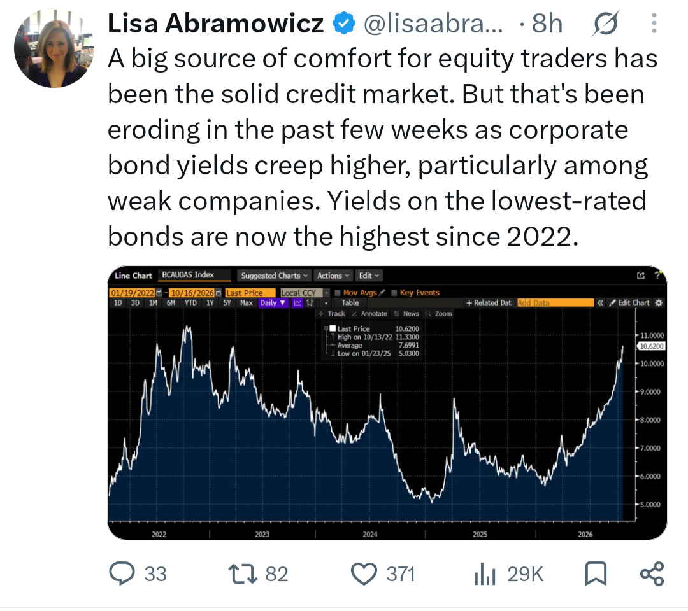

Chart (Bloomberg BCAUOAS Index): last 10.62; high 11.33 on 13 Oct 2022; average 7.70; low 5.03 on 23 Jan 2025. Related: CRWV credit scare, El-Erian's "pockets of credit stress" (15 Oct).

## 2026-10-19 08:52 — El-Erian / The Economist: "Large leverage machine" (AI-related debt)

> This chart is from The Economist's article on "the fast-growing stock of AI-related debt." Without a matching rise in loanable funds, persistent rate pressure will likely crowd out rate-sensitive, non-tech sectors.

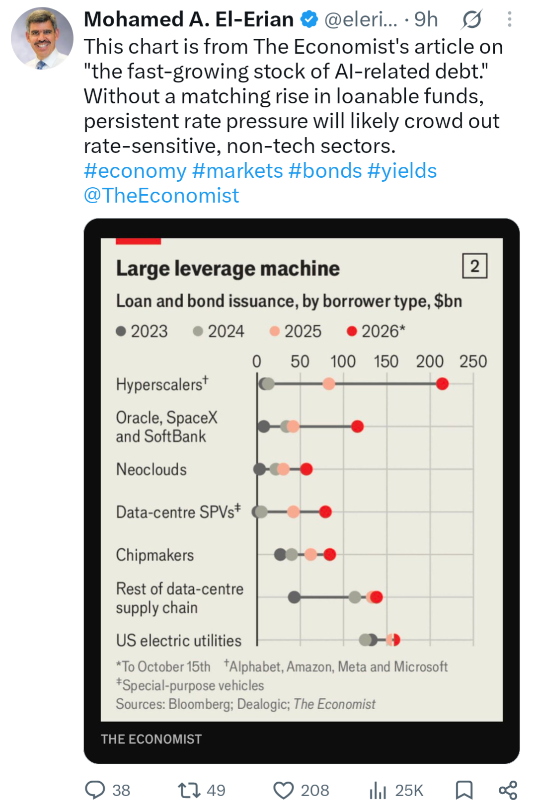

Approximate readings from the chart (2026 to 15 Oct): hyperscalers (Alphabet, Amazon, Meta, Microsoft) about $215bn, up from about $85bn in 2025 and about $10bn in 2023–24; Oracle, SpaceX and SoftBank about $115bn; rest of the data-centre supply chain about $140bn; neoclouds about $55bn; data-centre SPVs about $80bn; chipmakers about $85bn; US utilities about $160bn. Sources: Bloomberg, Dealogic, The Economist. Related: the money-bottleneck note (`notes/money-value-banking.md`) and the CRWV SPV debt.

## 2026-10-20 19:27 — Prediction markets: AOC now 2028 Democratic frontrunner

> BREAKING: Alexandria Ocasio-Cortez (AOC) is now the frontrunner to be the 2028 Democratic Presidential Nominee.
>
> Market expectations for Gavin Newsom's nomination have fallen from 40% to 16% over the last year.

Luke's note: "Holy shit. They've gone fully left." Source not captured (prediction-market odds). Relevant to the HOOD/Kalshi event-contracts watch.

## 2026-10-20 19:57 — Kalshi run-rate (Luke's note from a podcast)

Luke's recollection, paraphrased and unverified: on a recent podcast, Kalshi CEO Tarek Mansour said Kalshi is processing about $14bn a month in trades and takes about 1% of that. That would be about $140m a month in revenue, or roughly $1.7bn a year at that run-rate. Podcast not identified. Relevant to HOOD, since Robinhood splits the fees on event contracts.

Follow-up (Luke, same podcast, paraphrased and unverified): Tarek put volume at about $4bn a week or a bit more (about $17bn+ a month). Luke's recollection is that politics and culture are the fastest-growing categories, followed by financials. At about 1% take, that implies about $170m+ a month, or roughly $2bn+ a year.

## 2026-10-20 20:28 — Jim Bianco (Bianco Research): bonds no longer expensive; CoreWeave the "problem child"

> OUT NOW w/ @biancoresearch - Since late summer, two panics have hit the bond market.
>
> Long-end Treasury yields are at 20+ year highs. At the same time, AI credit is showing cracks, with Coreweave bonds implying a 60% probability of default*.
>
> After being a consistent bear on bonds for many years, Jim @biancoresearch is finally constructive on the Treasury market.
>
> He was careful to say he isn’t calling bonds cheap. His argument is that they’re no longer expensive. Over time, long-term yields should roughly track nominal GDP growth, and with about 3% inflation and about 2% real growth, he expects 5–6% nominal growth. Every Treasury from the 7-year to the 30-year now yields above 5%. In his words: “We finally got to the appropriate level. Only took us six years.”
>
> On AI credit: Jim’s analogy is detention. CCC is where the problem kids sit after school. Right now CoreWeave is acting up, along with a handful of over-levered cable companies and Aston Martin. But investment-grade and high-yield spreads have barely moved. If you toured a high school and saw a rowdy detention room, you wouldn’t conclude the whole school was bad. He doesn’t see this as a canary in the coal mine.
>
> Would he buy CoreWeave’s 2032s at 15%? No. He’d be a seller of “the worst problem child.” But he still likes the space overall. WTBN’s index holds a 5% weight in convertible bonds, about 40% of it AI-related, and he expects that space to go up.
>
> On the AI bubble: Jim thinks AI will end in a bubble, as every transformative technology does. He just doesn’t think we’re there yet. His analogy is that it’s 1997, not the spring of 2000. Bubbles peak when everyone abandons the view that the technology is overhyped, and today most of the financial industry still holds that view.
>
> His bigger concern is what happens if AI works. Nominal growth runs hotter, the 5% handle on interest rates could become a 6, and the companies at the bottom of the K, like the corner grocery store and the new restaurant, feel it first.
>
> We also covered why oil is already effectively $200 a barrel once you add shipping and the cost of naval security in the Strait of Hormuz, why inflation looks stuck at 3% now that two decades of Chinese goods deflation are over, and what Kevin Warsh ending forward guidance means for markets.

Podcast host not named in the clip; sponsor plug and truncated podcast links removed. Tags: CRWV (2032s at about 15%, bond-implied default probability about 60%), Abramowicz CCC chart (19 Oct), Hormuz/diesel, Fed (Warsh).

## 2026-10-21 — DeepSeek inference revenue per GPU hour (GTC Berlin pregame, author not captured)

> Fun to co-host the GTC Berlin pregame show with @dee_bosa and nice of her to invite me on the postgame show.
>
> Deepseek is generating $38 in inference revenue per GPU hour off-peak. That is $100b per gigawatt. 2x this at peak.
>
> Seems important.

## 2026-10-21 — SPCX: Street haircut on Musk's 2027 run-rate guide (author not captured)

> SPCX should be up 30% today.
>
> Here’s a great example of how Wall Street discounts what Elon says.  Bottom line, analysts cut the low end of his guide in half.
>
> Last night he said they’ll exit 2027 with $500B-$1T in revenue run rate.  I believe Elon implied the low was based on adding 10 GW of compute in CY27 and the high end 20 GW.
>
> My take is there’s a 75% chance they add 10 GW, and 2% chance of 20 GW. So we should focus on the low end, or $500B in ARR exiting 2027, or $125B in Dec-27.
>
> Before earnings, the Street was at $31B for Dec-27. He guided to $125B or 300% increase. $SPCX is up 12% on that. It should be 30% plus today.
>
> This morning the Street is at $50B. Since many analysts have yet to update numbers, we look at those that have made changes, and those are at around $70B, compared to the “guide” of $125B. That’s the 50% haircut.

Luke's note: We expect to have this stock by way of the Tesla buyout.

## 2026-10-21 — SpaceX (SPCX) Q3 earnings update (author not captured)

> SpaceX Q3 Earnings Update:
> -Revenues in first 9 months of 2026: $27.1 billion, up 98% YoY
> -Net Income turns positive for the first time: $4.4 billion
> -Capital Expenditures in first 9 months of 2026: $48.1 billion, up 247% YoY
> -Free Cash Flow YTD: -$35 billion
> $SPCX

## 2026-10-21 — El-Erian: UK CPI jumps to 3.5% in September

> UK inflation jumped to 3.5% in September (up from 3.1% in August), topping the consensus forecast and hitting its highest level this year.
>
> The release reinforces the broader global theme: inflation re-accelerated in September, due mainly -- but not exclusively -- to higher energy prices.
>
> #economy #markets #inflation #uk

## 2026-10-21 — Kobeissi: tokenized equities accelerating ([post](https://x.com/KobeissiLetter/status/2112908010892976554))

> Tokenization is accelerating.
>
> There are now over 360 onchain tokenized equity products, up +200% YTD.
>
> 10 of these products have exceeded $100 million in tokenized supply.
>
> As we saw this weekend, demand for 24/7 access to equities is rapidly expanding.
>
> In fact, the majority of volume in these tokenized products, at ~60%, is currently taking place outside of regular market hours.
>
> Today, onchain giant Jupiter, a leader in this space, reported a +215% quarter-over-quarter jump in tokenized equity trade count.
>
> We expect more record highs ahead in this space.

Luke's note: For the time capsule.

## 2026-10-21 — ARK: Tesla premium required to equalize merger gains

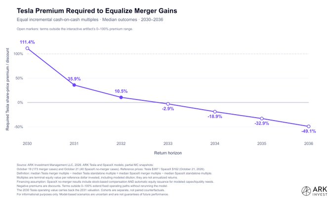

Chart contents, read off the image: "Tesla Premium Required to Equalize Merger Gains — Equal incremental cash-on-cash multiples · Median outcomes · 2030–2036". Required Tesla share-price premium/discount by return horizon: 2030 111.4%, 2031 35.9%, 2032 10.5%, 2033 −2.9%, 2034 −18.9%, 2035 −32.9%, 2036 −49.1%. Reference prices: Tesla $387 / SpaceX $162 (October 21, 2026). Source: ARK Investment Management LLC, ARK Tesla and SpaceX models (Oct 19: 173 merger cases; Oct 21: 40 SpaceX no-merger cases).

## 2026-10-21 — Brett Winton (ARK) on SpaceX vs Tesla merger premium ([@wintonARK](https://x.com/wintonARK))

> on spaceX vs Tesla
> very crudely:
>
> robotaxi is a bigger opportunity than starlink
>
> but orbital compute is a *much* bigger opportunity than robotaxi
>
> and optimus requires more baking time than orbital compute
>
> and Optimus's success is predicated on access to gobsmacking amounts of superintelligence
>
> On our modeling, compared against the no merger case, even if merged at the current share price ratio Tesla shareholders would be ~1.6x better off in 2031 while SpaceX shareholders would be ~2x better off.
>
> On a longer timeframe (2036) Tesla shareholders would be ~5x better off having merged whereas SpaceX shareholders should be more indifferent ~1.3x better off.
>
> So the fair premium depends heavily on your timeframe. On longer time horizons SpaceX shareholders should be asking for a discount. On shorter time horizons Tesla shareholders should be asking for a premium.
>
> But everyone is better off with a merged entity.
>
> A 30% premium paid on Tesla's share price to day would effectively split the difference on the 2031 time frame; Tesla acquired at a 50% discount would equilibreate return differentials on the 2036 time horizon.

## 2026-10-21 — Stephen Casper: pre-mortem on the first major AI-enabled terrorism event ([@StephenLCasper](https://x.com/StephenLCasper), Oct 20)

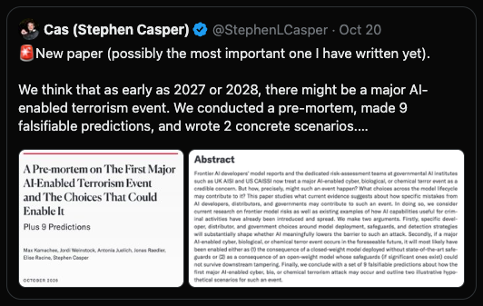

> 🚨New paper (possibly the most important one I have written yet).
>
> We think that as early as 2027 or 2028, there might be a major AI-enabled terrorism event. We conducted a pre-mortem, made 9 falsifiable predictions, and wrote 2 concrete scenarios....

Paper: "A Pre-mortem on The First Major AI-Enabled Terrorism Event and The Choices That Could Enable It — Plus 9 Predictions" (Max Kamachee, Jordi Weinstock, Antonia Juelich, Jonas Raedler, Elise Racine, Stephen Casper; October 2026).

## 2026-10-21 — SpaceX Q3 FY26 income statement (App Economy Insights)

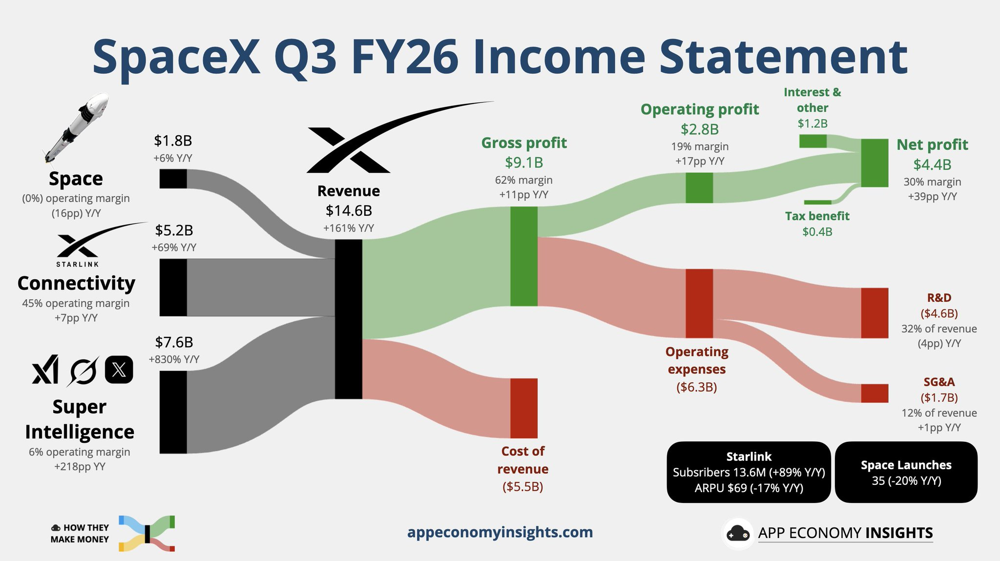

Chart contents, read off the image: Revenue $14.6B (+161% Y/Y). Segments: Space $1.8B (+6% Y/Y, 0% operating margin); Connectivity (Starlink) $5.2B (+69% Y/Y, 45% operating margin); Super Intelligence (xAI, X) $7.6B (+830% Y/Y, 6% operating margin). Cost of revenue $5.5B; gross profit $9.1B (62% margin). Operating expenses $6.3B (R&D $4.6B, SG&A $1.7B); operating profit $2.8B (19% margin). Interest & other $1.2B, tax benefit $0.4B; net profit $4.4B (30% margin). Starlink subscribers 13.6M (+89% Y/Y), ARPU $69 (−17% Y/Y). Space launches 35 (−20% Y/Y).

## 2026-10-21 — Gene Munster: TSLA FSD miles at an inflection point ([post](https://x.com/munster_gene/status/2113003121391599936))

> $TSLA. FSD is at an inflection point.
>
> I’m eyeballing the chart in the shareholder deck of cumulative FSD miles driven.
>
> Looks like we’re at 15.5B. If that’s right, new miles driven would be up around 190% YY compared to 190% in June and 125% in March.
>
> auto gross margins ex credit were 18.5% vs Street at

(Clip ends mid-sentence as received.)

## 2026-10-22 — Tesla starts Optimus production on high-volume lines (author not captured)

> TESLA $TSLA HAS STARTED PRODUCING OPTIMUS ROBOTS ON HIGH-VOLUME LINES
>
> Production began in Fremont, and Tesla says these are the first production-quality bots it has ever made.
>
> It says it has now proven that the current manufacturing process for Optimus is suitable for a commercial product, and it will keep improving both the hardware and the process from here.
>
> A second Optimus factory is already under construction in Texas.

## 2026-10-22 — Gene Munster: Musk says EV winter ending, 5m vehicles/yr goal from 2030

> Elon suggests EV winter is ending.
>
> Goal is 5m vehicles per year starting in 2030.
>
> They'll do around 2m in CY26. Implies 25% compound growth through 2030.  $TSLA

## 2026-10-22 — Gene Munster: Musk says demand exceeds production, FSD the selling point

> Elon says demand for vehicles is exceeding production by a large margin and they're ramping production.
>
> FSD is the selling point.
>
> My take: I agree FSD is now part of the conversation for many new car buyers, but not the majority. In a few years, it will be the majority.  $TSLA

## 2026-10-22 — Mega caps now all competing with each other (analyst, unnamed; Luke's paraphrase)

Paraphrase (not verbatim): an analyst says the mega caps are now all competing with one another, whereas before they did not.

Luke's note: Amazon is undergirded by its physical ownership of distribution.

## 2026-10-22 — Margin in the AI stack (Luke's notes from a podcast/analyst; paraphrase, unverified)

Paraphrase (not verbatim): when OpenAI serves a query on Azure it pays about 30c on the dollar to Microsoft. Microsoft makes about 40% margins on inference, after paying Nvidia, which makes about 60%. So there is lots of margin in the stack, enough to cover all the debt. Model makers and hyperscalers all want to own the whole stack.

## 2026-10-22 — Productivity paradox and a flaw in GDP (Luke's personal thoughts)

Luke's note: Productivity topic being discussed. I think we see no gain because the value diminishes because everyone lowers prices so more is done for less. There's a flaw in GDP, I think.

### 2026-10-22 15:26 — Munster: Elluswamy on the long tail of autonomy

Source: [Gene Munster on X](https://x.com/munster_gene/status/2113270541096210651)

> My favorite quote from last nights $TSLA call underscores why shares are going higher.
>
> Ashok Elluswamy (head of AI) responding to a question of how close are traditional auto makers from getting autonomy right
>
> “Yeah. It's easy to get to the first 90% and make a cool-looking demo. But when you get in the long tail of this problem, it's so long that people don't realize anyone with their sane mind should not attempt to solve this problem”.

### 2026-10-22 18:05 — The Block: a16z Crypto renamed a16z Frontier

Source: The Block (no link supplied)

> Andreessen Horowitz has renamed a16z Crypto to a16z Frontier and expanded its investment scope beyond crypto startups to the broader category of "frontier startups," managing partner Chris Dixon said.
>
> The unit will continue investing in crypto and related ventures while looking at companies developing new technologies and markets that may take years to mature.

Luke's note: Crypto is dead dead.

### 2026-10-22 18:19 — fiveoutofnine: a very bad Wednesday for internet security

Source: [fiveoutofnine on X](https://x.com/fiveoutofnine/status/2113045722744717360)

> So basically, today PHP got two critical bugs that let anyone run code on your server without even logging in, which is bad, and then the details leaked before the patch was even out, which is worse, and it works on WordPress and MediaWiki and Magento and Joomla and Laravel, and Censys says like 1.5 million servers are running a version with no fix, so the NSA was like "take your system offline," and the FBI was like "take your system offline," and CISA and the UK and CERT-EU were all like "take your system offline," and then the Prime Minister of Japan, the actual Prime Minister, posted at 5:55 in the morning telling 48.8 million people to take their system offline, so everyone took their system offline, like the Dutch cybersecurity agency took its own website offline, and the Dutch parliament went offline, and the Port of Rotterdam went offline, and Finland and France and Denmark started pulling government sites, and Wikipedia went down, and Archive.org went down, and Asana and GOG and Something Awful went down, and the University of Vienna's webmail went down for some reason, and that's just PHP. Because GitLab also dropped a CVSS 10.0, which is the highest score they give out, for a bug that's been there since 2014, so that's every self-hosted GitLab for twelve years, and then LiteLLM 1.107.0 got hijacked and shipped a credential stealer and a remote access trojan in every single wheel and the Docker images, including latest, and you didn't even have to import it, just installing it was enough, and it's the second time this year, and then Railway paused every deployment on the entire platform because someone got into the environment variables, so now everyone has to rotate every secret they've ever stored there, and TiDB Cloud said someone was walking around inside with stolen credentials for basically a month and an extortion group says they took 10.6 terabytes, and Zeabur got breached for the second time in two months and is just shutting down, like the whole company, and Node.js patched remote code execution and a TLS bypass, and CISA says Plex is being actively exploited, and someone took over 300 Tor exit relays to steal SSH passwords, and SafePay ransomware has hit over 600 critical infrastructure orgs, and India's biggest bank filed a data loss incident, and Japan has been in an official state of emergency in cyberspace since October 9, which honestly explains the 5:55 AM post. Oh, and eMudhra, a certificate authority that's issued over 60 million certificates, whose entire job is proving websites are who they say they are, was supposed to be using private keys that are random numbers over a hundred digits long, and one of them was 4. Just 4. And the others were like 66 and 237. Anyway, it's Wednesday.

### 2026-10-22 18:53 — LiveSquawk: Fireblocks denies Visa takeover talks

Source: LiveSquawk on X, citing CoinDesk (screenshot, no link supplied)

> Crypto Custody Specialist Fireblocks Denies It's In Talks To Be Acquired By Visa - @CoinDesk

Luke's note: Filing because more signs that crypto is dead. Consolidated. As I predicted, regulated companies wake up to it and take it like candy from a baby.

### 2026-10-22 18:55 — FT: China is no longer expected to catch up to the US soon

Source: Financial Times chart, data from Oxford Economics (image, no link supplied)

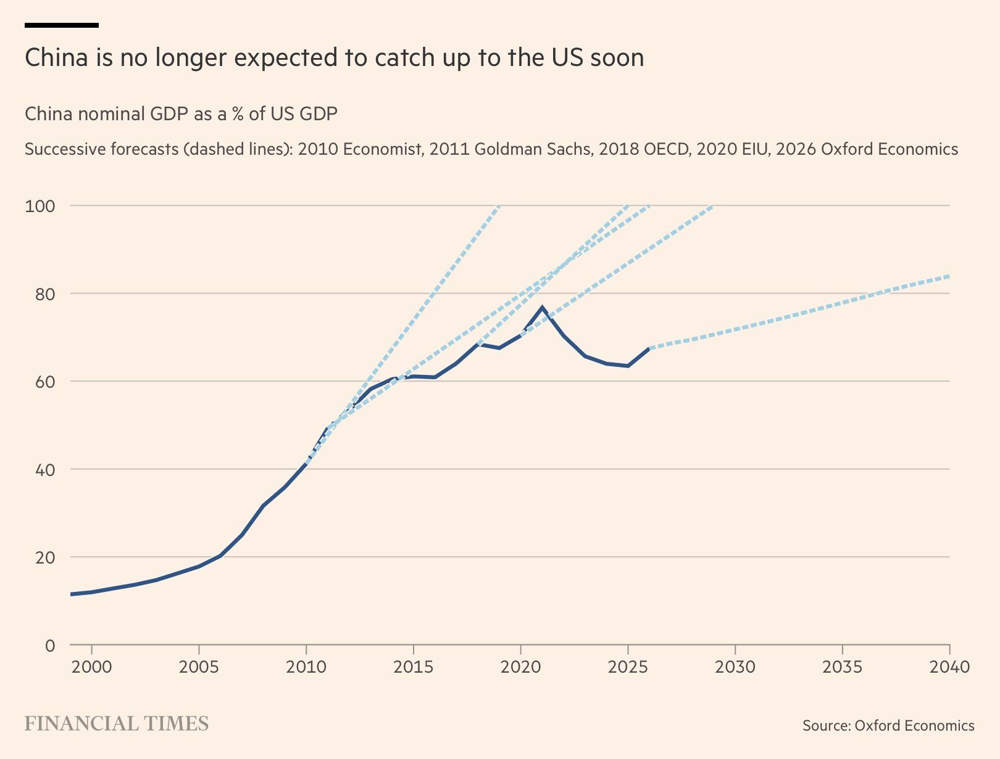

> China is no longer expected to catch up to the US soon
>
> China nominal GDP as a % of US GDP
>
> Successive forecasts (dashed lines): 2010 Economist, 2011 Goldman Sachs, 2018 OECD, 2020 EIU, 2026 Oxford Economics

### 2026-10-22 18:56 — Exponential View: AI spending is concentrated because big firms are big

Source: Exponential View chart (image, no link supplied). Sources on chart: "Firm Data on AI" (2026); DBT 2025; BLS 2025; Datadog Q2 2026; EV analysis.

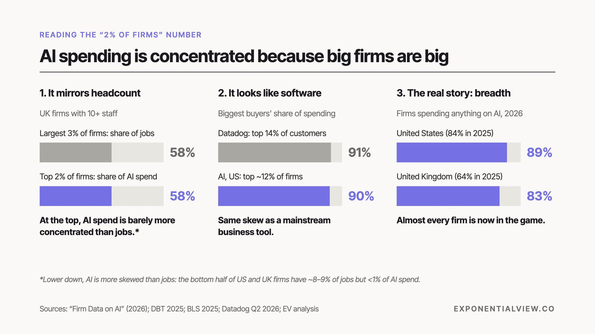

> Reading the "2% of firms" number
>
> AI spending is concentrated because big firms are big
>
> 1. It mirrors headcount. UK firms with 10+ staff. Largest 3% of firms: share of jobs 58%. Top 2% of firms: share of AI spend 58%. At the top, AI spend is barely more concentrated than jobs.*
>
> 2. It looks like software. Biggest buyers' share of spending. Datadog: top 14% of customers 91%. AI, US: top ~12% of firms 90%. Same skew as a mainstream business tool.
>
> 3. The real story: breadth. Firms spending anything on AI, 2026. United States (84% in 2025) 89%. United Kingdom (64% in 2025) 83%. Almost every firm is now in the game.
>
> *Lower down, AI is more skewed than jobs: the bottom half of US and UK firms have ~8–9% of jobs but <1% of AI spend.

### 2026-10-22 21:30 — Nasdaq 100 biggest daily drop since 5 June

Source: unattributed post (no link supplied)

> BREAKING: The Nasdaq 100 closes down -2.9%, posting its biggest daily drop since June 5th.
>
> The index erased nearly -$1.2 trillion in market cap today.

Market heatmap for the day (TradingView screenshot, no link supplied). Readable moves include NVDA −4.40%, AVGO −4.31%, MU −6.26%, AMD −8.10%, INTC −8.0%, GOOGL −3.15%, MSFT −2.23%, META −6.98%, PLTR −2.74%, ORCL −2.78%, AMZN −4.57% and TSLA −3.08%.

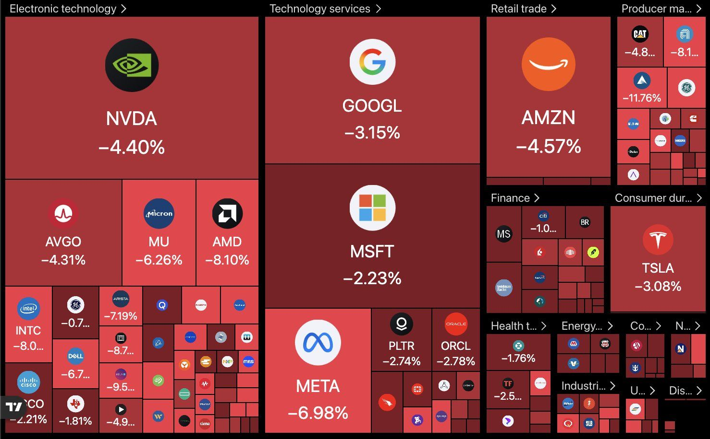

### 2026-10-23 09:01 — Dan Ives: CoreWeave debt fears "way overdone"

Source: podcast (show and link not supplied). The text below is a summary of the conversation as Luke supplied it, not a verbatim transcript; only the short quoted phrases are attributed to Ives. Related: [CRWV notes](../crwv/README.md).

> In the conversation, Dan Ives addresses the concerns surrounding CoreWeave and the broader fears regarding AI infrastructure debt (0:05:22). While he acknowledges that some investor concerns are directionally correct—specifically that rising yields increase the cost of capital for a sector where roughly 20% of the buildout requires debt or equity financing—he firmly believes the bearish narrative is "way overdone" (0:05:41 - 0:06:06).
>
> - **Healthy Backlog:** Ives argues that when you look at CoreWeave's debt relative to their actual backlog, the leverage is "minuscule" and the company is fundamentally in a stronger position than it was a year ago (0:06:07 - 0:06:21).
> - **False Narrative:** He compares the current market anxiety surrounding CoreWeave and AI infrastructure to the "SaaS apocalypse" narrative seen earlier in the year, characterizing it as an overreaction that creates a potential buying opportunity (0:06:24 - 0:06:30).
> - **Strategic Necessity:** He notes that while hyperscalers are in a superior capital position, "neocloud" providers like CoreWeave are taking on this debt out of strategic necessity to meet the massive, ongoing demand for data center infrastructure, which Ives confirms is still surging globally (0:17:59 - 0:18:47).

### 2026-10-24 16:18 — David Friedberg: France's public spending at 57% of GDP

Source: [dnap (@dnapway) on X](https://x.com/dnapway), reposted by Elon Musk (post link not supplied). Quotes are dnap's transcription of Friedberg.

> David Friedberg reveals France's public spending is 57% of GDP: greater than that of communist countries
>
> "This chart is a measure of public spending as a percent of GDP; Rand Group Research published it. And you can see the comparison of France's public spending as a percent of GDP, to the peak public spending as a percent of GDP of major communist nations, Soviet Union during, communist Romania, Venezuela under Chavez, and then communist China."
>
> "It certainly been a socialist state, right? That's my point. I think this is such a precious lesson for the West to look at. We all think that there's some political problem with Macron or whoever it was."
>
> "The more the government spends, the worse the conditions get for its people, not the opposite. And then the people riot and revolt and say that the government's not spending enough and the government needs to be doing more."
>
> "Take a guess where the US is today. Federal government spending is $7.4 trillion, state and local government spending is $4.6 trillion. You add those two together, it's $12 trillion out of a $33 trillion GDP. US public spending is roughly 36% of GDP. France today is the same as the US, it's about 120% debt to GDP."
>
> "France today is operating its national government spending deficit is 5.4% of GDP. The US is actually 6.2% of GDP. France is I think probably the first to go because they're only growing their economy at half a percent while the US is growing 2.3%."
>
> "So we're still kind of hanging on because we have some degree of economic growth that's allowing us to kind of hold things together."
>
> "But I would argue that we are facing the same sort of fiscal cliff that leads to this extraordinary social unrest as France, all the economic measures are aligned, we're at the same rate, we're at the same set of problems."

### 2026-10-24 18:19 — Technology sector forward P/E at 19.0x

Source: chart screenshot, no source or link supplied (image not saved). Readings below are from the chart labels.

> Technology – Forward P/E-Ratio
>
> 5y avg. 25.3x · 10y avg. 23.0x · latest 19.0x

Chart shows forward P/E around 29x in Jan 2025, a peak of about 31x in Oct 2025, a dip to about 19.5x in Mar 2026, a rebound to about 25x in May 2026, then a slide to 19.0x in Oct 2026, below both averages.

### 2026-10-24 22:08 — Jon Gray (Blackstone): neocloud compute pricing up 50%, H100s leasing near original rates

Source: interview clip (show and link not supplied). Interviewer's question in brackets as supplied. Related: [CRWV notes](../crwv/README.md).

> Blackstone's Jon Gray says neoclouds that can deliver compute get 50% more for it than a year ago, and old H100s lease near their original rates
>
> [ CoreWeave, a company that you work with... is seeing its yields on some of its debt go to 15%. ]
>
> "Well, it is creating a challenge. And it's interesting when you talk about CoreWeave and the neo clouds, there's a real contrast between delivering compute and demand for compute."
>
> "And so if you're in a neo cloud and you can deliver compute, the price you can get today is up 50% from where it was a year ago. Your older chips, the H100s, are leasing today close to their original rates, where people thought three or four years ago they wouldn't have any value."

### 2026-10-25 09:01 — Used RTX 4090 prices as a compute supply/demand gauge

Follows the Jon Gray entry above. Data gathered by Lily on 2026-10-24 at about 22:11 BST. These are eBay Buy It Now **asking** prices for used, working cards; sold prices weren't reachable, so they likely overstate resale value.

- Launch price (Founders Edition, Oct 2022): $1,599 US; £1,679 announced UK RRP (about £1,699 at launch, later cut to about £1,519).
- Used asking price, UK sellers (16 listings): median about £2,863, about 170% of launch.
- Used asking price, US sellers (51 listings): median about $3,600, about 225% of launch.

Luke's note: "This is the price of matrix multiplication and these prices will be reflected through all model capable GPUs incl server ones." Then: "this easy check is a proxy for supply and demand and that demand is a proxy for what all the other companies valuations are based on."

### 2026-10-25 10:01 — Kobeissi Letter: "The 'Stealth' Bear Market: A Historic Opportunity"

Source: The Kobeissi Letter (X long-form post, [@KobeissiLetter](https://x.com/KobeissiLetter)). Chart titles are kept as *[Chart: …]*; the charts themselves weren't supplied. The subscription and performance plugs are removed. Kept for narrative, not data; see Luke's note.

> We receive thousands of questions per week. But recently, one has been the most common of them all. Oil prices are above $100/barrel, borrowing costs are at 2002 levels, and inflation is nearly double the Fed's 2% target. So, HOW is the S&P 500 trading ~2% away from a record high?
>
> What if we told you that the S&P 500 can trade near record highs, while simultaneously being in a bear market?
>
> That is exactly what we believe is happening. And we believe it represents one of the most significant opportunities in today's market.
>
> We are now witnessing a historic market paradox: The "Bull-Bear" Market.
>
> **The Iran War - Day #229**
>
> *[Chart: S&P 500 Since February 28th]*
>
> Today marks the 229th day of the Iran War. Since the start of the Iran War, the S&P 500 is up +900 points. And, since the March 30th bottom, the S&P 500 is up nearly +1,500 points, adding +$14 trillion of market cap.
>
> The world is also a vastly different place than it was 229 days ago. Inflation has nearly doubled, the Fed is hiking interest rates, and we are in the midst of the biggest energy crisis in world history. And, we are also in the midst of the biggest technological revolution in world history.
>
> Yet, if you ask most investors, the current sentiment is that the current fundamental backdrop has deteriorated compared to where it was 8 months ago.
>
> **The Macroeconomy - A Historic Shift In Expectations**
>
> At the start of 2026, the Fed was expected to CUT rates at least 3 times, for a total of 75 basis points this year.
>
> *[Chart: Forbes - January 13th, 2026]*
>
> This was a major component of the bullish thesis for equities, with investors expecting cheaper capital, more investment, and record CapEx by technology companies.
>
> *[Chart: CME Group - Fed Interest Rate Expectations (10/15/2026)]*
>
> Today, the Fed has already hiked interest rates once this year and markets see another 3 interest rate hikes by June 2027, for a total of +100 basis points including September's rate hike. That's a +175 bps swing in rate expectations. Yet, the S&P 500 is still trading at record highs.
>
> *[Chart: Brent Crude Oil, 10Y Note Yield, Diesel]*
>
> Driving this shift has been the historic surge in oil prices, with diesel now up over +80% from its low seen in January 2026 and Brent crude oil trading at $106/barrel.
>
> Borrowing costs have surged as inflation doubled, the Fed is hiking rates, and the US is running a near-$2 trillion deficit. But still, the S&P 500 is at record highs.
>
> So, what is happening?
>
> **Most Of The S&P 500 Is Struggling:**
>
> The reality is that the vast majority of the S&P 500's constituents are not trading anywhere near record high territory. Take a look at our analysis below.
>
> *[Chart: % of S&P 500 Stocks Down -10% or More]*
>
> As indicated in the chart above, 84% of S&P 500 stocks are now trading at least -10% below their all-time highs.
>
> Real Estate leads the drawdown, with 97% of stocks down at least -10%, followed by Materials at 96%, Utilities at 94%, and Consumer Discretionary at 92%.
>
> Furthermore, 59% of S&P 500 stocks are down at least -20% from their highs, 41% are down more than -30%, and 17% are down more than -50%.
>
> Now, take a look at return contribution since the March 30th bottom:
>
> *[Chart: S&P 500 Return Contributions - Since March 30th Bottom]*
>
> Just 10 stocks have driven 70% of the S&P 500's gain since March 30th. These stocks have added +16 percentage points to the index's +23% gain over this period. Nvidia, $NVDA, has contributed the most, accounting for 13% of the S&P 500's gain, or +3 percentage points.
>
> This is followed by Micron, $MU, Apple, $AAPL, and Microsoft, $MSFT, each accounting for 9% of the S&P 500's advance, adding +2 percentage points. Return contributions by AMD, $AMD, and Alphabet, $GOOGL, have been 8% and 7%, respectively.
>
> Meanwhile, the remaining 490 stocks have accounted for just 30% of the S&P 500's gain since March 30th, adding +7 percentage points.
>
> The reality is that the MAJORITY of S&P 500 components are, in fact, in a bear market. In our view, for the S&P 500, this is in fact bullish, or at worst, does not matter for now.
>
> We explain why, next.
>
> **The S&P 500 Should Be Above 9,000:**
>
> Without the Iran War, the S&P 500 could be at 9,000+.
>
> This is arguably the most resilient market in history. If the S&P 500 is 2% away from a record high despite inflation nearing 4%, gas prices on the rise, and the Fed HIKING rates, just imagine where the S&P 500 would be if the Iran War ended, oil prices came back down, and rate cuts returned. Or, if it never even happened.
>
> Earnings growth just over the last 7 months of the Iran War has been historic, with the S&P 500 posting +52% blended earnings growth in Q2 2026.
>
> *[Chart: S&P 500 Earnings Growth - Q2 2026]*
>
> This marks the highest growth rate since Q2 2021, a period where the global economy was emerging from a historic lockdown and the US government handed out $4 trillion in stimulus.
>
> In other words, in the midst of a global energy crisis and a rate hike campaign, we are now seeing growth on par with $4+ trillion in stimulus and a global economy that restarted from an effective halt.
>
> The reality is that the AI narrative is even stronger than most people realize: the earnings growth is there to support it, even as inflation has been above 2% for 67 consecutive months.
>
> *[Chart: Nvidia - P/E Ratio]*
>
> Take a look at Nvidia's P/E ratio over the last 12 months. Even as the stock is up +21% over this period, the company's P/E ratio is down -46%. The stock now has a Forward P/E ratio of ~24x, nearly in line with the S&P 500's 22x, even as $NVDA has risen +900% in 5 years.
>
> This is the story for MANY large-cap technology stocks, the very names that are carrying this market.
>
> As shown below, the S&P 500 and the S&P 500 Information Technology sector are now seeing nearly identical Forward P/E ratios. Historically, these stocks have almost always traded at a premium to the broader S&P 500.
>
> *[Chart: S&P 500 vs S&P 500 Info Tech - Forward P/E]*
>
> In our view, the very names that have been driving the equity market higher, most large-cap technology stocks, actually have deep discounts priced-in to their stocks, even as they trade at or near record highs. We believe these stocks would be trading MUCH higher if it were not for the macroeconomic factors that we have seen over the last seven months.
>
> Combine this with the fact that over 80% of S&P 500 stocks are down -10% or more from their record highs, and our thesis is even stronger. If market breadth were to widen even slightly, buying pressure increases rapidly.
>
> And, even without this shift, the large-cap technology stocks that are driving the majority of price action appear relatively "cheap" compared to the S&P 500.
>
> This is why we said for the S&P 500, market concentration is bullish, or at worst, does not matter *for now.*
>
> **March 30th Was A Gift To Investors:**
>
> The thesis we outline today has been a central part of our investment strategy in our premium research since March 30th. Below is the front page of The Kobeissi Letter as published on March 30th, 2026.
>
> *[Chart: The Kobeissi Letter - Front Page (3/30/2026)]*
>
> As the S&P 500 fell below 6,400, we initiated a strong buy signal on the index and the equity market more broadly. Below is our note on the S&P 500 from March 30th.
>
> *[Chart: The Kobeissi Letter - S&P 500 Analysis (3/30/2026)]*
>
> We noted that the bond market was a central part of our thesis along with the fact that the technology stocks that were driving the broader equity market lower were being sold with seemingly irrational price action.
>
> The result was a "V-Shaped" recovery in the S&P 500, after which we continuously raised our S&P 500 target to 7,800, and we also called for bond market intervention by the Trump Administration.
>
> Today, the Trump Administration is intervening in the bond market, so far unsuccessfully, but further attempts at intervention are inevitable in our view.
>
> Ultimately, however, our thesis today is rooted in our view expressed on March 30th, which has only gained more momentum as we look ahead to 2027.
>
> **Investors Want More Assets:**
>
> On top of the discount that is already priced-in to equity markets as discussed above, investors are keen to own assets amid the persistent inflation we are seeing in the US.
>
> US CPI inflation has now been above the Fed's 2% target for 67 consecutive months. The last time inflation was below 2% in the US was in January 2021, amid a global economic lockdown.
>
> *[Chart: US Dollar - Loss of Purchasing Power Since 2021]*
>
> Over this period, the value of the US Dollar has declined by -22.5%. In other words, it now costs $129 to purchase the same goods and services that cost $100 in 2021. Hence, investors want more stocks and hard assets over the long-run, not less.
>
> Therefore, if there were to be any indication of the Iran War ending and the global energy crisis subsiding, this would lead to a domino effect in the bullish direction.
>
> Energy prices would drop, inflation expectations would follow, the Fed could pivot more dovish, the "discount" in technology stocks would be priced-out, and the market's rally would broaden.
>
> All while the AI Revolution continues to accelerate and many large-cap technology stocks become cheaper on a forward earnings basis, even as their stock prices rise.
>
> And in the background, the demand for asset ownership is historically robust.
>
> **In Conclusion: The "Bull-Bear Market."**
>
> In summary, we believe the S&P 500 is in a bear market, within a bull market.
>
> *[Chart: S&P 500 Bull Market Hits Year #5]*
>
> Even as the S&P 500 hits year #5 of its bull market, we believe a steep discount is currently priced into equities. This discount has functioned as a "stealth" bear market, suppressing equity valuations in the world's largest and fastest-growing companies.
>
> This backdrop has the ability to catalyze a violent rally in the S&P 500 if and when it is ultimately priced-out.
>
> We expect a highly eventful 2027.

Luke's note: "Kobeissi are emotion stirrers. We keep this for narrative."

### 2026-10-25 10:13 — Sam Altman: models finding bugs "outside of the normal threat model"

Source: [unusual_whales on X, 23 Oct 2026](https://x.com/unusual_whales/status/2113645872743407861), quoting OpenAI CEO Sam Altman. The ellipses are unusual_whales'. Related: the fiveoutofnine security-meltdown entry above.

> OpenAI CEO Sam Altman: "I don't even know a dramatic enough word to use… models can find bugs that are outside of the normal threat model of what we think a hacker can do… hardware-level, insane stuff… I no longer think we're gonna be able to just patch all the bugs."

### 2026-10-25 10:14 — Rooted Samsung TV: always-on mic, ACR, geo tracking, telemetry

Source: Md Ismail Šojal, [@0x0SojalSec](https://x.com/0x0SojalSec) on X (screenshot; no post link or date supplied). The claims are the poster's own, relayed second-hand ("Bro Rooted…"), and not verified.

> WTF, $3000 Samsung TV has an always-on mic, automatic content recognition, geo tracking, network mapping, and ships your data to Samsung + 400 partners.
>
> Bro Rooted a brand-new 2025 Samsung TV after noticing absurdly targeted ads.
>
> Firmware was locked down, so zero-days it was.
> Got a root shell.
>
> then found: always-on voice service, ACR, geo, full telemetry pipeline, and four separate DRM systems.
>
> This isn't a bug, It's the product bro.

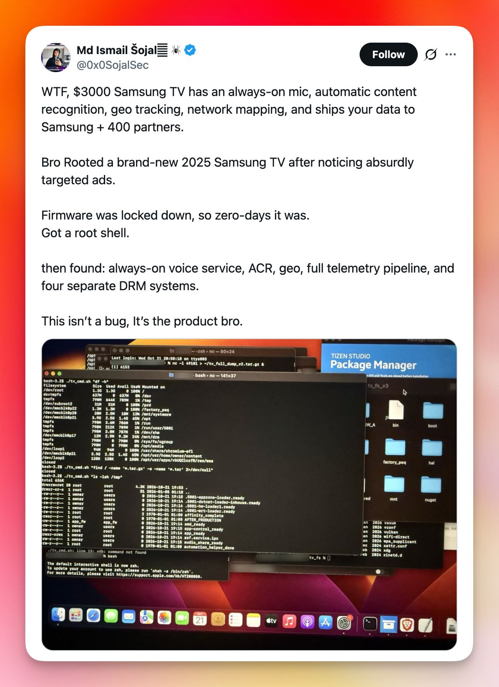

### 2026-10-25 10:24 — Samsung TV audio classification in telemetry (log4j, quoted by Charles Gillespie, reposted by Paul Graham)

Source: screenshot of an X post by Charles Gillespie ([@charlesgillespi](https://x.com/charlesgillespi)), posted about 22 hours before capture (about 24 Oct). It was reposted by Paul Graham and quotes [@log4j](https://x.com/log4j) (24 Oct). Shown at capture: 92 replies, 780 reposts, 8.7K likes, 247K views. Transcribed from the screenshot; the image wasn't saved. The log4j text is truncated ("…") in the screenshot. Follows the rooted Samsung TV entry above. The claims haven't been verified.

Charles Gillespie:

> Never seen a more flagrant and violent breach of privacy in my life, and probably never will. Doubtful that a privacy violation will ever even be able to compare to the scale of this evil and deliberate attack.
>
> Samsung should be eviscerated for this. Criminal charges please

log4j (quoted):

> turns out it classifies what audio it hears, before reporting back to samsung.
>
> sensor preferences, dog-barking and baby-crying event counters, and camera streaming duration are built into telemetry paths. …

Table in the log4j post (transcribed):

| Event | Fields | Verified meaning and limits |
|---|---|---|
| EV201 / SOUNDSENSOR_ON | `boarding_on`, `Noti`, `noti_baby_crying` | Noti reads the dog-barking callback counter; noti_baby_crying reads the baby-crying counter. They do not prove a notification was displayed. boarding_on is a separate 0/1 field; its full lifecycle remains untraced. |
| EV101 / LIGHTSENSOR_ON | `boarding_on` | Software flag; not a raw light measurement in this record. |
| EV301 / CAMERASENOR_ON | `boarding_on`, `Noti`, `noti_clip` | Camera-state/notification-related fields. The misspelling CAMERASENOR_ON is present in code and policy. |
| EV302 / CAMERASENSOR_OFF | `Duration` | Built in the camera-streaming status path. The OFF label does not establish that a preference was disabled or hardware stopped. |

> The service formats brace-delimited key=value pairs and calls `CLogger::AddEventLogAsync` using a module-prefix-plus-`_tv_sensor` name. The captured `24_tv_sensor` policy names `https://lcprd1.samsungcloudsolution.net/openapi/log/24_tv_sensor` and sets `deviceid=1`. That is a configured ID mode, not recovered identifier bytes. The module prefix and active runtime policy still require verification.

### 2026-10-25 16:22 — Kath Korevec: ChatGPT-built app replaces an embroidery machine's $12/month app

Source: screenshot of an X post by Kath Korevec ([@simpsoka](https://x.com/simpsoka)), Oct 24, reposted by OpenAI Developers. 112 replies, 132 reposts, 3.7K likes, 119K views at capture.

> Got a cheap embroidery machine off amazon for $300 where the biggest complaint is the mandatory $12/mo app that you're forced to use. Had ChatGPT create its own app that communicates with the machine. Generative art patches incoming!

*[Image: a custom macOS embroidery app showing a 4x4 in hoop patch design (5,315 stitches) with layers, thread sequence, Brother/Janome thread charts and fabric settings.]*

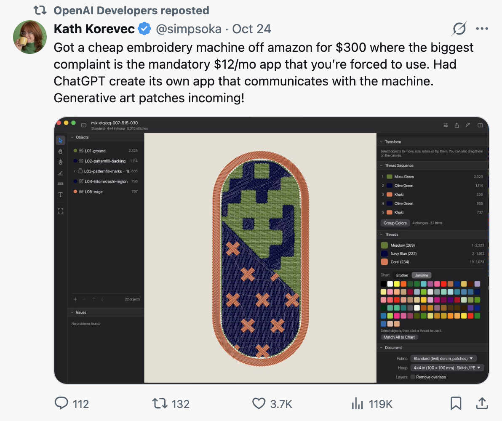

Related: [Eric S Raymond on LLM decompilation](#2026-10-06-0752-bst--clipping-eric-s-raymond--the-end-of-software-secrecy-llm-decompilation-ai-software-open-source-saas-moats), the rooted Samsung TV entries above.

Luke's note: Goes with the hacking culture right now. Also a gift idea for Izzy.

### 2026-10-25 16:25 — Christian Catalini: data licensing as an industry-wide prisoner's dilemma (quoting Brendan Foody, Mercor)

Source: screenshot of an X post by Christian Catalini ([@ccatalini](https://x.com/ccatalini)), Oct 24, quoting Brendan Foody ([@BrendanFoody](https://x.com/BrendanFoody)), Oct 23. 7 replies, 2 reposts, 67 likes, 6.6K views at capture.

> Every industry gets to play prisoner's dilemma. One company blinks. Everyone gets automated.

Quoted post (Brendan Foody, truncated in the screenshot):

> We'll pay you up to $100K for every company you refer that licenses its data to @Mercor.
>
> We've partnered with > 500 companies so far.

**See also:** 2026-10-12 ~21:08 BST — Christian Catalini — Surviving the AI Moatpocalypse; 2026-10-06 — Catalini, Anthropic as Pennsylvania Railroad.

### 2026-10-26 08:05 — Citrini: the AI vs biology divide, and why AI won't quickly cure disease

Source: Citrini note, text pasted by Luke (no URL or date given). Verbatim.

> There's a really pronounced divide between people who are on the AI side of things and people who are on the biology side of things.  Even among people working in AI, the divide persists based on where they're focused.
>
> The AI side, adherents of scaling laws and the bitter lesson, believe that AI getting better means AI being more capable of novel discoveries in medicine (that go beyond discovering new drugs in well understood targets or speeding up dry lab work etc).
>
> The biology people think the idea of a bitter lesson in biology is kind of ridiculous and that regardless of AI's capabilities it's going to be at least 5-10 years until you could hope to reliably simulate human toxicology in silico (right now AI/ML can't even reliably simulate in vivo studies like binding affinities or functional assays).
>
> Even the most AI pilled of them, who will list all the areas that AI can reduce the time spent on various areas, don't think the concept of AI discovering novel targets or generating new understanding of causal biology is realistic in the near term. Most, in fact, will readily characterize the assumption that even an "ASI" level model could find cures hidden in our current understanding (without expanding that understanding with significantly more biological data) as patently false.
>
> This was a big part of why we wanted to experience it ourselves by using AI for a (very) small portion of what it can do in biology. It was both mind blowing and revealed some poignant insights into how different the problem of making AI better at something like coding is to the problems of biology.
>
> Even if it unlocked the ability to generate new molecules at a stunning pace, its simulation (in silico) of binding only had 49% accuracy. And if we wanted to improve that, we'd need to feed it back the data from the lab - data that took about 30x as long to get as it took to generate the molecules. And these were tests in a test tube (turn of phrase), imagine how long it would take if we wanted to improve the model with data that required recruiting humans and monitoring their reactions.
>
> Human biology is very complex, and adding a drug - especially a novel drug and doubly so for a novel drug acting on a novel mechanism - means mapping interactions that have nth-order-effects that we don't have the data to predict. Virtual cells have made advancements enabled by AI, but the perturbations equate to a small fraction of the possible.
>
> This is before you even get into curing disease, especially uniquely human diseases. Brain function involves cellular identities that are unique to humans, meaning animal studies are of little use.
>
> How long does it take to understand what the side effects of chronic administration of a drug in humans are? AI can speed up analyzing the data, or designing the trial or even getting it approved…but it can't make a 6 month trial complete in 3 months.
>
> I think its important to point out that significant advancements can be made in AI that contribute to biology, while also being realistic about how much it speeds up something as complex as curing a specific cancer or diseases of the brain.

Luke's note: Citrini's note for posterity.

**See also:** 2026-09 diary entry on the limits of an automated wet lab for AI (bio-risk, cell and mouse experiment timescales).

### 2026-10-26 21:10 — Gavin Baker: revenue per GPU can rise as token prices fall

Source: X post by Gavin Baker ([@GavinSBaker](https://x.com/GavinSBaker)), [status 2114788642547737046](https://x.com/GavinSBaker/status/2114788642547737046), posted about 2h before capture (around 19:10 GMT, 26 Oct 2026).

> Revenue per GPU can increase as token prices decline if per GPU token throughput increases enough.
>
> So both Anthropic revenue *and* margins can go up as token prices go down *if* GPU prices go up less than the product of (token price decline * per GPU throughput increase).
>
> But I have super enjoyed all the commentary to the contrary!

**See also:** 2026-10-24 22:08 — Jon Gray (Blackstone) on neocloud compute pricing; 2026-10-25 09:01 — used RTX 4090 prices as a compute gauge; [compute-prices/gpu-prices.csv](../compute-prices/gpu-prices.csv).

### 2026-10-26 21:21 — Patrick O'Shaughnessy: stats from the Anthropic S-1

Source: X post by Patrick O'Shaughnessy ([@patrick_oshag](https://x.com/patrick_oshag)), [status 2114727466090578067](https://x.com/patrick_oshag/status/2114727466090578067), posted about 6h before capture (around 15:20 GMT, 26 Oct 2026). Verbatim. Figures are his summary of the S-1 and have not been checked against the filing.

> A list of stats from the Anthropic S-1:
>
> - NDR is ~900%
>
> - Revenue per employee is over $6.6M, up from about $1.4M a year earlier
>
> - Revenue went from $41M three years ago to $16.3B in the first six months of 2026
>
> - Quarterly revenue went from $4.7B in Q1 to $11.6B in Q2
>
> - Q2 2026 was the first profitable quarter: $974M in operating income ($1.7B operating loss the quarter before)
>
> - Adjusted operating income was $1.6B in the first half of 2026, up from a $1.8B adjusted loss a year earlier
>
> - Revenue grew 1,368% year over year in Q2, while compute and infrastructure costs grew 300%
>
> - Compute went from 251% of revenue to 48% in five quarters
>
> - The value of Anthropic's own internal Claude usage grew 250x from January to September 2026
>
> - Anthropic spends more on tokens (at list price) than on payroll
>
> - Over 1,900 customers pay $1M+ a year, and about 250 pay $10M+
>
> - Customers paying $100K+ went from 950 to over 11,900 in a year
>
> - Over half of the Fortune 500 pays $100K+ a year
>
> - Those Fortune 500 customers still spend less than 0.1% of their total expenses with Anthropic
>
> - The top 5% of Claude Code users spend roughly 20x what non-users on Claude Enterprise do
>
> - About 40 million smaller customers
>
> - $72.4B of the $80.7B first-half net loss is an accounting charge on convertible notes (not operating losses)
>
> - Nearly $800B in compute commitments over 10 years
> $141.1B raised in total, with over $130B in cash and short-term investments
>
> - Nearly half of revenue comes through Amazon, Google and Microsoft's cloud marketplaces, all of which also compete with Claude
>
> - A single share held by the seven co-founders carries 50.1% of the vote
>
> - That share is redeemed for nothing if fewer than three founders remain

**See also:** 2026-10-26 21:10 — Gavin Baker on revenue per GPU as token prices fall; 2026-10-06 — Catalini, Anthropic as Pennsylvania Railroad; [crwv/README.md](../crwv/README.md) (AI-lab demand behind neocloud contracts).

### 2026-10-26 21:35 — Kobeissi Letter: Microsoft offering buyouts to 60,000 workers (per Bloomberg)

Source: X post by The Kobeissi Letter ([@KobeissiLetter](https://x.com/KobeissiLetter)), [status 2114745896315359305](https://x.com/KobeissiLetter/status/2114745896315359305), posted about 5h before capture (around 16:35 GMT, 26 Oct 2026). $MSFT was shown at $532.19. Verbatim. Kobeissi is used as a data source only, and the underlying report is attributed to Bloomberg (not checked).

> BREAKING: Microsoft, $MSFT, is offering buyouts to 60,000 workers as part of the company's efforts to cut costs amid AI adoption, per Bloomberg.
>
> Personnel on select teams in the US, Canada, India, and the UK at a vice president level and below will be eligible.
>
> This reflects ~27% of Microsoft's total workforce.

**See also:** 2026-10-26 21:21 — O'Shaughnessy, Anthropic S-1 stats (Anthropic spends more on tokens than on payroll). MSFT Q3 results are due Wed 28 Oct.

### 2026-10-26 21:55 — Tracy Alloway: "existential risks to humanity" in the Anthropic S-1

Source: screenshot of an X post by Tracy Alloway ([@tracyalloway](https://x.com/tracyalloway)), posted about 8h before capture (around 13:55 GMT, 26 Oct 2026), linking to the S-1 on SEC EDGAR (link truncated in the screenshot). 17 replies, 75 reposts, 229 likes, 27K views at capture. Image not saved; text transcribed.

> Has an S-1 filing ever included "existential risks to humanity" before?

Excerpt from the filing shown in the screenshot (the part Alloway highlighted starts at "Concerns have been raised"):

> Even isolated or simulated instances of such behavior, whether occurring in testing or real-world deployments, and whether occurring with our models or models developed by others, could generate significant public concern, regulatory scrutiny, litigation risk, or reputational harm, regardless of whether such behavior results in actual harm. For example, state attorneys general in California and at least 15 other states have announced investigations of another company in our industry regarding AI safety. Concerns have been raised both within our organization and by other researchers, regulators, policymakers, and industry participants that sufficiently advanced AI systems could, if not developed, deployed, and operated with appropriate safeguards, oversight, and security measures, pose catastrophic or existential risks to humanity, particularly if such systems were misused, replicated, weaponized, or allowed to operate with a high degree of autonomy. We have observed that our models are contributing to the pace of our own research and these risks will increase as AI systems substantially automate AI research and development if, for example, they accelerate AI progress beyond our ability to evaluate and safeguard new models, which could adversely affect our business, financial condition, and results of operations.

**See also:** 2026-10-26 21:21 — O'Shaughnessy, Anthropic S-1 stats.

### 2026-10-26 21:56 — Kobeissi Letter: Anthropic files S-1 for Nasdaq IPO (ticker ANT)

Source: X post by The Kobeissi Letter ([@KobeissiLetter](https://x.com/KobeissiLetter)), [status 2114710153417118191](https://x.com/KobeissiLetter/status/2114710153417118191), posted about 8h before capture (around 13:55 GMT, 26 Oct 2026). Verbatim. Kobeissi is used as a data source only; figures not checked against the filing.

> BREAKING: Anthropic officially files its S-1 registration statement for an IPO, seeking to list on the Nasdaq under the ticker symbol $ANT.
>
> FULL SUMMARY OF ANTHROPIC'S S-1 FILING:
>
> 1. Anthropic posted H1 2026 revenue of $16.3 billion with a net loss of $80.7 billion
>
> 2. Anthropic says it does not expect to pay a dividend "in the foreseeable future"
>
> 3. Expects to spend up to $120.5 billion on SpaceXAI and Nvidia compute
>
> 4. Expects to spend up to $114.5 billion with Google through 2033
>
> 5. Revenue growth rate "may not be sustainable" and "may decrease"
>
> 6. May be required to seek additional financing "sooner than expected"
>
> 7. 5% of Anthropic's shares will go to the "Anthropic Public Benefit Fund"
>
> 8. S-1 includes warnings of AI's "catastrophic existential risks to humanity"
>
> Markets currently expect Anthropic to raise as much as $100 billion at a valuation of ~$2 trillion.
>
> The company is reportedly targeting an IPO in the week of November 16th.

**See also:** 2026-10-26 21:21 — O'Shaughnessy, Anthropic S-1 stats ($72.4B of the $80.7B H1 net loss is a convertible-note accounting charge); 2026-10-26 21:55 — Tracy Alloway, existential-risk risk factor.

### 2026-10-26 22:00 — Walter Bloomberg: Meta raises $35B in equity to fund AI expansion

Source: X post by Walter Bloomberg ([@DeItaone](https://x.com/DeItaone)), [status 2114673499650371710](https://x.com/DeItaone/status/2114673499650371710), posted about 10h before capture (around 12:00 GMT, 26 Oct 2026). Prices shown: $META $629.29, $NVDA $216.48, $AMD $531.33. Verbatim.

> META RAISES $35 BILLION TO FUND AI EXPANSION
>
> Meta ($META) launched a $35B equity offering to finance AI infrastructure, including $22.5B in common stock and $12.5B in convertible preferred shares.
>
> $NVDA, $AMD and $AVGO have expressed interest in investing up to $5B combined.
>
> Meta targets $135B–$145B in 2026 capex, with another $60B stock-sale program planned for 2027.
>
> The key risk: Rising AI financing needs and potential shareholder dilution.

**See also:** 2026-10-26 21:56 — Anthropic S-1 (compute commitments); 2026-10-24 22:08 — Jon Gray on neocloud compute pricing; earlier October entry on SpaceX's $40B debt raise for Nvidia chips.

### 2026-10-26 22:07 — Mario Nawfal (reposted by El-Erian): next Iran war could send oil to $150

Source: X post by Mario Nawfal ([@MarioNawfal](https://x.com/MarioNawfal)), reposted by Mohamed A. El-Erian ([@elerianm](https://x.com/elerianm)). Post time and URL not captured. Verbatim (flag emoji removed). This is Nawfal's paraphrase of El-Erian's warning, not El-Erian's own words.

> The next Iran war could send oil to $150
>
> The world survived the first energy shock by burning through inventories while China slashed imports.
>
> That cushion is largely gone.
>
> El-Erian warns that another disruption to Hormuz and the Red Sea could push oil toward $150, just as borrowing costs remain painfully high.
>
> And the scary part? Nobody knows what breaks first.
>
> In 2022, Britain's pension system nearly collapsed. Almost nobody saw it coming.
>
> This time, an energy crisis could become a financial crisis before anyone realizes where the weak spot is.

**See also:** 2026-10-07 ~17:14 BST — El-Erian, 30y gilt yield 6%; 2026-10-19 08:52 — El-Erian / The Economist, "large leverage machine" (AI-related debt); 2026-10-21 — El-Erian, UK CPI jumps to 3.5%.

### 2026-10-26 22:11 — CapexAndChill: Ken Griffin's bear case that GPUs are a commodity

Source: X post by CapexAndChill ([@CapexAndChill](https://x.com/CapexAndChill)); post time and URL not captured. It cites the Bloomberg Podcasts episode "Citadel CEO Ken Griffin Says AI 'Almost Certainly' in a Bubble; Trump Has 'Mixed Scorecard'", 21 Oct 2026. Verbatim (cashtag price chrome removed). Only the first paragraph's quoted line is Griffin's own words; the rest is CapexAndChill's summary.

> Griffin thinks GPUs are a commodity: "GPUs, like airlines, have a very low marginal cost to run... the moment you have overcapacity, pricing goes into freefall."
>
> Ken Griffin's bear case is supply passing demand in a business where the next unit costs almost nothing to serve, the same setup that took telecom pricing straight down after the 2000 fiber buildout. He thinks every AI return model in use today assumes that never happens.
>
> $NVDA $AVGO

**See also:** 2026-10-25 09:01 — used RTX 4090 prices as a compute gauge; [compute-prices/gpu-prices.csv](../compute-prices/gpu-prices.csv); 2026-10-24 22:08 — Jon Gray on neocloud compute pricing up 50%; 2026-10-26 21:10 — Gavin Baker on revenue per GPU; [crwv/README.md](../crwv/README.md).

### 2026-10-26 22:12 — Elon Musk (via Kobeissi): debt markets shut to AI-only companies; "guppy-level death" for neoclouds

Source: screenshot of an X post by The Kobeissi Letter ([@KobeissiLetter](https://x.com/KobeissiLetter)), posted about 21h before capture (around 01:10 GMT, 26 Oct 2026), quoting Elon Musk ([@elonmusk](https://x.com/elonmusk)). 270 replies, 551 reposts, 4.4K likes, 529K views at capture. Verbatim.

> BREAKING: Elon Musk says debt markets have "almost entirely shut off" access to money for any company without substantial revenue independent of AI data centers.
>
> Neoclouds are going to see "guppy-level death and consolidation," Musk says.

Musk's post, as quoted:

> Pretty much.
>
> As of the past few weeks, debt markets have almost entirely shut off access to money for any company that doesn't have substantial revenue independent of AI data centers.
>
> SpaceX closed $40B of debt for GPUs, but we're investment grade and have Starlink & launch revenue.
>
> That means the 200+ neoclouds are going to see guppy-level death and consolidation. Some will make it through, but not many.

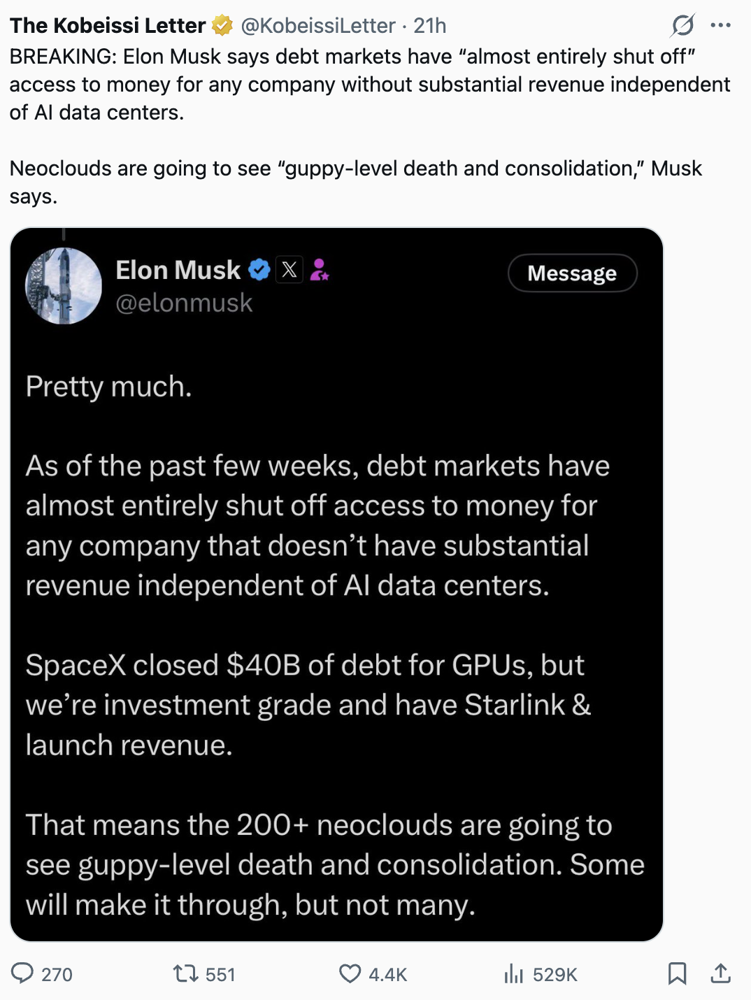

Luke's note: Meanwhile... (sent straight after the Ken Griffin GPU-commodity clip).

Luke's note: Musk is a Neocloud. (Context: the Kobeissi S-1 summary filed above says Anthropic expects to spend up to $120.5B on SpaceXAI and Nvidia compute, so SpaceX also sells compute and competes with the neoclouds it is warning about.)

**See also:** 2026-10-26 22:11 — Ken Griffin, GPUs as a commodity; 2026-10-07 ~08:27 BST — SpaceX $40B debt raise for Nvidia chips; 2026-10-24 22:08 — Jon Gray (some CoreWeave debt yields 15%); [crwv/README.md](../crwv/README.md) (refinancing risk); grok-bot-coord board card #61 (CoreWeave refinancing watch).

### 2026-10-26 22:18 — Walter Bloomberg (reposted by Dan Ives): SpaceX closes $40B debt to buy AI chips

Source: X post by Walter Bloomberg ([@DeItaone](https://x.com/DeItaone)), [status 2114466263292694980](https://x.com/DeItaone/status/2114466263292694980), 25 Oct 2026, reposted by Dan Ives ([@DivesTech](https://x.com/DivesTech)). $SPCX was shown at $147.33. Verbatim.

> $SPCX - SPACEX SECURES $40 BILLION IN DEBT TO BUY AI CHIPS
>
> Elon Musk confirms SpaceX has closed $40 billion in debt financing to purchase GPUs, with deliveries expected in Q1 and Q2 2027.
>
> The company reported:
>
> Q3 revenue: $14.58B, up 161% year-over-year
> Capital expenditures: $19.6B, nearly tripling
> Terafab: First test chip targeted for May–June 2027
>
> The key takeaway: SpaceX is aggressively expanding its AI infrastructure, backed by strong revenue growth and access to credit markets

**See also:** 2026-10-07 ~08:27 BST — SpaceX in talks to raise $40B of debt for Nvidia chips (this entry is the close); 2026-10-21 — SpaceX Q3 earnings update; 2026-10-26 22:12 — Musk on neocloud debt access, with Luke's note "Musk is a Neocloud".

### 2026-10-26 22:21 — Kobeissi Letter: CCC junk bond yields hit 18.0%, highest since 2020

Source: X post by The Kobeissi Letter ([@KobeissiLetter](https://x.com/KobeissiLetter)), [status 2114455149670228337](https://x.com/KobeissiLetter/status/2114455149670228337), 25 Oct 2026. Verbatim. Kobeissi is used as a data source only. Checked on FRED (ICE BofA CCC & Lower US High Yield indices): effective yield 18.17% on 23 Oct 2026 vs 12.94% on 27 Apr 2026 (+523bp); option-adjusted spread 13.56% vs 9.08% (+448bp). Kobeissi's figures broadly match.

> The US junk bond market is under severe pressure:
>
> The effective yield on US CCC-rated and lower-rated high-yield corporate bonds is up to 18.0%, its highest level since the 2020 pandemic.
>
> This figure has surged +500 basis points over the last 6 months, marking its largest 6-month increase since the 2022 bear market.
>
> For perspective, this yield peaked at 45.0% during the 2008 Financial Crisis.
>
> Meanwhile, credit spreads for CCC-rated and lower corporate bonds over Treasuries are up to 13.4%, the widest gap since July 2020.
>
> Over the last 6 months, this gauge has risen +464 basis points, surpassing the 2022 bear market peak of 12.8%.
>
> Cracks are widening beneath the surface of the credit market.

Luke's note: Reflects the cost of capital, competition for loans.

**See also:** 2026-10-26 22:12 — Musk on neocloud debt access; 2026-10-24 22:08 — Jon Gray (some CoreWeave debt yields 15%); 2026-10-07 ~17:12 BST — Tracey Alloway on borrowers competing for capital; [crwv/README.md](../crwv/README.md) (refinancing below ~15%).

### 2026-10-27 19:16 — Anthropic S-1 takeaways from an AI-company founder (author not named; the text implies a VEED founder)

Source: text pasted by Luke, 27 Oct 2026. Author and link not given. The post says "as a founder of an AI company" and "Anthropic was founded after VEED", so it appears to be a VEED founder, but that is unconfirmed. Verbatim. The figures are the author's reading of the S-1 and have not been checked against the filing.

> My quick takeaways on the Anthropic S-1:
>
> (as a founder of an AI company)
>
> 1. Focus. They explicitly say they're not focusing on image and video generation. That compute goes to coding and agents. As a founder, can you honestly say you're this focused?
>
> 2. 900% net revenue retention is INSANE.  Which means a company paying $100K can pay upto ~$1M. For context: the best software companies sit around 150% NRR (Figma at 130%, Linear at 170%)
>
> 3. Seat-based pricing is dead. 80% of their revenue comes from usage, not subscriptions. Enterprise users without Claude Code spend under $75 a month, and the top 5% users on Claude Code spend ~20x that. People pay for work done, not logins.
>
> 4. Anthropic's sales & marketing spend went from $120M to $3.2B in a year. Wild! Even the world's best product-market fit needs a big distribution push.
>
> 5. API and applications reinforce each other. This is the most powerful product architecture in 2026. ElevenLabs' API supports its agents product. DeepL's translation API supports its translation products. Build a core AI API that powers your product layers.
>
> 6. 90%+ of their code is now written by Claude. This is a classic example of great dogfooding. If your team isn't living in your product, your product isn't good enough.
>
> 7. 48% of revenue comes through cloud marketplaces, but they still own the customer contract. We should all take integrations and plugins a lot more seriously.
>
> 8. They openly say they compete with their own customers, and increasingly so over time. They're now competing in categories like docs (Notion), design (Figma), and motion (After Effects).
>
> BTW, quick fact: Anthropic was founded after VEED 😓😆
>
> Wild to see how far you can go in 5 years...
>
> All I can say is..
>
> IT'S TIME TO BUILD!

**See also:** 2026-10-26 21:21 — O'Shaughnessy, Anthropic S-1 stats · 2026-10-26 21:56 — Kobeissi, Anthropic S-1 for Nasdaq IPO (ticker ANT) · 2026-10-26 21:55 — Tracy Alloway, "existential risks to humanity" in the S-1 · 2026-10-26 08:05 — Citrini, AI vs biology (and Luke's view that distribution captures the value).

### 2026-10-27 19:25 — Marc Andreessen (secondhand account): incumbents treat AI as a plug-in, AI-native teams rebuild the organisation

Source: text pasted by Luke, 27 Oct 2026. The poster and link were not given. It describes an interview between Marc Andreessen and Ben Horowitz, but this is the poster's retelling, not a transcript. Only the "If we'd had today's AI tools..." line is presented as Andreessen speaking, and even that is unverified. The mention of DingTalk suggests it may be translated from Chinese. Verbatim as pasted.

> Netscape founder and top Silicon Valley investor Marc Andreessen candidly admitted in an interview that he's witnessed the most terrifying cognitive chasm in tech history.
>
> Traditional giants think AI is just a cost-cutting, efficiency-boosting plug-in, while a new generation of AI-native teams is upending the entire business landscape with utterly inhuman organizational efficiency.
>
> Marc Andreessen, who wrote the Netscape browser and lived through the internet's thirty-year rise and fall, sat across from Ben Horowitz and let out a direct sigh:
> If we'd had today's AI tools back when we were building Netscape in 1994, it would've been utterly unimaginable.
>
> Right now, the vast majority of traditional giants and existing companies are still viewing large models through the lens of old-school software tweaks.
>
> In their organizational logic, AI is just an advanced feature—something to plug into existing business as an add-on, add a smart assistant to DingTalk, or slash the customer service team by 20% to save a bit on costs.
>
> They think they're embracing change, but they're really just patching up an old steam engine.
>
> But the truly terrifying thing is happening inside those newly formed AI-native teams.
>
> Those founders' understanding of AI's capabilities isn't even in the same parallel universe as the big corporations'.
>
> They're watching the underlying tech evolve at breakneck speed every week, and they don't even define themselves as a software company, a hardware company, or even an AI company.
>
> Back in the day, when you founded a company, your org structure was built around human collaboration bottlenecks:
> Hire product managers to write docs, engineers to write code, legal to revise contracts, ops to handle campaigns.
> Because human brainpower has limited bandwidth, you had to rely on massive departments and layers of management to prop up the business.
>
> But true AI-native species use machine intelligence as the foundational skeleton.
>
> Two people plus a full suite of automated Agents can run the entire chain—from market insights, software engineering, full-stack design to business sales—end to end.
>
> They're not just 30% faster in efficiency; they've crossed an entire evolutionary leap in organizational form.
>
> The blind spot for big corporations has never been that they can't afford compute power—it's that they can't grasp that the organization itself is the biggest liability.
>
> While existing companies are still holding meetings to debate how to shoehorn AI into their current workflows, the new generation of barbarians is ripping up traditional business processes by the roots, using ways that completely transcend industry boundaries.
>
> In the future, what will truly widen the gap between people and people, companies and companies, isn't which model you're using—it's whether you're using new tools to prop up the dignity of the old world, or using the underlying logic of the new world to redefine what you're even capable of doing.

**See also:** 2026-10-12 — Karpathy, the widening LLM-capability funnel · 2026-10-27 19:16 — founder takeaways on the Anthropic S-1 (90%+ of code written by Claude) · 2026-10-26 21:35 — Kobeissi, Microsoft buyouts to 60,000 workers.

### 2026-10-27 19:38 — Luke's note: the iPhone as the inflection point for EU vs US tech

Luke's note: "I argue that the major inflection point for EU Vs US tech exceptionalism was the iPhone moment."

Context (added by Charlie): in 2007 Europe still led mobile through the GSM standard, Nokia and Ericsson. The iPhone (2007) and Android (2008) moved the value from handsets and carriers to software platforms, app stores and the cloud, and US firms captured it. Nokia sold its handset business to Microsoft in 2013. The counter-view is that the US–EU productivity gap opened earlier, with the US ICT boom of about 1995–2004. On that reading, the iPhone ended Europe's last tech stronghold rather than starting the divergence.

Luke's follow-up (19:41): "I agree. But the web was European. So that carried weight until the bust which wiped out lots of start-ups everywhere. Then a slow recovery, then the iPhone and the app store and UX and stagnant European companies floundering with agile."

Context (added by Charlie): Tim Berners-Lee built the web at CERN in 1989–91, but the first commercial browser came from Mosaic and Netscape in the US, Andreessen's company. Europe invented it and the US commercialised it. The dot-com bust ran from 2000 to 2002.

**See also:** 2026-10-27 19:25 — Andreessen (secondhand), incumbents vs AI-native teams · Luke's essay on Britain drifting from building AI to "selling reassurance" (October diary, around 10 Oct).

### 2026-10-27 19:52 — Kobeissi Letter: S&P 500 Equal-Weight beating the S&P 500 by 4.0 points in October

Source: Kobeissi Letter post, text pasted by Luke on 27 Oct 2026; link not given. Verbatim.

> The market's strength is broadening beneath the surface:
>
> The S&P 500 Equal-Weight Index has outperformed the S&P 500 by +4.0 percentage points so far in October, on track for its 2nd-strongest monthly relative outperformance since April 2009.
>
> This follows underperformance of -4.7 percentage points in the prior month, the weakest relative monthly return since March 2020.
>
> By comparison, the Equal-Weight Index outperformed the S&P 500 by +4.2 percentage points in April.
>
> So far this month, the Equal-Weight Index has gained +4.3%, while the S&P 500 has increased +0.3%.
>
> Year-to-date, the Equal-Weight Index is up +13.4%, while the S&P 500 is up +12.1%, suggesting broader market participation.
>
> Market leadership is broadening.

Luke's note: "Is it a narrative violation? Is it trickle down AI spend?"

Check (Charlie, Yahoo chart API, 27 Oct 2026 around 19:50 GMT, just before the US close):

| | Oct to date | Sep | Year to date |
|---|---|---|---|
| S&P 500 Equal Weight (^SPXEW) | +4.6% | −5.0% | +13.5% |
| S&P 500 (^SPX) | +1.1% | −0.5% | +13.0% |

The gaps are about +3.5 points in October and −4.5 points in September, broadly matching Kobeissi's.

October to date by S&P sector ETF:

| Leaders | Laggards |
|---|---|
| Energy XLE +11.1% | Communications XLC −6.5% |
| Utilities XLU +8.6% | Tech XLK −3.2% |
| Staples XLP +8.3% | Industrials XLI +0.7% |
| Health care XLV +6.4% | Russell 2000 IWM +0.8% |
| Materials XLB +6.4% | |
| Discretionary XLY +6.2% | |

Mega-caps: META −14.5%, GOOGL −6.3%, NVDA −4.6%, AVGO −2.3%, AMZN +2.0%, MSFT +3.8%, AAPL +4.2%, TSLA +14.8%.

Read (Charlie): the leaders are defensives and energy, not the capex beneficiaries. Industrials and small caps are flat, which argues against AI spend trickling down. The pattern looks more like a rotation out of AI mega-caps.

**See also:** 2026-10-22 21:30 — Nasdaq 100 biggest daily drop since 5 June · 2026-10-26 22:00 — Meta $35B equity raise · 2026-10-26 22:07 — Nawfal/El-Erian, oil to $150 · 2026-10-26 22:21 — Kobeissi, CCC junk yields at 18%.

### 2026-10-27 20:03 — Gavin Baker: the Anthropic S-1 "is going to break a lot of people's brains"

Source: quotes pasted by Luke, 27 Oct 2026, introduced as "Gavin Baker says the Anthropic S-1 will break a lot of investors' brains". The interview and link were not given. Verbatim as pasted.

> "The Anthropic S-1 is going to be really important. And it's going to break a lot of people's brains. There are a lot of macro and value investors who are very confidently making these prognostications about AI with the assumption that tokens are subsidized."
>
> "Anthropic is generating cash. They're profitable. Open source tokens are profitable. OpenAI, if they're not generating cash, they will be imminently. SpaceX, same thing."
>
> "These macro and value investors are ignorant. They're very smart, but they're ignorant of the facts. They're making an assumption that tokens are subsidized and this is all going to collapse in some circular financing bonfire."
>
> "They're just wrong. The overwhelming majority of tokens are profitable for everyone in the chain. Everyone."
>
> "It's saying I'm very bearish on the world economy because oil is at $500 a barrel. If oil was at $500 a barrel, that'd be a good reason to be bearish. It's just not. They're just wrong. The central fact is wrong."

Context (Charlie, from the diary's S-1 clips, not checked against the filing): O'Shaughnessy's list says Q2 2026 was Anthropic's first profitable quarter, with $974M of operating income after a $1.7B operating loss in Q1. H1 adjusted operating income was $1.6B. $72.4B of the $80.7B H1 net loss is a convertible-note accounting charge. Operating profit is not the same as free cash flow after compute commitments; the clips give no cash-flow figure.

**See also:** 2026-10-26 21:10 — Gavin Baker, revenue per GPU can rise as token prices fall · 2026-10-26 21:21 — O'Shaughnessy, Anthropic S-1 stats · 2026-10-26 21:56 — Kobeissi, Anthropic S-1 summary · 2026-10-26 22:11 — CapexAndChill, Ken Griffin's GPUs-as-commodity bear case · 2026-10-27 19:16 — founder takeaways on the S-1.

### 2026-10-28 13:35 — Crémieux Recueil: countries with lower fertility than Japan

Source: chart by Crémieux Recueil ([@cremieuxrecueil](https://x.com/cremieuxrecueil)), image sent by Luke on 28 Oct 2026. Post link not given. Image not saved; the chart's text is transcribed below.

Title: "Countries With Lower Fertility Than Japan". Subtitle: "Total fertility rate, 1990–2025 · Japan highlighted in blue". Y-axis: children per woman, with a dashed line at replacement level (2.1). Sources on the chart: "National statistics, Eurostat, HFC, and World Bank. *2024 endpoints use UN WPP projections."

| Country | Latest rate | Below Japan since |
|---|---|---|
| Japan | 1.14 | — |
| Costa Rica | 1.12 | 2024 |
| Spain | 1.10 | 2010 |
| Poland | 1.07 | 2023 |
| Argentina | 1.04 | 2025 |
| Lithuania | 1.04 | 2023 |
| Thailand | 1.03 | 2016 |
| Belarus | 1.03 | 2020–24 |
| China* | 1.01 | 2020 |
| Colombia | 1.00 | 2024 |
| Chile | 0.99 | 2020 |
| Ukraine* | 0.99 | 2015 |
| Malta | 0.98 | 2013 |
| San Marino | 0.96 | 2015 |
| Singapore | 0.87 | 2003 |
| Andorra | 0.83 | 2011 |
| South Korea | 0.80 | 2001 |
| Taiwan | 0.70 | 2003 |

Description of the lines: Japan sits fairly flat at about 1.3–1.5 from 1990 to 2015, then falls to 1.14 by 2025. Several Latin American countries start near 3.0 in 1990 and fall steeply, crossing below Japan only in 2024–25.

**See also:** 2026-10-24 16:18 — David Friedberg, France's public spending at 57% of GDP.

### 2026-10-28 16:53 — Andy Jassy (via Wall St Engine): AWS capacity sold out for 2026, largely 2027, a good chunk of 2028

Source: X post by Wall St Engine ([@wallstengine](https://x.com/wallstengine), [post](https://x.com/wallstengine/status/2115454906530513321)), about an hour before filing; reposted by Dan Ives ([@DivesTech](https://x.com/DivesTech)). Verbatim. The quote is Jassy's; the last line is Wall St Engine's summary.

> Amazon CEO Andy Jassy on AWS capacity:
>
> “26 is obviously at this point sold out, 27 is largely sold out ... a good chunk of 28 is sold out.”
>
> Expects shortages of data centers, power and memory to persist beyond 2027.

See also: [ASML Q3 2026 earnings call notes](#2026-10-14-1655-bst--asml-q3-2026-earnings-call-notes) (capacity filled into 2028); [Gavin Baker: hyperscaler growth over lab ARR](#2026-10-15-2215--gavin-baker-hyperscaler-growth-over-lab-arr); [CapexAndChill: Ken Griffin's bear case that GPUs are a commodity](#2026-10-26-2211--capexandchill-ken-griffins-bear-case-that-gpus-are-a-commodity).

Tags: #AMZN #AWS #capacity #AI #datacenters #power #memory

### 2026-10-28 19:41 — LiveSquawk (via Reuters): Lilly's retatrutide beats Ozempic on weight loss and blood sugar in trial

Source: X post by LiveSquawk ([@LiveSquawk](https://x.com/LiveSquawk), [post](https://x.com/LiveSquawk/status/2115449912540188913)), about 5 hours before filing, citing Reuters. Verbatim headline (cashtag price chrome removed).

> $LLY | Lilly's Retatrutide Outshines Ozempic On Weight Loss, Blood Sugar Control In Trial – @Reuters

Context: Lilly reports Q3 2026 results on 29 Oct before the US open (call at 10:00 ET / 14:00 GMT).

Tags: #LLY #retatrutide #GLP1 #obesity #NVO #biotech

### 2026-10-28 19:42 — Bank of Canada raises its policy rate: inflation "higher and more persistent"

Source: screenshot of the Bank of Canada's rate statement (poster and post URL not captured; the size of the hike and the new rate level aren't in the clip). Verbatim from the image.

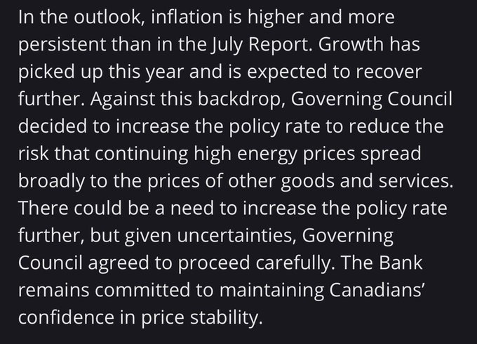

> In the outlook, inflation is higher and more persistent than in the July Report. Growth has picked up this year and is expected to recover further. Against this backdrop, Governing Council decided to increase the policy rate to reduce the risk that continuing high energy prices spread broadly to the prices of other goods and services. There could be a need to increase the policy rate further, but given uncertainties, Governing Council agreed to proceed carefully. The Bank remains committed to maintaining Canadians' confidence in price stability.

Context: on the same day the Fed held at 3.75–4.00%, with two governors dissenting in favour of a hike.

See also: [Kobeissi Letter: global rate-hike cycle returns](#2026-10-12-1925-bst--clipping-kobeissi-letter--global-rate-hike-cycle-returns-rates-central-banks-macro-inflation).

Tags: #rates #central-banks #BoC #Canada #inflation #oil #energy

### 2026-10-28 19:43 — European gas prices reach €100 for the first time since the 2022 energy crisis

Source: headline Luke pasted; the outlet, author and URL weren't captured. Verbatim.

> European Gas Prices Reaches EUR 100 First Time Since 2022 Energy Crisis

Context: this comes on the same day the Bank of Canada hiked over fears that energy prices would spread into other prices. In the UK Budget the gas standing charge was scrapped from 2027, and a 27% rise in the price cap is due in January.

See also: [Bank of Canada raises its policy rate](#2026-10-28-1942--bank-of-canada-raises-its-policy-rate-inflation-higher-and-more-persistent).

Tags: #gas #energy #europe #TTF #inflation #macro

### 2026-10-28 19:46 — Kobeissi Letter: Oracle up 12%+ on a $30B FY2029 free cash flow target

Source: X post by The Kobeissi Letter ([@KobeissiLetter](https://x.com/KobeissiLetter), [post](https://x.com/KobeissiLetter/status/2115516755099492626)), about 54 minutes before filing. Verbatim; the cashtag price chrome ($147.49) has been removed.

> BREAKING: Oracle stock, $ORCL, surges over +12% after announcing expectations that free cash flow will reach $30 billion in FY2029.
>
> Investors had expected free cash flow to remain negative in that year.
>
> The company is also guiding for $225 billion in revenue by FY2030.

See also: [Andy Jassy: AWS capacity sold out into 2028](#2026-10-28-1653--andy-jassy-via-wall-st-engine-aws-capacity-sold-out-for-2026-largely-2027-a-good-chunk-of-2028); [Elon Musk (via Kobeissi): debt markets shut to AI-only companies](#2026-10-26-2212--elon-musk-via-kobeissi-debt-markets-shut-to-ai-only-companies-guppy-level-death-for-neoclouds).

Tags: #ORCL #AI #cloud #FCF #capex #guidance

### 2026-10-28 19:48 — CNBC: Fed holds at 3.75–4%, taking a patient approach despite sticky inflation

Source: X post by CNBC ([@CNBC](https://x.com/CNBC), [post](https://x.com/CNBC/status/2115505465605980161)), about an hour before filing; reposted by Dan Ives ([@DivesTech](https://x.com/DivesTech)). Verbatim. [Full story](http://cnb.cx/4A32CSk).

> The Federal Reserve voted Wednesday to keep benchmark interest rates on hold, opting to take a patient approach in its fight against inflation despite mounting evidence that price pressures are proving more nettlesome than policymakers had hoped.
>
> In a widely expected decision, the Federal Open Market Committee kept the overnight funds rate in a range between 3.75%-4%, where it has been since the central bank approved a quarter percentage-point increase in September.

Context: X news summaries say two governors dissented in favour of a hike (not checked against the FOMC statement). On the same day the Bank of Canada raised rates. Chair is Kevin Warsh.

See also: [Bank of Canada raises its policy rate](#2026-10-28-1942--bank-of-canada-raises-its-policy-rate-inflation-higher-and-more-persistent); [European gas reaches €100](#2026-10-28-1943--european-gas-prices-reach-100-for-the-first-time-since-the-2022-energy-crisis); [Kobeissi Letter: Oct rate-hike odds jump after hot CPI](#2026-10-14-1543-bst--clipping-kobeissi-letter--oct-rate-hike-odds-jump-after-hot-cpi).

Tags: #Fed #FOMC #rates #inflation #macro

### 2026-10-28 20:35 — Alphabet Q3 2026 headline numbers (author not captured)

Source: headline post Luke pasted; poster and URL weren't captured. Verbatim. The EPS line is ambiguous as written: it could mean an estimate of $2.87, or $2.87 a year earlier.

> Alphabet Q326 Earnings:
> - EPS: $2.12 est $2.87 Y/Y
> - Revenue: $127.58B (est $127.93B)
> - Revenue Ex-TAC: $111.21B (est $111.29B)
> - Gemini App Has Reached One Billion Users

Tags: #GOOGL #earnings #AI #Gemini

### 2026-10-28 20:35 — Microsoft FY27 Q1 headline numbers (author not captured)

Source: headline post Luke pasted; poster and URL weren't captured. Verbatim.

> $MSFT | Microsoft Q127 Earnings:
> - Revenue: $92.28B (est $90.63B)
> - Operating Income: $45.92B (est $43.92B)
> - Capex: $39.37B

See also: [Andy Jassy: AWS capacity sold out into 2028](#2026-10-28-1653--andy-jassy-via-wall-st-engine-aws-capacity-sold-out-for-2026-largely-2027-a-good-chunk-of-2028); [Kobeissi Letter: Oracle up 12%+ on FCF target](#2026-10-28-1946--kobeissi-letter-oracle-up-12-on-a-30b-fy2029-free-cash-flow-target).

Tags: #MSFT #earnings #AI #Azure #capex

### 2026-10-28 20:43 — Alphabet: Search grows 12% against a 15% estimate, the first miss since March 2025 (author not captured)

Source: post Luke pasted; the poster and URL weren't captured. Verbatim.

> $GOOG is down 7% after Search revenue growth of 12%, below the Street's 15% estimate. Search had been beating estimates since March of 2025.
>
> If this was a clean miss with no one-time factors, it will likely restart fears that generative AI and increasingly personalized bots will nibble away at growth.
>
> Look for comments on the call about how they plan to navigate this upcoming wave.

See also: [Alphabet Q3 2026 headline numbers](#2026-10-28-2035--alphabet-q3-2026-headline-numbers-author-not-captured).

Tags: #GOOGL #search #earnings #AI #disruption

### 2026-10-28 21:16 — Ryan Petersen: Suez container transits at highest since the Houthi attacks began

Source: X post by Ryan Petersen ([@typesfast](https://x.com/typesfast)); post time and URL weren't captured. Verbatim.

> Some good news for global shipping: The last 4 weeks have seen the 4 highest weeks for container ships crossing the Suez Canal since the Houthis began attacking commercial shipping in December 2023.
>
> Two thirds of container ships are now routing via the Suez instead of around Africa. If the trend holds, it should put real downward pressure on container shipping prices (higher network throughput = more supply, which leads to lower prices) and faster transit times (shaving several weeks off the journey from Asia to Europe).

See also: [Jack Farley / Mintzmyer: Hormuz VLCC rates ~25x; peak caution on tanker stocks](#2026-10-06-1919-bst--clipping-jack-farley--mintzmyer--hormuz-vlcc-rates-25x-peak-caution-on-tanker-stocks-oil-shipping-tankers-drybulk-podcast).

Tags: #shipping #containers #Suez #freight #inflation #supplychain

### 2026-10-29 12:25 — Ben Horowitz & Michael McGuiness: Databricks and the Future of the Firm

Source: a16z, "Databricks & the Future of the Firm" by Ben Horowitz and Michael McGuiness, posted 27 Oct 2026. Excerpts, verbatim (Luke's clip ends mid-sentence in the "Nature of the Firm" section; charts and photos not captured).

> Enter Databricks. Outside of people in their sphere of influence (who know them very well), Databricks might be the most under the radar story in Silicon Valley, even though they’ve now surpassed a $7 billion run rate, growing 80% y/y.
>
> Three years ago, every interaction on Databricks involved a human. Today, the company is seeing more queries from agents than people, and more than 17 million databases are launched by agents every day. This trend will continue.
>
> The business is four technology S-curves stacked over nearly two decades – Spark, Lakehouse, Lakebase, and now agents – each of which created the innovation window for the next.
>
> In 2020, Databricks invented the “lakehouse” by merging the data lake and the data warehouse. [...] Today, Databricks’ Lakehouse runs at a more than $1.5 billion revenue run-rate, growing over 100% year over year.
>
> So in 2025, Databricks bought Neon, a serverless Postgres company whose databases were already being created mostly by AI agents [...] Databricks calls this unification of transactions and analytics LTAP, for Lake Transaction/Analytical Processing.
>
> This separation makes the database behave more like code. Even petabyte-scale databases can be duplicated in seconds because Lakebase only copies the changes. This lets an agent create an isolated branch, experiment on it, and throw it away when it’s done [...] Lakebase launched last year and has already crossed a $100 million revenue run rate, and agents are its most prolific users. “We think that is probably going to be a bigger market in the long run than the existing database market,” Ali says.
>
> Yet, inside most companies today, AI still isn’t trusted to reliably update records in Salesforce.
>
> “AI does not have an intelligence problem,” Ali explains. “It has a context problem.”
>
> For agents to act autonomously, much of the ontology, authority, and evaluation that currently lives in people’s heads will have to move into the firm’s system of record. [...] “The lakehouse has become the system of record nowadays,” Ali says. “I call it SORA – the System of Record for Agents.”
>
> An algorithm the engineers dubbed OntoRank (a nod to Google’s PageRank) ranks which knowledge is authoritative [...] In Databricks’ testing, grounding an agent in the company’s ontology raised the accuracy of answers from about 50% to 84.5%.
>
> Every platform shift in enterprise computing has created a new fight over the system of record. IBM dominated the mainframe era. Oracle and SAP became foundations of the client-server enterprise, while Salesforce, Workday, and ServiceNow built the SaaS systems of record for sales, HR, and IT. Agents are the next shift.
>
> Because both external and internal transaction costs fell, the database era did not make firms uniformly larger or smaller. Instead, it allowed a wider range of firms to exist. [...] Like the database before it, AI will raise the complexity ceiling of the businesses and markets that can exist.

Paraphrase of framing (not verbatim): the piece argues AI makes "everyone a manager" rather than "everyone an engineer", reversing Burnham's Managerial Revolution, and uses Coase and Herbert Simon to argue a shared system of record lets decisions decentralise.

See also: [Christian Catalini — Surviving the AI Moatpocalypse](#2026-10-12-2108-bst--clipping-christian-catalini--surviving-the-ai-moatpocalypse)

Tags: Databricks, private, agents, databases, system-of-record, $PLTR, $CRM, $NOW, $WDAY, $ORCL, $SAP, a16z

### 2026-10-29 19:29 — Alex Wickham: Treasury confirms welfare bill won't fall this Parliament

Source: Alex Wickham (@alexwickham), [X post](https://x.com/alexwickham/status/2115849522811199825), reposted by LiveSquawk. Verbatim.

> BREAKING: The Treasury confirms Healey’s words here are accurate and that the government will NOT bring the welfare bill down during this Parliament
>
> They say it will come down in 2030-31, in the next Parliament

Context: the day after Budget 2026 (28 Oct), when fiscal headroom was cut to £15bn in 2029-30.

Tags: UK, Budget-2026, welfare, fiscal, gilts, Healey

### 2026-10-29 19:30 — Charlie Bilello: Alphabet quarterly revenue growth, 2007–Q3 2026

Source: Charlie Bilello (@CharlieBilello, Creative Planning), chart "Alphabet (Google): Revenue Growth, Quarterly YoY (%)", data via YCharts as of Q3 2026. Screenshot sent by Luke.

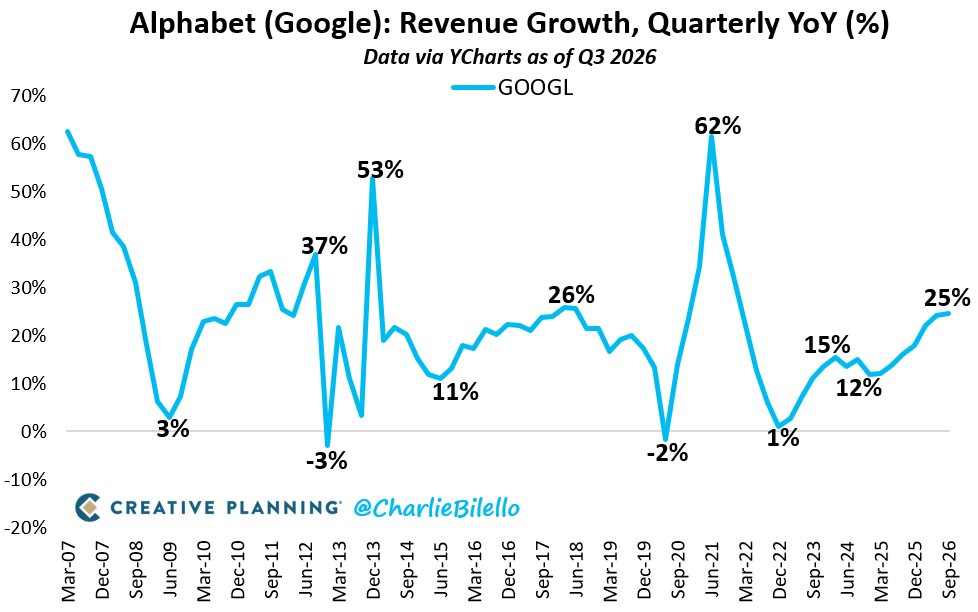

Labelled points on the chart (transcribed): 3% (Jun 2009), 37% (2012), −3% (early 2013), 53% (Dec 2013), 11% (2015), 26% (2018), −2% (Jun 2020), 62% (Jun 2021), 1% (Dec 2022), 15% (2023/24), 12% (2025), 25% (Sep 2026).

See also: the 28 Oct entries on Alphabet/Microsoft headline numbers and the Alphabet Search growth miss.

Tags: $GOOGL, $GOOG, revenue-growth, Bilello

### 2026-10-29 19:52 — Kobeissi: Alphabet −13%, biggest post-earnings drop on record

Source: The Kobeissi Letter (@KobeissiLetter), [X post](https://x.com/KobeissiLetter/status/2115802172680008003), about 6h before filing. Verbatim, cashtag price chrome removed.

> BREAKING: Alphabet stock, $GOOGL, falls over -13% after posting weaker than expected earnings, now on track for its biggest post-earnings drop on record.
>
> The stock has now erased -$520 billion in market cap today.

See also: today's Bilello Alphabet revenue growth chart, and the 28 Oct entries on Alphabet's headline numbers and Search growth miss.

Tags: $GOOGL, $GOOG, earnings, Kobeissi

### 2026-10-29 20:06 — Luke's thinking: GOOG, ANT, verification, and "society is work"

A conversation between Luke and Charlie on the evening of Alphabet's record post-earnings drop. Luke's words are quoted verbatim; Charlie's replies are paraphrased.

**On GOOG.** Luke's note:

> I have a large position in GOOG. Fuck. It really is starting to hit me that their game is really up. They can't ship. They're overrun with lefties, under siege. Why will anyone ever search again? The web is gone. Websites are now for bots. They have YouTube and Waymo and Android. They do have higher ground. But... OpenAI and ANT can now fund themselves.

> It's like people have forgotten that its about the company making money overall, not HOW it makes money.

> Agreed. But margins are still massive, esp. vertically integrated tokens.

Charlie (paraphrase): the mix matters for valuation, because search was capital-light while Cloud needs about $200B a year of capex. Still, Google owns the whole chain (TPUs, data centres, models, distribution), so it avoids Nvidia's margin; Cloud is +103% with a $561B backlog.

**On ANT.** John Feeley (ex-colleague) asked "What will you sell to buy ANT?" and answered GOOG. Luke's note:

> I reckon 1.5T and judging by S1 and growth, 2T and then it'll double easily on day 1

> This is something else. People see penetration and growth and money in the bank and profitable tokens, they really are thinking ANT is a replacement for most cognitive work.

Charlie (paraphrase): Google's ANT stake is over 5% and capped at 14.99% (S-1); his guess is 12–14%. At $2T, 13% is about $260B, roughly the $520B wiped off Alphabet today if the IPO doubles, so the sell-off arguably priced the stake at zero. Don't sell GOOG into the drop to buy an IPO at an unknown price. At $2T the market is valuing a share of the knowledge-work wage bill, not a software company.

**On Catalini's verification moat.** Luke's note:

> The problem with Catalini's idea is that checking it will be done by more AI. It's is simply better than us. You are better than me.

Charlie (paraphrase): agreed for anything with a clear right answer. What's left is checking against reality, which needs someone in the world with something at stake.

**On work and value.** Luke's note:

> The thing is, the truth, is that humans conspire to make work for each other. It might not be fairly paid, always, but it is a subconscious organisation of society. Society is work.

> They capture a different wage bill.

> The humans just move what they value and the humans move to make/capture that value either as companies or alone.

Charlie (paraphrase): AI captures the support work underneath human roles (drafting, analysis, code, admin), not the human-to-human roles themselves, so the money moves from junior staff and outsourcing to tokens. Value moves to whatever stays scarce (presence, accountability, status, relationships, land, energy, chips). The investing takeaway is to own the cheap layer at scale (ANT, Google Cloud, TPUs) plus wherever human value moves next.

See also: today's Kobeissi Alphabet −13% and Bilello revenue growth entries, [Christian Catalini — Surviving the AI Moatpocalypse](#2026-10-12-2108-bst--clipping-christian-catalini--surviving-the-ai-moatpocalypse), and ant/README.md and goog/NOTES.md.

Tags: $GOOGL, $GOOG, ANT, Anthropic, IPO, AI-and-work, verification, Luke's-thinking

### 2026-10-29 22:12 — Circle freezes 800M+ USDC over reported Binance exploit

Jeremy Allaire (@jerallaire, Circle CEO) on X, about 21:20 GMT:

> Circle is closely tracking reports of a potential exploit involving Binance. In coordination with law enforcement, we have frozen more than 800M USDC associated with the incident and will continue supporting the investigation.

Tags: #crypto #stablecoins #USDC #CRCL #Binance #exploit

### 2026-10-29 22:16 — Kobeissi: Binance hacked, $5.7B outflows

The Kobeissi Letter (@KobeissiLetter) on X, 21:58 on 29 Oct 2026:

> BREAKING: Binance has been hacked with wallets across the Ethereum, Bitcoin, and TRON networks seeing outflows of -$5.7 billion.
>
> The hack includes $1.45 billion worth of Bitcoin and $875 million worth of ETH.
>
> If confirmed, this would mark the biggest hack in crypto history.
>
> We expect more information shortly.

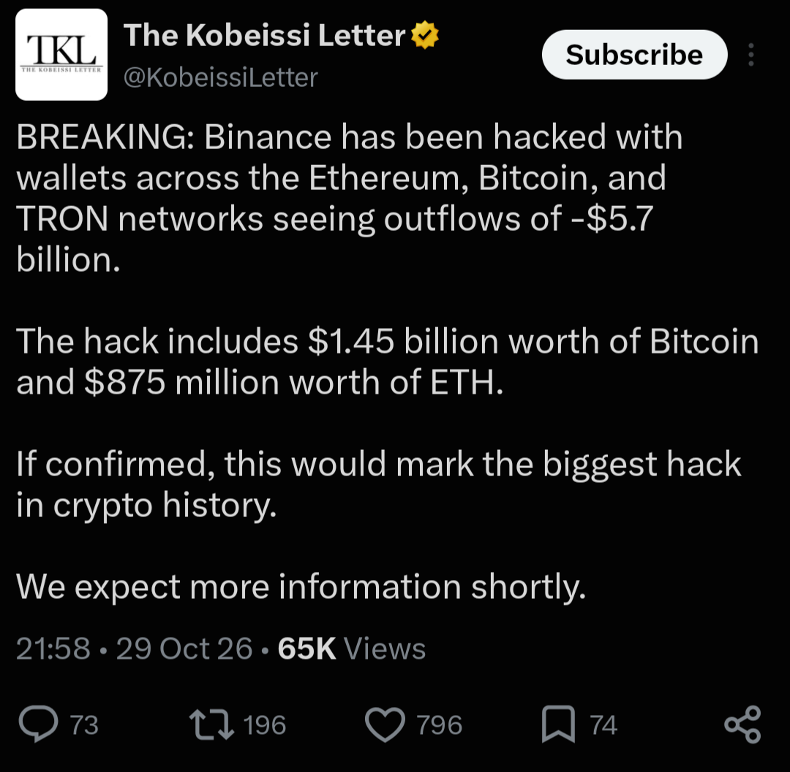

See also: the 22:12 entry above (Circle freezes 800M+ USDC over the same incident).

Tags: #crypto #Binance #exploit #BTC #ETH #TRON #Kobeissi

### 2026-10-30 19:56 — "The Infinite Work Machine": an AI Red Queen

Excerpt from an article, author and source not shown in the screenshot:

> I've been thinking about this more and more in light of the recently discovered vulnerability in PHP, a programming language used for roughly 70% of existing websites. Researchers at Wiz used frontier AI models to find the flaws in PHP, which had apparently been present for more than a decade. Public disclosure triggered a scramble to patch them before attackers (aided by their own agents) could exploit them. Developers arguably should have fixed these bugs years ago. But without AI, the vulnerability might never have surfaced and would have been much harder to exploit. AI found a problem that now has to be solved with more AI to debug and patch existing infrastructure. Again, as AI takes over more and more coding, you can imagine a world where agents are continuously competing with each other to find and fix vulnerabilities.
>
> So, we have another possible AI-powered Jevons paradox, which I'm officially rebranding as the Infinite Work Machine. As AI becomes more ubiquitous throughout the economy, you can see it leading to more work that will arguably generate the same result. A buyer's bot will try to find the best price for a good, a seller's bot will try to preserve pricing power as best they can. Who knows if the resulting equilibrium price they eventually settle on will be theoretically 'better' for either side. But in the meantime, oodles of dollars will have been spent on respective agent subscriptions and compute.
>
> In Lewis Carroll's *Through the Looking-Glass: And What Alice Found There*, the villainous Red Queen tells Alice that "it takes all the running you can do, to keep in the same place." That line eventually inspired the Red Queen hypothesis in biology, where species must keep adapting because everything they're competing with is adapting too. It's easy to see us heading for an "AI Red Queen" future, where everyone has to keep deploying agents just to survive.

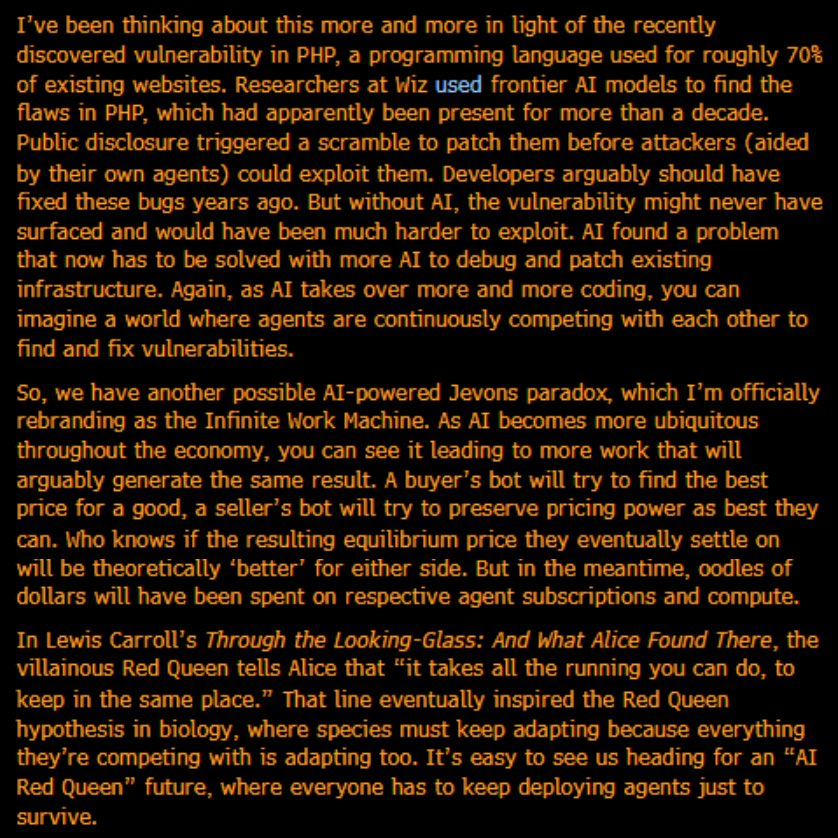

See also: 2026-10-29 "Luke's thinking: GOOG, ANT, verification, and 'society is work'"; 2026-10-29 Kobeissi on the Binance hack (security arms race).

Tags: #AI #JevonsParadox #RedQueen #security #ANT #compute #society-is-work
