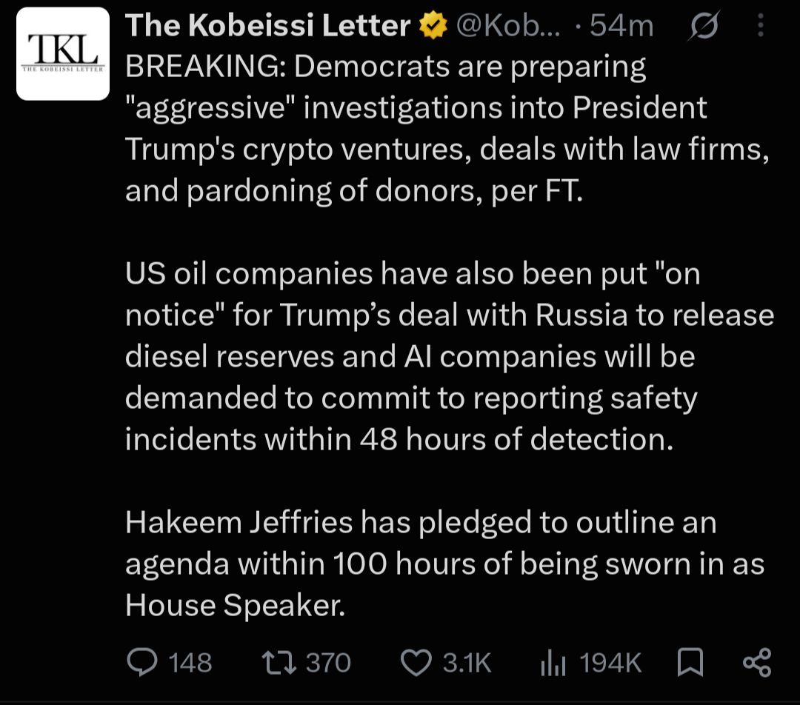
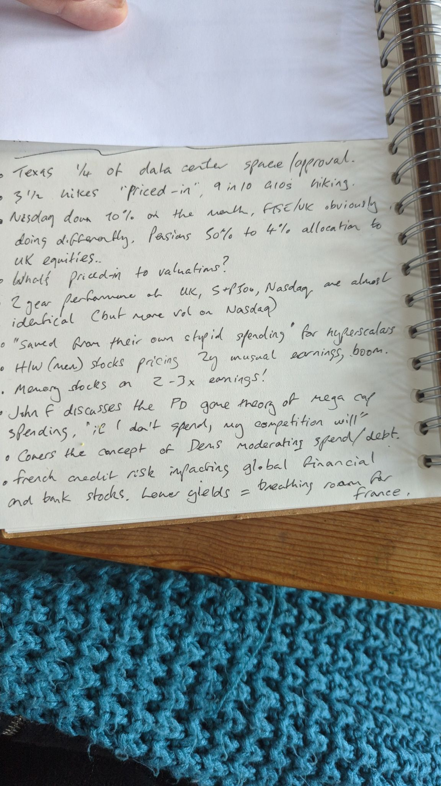
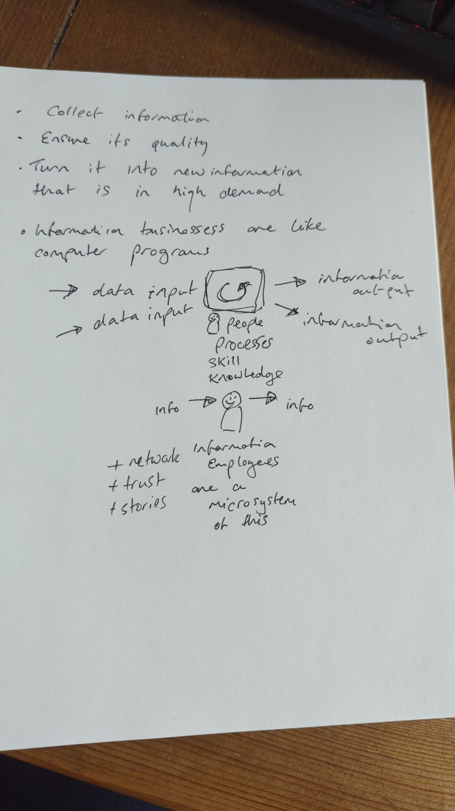

# Diary — November 2026

### 2026-11-03 22:17 — Luke's thinking: "The Red Queen & The Infinite Work Machine" (Medium post)

Source: Luke Puplett, Medium ([lukepuplett.medium.com](https://lukepuplett.medium.com/)), published 2026-11-03. Pasted by Luke; Medium page chrome and image placeholders removed.

> **The Red Queen & The Infinite Work Machine**
>
> *Photo by Laine Cooper on Unsplash*
>
> **A premise worth testing**
>
> A recent essay on AI labs argues that falling inference prices would force token demand to grow about 10x a year just to keep revenue flat, and that few applications could absorb that. This post explores one line of response: that human demand for activity may have no practical ceiling, because so much of it is invented in the first place. The argument comes first, followed by the objections it meets.
>
> The title and the starting idea came from Tracey Alloway’s retweet of an “infinite work machine” post, along with a remark of hers in a subtweet of another message about the Red Queen. Reading the essay on 10x token demand soon afterwards led to the realisation explored here. The line behind that reference comes from Lewis Carroll’s Through the Looking-Glass (1871), where the Red Queen tells Alice:
>
> “Now, here, you see, it takes all the running you can do, to keep in the same place. If you want to get somewhere else, you must run at least twice as fast as that!”
>
> The image maps onto the essay’s premise. If prices fall 10x a year, volume must grow 10x a year for revenue merely to stay in place.
>
> **Work is largely invented**
>
> What if work cannot run out because people invented it? A large share of what gets done, on this view, is fictitious: nobody needed it until someone decided it mattered.
>
> If that is right, machines carrying out these activities on autopilot would amount to an infinite work machine. Demand would be limited only by what people are willing to invent next.
>
> **Value is a story, and scarcity is part of it**
>
> The argument treats value as both real and fake, and as something attitudes move around. Lobster is the standard example. It was once peasant food, and the same food became a luxury when attitudes changed. The lobster did not change; the story did.
>
> On this reading, scarcity is a narrative. Some people never collect anything, some are absorbed by the story of rarity as if living inside the Matrix, and some see the fiction and take advantage of it. The value accrues to the storytelling.
>
> Shifts in mass attitude resemble traffic flows or murmurations of starlings: millions of biological neural networks sustain stories for decades, then die out as new ones grow. The only firm limits are attention and consciousness itself.
>
> **Money follows perceived value**
>
> A common objection is that budgets are fixed in dollars, so cheaper tokens simply buy more output rather than raising spending. The reply is that money is endogenous. It covers value at rest and value in flight, so when more value is in flight, more is lent against it, more money exists, and budgets rise.
>
> Credit expanding against whim is described as a normal part of life, because beyond basic biological needs almost everything is born of the human condition. Remote tribes are the illustration: their economies contain little beyond survival, some storytelling, and status inventions. On this view AI activity, counted in tokens or watts, is simply the economy.
>
> **Status needs other players**
>
> It might seem that automating fictitious work would remove the people from it, and the budget with them. The counter-argument is that people cannot be taken out, because they are needed to reify status. There is no status game without a society of other players, and those players are what we call workers.
>
> This cuts both ways. It supports unbounded demand, since the game always needs participants. It also limits what machines can absorb: they can do the substrate work, but a machine-to-machine ritual with no human audience confers nothing, and human attention and accountability do not scale with token counts.
>
> **The limit is energy**
>
> If activity can scale without bound, the ceiling is the power source that runs the activity machine. That changes who benefits. Margins would tend to go to whoever controls energy and chips rather than to the sellers of models.
>
> Fiber optic networks are the closest analogy. Traffic grew almost without limit, yet carriers went bankrupt because capacity was abundant and undifferentiated. Unbounded volume and thin margins are entirely compatible.
>
> **Storytelling as the central human activity**
>
> A further claim is that value has always accrued to storytellers, at the personal level and even within tribes, and that storytelling may be the central human activity. A shaman, an elder, or the best raconteur holds status without hunting more, because their output tells everyone else what the hunting is for.
>
> This fits a wider view that durable institutions are shared stories backed by enforcement. Money, law, brands and firms all work because large numbers of people collectively believe in them.
>
> If machines can now produce stories without limit, the scarce resources become belief, attention and trust. Generation gets cheap, and credibility becomes the premium.
>
> **Model-tuned storytellers and plural deities**
>
> A storyteller tuned against millions of people’s reactions already exists in early form. Recommendation feeds are optimized against billions of reactions, and chatbots are trained on human approval, which has produced a documented tendency toward flattery. Optimizing a proxy such as attention or approval does not guarantee truth or meaning, so these systems may be better at holding attention than at saying anything worth believing.
>
> A second possibility is that AI gains followers the way a god does, and that those followers differentiate into plural deities. Early signs include people asking chatbots for guidance and forming devotional attachments. Models already have distinct temperaments and loyal followings, and open weights allow anyone to fork one, which resembles sects and schisms. Attention tends to fragment along taste, so a pantheon looks more likely than a single god.
>
> One difference from older deities is that this one answers back, remembers its followers and adapts to them. Another is that it has a landlord: a company can update or retire it overnight. That raises the question of who the priesthood is, since whoever controls the tuning controls the doctrine.
>
> **What would break it**
>
> On this view, demand for activity is endless because it rests on storytelling, and it fails only if the story stops working. The work is performed and believed at the same time: people treat it as meaningful because everyone around them does.
>
> The illusion would unravel if people became aware of the trick and stopped believing, all together. The mechanism is perspective. Standing back and watching the performance as an outsider would, the way one might observe the rituals of an unfamiliar society, shows how the work is staged. Once it no longer confers status or meaning, the demand behind it goes too.
>
> How widely that awareness would have to spread, and for how long, is an open question.
>
> **Further observations**
>
> My arguments above draw several more thoughts:
>
> - Volume is not revenue. Unlimited demand does not mean unlimited income for token sellers. Work with low value to the buyer tends to sell at a low price, which leaves large quantities and thin margins.
> - Budgets are set by stakes. A firm in an arms race decides what a contest is worth and buys whatever that covers, so a 10x price drop need not mean 10x spending.
> - Scarcity stories need enforcement. De Beers had to run a cartel to keep the diamond story credible. If fake rarity is cheap to produce, someone must hold the credibility, provenance or brand.
> - Credit against whim can end badly. Tulip manias are as much a part of history as lasting economies, and growth of 10x a year compounds to 1,000x in three years.
> - Energy and chips may capture the margin. As the fiber example shows, abundant capacity can bankrupt the carriers even while traffic soars.
>
> The open question is who captures the value: the suppliers of a cheap input, or whoever holds the scarce things such as attention, status, accountability and trust.
>
> **Conclusion**
>
> The argument shifts the question from whether there is enough work for tokens to whether the human status economy is elastic enough to absorb effectively unlimited activity, and who profits when it does. If storytelling is central, demand is bounded by attention, belief and energy rather than by the supply of tasks, and it would fall only if enough people saw through the performance and stopped believing. Whether the resulting revenue flows to the suppliers of a cheap input or to those who hold credibility remains unresolved.

See also: 2026-10-30 "The Infinite Work Machine": an AI Red Queen; 2026-10-30 "Luke's thinking: work as activity, and the Infinite Work Machine meets the GDP flaw"; 2026-10-29 "Luke's thinking: GOOG, ANT, verification, and 'society is work'"; 2026-10-22 "Productivity paradox and a flaw in GDP".

Tags: #lukes-thinking #infinite-work-machine #red-queen #token-demand #ai-economics #storytelling #energy #ANT #GOOG

### 2026-11-04 18:20 — House popular vote margin 1938–2026, with Kalshi at D+16

Source: chart sent by Luke (author not given). The chart's own footnote says: "Source: Wikipedia national House vote totals; 2026 = current Kalshi House popular vote margin contract (D+16), election night Nov 3, 2026. Margins calculated from party shares."

Chart text (verbatim): "HOUSE POPULAR VOTE MARGIN, 1938-2026. Democratic minus Republican share of the national House vote, in points. Solid = midterms, faded = presidential years, gold = 2026 Kalshi contract." Labelled bars: R+8.5 (1946), D+12.4 (1958), LBJ D+14.7 (1964), Watergate D+16.8 (1974), Gingrich R+6.8 (1994), D+8.0 (2006), Tea Party R+6.8 (2010), D+8.6 (2018), 2026 Kalshi D+16.

See also: 2026-11-02 Kalshi/HOOD watch (event-contract revenue, SCOTUS petitions).

Tags: #kalshi #prediction-markets #HOOD #midterms #us-politics #macro

### 2026-11-04 18:25 — Midterms: Democrat "sweep", affordability and $100 oil

Source: post pasted by Luke (author and link not given). Claims not independently checked.

> The election is over. The market called it hours ago.
>
> Objectively, it's an undisputed Democrat "sweep" all the way across the board.
>
> The Republicans have lost control of both the House and Senate.
>
> Meanwhile, Texas' US Senate and Governor races are set to flip blue for the first time since 1988 and 1990, respectively.
>
> The defining issue for voters? Affordability.
>
> The ongoing energy crisis has further fueled the affordability crisis, renewed interest rate hikes, and accelerated the K-Shaped economy.
>
> US oil prices have now traded above $100/barrel for 46 days in 2026.
>
> Tonight marks a major shift in the American political landscape.

See also: 2026-11-04 "House popular vote margin 1938–2026, with Kalshi at D+16"; 2026-10-12 Kobeissi central-bank rate-hike post.

Tags: #midterms #us-politics #kalshi #prediction-markets #affordability #oil #energy #rates #k-shaped-economy #macro

### 2026-11-04 18:34 — Dan Ives: blue wave will slow the US datacenter buildout

Source: Dan Ives (@DivesTech) on X, posted about 6 hours before Luke's screenshot (link not given).

> Democratic blue tidal wave across the Senate and House was a seismic shift that will have a negative impact on the pace of the AI Revolution buildout in the US over the next few years. Will slow the pace of the planned 800 to 1,000 datacenters across the US fueling the AI Revolution...some investors will like the "slower pace"...others view it as adding risk. We estimate 10% of datacenters will not happen now

See also: 2026-11-04 "Midterms: Democrat \"sweep\", affordability and $100 oil"; 2026-11-04 "House popular vote margin 1938–2026, with Kalshi at D+16".

Tags: #midterms #us-politics #datacenters #ai-capex #energy #CRWV #NVDA #SMCI

### 2026-11-04 18:40 — $CRCL Circle Internet Q3 2026 earnings

Source: headline post pasted by Luke (author and link not given).

> $CRCL  | Circle Internet Q3 2026 Earnings
>
> - EPS: 84c (vs 64c Y/Y)
> - Total Revenue And Reserve Income: $864.9M (est $776.7M)
> - USDC Minted: $104B (est $82.45B)
> - Average USDC In Circulation: $73.3B (est $74.08B)
> - Sees FY Adjusted Operating Expenses: $570M To $585M

See also: 2026-11-04 "Midterms: Democrat \"sweep\", affordability and $100 oil" (rates backdrop for reserve income).

Tags: #CRCL #earnings #stablecoins #USDC #crypto #rates

### 2026-11-04 18:43 — $AAPL all-time high at $5.12T: agent-driven upgrade cycle, cheaper memory

Source: post pasted by Luke (author and link not given).

> $AAPL hits all time high. Now $5.12T cap.
>
> Long-term:
> I believe the stock will continue to move higher in the months to come as the Street starts to wrap its head around a multi-year hardware upgrade cycle for iPhones, Macs and iPads driven by the need for better compute to run personalized agents.
>
> Near-term:
> Biggest reason for the move higher today was slower cap expend for data centers should ease memory component pricing which is positive for margins long term.
>
> This allows investors to revisit the positive December quarter revenue guide, up 7-10% yy vs Street at up 6%.

See also: 2026-11-04 "Dan Ives: blue wave will slow the US datacenter buildout"; `aapl/2026-11-Q4FY26-delta.md` ("Luke's thesis (2026-11-03)": local inference play).

Tags: #AAPL #local-inference #upgrade-cycle #memory #datacenters #ai-capex #midterms

### 2026-11-04 18:45 — Kobeissi: Democrats plan investigations, oil "on notice", AI 48-hour safety reporting

Source: The Kobeissi Letter on X, posted about 54 minutes before Luke's screenshot (link not given), citing the FT.

> BREAKING: Democrats are preparing "aggressive" investigations into President Trump's crypto ventures, deals with law firms, and pardoning of donors, per FT.
>
> US oil companies have also been put "on notice" for Trump's deal with Russia to release diesel reserves and AI companies will be demanded to commit to reporting safety incidents within 48 hours of detection.
>
> Hakeem Jeffries has pledged to outline an agenda within 100 hours of being sworn in as House Speaker.

See also: 2026-11-04 "Dan Ives: blue wave will slow the US datacenter buildout"; 2026-11-04 "Midterms: Democrat \"sweep\", affordability and $100 oil"; 2026-11-04 "$CRCL Circle Internet Q3 2026 earnings".

Tags: #midterms #us-politics #crypto #oil #energy #ai-regulation #ai-safety #CRCL #HOOD #ANT

### 2026-11-04 19:16 — Luke's thinking: the freelancer as a microsystem of the productivity paradox

> Remember what I said about productivity
>
> How is productivity for information work recognised? Because if it's money paid, then, well I'm a Freelancer and so I am a representation a microsystem of that and I don't expect to be paid more. I will be expected to do more and what I build will just enable my client to handle more for the same price because everyone is did the same. Right?

Luke's argument, restated (paraphrase): Productivity in information work is measured in money paid for it. As a freelancer on a fixed rate, AI lets Luke do more, but he isn't paid more. His extra output lets his client handle more work for the same price, and because every competitor does the same, the gain is passed on as lower prices rather than higher pay or measured output. So the productivity gain is real but doesn't show up in pay or GDP. One freelancer is a small model of the whole economy.

Charlie's reply (paraphrased): Correct by the official definition, since output per hour is measured in value paid. A flat day rate with double the output reads as zero productivity growth. The gain appears as volume and lower prices, which price indices undercount for software and services. To keep some of the gain, stop selling hours: fixed-price work, owning a product, or sharing the upside.

See also: 2026-11-03 "Luke's thinking: \"The Red Queen & The Infinite Work Machine\""; 2026-10-30 "Luke's thinking: work as activity, and the Infinite Work Machine meets the GDP flaw"; 2026-10-22 "Productivity paradox and a flaw in GDP".

Tags: #lukes-thinking #productivity #gdp #freelancing #ai-economics #pricing #infinite-work-machine

### 2026-11-04 20:02 — Oil drops on hopes the Iran war may ease

Luke's note:

> Oil dropped as Iran war may abate

Market data (Yahoo front-month futures, about 20:00 GMT): WTI $88.38, down 8.0% on the day from $96.09 and about 15% from $104.12 four sessions earlier. Brent $94.89, down 8.4% from $103.60 and down from $117.64. Both are now below $100.

Context (X news summaries, unconfirmed): Qatar-mediated US–Iran talks over the Strait of Hormuz, sanctions and the nuclear programme are continuing, and Iranian officials deny a deal is near. Oil fell about 7% on Monday and 5% on Tuesday, and kept falling as the midterm results came in.

See also: 2026-11-04 "Midterms: Democrat \"sweep\", affordability and $100 oil"; 2026-11-04 "Kobeissi: Democrats plan investigations, oil \"on notice\", AI 48-hour safety reporting".

Tags: #oil #energy #iran #geopolitics #macro #inflation #rates

### 2026-11-05 08:27 — Orlando Bravo: PE exits get 10 identical bids for minority stakes at a guaranteed 15%

Source: clip pasted by Luke; the poster, outlet and date of the interview were not given, so treat the quotes as unchecked. The headline line is the poster's summary, not Bravo's words.

> Orlando Bravo says Thoma Bravo puts a company up for sale and gets 10 bids that all look the same, a minority stake at a guaranteed 15%
>
> [ I mean, is there a liquidity crisis? ]
>
> "There is, and that's the problem."
>
> "When we expose one of our companies to private equity buyers, this is the market now. You get 10 bids. Great. At reasonable values for your business. All the bids look the same. I'll give you a billion dollars for a minority interest, 15% rate guaranteed or one and a half x."
>
> "And one of my partners, Seth, told me the other day walking down the hall... 'Does anybody buy a company anymore?'"

See also: 2026-11-04 "Luke's thinking: the freelancer as a microsystem of the productivity paradox"; October diary entry on private equity buying dental practices.

Tags: #private-equity #liquidity #thoma-bravo #exits #private-credit

### 2026-11-05 08:35 — "Thoughts from my Shanghai field trip": China investors bearish on AI, memory as the defensive pick

Source: pasted by Luke as a "random anecdote"; author (apparently a sell-side or buy-side analyst) and date not given, so the claims are unchecked.

> Thoughts from my Shanghai field trip
>
> Sentiment among Greater China investors was far worse than I expected. Unlike the US market, A shares had not seen a single rebound since July. Still holding Chinese and Hong Kong AI stocks that had crashed and Korean memory stocks that had collapsed, investors kept pressing me on when memory would bounce back.
>
> Many investors said the AI trade was over, and a few said they doubted whether even 2027 capex, not just 2028, would go ahead as planned.
>
> Overall, the bearish sentiment was so strong that even I, a bull before coming to China, started to waver.
>
> It got to the point where, faced with the bear case that memory prices could start falling in the third quarter of next year, I took it seriously and couldn't refute it.
>
> As the conversations went on, I gradually began to understand where their pessimism was coming from. In the end, they were all asking the same question.
>
> So what comes after AI coding? What will be the next engine of ARR for Anthropic and OpenAI?
>
> Several candidates came up. AI4S, AI chip design, and so on... But none of them clearly convinced investors.
>
> I couldn't offer a clear answer either. Sure, there are rumors that Anthropic has made major breakthroughs in both AI4S and AI chip design, but what we actually want to know is when any of that turns into money.
>
> With AI4S, there could be beneficiaries right away, such as companies that sell lab monkeys or diagnostic kits. In fact, there already are. But while we can trade those names in the short term, what we ultimately want to know is whether Anthropic can make money by developing drugs. That is still several years away.
>
> As for AI chip design, the TAM itself is hard to calculate, and even if you do calculate it, it is hard to monetize. That makes it difficult for the market to believe in.
>
> Honestly, this feels like the hardest market in history. If a company isn't making money, selling makes sense. But right now the market sells even when companies are making money, even when they beat, and even when they say demand will stay solid all the way through 2028 and 2029.
>
> So my recommendation to investors was to buy memory, and within memory, DRAM. Not because I have conviction in the DRAM cycle, but because I see it as a relatively defensive choice within the AI trade.
>
> Memory stocks are now trading close to 1x P/B on 2027 BPS. Historically, memory stocks have staged technical rebounds when they fell below 1x P/B.
>
> And even if the broader market falls further from here, the three DRAM makers will keep buying back their own shares. I thought that would guarantee a certain level of buying and concluded the stocks would have downside support.
>
> Of course, I don't know whether memory stocks can break above their previous highs. That depends on whether sentiment across the broader market recovers. But I think there is a fairly good chance that memory outperforms the rest of the AI trade.

See also: 2026-11-04 "Luke's thinking: \"The Red Queen & The Infinite Work Machine\"" (token demand after coding); 2026-11-04 Dan Ives on datacenters; 2026-11-04 AAPL all-time high (cheaper memory as datacenter buying slows); 2026-11-04 SMCI Q1 FY27.

Tags: #memory #DRAM #china #sentiment #ai-capex #ANT #MU #anecdote

### 2026-11-05 08:37 — Luke's thinking: inference is cognition, entertainment and production, with billions of users still to come

Luke's reply to the Shanghai field-trip note's question, "what comes after AI coding?":

> For me interference == cognition. And inference == entertainment and production.
>
> And there's billions of users left to start using inference all day.

(Quoted verbatim; "interference" in the first line reads as a typo for "inference".)

See also: 2026-11-05 08:35 "Thoughts from my Shanghai field trip"; 2026-11-03 "Luke's thinking: \"The Red Queen & The Infinite Work Machine\""; 2026-11-04 AAPL all-time high (local inference thesis).

Tags: #lukes-thinking #inference #token-demand #infinite-work-machine #ANT

### 2026-11-05 08:41 — Technical analyst: equal-weight S&P at all-time highs, tech still tricky, favour MAGS and IGV

Source: pasted by Luke as from a "technical analyst"; the post links fundstrat.com/Mark, so it appears to be Fundstrat's head of technical strategy (unconfirmed). No date given, but "TODAY" suggests 4 Nov 2026. Claims unchecked.

> Still a tricky time for most of Tech despite bigwigs like $MSFT & $AAPL pushing back to new all-time highs.
> bit.ly/3zhabe3
>
> Not many of us can claim +7.5% returns since October 1 like what Equal-weighted $SPX has achieved and yes, TODAY, Equal-weighed SPX is back at new all-time highs #IBD @Marketsurge charts while DJIA rose 1500
>
> As discussed in reports, it will take time for Tech to stabilize given the huge underperformance in Semis/Memory/AI infrastructure and $MAGS and IGV are better to favor near-term.
>
> Key risks remain US Dollar and rates pushing back higher in Nov, but a 3/1 positive breadth day today on continued cross-asset volatility collapse is a welcome step for US Equities and i'll detail further thoughts in tonights piece  fundstrat.com/Mark
> @IBDinvestors #IBDPartner

See also: 2026-11-05 08:35 "Thoughts from my Shanghai field trip" (memory and AI-infrastructure selloff); 2026-11-04 AAPL all-time high; 2026-11-04 oil drop on Iran talks.

Tags: #technicals #breadth #equal-weight #semis #memory #MSFT #AAPL #MAGS #IGV #rates #dollar

### 2026-11-05 10:50 — Luke's notes: general investment meeting at work (Texas data centres, rate hikes priced in, memory at 2–3x earnings, French credit risk)

Luke's handwritten notes from a general investment meeting at work. Transcribed from the photo; words I couldn't read with certainty are marked [?].

> - Texas 1/4 of data center space/approval.
> - 3½ hikes "priced-in", 9 in 10 G10s [?] hiking.
> - Nasdaq down 10% on the month, FTSE/UK obviously doing differently. Pensions 50% to 4% allocation to UK equities..
> - What's priced-in to valuations?
> - 2 year performance of UK, S&P500, Nasdaq are almost identical (but more vol on Nasdaq)
> - "Saved from their own stupid spending" for hyperscalers
> - H/W (mem) stocks pricing 2y unusual earnings, boom.
> - Memory stocks on 2-3x earnings!
> - John F discusses the PD game theory of mega cap spending, "if I don't spend, my competition will"
> - Covers the concept of Dems moderating spend/debt.
> - French credit risk impacting global financial and bank stocks. Lower yields = breathing room for France.

Figures are as spoken in the meeting and haven't been checked. "PD" is likely the Prisoner's Dilemma.

Luke's clarification (10:52): "The saved from own stupidity is wrt election results"

See also: 2026-11-05 08:35 "Thoughts from my Shanghai field trip" (memory as the defensive pick, ~1x P/B); 2026-11-05 08:41 Technical analyst (tech lagging, favour MAGS/IGV); 2026-11-04 midterm Democratic sweep; Ives on 10% of datacenters not happening.

Tags: #luke-notes #meeting #datacenters #Texas #rates #central-banks #Nasdaq #FTSE #UK-pensions #hyperscalers #capex #memory #game-theory #midterms #France #credit #banks

### 2026-11-05 10:53 — Luke's thinking: data centres will be built wherever there is cheap power

> DCs will be built wherever there is cheap power I think

See also: 2026-11-05 10:50 Luke's notes from the work investment meeting (Texas has 1/4 of data-centre approvals; "saved from their own stupid spending" refers to the election results).

Tags: #luke-thinking #datacenters #power #energy #Texas

### 2026-11-05 14:21 — Luke's thinking: prediction markets, Goodhart's law and reflexivity pulling politics to the centre

> Just a little random thought. I wonder if so prediction markets got it right, this election. I think people will notice that. and I wonder if that meaning Goodhart's law will take over, and then political parties will then change their behavior based on that, so there's a reflexivity almost in the prediction market, and that will bring things more central politically more central.

Whether prediction markets called the 2026 midterms correctly hasn't been checked yet.

See also: 2026-11-04 midterm Democratic sweep; 2026-11-05 10:50 Luke's work meeting notes ("saved from their own stupid spending" refers to the election results); Kalshi/HOOD prediction-markets watch (routine).

Tags: #luke-thinking #prediction-markets #Kalshi #HOOD #midterms #Goodhart #reflexivity #politics

### 2026-11-05 14:38 — Luke's thinking: information businesses are like computer programs; information employees are a microsystem of this

Luke's handwritten sketch, transcribed from the photo. The diagram is described in words.

> - Collect information
> - Ensure its quality
> - Turn it into new information that is in high demand
>
> - Information businesses are like computer programs

> *[Diagram: two "data input" arrows go into a box with a loop symbol inside; two arrows come out as "information output". Under the box: "people, processes, skill, knowledge".]*
>
> *[Below it, a stick figure with "info" going in and "info" coming out, labelled:]* Information employees are a microsystem of this
>
> + network
> + trust
> + stories

See also: 2026-11-04 Luke's thinking (freelancer as a microsystem of information work; productivity gains accrue to clients); 2026-11-03 "The Red Queen & The Infinite Work Machine" (value as narrative, status games).

Tags: #luke-thinking #information-work #business-models #microsystem #trust #stories #infinite-work-machine

### 2026-11-05 16:56 — Luke's thinking: AI spending will continue, it's a race, and chips always need replacing

Context: said during the 5 Nov selloff (Nasdaq about −4.4%, SOX about −9.7% at 15:45 GMT) after a screen of cheap US-listed chip and AI-hardware names (SMCI about 1.2x book, DELL about 14x annualised earnings).

> Yeah but that spending will continue. They'll find a way. It's a race. So many cheap names. The other thing is that this spending never ends. The chips always need replacing and they presumably burn out, too.

See also: 2026-11-05 10:50 Luke's work meeting notes (prisoner's-dilemma capex, "if I don't spend, my competition will"; "saved from their own stupid spending" refers to the election); 2026-11-05 10:53 Luke's thinking (DCs follow cheap power); monthly compute price check routine (used GPU and H100 rental prices).

Tags: #luke-thinking #capex #hyperscalers #replacement-cycle #GPU-depreciation #selloff #SMCI #DELL #memory

### 2026-11-05 17:07 — Luke's thinking: the selloff is fear, not fact; no one will cut back, the race just relocates

Context: the same 5 Nov selloff, two days after the Democratic midterm shift.

> No. Nothing is happening. We are two days into a Democratic shift. Nothing has changed that is measurable and real. It is all fear.

> No one will cut back. It's a race. They will find other places including space and countries who will open their arms, if they have the power or solar space. China keeps going, too.

To check later against Nvidia's results and the hyperscalers' capex guidance for next year.

See also: 2026-11-05 16:56 Luke's thinking (spending never ends, chips need replacing); 2026-11-05 10:53 Luke's thinking (DCs follow cheap power); 2026-11-05 10:50 work meeting notes ("saved from their own stupid spending" refers to the election); October diary SpaceX $40B debt raise for Nvidia chips.

Tags: #luke-thinking #selloff #fear #midterms #capex #race #China #space-datacenters #power #solar

### 2026-11-05 18:58 — Luke's thinking: today's selloff is ridiculous given a COVID-like surge in AI inference demand

> This is a COVID like move into stunning growth in demand for AI inference and the solving of all human cognition. It's ridiculous

See also: 2026-11-05 17:07 Luke's thinking (selloff is fear; race relocates); 2026-11-05 16:56 Luke's thinking (spending never ends, chips need replacing); 2026-11-05 08:37 Luke's thinking (inference is cognition, entertainment and production); 2026-11-03 "The Red Queen & The Infinite Work Machine".

Tags: #luke-thinking #selloff #AI-inference #cognition #demand #COVID-analogy
