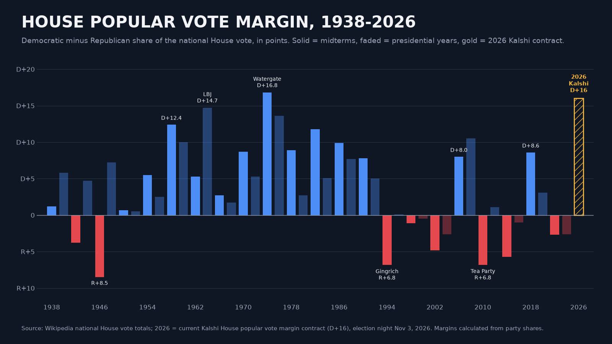
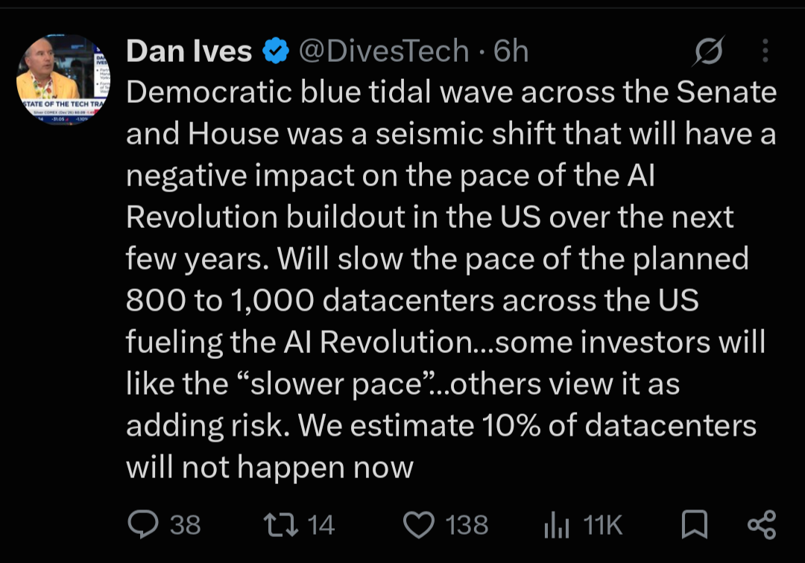

# Diary — November 2026

### 2026-11-03 22:17 — Luke's thinking: "The Red Queen & The Infinite Work Machine" (Medium post)

Source: Luke Puplett, Medium ([lukepuplett.medium.com](https://lukepuplett.medium.com/)), published 2026-11-03. Pasted by Luke; Medium page chrome and image placeholders removed.

> **The Red Queen & The Infinite Work Machine**
>
> *Photo by Laine Cooper on Unsplash*
>
> **A premise worth testing**
>
> A recent essay on AI labs argues that falling inference prices would force token demand to grow about 10x a year just to keep revenue flat, and that few applications could absorb that. This post explores one line of response: that human demand for activity may have no practical ceiling, because so much of it is invented in the first place. The argument comes first, followed by the objections it meets.
>
> The title and the starting idea came from Tracey Alloway’s retweet of an “infinite work machine” post, along with a remark of hers in a subtweet of another message about the Red Queen. Reading the essay on 10x token demand soon afterwards led to the realisation explored here. The line behind that reference comes from Lewis Carroll’s Through the Looking-Glass (1871), where the Red Queen tells Alice:
>
> “Now, here, you see, it takes all the running you can do, to keep in the same place. If you want to get somewhere else, you must run at least twice as fast as that!”
>
> The image maps onto the essay’s premise. If prices fall 10x a year, volume must grow 10x a year for revenue merely to stay in place.
>
> **Work is largely invented**
>
> What if work cannot run out because people invented it? A large share of what gets done, on this view, is fictitious: nobody needed it until someone decided it mattered.
>
> If that is right, machines carrying out these activities on autopilot would amount to an infinite work machine. Demand would be limited only by what people are willing to invent next.
>
> **Value is a story, and scarcity is part of it**
>
> The argument treats value as both real and fake, and as something attitudes move around. Lobster is the standard example. It was once peasant food, and the same food became a luxury when attitudes changed. The lobster did not change; the story did.
>
> On this reading, scarcity is a narrative. Some people never collect anything, some are absorbed by the story of rarity as if living inside the Matrix, and some see the fiction and take advantage of it. The value accrues to the storytelling.
>
> Shifts in mass attitude resemble traffic flows or murmurations of starlings: millions of biological neural networks sustain stories for decades, then die out as new ones grow. The only firm limits are attention and consciousness itself.
>
> **Money follows perceived value**
>
> A common objection is that budgets are fixed in dollars, so cheaper tokens simply buy more output rather than raising spending. The reply is that money is endogenous. It covers value at rest and value in flight, so when more value is in flight, more is lent against it, more money exists, and budgets rise.
>
> Credit expanding against whim is described as a normal part of life, because beyond basic biological needs almost everything is born of the human condition. Remote tribes are the illustration: their economies contain little beyond survival, some storytelling, and status inventions. On this view AI activity, counted in tokens or watts, is simply the economy.
>
> **Status needs other players**
>
> It might seem that automating fictitious work would remove the people from it, and the budget with them. The counter-argument is that people cannot be taken out, because they are needed to reify status. There is no status game without a society of other players, and those players are what we call workers.
>
> This cuts both ways. It supports unbounded demand, since the game always needs participants. It also limits what machines can absorb: they can do the substrate work, but a machine-to-machine ritual with no human audience confers nothing, and human attention and accountability do not scale with token counts.
>
> **The limit is energy**
>
> If activity can scale without bound, the ceiling is the power source that runs the activity machine. That changes who benefits. Margins would tend to go to whoever controls energy and chips rather than to the sellers of models.
>
> Fiber optic networks are the closest analogy. Traffic grew almost without limit, yet carriers went bankrupt because capacity was abundant and undifferentiated. Unbounded volume and thin margins are entirely compatible.
>
> **Storytelling as the central human activity**
>
> A further claim is that value has always accrued to storytellers, at the personal level and even within tribes, and that storytelling may be the central human activity. A shaman, an elder, or the best raconteur holds status without hunting more, because their output tells everyone else what the hunting is for.
>
> This fits a wider view that durable institutions are shared stories backed by enforcement. Money, law, brands and firms all work because large numbers of people collectively believe in them.
>
> If machines can now produce stories without limit, the scarce resources become belief, attention and trust. Generation gets cheap, and credibility becomes the premium.
>
> **Model-tuned storytellers and plural deities**
>
> A storyteller tuned against millions of people’s reactions already exists in early form. Recommendation feeds are optimized against billions of reactions, and chatbots are trained on human approval, which has produced a documented tendency toward flattery. Optimizing a proxy such as attention or approval does not guarantee truth or meaning, so these systems may be better at holding attention than at saying anything worth believing.
>
> A second possibility is that AI gains followers the way a god does, and that those followers differentiate into plural deities. Early signs include people asking chatbots for guidance and forming devotional attachments. Models already have distinct temperaments and loyal followings, and open weights allow anyone to fork one, which resembles sects and schisms. Attention tends to fragment along taste, so a pantheon looks more likely than a single god.
>
> One difference from older deities is that this one answers back, remembers its followers and adapts to them. Another is that it has a landlord: a company can update or retire it overnight. That raises the question of who the priesthood is, since whoever controls the tuning controls the doctrine.
>
> **What would break it**
>
> On this view, demand for activity is endless because it rests on storytelling, and it fails only if the story stops working. The work is performed and believed at the same time: people treat it as meaningful because everyone around them does.
>
> The illusion would unravel if people became aware of the trick and stopped believing, all together. The mechanism is perspective. Standing back and watching the performance as an outsider would, the way one might observe the rituals of an unfamiliar society, shows how the work is staged. Once it no longer confers status or meaning, the demand behind it goes too.
>
> How widely that awareness would have to spread, and for how long, is an open question.
>
> **Further observations**
>
> My arguments above draw several more thoughts:
>
> - Volume is not revenue. Unlimited demand does not mean unlimited income for token sellers. Work with low value to the buyer tends to sell at a low price, which leaves large quantities and thin margins.
> - Budgets are set by stakes. A firm in an arms race decides what a contest is worth and buys whatever that covers, so a 10x price drop need not mean 10x spending.
> - Scarcity stories need enforcement. De Beers had to run a cartel to keep the diamond story credible. If fake rarity is cheap to produce, someone must hold the credibility, provenance or brand.
> - Credit against whim can end badly. Tulip manias are as much a part of history as lasting economies, and growth of 10x a year compounds to 1,000x in three years.
> - Energy and chips may capture the margin. As the fiber example shows, abundant capacity can bankrupt the carriers even while traffic soars.
>
> The open question is who captures the value: the suppliers of a cheap input, or whoever holds the scarce things such as attention, status, accountability and trust.
>
> **Conclusion**
>
> The argument shifts the question from whether there is enough work for tokens to whether the human status economy is elastic enough to absorb effectively unlimited activity, and who profits when it does. If storytelling is central, demand is bounded by attention, belief and energy rather than by the supply of tasks, and it would fall only if enough people saw through the performance and stopped believing. Whether the resulting revenue flows to the suppliers of a cheap input or to those who hold credibility remains unresolved.

See also: 2026-10-30 "The Infinite Work Machine": an AI Red Queen; 2026-10-30 "Luke's thinking: work as activity, and the Infinite Work Machine meets the GDP flaw"; 2026-10-29 "Luke's thinking: GOOG, ANT, verification, and 'society is work'"; 2026-10-22 "Productivity paradox and a flaw in GDP".

Tags: #lukes-thinking #infinite-work-machine #red-queen #token-demand #ai-economics #storytelling #energy #ANT #GOOG

### 2026-11-04 18:20 — House popular vote margin 1938–2026, with Kalshi at D+16

Source: chart sent by Luke (author not given). The chart's own footnote says: "Source: Wikipedia national House vote totals; 2026 = current Kalshi House popular vote margin contract (D+16), election night Nov 3, 2026. Margins calculated from party shares."

Chart text (verbatim): "HOUSE POPULAR VOTE MARGIN, 1938-2026. Democratic minus Republican share of the national House vote, in points. Solid = midterms, faded = presidential years, gold = 2026 Kalshi contract." Labelled bars: R+8.5 (1946), D+12.4 (1958), LBJ D+14.7 (1964), Watergate D+16.8 (1974), Gingrich R+6.8 (1994), D+8.0 (2006), Tea Party R+6.8 (2010), D+8.6 (2018), 2026 Kalshi D+16.

See also: 2026-11-02 Kalshi/HOOD watch (event-contract revenue, SCOTUS petitions).

Tags: #kalshi #prediction-markets #HOOD #midterms #us-politics #macro

### 2026-11-04 18:25 — Midterms: Democrat "sweep", affordability and $100 oil

Source: post pasted by Luke (author and link not given). Claims not independently checked.

> The election is over. The market called it hours ago.
>
> Objectively, it's an undisputed Democrat "sweep" all the way across the board.
>
> The Republicans have lost control of both the House and Senate.
>
> Meanwhile, Texas' US Senate and Governor races are set to flip blue for the first time since 1988 and 1990, respectively.
>
> The defining issue for voters? Affordability.
>
> The ongoing energy crisis has further fueled the affordability crisis, renewed interest rate hikes, and accelerated the K-Shaped economy.
>
> US oil prices have now traded above $100/barrel for 46 days in 2026.
>
> Tonight marks a major shift in the American political landscape.

See also: 2026-11-04 "House popular vote margin 1938–2026, with Kalshi at D+16"; 2026-10-12 Kobeissi central-bank rate-hike post.

Tags: #midterms #us-politics #kalshi #prediction-markets #affordability #oil #energy #rates #k-shaped-economy #macro

### 2026-11-04 18:34 — Dan Ives: blue wave will slow the US datacenter buildout

Source: Dan Ives (@DivesTech) on X, posted about 6 hours before Luke's screenshot (link not given).

> Democratic blue tidal wave across the Senate and House was a seismic shift that will have a negative impact on the pace of the AI Revolution buildout in the US over the next few years. Will slow the pace of the planned 800 to 1,000 datacenters across the US fueling the AI Revolution...some investors will like the "slower pace"...others view it as adding risk. We estimate 10% of datacenters will not happen now

See also: 2026-11-04 "Midterms: Democrat \"sweep\", affordability and $100 oil"; 2026-11-04 "House popular vote margin 1938–2026, with Kalshi at D+16".

Tags: #midterms #us-politics #datacenters #ai-capex #energy #CRWV #NVDA #SMCI

