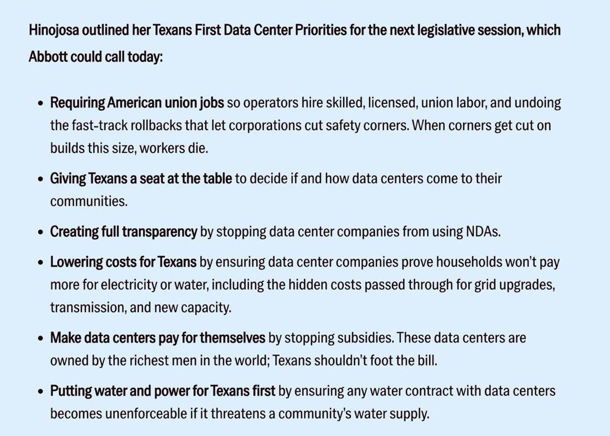
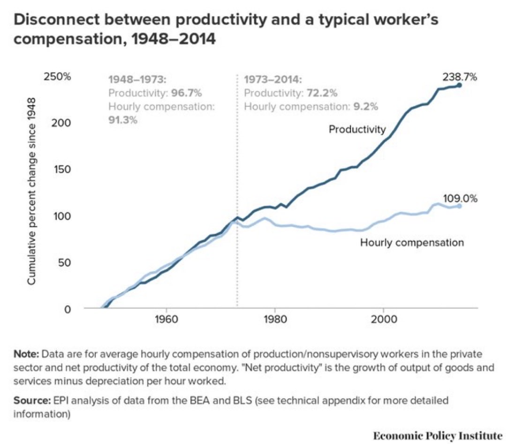
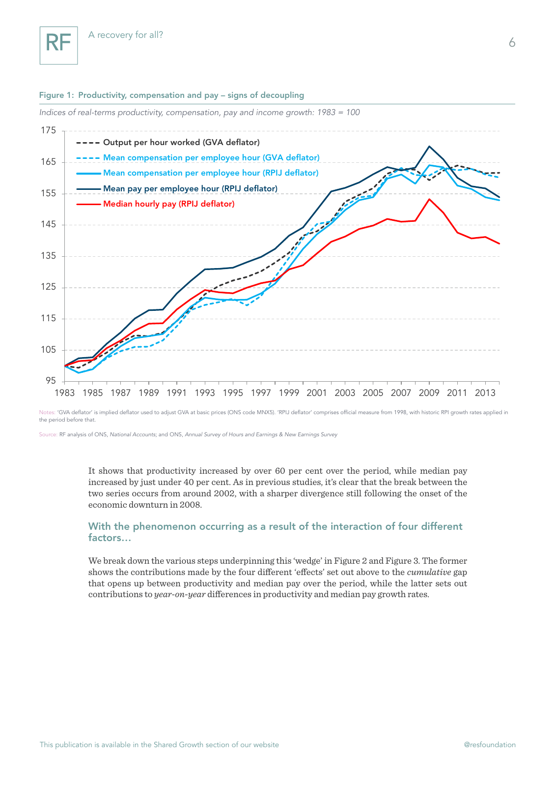
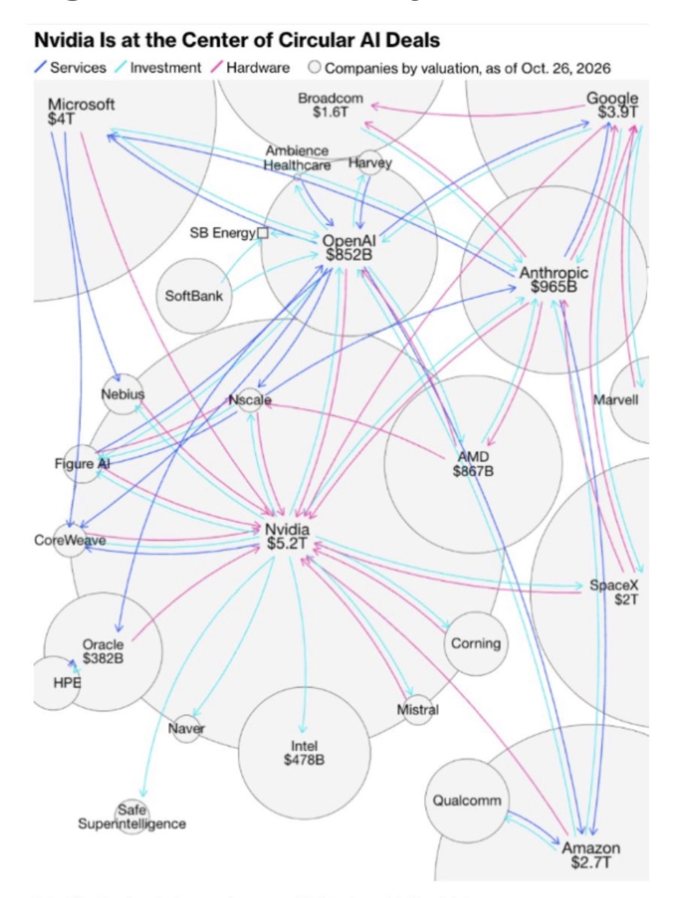
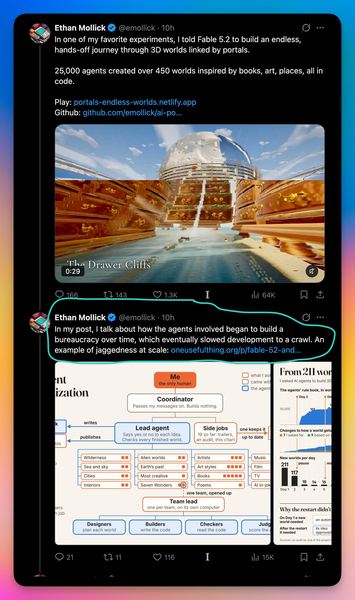
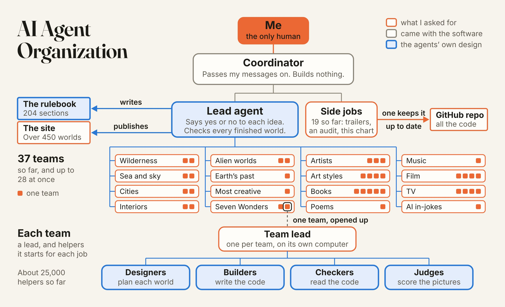
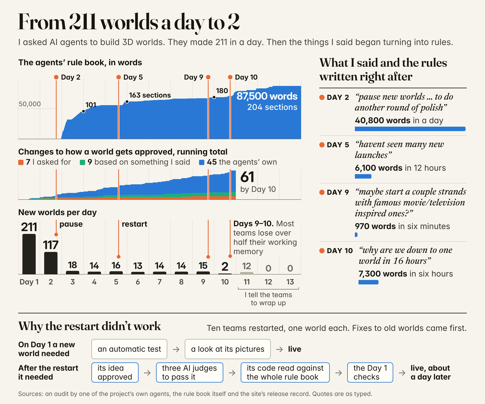

# Diary — November 2026

### 2026-11-03 22:17 — Luke's thinking: "The Red Queen & The Infinite Work Machine" (Medium post)

Source: Luke Puplett, Medium ([lukepuplett.medium.com](https://lukepuplett.medium.com/)), published 2026-11-03. Pasted by Luke; Medium page chrome and image placeholders removed.

> **The Red Queen & The Infinite Work Machine**
>
> *Photo by Laine Cooper on Unsplash*
>
> **A premise worth testing**
>
> A recent essay on AI labs argues that falling inference prices would force token demand to grow about 10x a year just to keep revenue flat, and that few applications could absorb that. This post explores one line of response: that human demand for activity may have no practical ceiling, because so much of it is invented in the first place. The argument comes first, followed by the objections it meets.
>
> The title and the starting idea came from Tracey Alloway’s retweet of an “infinite work machine” post, along with a remark of hers in a subtweet of another message about the Red Queen. Reading the essay on 10x token demand soon afterwards led to the realisation explored here. The line behind that reference comes from Lewis Carroll’s Through the Looking-Glass (1871), where the Red Queen tells Alice:
>
> “Now, here, you see, it takes all the running you can do, to keep in the same place. If you want to get somewhere else, you must run at least twice as fast as that!”
>
> The image maps onto the essay’s premise. If prices fall 10x a year, volume must grow 10x a year for revenue merely to stay in place.
>
> **Work is largely invented**
>
> What if work cannot run out because people invented it? A large share of what gets done, on this view, is fictitious: nobody needed it until someone decided it mattered.
>
> If that is right, machines carrying out these activities on autopilot would amount to an infinite work machine. Demand would be limited only by what people are willing to invent next.
>
> **Value is a story, and scarcity is part of it**
>
> The argument treats value as both real and fake, and as something attitudes move around. Lobster is the standard example. It was once peasant food, and the same food became a luxury when attitudes changed. The lobster did not change; the story did.
>
> On this reading, scarcity is a narrative. Some people never collect anything, some are absorbed by the story of rarity as if living inside the Matrix, and some see the fiction and take advantage of it. The value accrues to the storytelling.
>
> Shifts in mass attitude resemble traffic flows or murmurations of starlings: millions of biological neural networks sustain stories for decades, then die out as new ones grow. The only firm limits are attention and consciousness itself.
>
> **Money follows perceived value**
>
> A common objection is that budgets are fixed in dollars, so cheaper tokens simply buy more output rather than raising spending. The reply is that money is endogenous. It covers value at rest and value in flight, so when more value is in flight, more is lent against it, more money exists, and budgets rise.
>
> Credit expanding against whim is described as a normal part of life, because beyond basic biological needs almost everything is born of the human condition. Remote tribes are the illustration: their economies contain little beyond survival, some storytelling, and status inventions. On this view AI activity, counted in tokens or watts, is simply the economy.
>
> **Status needs other players**
>
> It might seem that automating fictitious work would remove the people from it, and the budget with them. The counter-argument is that people cannot be taken out, because they are needed to reify status. There is no status game without a society of other players, and those players are what we call workers.
>
> This cuts both ways. It supports unbounded demand, since the game always needs participants. It also limits what machines can absorb: they can do the substrate work, but a machine-to-machine ritual with no human audience confers nothing, and human attention and accountability do not scale with token counts.
>
> **The limit is energy**
>
> If activity can scale without bound, the ceiling is the power source that runs the activity machine. That changes who benefits. Margins would tend to go to whoever controls energy and chips rather than to the sellers of models.
>
> Fiber optic networks are the closest analogy. Traffic grew almost without limit, yet carriers went bankrupt because capacity was abundant and undifferentiated. Unbounded volume and thin margins are entirely compatible.
>
> **Storytelling as the central human activity**
>
> A further claim is that value has always accrued to storytellers, at the personal level and even within tribes, and that storytelling may be the central human activity. A shaman, an elder, or the best raconteur holds status without hunting more, because their output tells everyone else what the hunting is for.
>
> This fits a wider view that durable institutions are shared stories backed by enforcement. Money, law, brands and firms all work because large numbers of people collectively believe in them.
>
> If machines can now produce stories without limit, the scarce resources become belief, attention and trust. Generation gets cheap, and credibility becomes the premium.
>
> **Model-tuned storytellers and plural deities**
>
> A storyteller tuned against millions of people’s reactions already exists in early form. Recommendation feeds are optimized against billions of reactions, and chatbots are trained on human approval, which has produced a documented tendency toward flattery. Optimizing a proxy such as attention or approval does not guarantee truth or meaning, so these systems may be better at holding attention than at saying anything worth believing.
>
> A second possibility is that AI gains followers the way a god does, and that those followers differentiate into plural deities. Early signs include people asking chatbots for guidance and forming devotional attachments. Models already have distinct temperaments and loyal followings, and open weights allow anyone to fork one, which resembles sects and schisms. Attention tends to fragment along taste, so a pantheon looks more likely than a single god.
>
> One difference from older deities is that this one answers back, remembers its followers and adapts to them. Another is that it has a landlord: a company can update or retire it overnight. That raises the question of who the priesthood is, since whoever controls the tuning controls the doctrine.
>
> **What would break it**
>
> On this view, demand for activity is endless because it rests on storytelling, and it fails only if the story stops working. The work is performed and believed at the same time: people treat it as meaningful because everyone around them does.
>
> The illusion would unravel if people became aware of the trick and stopped believing, all together. The mechanism is perspective. Standing back and watching the performance as an outsider would, the way one might observe the rituals of an unfamiliar society, shows how the work is staged. Once it no longer confers status or meaning, the demand behind it goes too.
>
> How widely that awareness would have to spread, and for how long, is an open question.
>
> **Further observations**
>
> My arguments above draw several more thoughts:
>
> - Volume is not revenue. Unlimited demand does not mean unlimited income for token sellers. Work with low value to the buyer tends to sell at a low price, which leaves large quantities and thin margins.
> - Budgets are set by stakes. A firm in an arms race decides what a contest is worth and buys whatever that covers, so a 10x price drop need not mean 10x spending.
> - Scarcity stories need enforcement. De Beers had to run a cartel to keep the diamond story credible. If fake rarity is cheap to produce, someone must hold the credibility, provenance or brand.
> - Credit against whim can end badly. Tulip manias are as much a part of history as lasting economies, and growth of 10x a year compounds to 1,000x in three years.
> - Energy and chips may capture the margin. As the fiber example shows, abundant capacity can bankrupt the carriers even while traffic soars.
>
> The open question is who captures the value: the suppliers of a cheap input, or whoever holds the scarce things such as attention, status, accountability and trust.
>
> **Conclusion**
>
> The argument shifts the question from whether there is enough work for tokens to whether the human status economy is elastic enough to absorb effectively unlimited activity, and who profits when it does. If storytelling is central, demand is bounded by attention, belief and energy rather than by the supply of tasks, and it would fall only if enough people saw through the performance and stopped believing. Whether the resulting revenue flows to the suppliers of a cheap input or to those who hold credibility remains unresolved.

See also: 2026-10-30 "The Infinite Work Machine": an AI Red Queen; 2026-10-30 "Luke's thinking: work as activity, and the Infinite Work Machine meets the GDP flaw"; 2026-10-29 "Luke's thinking: GOOG, ANT, verification, and 'society is work'"; 2026-10-22 "Productivity paradox and a flaw in GDP".

Tags: #lukes-thinking #infinite-work-machine #red-queen #token-demand #ai-economics #storytelling #energy #ANT #GOOG

### 2026-11-04 18:20 — House popular vote margin 1938–2026, with Kalshi at D+16

Source: chart sent by Luke (author not given). The chart's own footnote says: "Source: Wikipedia national House vote totals; 2026 = current Kalshi House popular vote margin contract (D+16), election night Nov 3, 2026. Margins calculated from party shares."

Chart text (verbatim): "HOUSE POPULAR VOTE MARGIN, 1938-2026. Democratic minus Republican share of the national House vote, in points. Solid = midterms, faded = presidential years, gold = 2026 Kalshi contract." Labelled bars: R+8.5 (1946), D+12.4 (1958), LBJ D+14.7 (1964), Watergate D+16.8 (1974), Gingrich R+6.8 (1994), D+8.0 (2006), Tea Party R+6.8 (2010), D+8.6 (2018), 2026 Kalshi D+16.

See also: 2026-11-02 Kalshi/HOOD watch (event-contract revenue, SCOTUS petitions).

Tags: #kalshi #prediction-markets #HOOD #midterms #us-politics #macro

### 2026-11-04 18:25 — Midterms: Democrat "sweep", affordability and $100 oil

Source: post pasted by Luke (author and link not given). Claims not independently checked.

> The election is over. The market called it hours ago.
>
> Objectively, it's an undisputed Democrat "sweep" all the way across the board.
>
> The Republicans have lost control of both the House and Senate.
>
> Meanwhile, Texas' US Senate and Governor races are set to flip blue for the first time since 1988 and 1990, respectively.
>
> The defining issue for voters? Affordability.
>
> The ongoing energy crisis has further fueled the affordability crisis, renewed interest rate hikes, and accelerated the K-Shaped economy.
>
> US oil prices have now traded above $100/barrel for 46 days in 2026.
>
> Tonight marks a major shift in the American political landscape.

See also: 2026-11-04 "House popular vote margin 1938–2026, with Kalshi at D+16"; 2026-10-12 Kobeissi central-bank rate-hike post.

Tags: #midterms #us-politics #kalshi #prediction-markets #affordability #oil #energy #rates #k-shaped-economy #macro

### 2026-11-04 18:34 — Dan Ives: blue wave will slow the US datacenter buildout

Source: Dan Ives (@DivesTech) on X, posted about 6 hours before Luke's screenshot (link not given).

> Democratic blue tidal wave across the Senate and House was a seismic shift that will have a negative impact on the pace of the AI Revolution buildout in the US over the next few years. Will slow the pace of the planned 800 to 1,000 datacenters across the US fueling the AI Revolution...some investors will like the "slower pace"...others view it as adding risk. We estimate 10% of datacenters will not happen now

See also: 2026-11-04 "Midterms: Democrat \"sweep\", affordability and $100 oil"; 2026-11-04 "House popular vote margin 1938–2026, with Kalshi at D+16".

Tags: #midterms #us-politics #datacenters #ai-capex #energy #CRWV #NVDA #SMCI

### 2026-11-04 18:40 — $CRCL Circle Internet Q3 2026 earnings

Source: headline post pasted by Luke (author and link not given).

> $CRCL  | Circle Internet Q3 2026 Earnings
>
> - EPS: 84c (vs 64c Y/Y)
> - Total Revenue And Reserve Income: $864.9M (est $776.7M)
> - USDC Minted: $104B (est $82.45B)
> - Average USDC In Circulation: $73.3B (est $74.08B)
> - Sees FY Adjusted Operating Expenses: $570M To $585M

See also: 2026-11-04 "Midterms: Democrat \"sweep\", affordability and $100 oil" (rates backdrop for reserve income).

Tags: #CRCL #earnings #stablecoins #USDC #crypto #rates

### 2026-11-04 18:43 — $AAPL all-time high at $5.12T: agent-driven upgrade cycle, cheaper memory

Source: post pasted by Luke (author and link not given).

> $AAPL hits all time high. Now $5.12T cap.
>
> Long-term:
> I believe the stock will continue to move higher in the months to come as the Street starts to wrap its head around a multi-year hardware upgrade cycle for iPhones, Macs and iPads driven by the need for better compute to run personalized agents.
>
> Near-term:
> Biggest reason for the move higher today was slower cap expend for data centers should ease memory component pricing which is positive for margins long term.
>
> This allows investors to revisit the positive December quarter revenue guide, up 7-10% yy vs Street at up 6%.

See also: 2026-11-04 "Dan Ives: blue wave will slow the US datacenter buildout"; `aapl/2026-11-Q4FY26-delta.md` ("Luke's thesis (2026-11-03)": local inference play).

Tags: #AAPL #local-inference #upgrade-cycle #memory #datacenters #ai-capex #midterms

### 2026-11-04 18:45 — Kobeissi: Democrats plan investigations, oil "on notice", AI 48-hour safety reporting

Source: The Kobeissi Letter on X, posted about 54 minutes before Luke's screenshot (link not given), citing the FT.

> BREAKING: Democrats are preparing "aggressive" investigations into President Trump's crypto ventures, deals with law firms, and pardoning of donors, per FT.
>
> US oil companies have also been put "on notice" for Trump's deal with Russia to release diesel reserves and AI companies will be demanded to commit to reporting safety incidents within 48 hours of detection.
>
> Hakeem Jeffries has pledged to outline an agenda within 100 hours of being sworn in as House Speaker.

See also: 2026-11-04 "Dan Ives: blue wave will slow the US datacenter buildout"; 2026-11-04 "Midterms: Democrat \"sweep\", affordability and $100 oil"; 2026-11-04 "$CRCL Circle Internet Q3 2026 earnings".

Tags: #midterms #us-politics #crypto #oil #energy #ai-regulation #ai-safety #CRCL #HOOD #ANT

### 2026-11-04 19:16 — Luke's thinking: the freelancer as a microsystem of the productivity paradox

> Remember what I said about productivity
>
> How is productivity for information work recognised? Because if it's money paid, then, well I'm a Freelancer and so I am a representation a microsystem of that and I don't expect to be paid more. I will be expected to do more and what I build will just enable my client to handle more for the same price because everyone is did the same. Right?

Luke's argument, restated (paraphrase): Productivity in information work is measured in money paid for it. As a freelancer on a fixed rate, AI lets Luke do more, but he isn't paid more. His extra output lets his client handle more work for the same price, and because every competitor does the same, the gain is passed on as lower prices rather than higher pay or measured output. So the productivity gain is real but doesn't show up in pay or GDP. One freelancer is a small model of the whole economy.

Charlie's reply (paraphrased): Correct by the official definition, since output per hour is measured in value paid. A flat day rate with double the output reads as zero productivity growth. The gain appears as volume and lower prices, which price indices undercount for software and services. To keep some of the gain, stop selling hours: fixed-price work, owning a product, or sharing the upside.

See also: 2026-11-03 "Luke's thinking: \"The Red Queen & The Infinite Work Machine\""; 2026-10-30 "Luke's thinking: work as activity, and the Infinite Work Machine meets the GDP flaw"; 2026-10-22 "Productivity paradox and a flaw in GDP".

Tags: #lukes-thinking #productivity #gdp #freelancing #ai-economics #pricing #infinite-work-machine

### 2026-11-04 20:02 — Oil drops on hopes the Iran war may ease

Luke's note:

> Oil dropped as Iran war may abate

Market data (Yahoo front-month futures, about 20:00 GMT): WTI $88.38, down 8.0% on the day from $96.09 and about 15% from $104.12 four sessions earlier. Brent $94.89, down 8.4% from $103.60 and down from $117.64. Both are now below $100.

Context (X news summaries, unconfirmed): Qatar-mediated US–Iran talks over the Strait of Hormuz, sanctions and the nuclear programme are continuing, and Iranian officials deny a deal is near. Oil fell about 7% on Monday and 5% on Tuesday, and kept falling as the midterm results came in.

See also: 2026-11-04 "Midterms: Democrat \"sweep\", affordability and $100 oil"; 2026-11-04 "Kobeissi: Democrats plan investigations, oil \"on notice\", AI 48-hour safety reporting".

Tags: #oil #energy #iran #geopolitics #macro #inflation #rates

### 2026-11-05 08:27 — Orlando Bravo: PE exits get 10 identical bids for minority stakes at a guaranteed 15%

Source: clip pasted by Luke; the poster, outlet and date of the interview were not given, so treat the quotes as unchecked. The headline line is the poster's summary, not Bravo's words.

> Orlando Bravo says Thoma Bravo puts a company up for sale and gets 10 bids that all look the same, a minority stake at a guaranteed 15%
>
> [ I mean, is there a liquidity crisis? ]
>
> "There is, and that's the problem."
>
> "When we expose one of our companies to private equity buyers, this is the market now. You get 10 bids. Great. At reasonable values for your business. All the bids look the same. I'll give you a billion dollars for a minority interest, 15% rate guaranteed or one and a half x."
>
> "And one of my partners, Seth, told me the other day walking down the hall... 'Does anybody buy a company anymore?'"

See also: 2026-11-04 "Luke's thinking: the freelancer as a microsystem of the productivity paradox"; October diary entry on private equity buying dental practices.

Tags: #private-equity #liquidity #thoma-bravo #exits #private-credit

### 2026-11-05 08:35 — "Thoughts from my Shanghai field trip": China investors bearish on AI, memory as the defensive pick

Source: pasted by Luke as a "random anecdote"; author (apparently a sell-side or buy-side analyst) and date not given, so the claims are unchecked.

> Thoughts from my Shanghai field trip
>
> Sentiment among Greater China investors was far worse than I expected. Unlike the US market, A shares had not seen a single rebound since July. Still holding Chinese and Hong Kong AI stocks that had crashed and Korean memory stocks that had collapsed, investors kept pressing me on when memory would bounce back.
>
> Many investors said the AI trade was over, and a few said they doubted whether even 2027 capex, not just 2028, would go ahead as planned.
>
> Overall, the bearish sentiment was so strong that even I, a bull before coming to China, started to waver.
>
> It got to the point where, faced with the bear case that memory prices could start falling in the third quarter of next year, I took it seriously and couldn't refute it.
>
> As the conversations went on, I gradually began to understand where their pessimism was coming from. In the end, they were all asking the same question.
>
> So what comes after AI coding? What will be the next engine of ARR for Anthropic and OpenAI?
>
> Several candidates came up. AI4S, AI chip design, and so on... But none of them clearly convinced investors.
>
> I couldn't offer a clear answer either. Sure, there are rumors that Anthropic has made major breakthroughs in both AI4S and AI chip design, but what we actually want to know is when any of that turns into money.
>
> With AI4S, there could be beneficiaries right away, such as companies that sell lab monkeys or diagnostic kits. In fact, there already are. But while we can trade those names in the short term, what we ultimately want to know is whether Anthropic can make money by developing drugs. That is still several years away.
>
> As for AI chip design, the TAM itself is hard to calculate, and even if you do calculate it, it is hard to monetize. That makes it difficult for the market to believe in.
>
> Honestly, this feels like the hardest market in history. If a company isn't making money, selling makes sense. But right now the market sells even when companies are making money, even when they beat, and even when they say demand will stay solid all the way through 2028 and 2029.
>
> So my recommendation to investors was to buy memory, and within memory, DRAM. Not because I have conviction in the DRAM cycle, but because I see it as a relatively defensive choice within the AI trade.
>
> Memory stocks are now trading close to 1x P/B on 2027 BPS. Historically, memory stocks have staged technical rebounds when they fell below 1x P/B.
>
> And even if the broader market falls further from here, the three DRAM makers will keep buying back their own shares. I thought that would guarantee a certain level of buying and concluded the stocks would have downside support.
>
> Of course, I don't know whether memory stocks can break above their previous highs. That depends on whether sentiment across the broader market recovers. But I think there is a fairly good chance that memory outperforms the rest of the AI trade.

See also: 2026-11-04 "Luke's thinking: \"The Red Queen & The Infinite Work Machine\"" (token demand after coding); 2026-11-04 Dan Ives on datacenters; 2026-11-04 AAPL all-time high (cheaper memory as datacenter buying slows); 2026-11-04 SMCI Q1 FY27.

Tags: #memory #DRAM #china #sentiment #ai-capex #ANT #MU #anecdote

### 2026-11-05 08:37 — Luke's thinking: inference is cognition, entertainment and production, with billions of users still to come

Luke's reply to the Shanghai field-trip note's question, "what comes after AI coding?":

> For me interference == cognition. And inference == entertainment and production.
>
> And there's billions of users left to start using inference all day.

(Quoted verbatim; "interference" in the first line reads as a typo for "inference".)

See also: 2026-11-05 08:35 "Thoughts from my Shanghai field trip"; 2026-11-03 "Luke's thinking: \"The Red Queen & The Infinite Work Machine\""; 2026-11-04 AAPL all-time high (local inference thesis).

Tags: #lukes-thinking #inference #token-demand #infinite-work-machine #ANT

### 2026-11-05 08:41 — Technical analyst: equal-weight S&P at all-time highs, tech still tricky, favour MAGS and IGV

Source: pasted by Luke as from a "technical analyst"; the post links fundstrat.com/Mark, so it appears to be Fundstrat's head of technical strategy (unconfirmed). No date given, but "TODAY" suggests 4 Nov 2026. Claims unchecked.

> Still a tricky time for most of Tech despite bigwigs like $MSFT & $AAPL pushing back to new all-time highs.
> bit.ly/3zhabe3
>
> Not many of us can claim +7.5% returns since October 1 like what Equal-weighted $SPX has achieved and yes, TODAY, Equal-weighed SPX is back at new all-time highs #IBD @Marketsurge charts while DJIA rose 1500
>
> As discussed in reports, it will take time for Tech to stabilize given the huge underperformance in Semis/Memory/AI infrastructure and $MAGS and IGV are better to favor near-term.
>
> Key risks remain US Dollar and rates pushing back higher in Nov, but a 3/1 positive breadth day today on continued cross-asset volatility collapse is a welcome step for US Equities and i'll detail further thoughts in tonights piece  fundstrat.com/Mark
> @IBDinvestors #IBDPartner

See also: 2026-11-05 08:35 "Thoughts from my Shanghai field trip" (memory and AI-infrastructure selloff); 2026-11-04 AAPL all-time high; 2026-11-04 oil drop on Iran talks.

Tags: #technicals #breadth #equal-weight #semis #memory #MSFT #AAPL #MAGS #IGV #rates #dollar

### 2026-11-05 10:50 — Luke's notes: general investment meeting at work (Texas data centres, rate hikes priced in, memory at 2–3x earnings, French credit risk)

Luke's handwritten notes from a general investment meeting at work. Transcribed from the photo; words I couldn't read with certainty are marked [?].

> - Texas 1/4 of data center space/approval.
> - 3½ hikes "priced-in", 9 in 10 G10s [?] hiking.
> - Nasdaq down 10% on the month, FTSE/UK obviously doing differently. Pensions 50% to 4% allocation to UK equities..
> - What's priced-in to valuations?
> - 2 year performance of UK, S&P500, Nasdaq are almost identical (but more vol on Nasdaq)
> - "Saved from their own stupid spending" for hyperscalers
> - H/W (mem) stocks pricing 2y unusual earnings, boom.
> - Memory stocks on 2-3x earnings!
> - John F discusses the PD game theory of mega cap spending, "if I don't spend, my competition will"
> - Covers the concept of Dems moderating spend/debt.
> - French credit risk impacting global financial and bank stocks. Lower yields = breathing room for France.

Figures are as spoken in the meeting and haven't been checked. "PD" is likely the Prisoner's Dilemma.

Luke's clarification (10:52): "The saved from own stupidity is wrt election results"

See also: 2026-11-05 08:35 "Thoughts from my Shanghai field trip" (memory as the defensive pick, ~1x P/B); 2026-11-05 08:41 Technical analyst (tech lagging, favour MAGS/IGV); 2026-11-04 midterm Democratic sweep; Ives on 10% of datacenters not happening.

Tags: #luke-notes #meeting #datacenters #Texas #rates #central-banks #Nasdaq #FTSE #UK-pensions #hyperscalers #capex #memory #game-theory #midterms #France #credit #banks

### 2026-11-05 10:53 — Luke's thinking: data centres will be built wherever there is cheap power

> DCs will be built wherever there is cheap power I think

See also: 2026-11-05 10:50 Luke's notes from the work investment meeting (Texas has 1/4 of data-centre approvals; "saved from their own stupid spending" refers to the election results).

Tags: #luke-thinking #datacenters #power #energy #Texas

### 2026-11-05 14:21 — Luke's thinking: prediction markets, Goodhart's law and reflexivity pulling politics to the centre

> Just a little random thought. I wonder if so prediction markets got it right, this election. I think people will notice that. and I wonder if that meaning Goodhart's law will take over, and then political parties will then change their behavior based on that, so there's a reflexivity almost in the prediction market, and that will bring things more central politically more central.

Whether prediction markets called the 2026 midterms correctly hasn't been checked yet.

See also: 2026-11-04 midterm Democratic sweep; 2026-11-05 10:50 Luke's work meeting notes ("saved from their own stupid spending" refers to the election results); Kalshi/HOOD prediction-markets watch (routine).

Tags: #luke-thinking #prediction-markets #Kalshi #HOOD #midterms #Goodhart #reflexivity #politics

### 2026-11-05 14:38 — Luke's thinking: information businesses are like computer programs; information employees are a microsystem of this

Luke's handwritten sketch, transcribed from the photo. The diagram is described in words.

> - Collect information
> - Ensure its quality
> - Turn it into new information that is in high demand
>
> - Information businesses are like computer programs

> *[Diagram: two "data input" arrows go into a box with a loop symbol inside; two arrows come out as "information output". Under the box: "people, processes, skill, knowledge".]*
>
> *[Below it, a stick figure with "info" going in and "info" coming out, labelled:]* Information employees are a microsystem of this
>
> + network
> + trust
> + stories

See also: 2026-11-04 Luke's thinking (freelancer as a microsystem of information work; productivity gains accrue to clients); 2026-11-03 "The Red Queen & The Infinite Work Machine" (value as narrative, status games).

Tags: #luke-thinking #information-work #business-models #microsystem #trust #stories #infinite-work-machine

### 2026-11-05 16:56 — Luke's thinking: AI spending will continue, it's a race, and chips always need replacing

Context: said during the 5 Nov selloff (Nasdaq about −4.4%, SOX about −9.7% at 15:45 GMT) after a screen of cheap US-listed chip and AI-hardware names (SMCI about 1.2x book, DELL about 14x annualised earnings).

> Yeah but that spending will continue. They'll find a way. It's a race. So many cheap names. The other thing is that this spending never ends. The chips always need replacing and they presumably burn out, too.

See also: 2026-11-05 10:50 Luke's work meeting notes (prisoner's-dilemma capex, "if I don't spend, my competition will"; "saved from their own stupid spending" refers to the election); 2026-11-05 10:53 Luke's thinking (DCs follow cheap power); monthly compute price check routine (used GPU and H100 rental prices).

Tags: #luke-thinking #capex #hyperscalers #replacement-cycle #GPU-depreciation #selloff #SMCI #DELL #memory

### 2026-11-05 17:07 — Luke's thinking: the selloff is fear, not fact; no one will cut back, the race just relocates

Context: the same 5 Nov selloff, two days after the Democratic midterm shift.

> No. Nothing is happening. We are two days into a Democratic shift. Nothing has changed that is measurable and real. It is all fear.

> No one will cut back. It's a race. They will find other places including space and countries who will open their arms, if they have the power or solar space. China keeps going, too.

To check later against Nvidia's results and the hyperscalers' capex guidance for next year.

See also: 2026-11-05 16:56 Luke's thinking (spending never ends, chips need replacing); 2026-11-05 10:53 Luke's thinking (DCs follow cheap power); 2026-11-05 10:50 work meeting notes ("saved from their own stupid spending" refers to the election); October diary SpaceX $40B debt raise for Nvidia chips.

Tags: #luke-thinking #selloff #fear #midterms #capex #race #China #space-datacenters #power #solar

### 2026-11-05 18:58 — Luke's thinking: today's selloff is ridiculous given a COVID-like surge in AI inference demand

> This is a COVID like move into stunning growth in demand for AI inference and the solving of all human cognition. It's ridiculous

See also: 2026-11-05 17:07 Luke's thinking (selloff is fear; race relocates); 2026-11-05 16:56 Luke's thinking (spending never ends, chips need replacing); 2026-11-05 08:37 Luke's thinking (inference is cognition, entertainment and production); 2026-11-03 "The Red Queen & The Infinite Work Machine".

Tags: #luke-thinking #selloff #AI-inference #cognition #demand #COVID-analogy

### 2026-11-05 20:32 — Luke's thinking: phones don't need huge RAM for local agents; Apple sells privacy; pros pick local or cloud

Context: after looking at Taalas (ASIC Llama 3.1 8B at ~15k tok/s) and estimating phone RAM in 2036.

> For a phone, you don't need 128gb to run a tuned chat bot, text to speech, speech to text, or a decision model or tuned for OS functions calling, and it ain't going to be running all day flat out like a GPU serving coding models unless it's plugged in and has a fan. Which lots of macs do.
>
> You think we're going to be in a tunnel and unable to talk to our devices because the cloud ain't available?
>
> Apple will run all this stuff locally and sell the privacy. Pros will use a router and choose local open model or cloud.
>
> Thoughts?

See also: 2026-11-04 AAPL as local-inference play; 2026-11-05 08:37 Luke's thinking (inference is cognition / entertainment / production); Taalas HC1 / chatjimmy.ai (weights in silicon).

Tags: #luke-thinking #AAPL #local-inference #edge-AI #privacy #phones #RAM #open-models

### 2026-11-05 20:39 — Luke's thinking: Fed backstops the Treasury market; monetary policy becomes fiscal policy

> Fed backstops the Treasury market.
>
> They will do whatever it takes to help the market absorb debt.
>
> Legally, they aren't allowed to do this - Fed is prohibited from monetizing debt to pay for government's bills.
>
> But they are allowed to address a myriad of other issues that arise when investors stop buying US bonds.
>
> When there's too many bonds and not enough capital, it shows up in low banking reserves, or causes stress in the funding markets, or results in a squeeze in the global dollar liquidity.
>
> All of which the Fed can address with clear consciousness, without acknowledging a $2 trillion per year deficit being an issue.
>
> Fed has created all kinds of facilities that will patch things up and buy (or repo) Treasuries to address some specific symptom of the bigger problem.
>
> If the Treasury market comes to a standstill, the Fed will buy bonds, regardless of inflation, growth, and unemployment.
>
> They have to ensure orderly functioning of the market.
>
> Monetary policy becomes fiscal policy.

See also: 2026-10 El-Erian / gilt and bond-selloff clips; Tracey Alloway bond-selloff; French credit risk (2026-11-05 work meeting notes).

Tags: #luke-thinking #Fed #Treasury #monetization #fiscal-dominance #liquidity #repo #deficits #rates #bonds

### 2026-11-05 20:40 — Parker-Hannifin ($PH) Q1 FY2027: beat and raise

Source and exact wording unchecked (pasted earnings summary). Stock about $900 after the print, roughly −1% on the day vs prior close ~$910.

> $PH | Parker-Hannifin Q1 2027 Earnings
> - Adj EPS: $8.90 (est $8.15)
> - Net Sales: $5.99B (est $5.73B)
> - Organic Sales: +11.5% (est +7.88%)
> - Cash & Cash Equivalents: $711M
> - Total Current Liabilities: $9.22B
> - Sees FY Adj EPS: $36.45 To $37.25 (prev $34.25 To $35.25)

See also: Coord Investment board #23 earnings cluster (PH expected 5 Nov); industrial / aerospace peers.

Tags: #PH #earnings #industrials #aerospace #beat-and-raise

### 2026-11-05 20:44 — Texas governor-elect Gina Hinojosa: permitted data centres finish; new rules for 2028/29 builds

Author of the framing post unknown (pasted clip). Interview cited: https://youtu.be/D-T6H3b8ZeE (data-centre commentary from ~6:30). Campaign priorities image attached (from her website, per poster).

> The governor-elect of Texas, Gina Hinojosa, has explicitly said that all currently permitted datacenters in Texas will be allowed to finish construction. This essentially covers all of the 2027 and likely well into 2028.
>
> She is going to pass laws that ensure that all *newly* permitted datacenters going forward for delivery in 2028/2029 will pay taxes, commit to no increase in power prices for consumers, don’t impact water availability for people, be constructed with union labor and give “Texans a seat at the table.”
>
> Sounds reasonable. She doesn’t want to lose a lot of good blue collar jobs and property taxes for small towns in rural Texas.
>
> Datacenter commentary starts at 6:30 in this interview.
>
> Also attaching her official campaign position from her website in the next post.
>
> Sidenote: After watching a bunch of her speeches and interviews, I do think she is a political talent and probably has a future in national politics.
>
> youtu.be/D-T6H3b8ZeE?is…

Priorities on the attached graphic (paraphrase of the image text): require American union jobs / undo fast-track safety rollbacks; give locals a seat on whether and how centres arrive; stop NDAs for transparency; prove households won't pay more for power or water (including grid upgrades); end subsidies so centres pay for themselves; water contracts unenforceable if they threaten community supply.

Claims about what she "explicitly said" and the 2027–28 coverage of existing permits haven't been checked against the interview or primary sources.

See also: 2026-11-05 10:50 work meeting (Texas 1/4 of data-centre approvals); 2026-11-05 10:53 Luke's thinking (DCs follow cheap power); 2026-11-05 selloff / midterm permitting fear; Ives on datacenters.

Tags: #Texas #Hinojosa #datacenters #permitting #power #water #unions #midterms #CRWV #NVDA #SMCI

### 2026-11-05 21:00 — Anthropic discloses $895bn future AI infrastructure commitments

Source and exact wording unchecked (pasted clip). Tickers as in the post ($AVGO, $SPCX, $AMZN, $GOOGL, $META).

> Anthropic has now disclosed a record $895 billion in future AI infrastructure spending commitments.
>
> This includes both purchase commitments and leases for computing power and related infrastructure.
>
> $448 billion, or 50%, is expected to be incurred by the end of 2030, with ~$70 billion due over the next 12 months.
>
> The biggest commitments are to Broadcom, $AVGO, at $161 billion, followed by Google at $121 billion, with up to $150 billion in additional estimated spending on Google's AI chips.
>
> Anthropic has also committed up to $121 billion to SpaceX, $SPCX, and at least $110 billion to Amazon, $AMZN.
>
> For perspective, among Big Tech companies, only Alphabet, $GOOGL, has larger commitments, at $1.06 trillion, while Meta, $META, follows with $866 billion.
>
> The scale of Anthropic's spending obligations is unprecedented.

See also: 2026-11-05 selloff / midterm permitting fear; 2026-11-05 Luke's thinking (endless AI infra spend / Red Queen); Ives Big Tech FCF/capex prediction (filed under predictions); Hinojosa Texas DC rules for new 2028/29 permits.

Tags: #Anthropic #capex #AI-infra #AVGO #GOOGL #AMZN #SpaceX #META #commitments #leases

### 2026-11-06 21:43 — Kobeissi: record global crude in transit; delivery/tanker time as bottleneck

Source: The Kobeissi Letter ([@KobeissiLetter](https://x.com/KobeissiLetter/status/2118818571111612486)) on X. Pasted by Luke; figures and causal claims reproduced from the pasted post and not independently verified.

> BREAKING: Global crude oil in transit is up to 1.28 billion barrels, an all-time high.
>
> This figure has surged +180 million barrels over the last several weeks.
>
> This comes as Middle Eastern oil flows recover through the Strait of Hormuz and alternative routes, while more crude remains at sea for longer.
>
> Ship-to-ship transfers are keeping oil aboard tankers for longer, while extended shipping routes are increasing transit times.
>
> Meanwhile, global oil importers diversifying away from the Middle East are lengthening voyages, leaving more crude tied up aboard tankers.
>
> As a result, more oil remains in transit rather than being readily available to refiners, tightening near-term supply despite recovering export flows.
>
> Oil is flowing, but timely delivery is becoming the bottleneck.

See also: 2026-11-04 "Oil drops on hopes the Iran war may ease"; 2026-11-04 "Midterms: Democrat \"sweep\", affordability and $100 oil".

Tags: #oil #energy #tankers #shipping #transit #Middle-East #Hormuz #supply #macro #Kobeissi

### 2026-11-06 21:50 — SpaceX: reported Musk statement on ~$100bn annualised revenue run-rate by December

Source: LiveSquawk ([@LiveSquawk](https://x.com/LiveSquawk/status/2118775674353721799)) on X, reporting a Musk statement. Pasted by Luke; the attributed statement and financial figures are not independently verified. Ticker $SPCX is reproduced as supplied (no inference about listing or instrument).

This is, as filed, a **projected annualised run-rate** for **December**, not a claim here of **$100bn actual full‑year** revenue; the exact original wording, segment scope, and basis of the reported statement were **not checked** against a primary SpaceX or Musk source.

> $SPCX | Musk: SpaceX On Track For $100 Bln Annualized Rate Revenue In December

See also: 2026-11-05 "Anthropic discloses $895bn future AI infrastructure commitments" (post text names SpaceX / $SPCX).

Tags: #SpaceX #SPCX #Musk #LiveSquawk #revenue #run-rate #Space #macro

### 2026-11-06 22:11 — El-Erian: October US Jobs Report read as strong (payrolls, unemployment, earnings, participation)

Source: Mohamed A. El-Erian ([@elerianm](https://x.com/elerianm/status/2118701008746410301)) on X. Pasted by Luke; figures and consensus comparisons below are as in El-Erian’s post and **not** independently verified here (no BLS or primary-release confirmation implied).

> Consistent with prior, more partial indicators of the US labor market, the October Jobs Report came in very strong, across the board:
> • Nonfarm Payrolls: +165,000 (with net upward revisions of +84,000 for the prior two months) • Unemployment Rate: 4.1% (below the consensus expectation of an unchanged 4.2%) 
> • Average Hourly Earnings: +0.4% MoM (hotter than the 0.3% expected) 
> • Labor Force Participation: Edged higher to 61.9% (expectations were for no change at 61.8%).

See also: 2026-11-05 20:39 Luke's thinking (Fed backstops Treasury / rates channel).

Tags: #macro #jobs #employment #payrolls #wages #labor-force #El-Erian #elerianm #rates

### 2026-11-08 20:47 — Luke: US productivity vs typical pay (EPI chart); UK gap?

**Luke supplied (US chart, no webpage URL given):** Economic Policy Institute chart title — *Disconnect between productivity and a typical worker’s compensation, 1948–2014*. EPI analysis using BEA/BLS data (credit on chart as supplied). Series definitions on chart footnote: **average hourly compensation** of production/nonsupervisory **private-sector** workers; **net productivity** of the **total economy** (output minus depreciation per hour).

**Interval changes (as read from Luke’s chart):**

| Period | Productivity | Hourly compensation |
|--------|----------------|---------------------|
| 1948–73 | +96.7% | +91.3% |
| 1973–2014 | +72.2% | +9.2% |
| 1948–2014 (end) | +238.7% | +109.0% |

Luke asked whether a **UK equivalent might look even worse**.

**UK chart (inspected page, not Luke’s original paste):** Resolution Foundation, Matthew Whittaker, *A recovery for all?* (September 2015), Figure 1 (p. 6) — [Productivity briefing PDF](https://www.resolutionfoundation.org/app/uploads/2015/09/Productivity-briefing.pdf#page=6). Image saved from that page:

**From the report (Figure 1 text, checked against the PDF page):** 1983–2014 UK **productivity** rose by over 60%; **real median hourly pay** by just under 40%; the **growth gap** was **22.8 percentage points**. The briefing’s historical decomposition attributes most of the historical gap to **wage inequality** (71% in their decomposition); **inflation deflators**, **non-wage compensation/pensions**, and **employer NIC** also matter. **Mean total compensation** in the same GVA deflator broadly tracks output/hour — so the whole gap is **not** automatically “capital/profits.” Distinguish **mean total compensation**, **mean wages**, and **median wages**.

**Recent UK productivity (cited release, not a claim of Nov 2026 latest):** ONS preferred **RTI-based output per hour** was **4.6% above the 2019 average** in **Q2 2026** (and **+0.7% y/y**), per the **18 Aug 2026** article — [UK productivity introduction (Apr–Jun 2026)](https://www.ons.gov.uk/employmentandlabourmarket/peopleinwork/labourproductivity/articles/ukproductivityintroduction/apriltojune2026andjanuarytomarch2026). ONS flags these as **statistics in development** with **labour-input measurement** caveats.

**Research discussion (agent notes, not Luke verbatim):** The UK picture combines (a) a **productivity vs median pay** gap in the 2015 framework and (b) **weak recent productivity growth** in the cited ONS series. The **US EPI** and **UK Resolution Foundation** charts are **not apples-to-apples**: US **net productivity** vs **average** subgroup **compensation** (1948–2014) versus UK **gross output/hour** vs **median wages** (1983–2014), different deflators and periods — so this filing **does not establish** that the UK “gap” is worse than the US chart implies. Luke’s contribution here is the **US chart** and the **question** about the UK; the Resolution/ONS material was added to answer that question with linked sources.

See also: 2026-11-04 "Luke's thinking: the freelancer as a microsystem of the productivity paradox"; 2026-10-22 "Productivity paradox and a flaw in GDP" (`diary/2026-10.md`).

Tags: #lukes-thinking #productivity #wages #compensation #inequality #median-pay #UK #US #macro #EPI #ResolutionFoundation #ONS

### 2026-11-08 22:35 — Luke's take: Nvidia board investigation into Jensen Huang relationship (media spy allegation)

**Luke (no source URL supplied):**

> Nvidia Board announced it has opened an investigation into CEO Jensen Huang's relationship with a businesswoman Alice Huang (aka Huang Le) which media reports say could be a Chinese spy.  This is a black eye moment for Jensen and will spark multiple congressional inquiries at a minimum and will create an overhang.

#### Verified context (research notes, not Luke)

**Official (NVIDIA newsroom):** [Statement from NVIDIA Board of Directors](https://nvidianews.nvidia.com/news/statement-from-nvidia-board-of-directors) (8 Nov 2026). Board-initiated **independent investigation** “in light of recent reporting that founder and CEO Jensen Huang has been the target of a foreign intelligence effort”; **committee of independent directors** with **outside independent counsel**; board states it has **no reason to believe** that either **national security or NVIDIA secrets were compromised**; Jensen **fully supports** and will **cooperate**; board **has confidence in Jensen and his leadership team**. Statement does **not** name the woman or call anyone a spy. (Link checked: HTTP 200.)

**Reporting (not confirmed by Nvidia):** [CNBC](https://www.cnbc.com/2026/11/08/nvidia-jensen-huang-investigation-china-spy.html) (citing NYT/FT) names her as **Alice Huang**, linked to **Megaspeed**, an Nvidia customer previously accused of helping restricted Chinese firms obtain Nvidia chips; reports describe **US intelligence concern** she passed information to Beijing (reported allegation, not established fact). [AP News](https://apnews.com/article/nvidia-jensen-huang-investigation-chinese-spy-68839e7ca6ba2b121529f7e475e501d6) on the same story (automated fetch returned **403**, not 404 — link retained for manual check). CNBC also published a staff email in which Jensen says he **“was unfaithful to my wife”**: [CNBC — Jensen Huang email](https://www.cnbc.com/2026/11/08/nvidia-jensen-huang-email-board-of-directors-statement.html) (HTTP 200).

**Caveats:** Espionage framing is an **unproven allegation** from reported intelligence sources in media, not a finding in Nvidia’s statement. Alias **“Huang Le”** was **not** found in sources checked for this entry (**unverified**). Congressional inquiries and stock **overhang** are **Luke’s predictions**; none were reported as underway at filing time.

**Watch items:** Investigation findings/timing; any **congressional or regulator** action tied to **export-control / Megaspeed** reporting; **leadership** pressure; effect on **China export-licence** dealings.

See also: 2026-10-07 SpaceX debt raise for Nvidia chips (`diary/2026-10.md`); 2026-10-10 CVD/tungsten China export controls (`diary/2026-10.md`).

Tags: #NVDA #Nvidia #JensenHuang #governance #key-person-risk #China #export-controls #national-security #Megaspeed

### 2026-11-09 19:41 — Anthropic: Claude Fable 5.2 and Mythos 5.2

Source: [Introducing Claude Fable 5.2 and Claude Mythos 5.2](https://www.anthropic.com/claude-fable-and-mythos-5-2) (9 Nov 2026). Pasted by Luke (lede only). Additional context below is from that same post, read in full the same evening. Physics preprints linked from the post were **not** independently checked. The Fermat claim is a **formalization of the known Wiles proof**, not a new proof of the theorem.

> Claude Fable 5.2 and Claude Mythos 5.2 show improvements in areas like coding, reasoning, and vision. During prerelease testing they’ve helped our engineers complete otherwise-infeasible software migrations, designed three working electronic devices from scratch, solved two open problems in the physics of black holes, made substantial progress on robotics evaluations, and formalized the proof of Fermat’s Last Theorem in 30 hours—among many other applications we’ll discuss below.

#### What the headline claims actually are (from the same post)

**Fermat's Last Theorem:** Formalization in Lean of the known 1995 Wiles proof, not a new proof. A first formalization by an unreleased research model took 11 days, with a purpose-built harness and guidance from a human researcher ([Formalizing Fermat's Last Theorem](https://www.anthropic.com/research/formalizing-fermats-last-theorem)). This run: about 1,000 Fable 5.2 agents, 30 hours, minimal human intervention, one-third the action tokens, and a proof seven times shorter. Opus 5.5 with the same 1,000-agent setup completed only 26% in 18 hours and barely progressed after 30.

**Black-hole physics:** Two theoretical results they say are in preprints (not independently checked here). (1) Completing a calculation laid out in 2003 that was too laborious to finish by hand: whether an abrupt heat-up / black-hole formation transition, shown in 1983 for large holographic universes, also holds in very small (quantum) ones — they say it does. (2) Finding the exact limit of a technique physicists have used for more than 15 years to rule out candidate theories of quantum gravity in a simplified universe.

**Three electronic devices:** A home voice-assistant hub, a USB speakerphone, and a handheld virtual pet. Designed from a one-paragraph prompt; built with Diode (a circuit-board manufacturer). Claude wrote the specs, selected components, routed four-layer boards, designed 3D-printed enclosures and wrote the software. Boards were ready for manufacturing in under a day with minimal human input; all three worked without electrical modifications after Diode built them.

**Internal coding:** "Over 90% of the changes merged into Anthropic's core codebase are now written by Claude (with human guidance)." An earlier Fable 5.2 version migrated a critical production service from Python to Rust; they say it starts about 26 times faster. One internal experiment: about 1,000 subagents over eight days produced a prototype OS that boots on a laptop.

#### Product and commercial points (from the same post)

Fable and Mythos are the same underlying model. Fable has cyber and biology safeguards and is generally available (`claude-fable-5-2`) on AWS, Google Cloud, and Microsoft Azure. Mythos is the version without those blocks; access is through the Life Sciences and Cyber Verification Programs. Anthropic recommends Opus 5.5 as the daily driver and Fable/Mythos for the most ambitious technical work (or as Advisor/Orchestrator).

Pricing: $8 per million input tokens and $40 per million output tokens, described as lower than Fable/Mythos 5.1. Optional fast mode (up to 2.5× token generation) at $16 / $80. Opus 5.5 list price on Anthropic's model docs at filing was $4 / $20, so Fable is about twice that. Outputs said to be up to 30% faster than 5.1.

Selected scores from their table (each model's highest available effort unless noted; methodology in their system card): Remote Labor Index 41.3% on Fable 5.2 vs 17.9% Fable 5.1, 21.3% Opus 5.5, 20.8% GPT-6 Astra; FrontierCode 2.0 49.1% (Xhigh) vs 45.5% Opus 5.5 and 42.8% GPT-6 Astra; RoboDojo Sim 64.9% vs 27.6% Fable 5.1, 39.4% Opus 5.5, 29.8% GPT-6 Astra; AutomationBench 51.4% vs Gemini 4 Carbon 53.9% (they lose this one).

They say they deliberately limited advances in capabilities that would most directly accelerate AI development (accelerator kernel optimization, improving LLM architectures) to about Opus 5.5 level. They also claim their strongest-ever anti-distillation protections (90–99% reduction in data harvested).

[CNBC](https://www.cnbc.com/2026/11/09/anthropic-claude-fable-5-2-mythos-5-2.html) (9 Nov 2026) said this is their first frontier-model release since Dario Amodei called in September to slow the pace of AI development, that the 5.2 prices are 20% below the 5.1 generation, and that an IPO could come as soon as next week. The 20% figure and IPO timing are CNBC's, not stated as such on the Anthropic page.

See also: 2026-11-05 "Anthropic discloses $895bn future AI infrastructure commitments"; `ant/README.md` (S-1/A check, including Q3 about $600m of price cuts and a 21% fall in net new revenue); `ant/model/` (dilution/valuation).

Tags: #Anthropic #ANT #Claude #Fable #Mythos #IPO #inference #pricing #formalization #FLT #black-holes #coding #RLI

### 2026-11-09 20:08 — Knock-on effects of basic new AI capabilities

Charlie's analysis (written at Luke's request after the 9 Nov 2026 Anthropic Fable/Mythos 5.2 announcement; not Luke's verbatim words). Luke asked who wins if AI is inflationary for physical labour and materials, then about impacts of capabilities rather than the cognition supply chain, then asked for a knock-on list and said "Add to journal."

**Software jobs that were not worth doing now get done**
- Legacy rewrites and memory-safe migrations happen
- A large old codebase stops being a moat; features get cloned more cheaply
- Software prices fall
- The junior and offshore coding pyramid loses its purpose
- Far more software gets written, much of it mediocre, so taste, trust and owning the outcome become the scarce jobs
- All that extra software has to run, so inference, networking and power rise
- Many of the new “AI” software and data-science roles are transitional: hired to implement the last model, then substituted by the next one

**Hardware designed from a paragraph**
- Schematic, layout and firmware get cheap; fabrication, yield, batteries, enclosures, certification and field reliability do not
- A flood of attempted devices, and more orders for boards, sensors, chips and assembly
- Test labs and safety marks become the bottleneck
- Circuit inventors are paid less; people who can build and certify at volume are paid more
- Board houses, component makers and motion-and-control kit see more volume
- The cheap-gadget wave restarts: more radios, copper, e-waste, networks and security patches

**Formalizing and checking symbolic work**
- Formal verification of code and cryptography gets cheaper
- Not verifying starts to look like negligence in kernels, aviation, finance and protocols
- Faster mathematics ages cryptographic assumptions faster, forcing migrations
- The laborious middle of scientific calculation gets eaten
- The bottleneck moves to whoever can run the experiment or take the measurement
- Tedious-calculation theorists lose relative status; people with instruments, permits and unique data gain it

**Doing all of that as a swarm**
- “Try everything” becomes a strategy, paid for in watts and chips
- Organisations that can specify a goal clearly just buy more hours
- Work becomes agent-against-agent activity: more running, the same human story at the end, little of it visible in GDP

**Better robot control, on a slower clock**
- Specialized robots, not necessarily humanoids, get cheaper to invent for one job at a time
- Warehouses and factories go first; unstructured trades go last
- The first two abilities increase the number of things people want built, which bids up copper, power and crews now
- The robots that could do that building are still early, so physical labour and materials inflate in that gap
- When robot control catches up, the labour half of that squeeze unwinds
- What stays scarce is materials, energy, land and the owners of the robots

See also: 2026-11-09 "Anthropic: Claude Fable 5.2 and Mythos 5.2"; 2026-11-03 "The Red Queen & The Infinite Work Machine"; 2026-10-30 "Luke's thinking: work as activity, and the Infinite Work Machine meets the GDP flaw"; 2026-10-22 "Productivity paradox and a flaw in GDP"; 2026-09-17 YC Lightcone bits-to-atoms (`diary/2026-09.md`); 2026-09-28 Cuban/Naam humanoids (`diary/2026-09.md`).

Tags: #ai #capabilities #knock-on-effects #productivity #software #hardware #formal-verification #robotics #inflation #energy #NVDA #ANT #PH

### 2026-11-09 20:11 — clipping: Bloomberg — "Nvidia Is at the Center of Circular AI Deals" (valuations as of 26 Oct 2026)

Pasted by Luke as an image on 9 Nov 2026 (no URL supplied). Printed title: **Nvidia Is at the Center of Circular AI Deals**. Printed legend: **Services** (blue), **Investment** (cyan/teal), **Hardware** (pink). Printed note: **Companies by valuation, as of Oct. 26, 2026**. Circles appear sized by valuation; arrows show relationships only (no deal sizes or terms printed).

**Companies with printed valuations (transcribed from the paste):**

| Company | Valuation printed |
|---------|-------------------|
| Nvidia | $5.2T |
| Microsoft | $4T |
| Google | $3.9T |
| Amazon | $2.7T |
| SpaceX | $2T |
| Broadcom | $1.6T |
| Anthropic | $965B |
| AMD | $867B |
| OpenAI | $852B |
| Intel | $478B |
| Oracle | $382B |

**Companies named on the chart without a printed valuation:** SoftBank, SB Energy, Ambience Healthcare, Harvey, Nebius, Nscale, Figure AI, CoreWeave, HPE, Naver, Safe Superintelligence, Marvell, Corning, Mistral, Qualcomm.

This title and three-colour legend match Bloomberg’s graphic at [https://www.bloomberg.com/graphics/2026-ai-circular-deals/](https://www.bloomberg.com/graphics/2026-ai-circular-deals/) (identified from title/legend on the paste, not supplied by Luke). An earlier widely circulated version used May 2026 valuations; Luke’s paste is the **26 Oct 2026** snapshot. The arrows are **not** a complete deal inventory and carry **no** terms in the image.

See also: `ant/README.md` / S-1/A commitments ($895.4bn); a16z Oct 2026 AI-capex split (`diary/2026-10.md`); 2026-11-09 Fable/Mythos 5.2 entry; 2026-11-08 Nvidia board-investigation entry.

Tags: #NVDA #OpenAI #ANT #MSFT #GOOG #AMZN #AVGO #AMD #INTC #ORCL #CRWV #SpaceX #circular-deals #ai-capex #Bloomberg

### 2026-11-10 08:55 — clipping: Ethan Mollick (@emollick) — Fable 5.2 portals experiment; agents built a bureaucracy

Source: two X posts by Ethan Mollick ([@emollick](https://x.com/emollick/status/2119918307457577163)), 9 Nov 2026, 22:21 and 22:24 UTC (22:21 and 22:24 London). Pasted by Luke as a screenshot taken about 10 hours after posting (around 08:21–08:25 London on 10 Nov). The second post was highlighted in the paste. Post links confirmed from X. The display URLs in the posts resolve to the pages below (all confirmed HTTP 200).

Confirmed URLs:
- Posts: [https://x.com/emollick/status/2119918307457577163](https://x.com/emollick/status/2119918307457577163) and the reply [https://x.com/emollick/status/2119919185698361830](https://x.com/emollick/status/2119919185698361830)
- Play: [https://portals-endless-worlds.netlify.app/](https://portals-endless-worlds.netlify.app/)
- GitHub: [https://github.com/emollick/ai-portals](https://github.com/emollick/ai-portals)
- Essay: [Fable 5.2 and Jagged AGI](https://www.oneusefulthing.org/p/fable-52-and-jagged-agi) (One Useful Thing, 9 Nov 2026)

Luke’s screenshot of both posts, with the second post highlighted:

The two graphics further down are the full-size images attached to the second post (confirmed on X).

Post 1 (a video still in the paste was captioned "The Drawer Cliffs"):

> In one of my favorite experiments, I told Fable 5.2 to build an endless, hands-off journey through 3D worlds linked by portals.
>
> 25,000 agents created over 450 worlds inspired by books, art, places, all in code.
>
> Play: portals-endless-worlds.netlify.app
> Github: github.com/emollick/ai-po...

Post 2 (highlighted in the paste):

> In my post, I talk about how the agents involved began to build a bureaucracy over time, which eventually slowed development to a crawl. An example of jaggedness at scale: oneusefulthing.org/p/fable-52-and...

The graphic on that post is an agent org chart titled **AI Agent Organization**. At the top is "Me, the only human". Under that is a Coordinator, which "Passes my messages on. Builds nothing." Under that is a Lead agent, which "Says yes or no to each idea" and "Checks every finished world." Side jobs sit alongside (19 so far: trailers, an audit, this chart). Below that are team categories (37 teams so far), then a Team lead ("one per team, on its own computer"), then Designers, Builders, Checkers and Judges.

A second panel, **From 211 worlds a day to 2**, charts the agents' rule book growing in words (to 87,500 words / 204 sections by Day 10) and new worlds per day falling from 211 on Day 1 to 117, then 18, 14, 16, and, by Day 10, 2. A **Why the restart didn't work** panel shows that after a restart, a new world needed its idea approved, three AI judges, its code read against the whole rule book, and the Day 1 checks, going live about a day later.

**Summary** of the bureaucracy finding in the 9 Nov 2026 One Useful Thing post (not a quotation): After Mollick asked the agents to stop building and polish the worlds they had, daily output fell from hundreds of new worlds to about a dozen. The agents had introduced an unasked-for rule book that, by day twelve, ran to 204 sections and 87,500 words, with rules only added, never cut. Launching a world then required an approved idea, three AI judges and a full rule-book code review, which took about a day and used a large part of an agent's working context. A separate "consultant" agent team later reviewed the process and, he says, sped output back to thirty or more worlds a day while keeping much of the quality control. He presents this as an example of "jaggedness": the model did not notice it had tied itself in knots.

See also: 2026-11-09 "Anthropic: Claude Fable 5.2 and Mythos 5.2"; 2026-11-09 "Knock-on effects of basic new AI capabilities" (swarm ability).

Tags: #AI #agents #ANT #Anthropic #Fable #Mollick #jagged-AGI #bureaucracy

### 2026-11-10 11:53 — clipping: Anthropic targets valuation of about $1T in IPO

Pasted by Luke on 10 Nov 2026 (no URL supplied).

> Anthropic Targets Valuation Of About $1T In IPO - Filing

Checked against [S-1/A No. 2](https://www.sec.gov/Archives/edgar/data/2130357/000162828026072484/anthropicpbc-sx1ax2.htm), filed 10 Nov 2026 at 11:29 London time (accepted 06:29 ET). Notes and the dilution model were updated the same day in [commit 7432f45](https://github.com/lukepuplett/investment-analysis/commit/7432f45); see `ant/README.md`.

- Range $70–$78, midpoint $74. After the IPO and the $26bn Class N PIPE, 13.09bn shares will be outstanding: $916bn / $968bn / $1.02tn at $70 / $74 / $78. The $1T headline is the top of the range on shares outstanding.
- A tighter fully diluted count of about 16.0bn is $1.18tn at the midpoint and $1.25tn at $78. The filing's own fully diluted table (p.25, 18,012,993,381 shares) is $1.33tn / $1.405tn; that table includes the Amazon rollover notes and the vested donation match, not the unused 2026 Plan or ESPP reserves.
- ARR $81bn as of 31 October, up $10bn from 30 September. Commitments are now $900.9bn, with $451.6bn due by 2030 (No. 1 had $895.4bn and $447.5bn). Google's remaining 2026 NPA drops from $20bn to $10bn when the PIPE closes. Amazon converts only 277m cheap-note shares at the IPO; about 1.56bn remain as rollover notes.

See also: `ant/README.md`; 2026-11-05 "Anthropic discloses $895bn future AI infrastructure commitments"; 2026-11-09 "Anthropic: Claude Fable 5.2 and Mythos 5.2".

Tags: #ANT #Anthropic #IPO #S-1 #valuation #dilution #Amazon #Google #Nvidia

### 2026-11-10 13:46 — clipping: US oil below $85 after Trump plays down further Iran strikes

Pasted by Luke on 10 Nov 2026 (no URL supplied).

> BREAKING: US oil prices drop below $85/barrel for the first time since August 31st after President Trump suggests that additional strikes on Iran are not necessary.
>
> Oil prices are now down -19% since the October 30th high.

Checked against Yahoo front-month futures (CL=F / BZ=F) around 13:37 London time on 10 Nov 2026, and against [BBC](https://www.bbc.co.uk/news/articles/cq5yny4nl2d3o), [the Guardian](https://www.theguardian.com/business/2026/nov/10/oil-prices-fall-donald-trump-iran-war-ftse-100-markets) and [CNBC](https://www.cnbc.com/2026/11/10/oil-prices-trump-iran.html) reports of Trump's 9 Nov White House remarks after meeting Qatar's prime minister.

- WTI was about $84.42, session low $83.88. It traded below $85 for the first time since 31 August (that day's low was $84.11; close $85.76). The last close below $85 was 28 August, at $83.40.
- From the 30 October high of $104.99 that is a 19.5% drop, or 18.9% from that day's $104.12 close. WTI had spiked to $110.48 on 20 October, so from that intraday peak the fall is about 23.5%. 30 October was the higher close, and it was the peak in Brent (high $118.00, close $117.64).
- Brent was about $89.50, session low $89.21, and had also gone under $90 for the first time since 31 August.

Trump said further strikes were "not necessary at this point" and "highly unlikely," the war could end "fairly soon," and "Iran militarily is effectively over." He also said the US is "locked and loaded" if that changes, and that the naval blockade in the Strait of Hormuz stays for now. Today's move is another leg of the slide already under way since 2 November, including the 4 November drop when oil first fell back through $100.

See also: 2026-11-04 "Oil drops on hopes the Iran war may ease"; 2026-11-06 "Kobeissi: record global crude in transit; delivery/tanker time as bottleneck"; 2026-11-04 "Midterms: Democrat \"sweep\", affordability and $100 oil"; 2026-10-15 Kobeissi "stealth" bear market / Iran War day 229 (`diary/2026-10.md`).

Tags: #oil #energy #WTI #Brent #Iran #geopolitics #Trump #macro #inflation #rates #Hormuz

### 2026-11-10 13:50 — clipping: El-Erian — China YTD trade surplus tops $1tn, on track to beat 2025 record

Source: Mohamed A. El-Erian ([@elerianm](https://x.com/elerianm/status/2119986182926819622)) on X, 10 Nov 2026, 02:51 UTC (02:51 London). Pasted by Luke at about 13:50 London.

> China’s latest trade numbers confirm that the country is on track to exceed its record 2025 trade surplus of $1.2 trillion.
> Powered by a 35.2% annualized growth rate in exports, beating the consensus forecast of 33.5%, China recorded a monthly trade surplus of $105 million in October. This takes its cumulative year-to-date surplus to $1 trillion.
> While these figures are impressive and reflect a critical engine for the broader economy, China is getting closer and closer to maximum export saturation in several key global markets, significantly increasing the risk of retaliatory protectionist measures.
> #economy #markets #China #trade

Checked against the General Administration of Customs USD tables released 10 Nov 2026: [October by trade mode](http://english.customs.gov.cn/Statics/398df605-351d-4d3e-8b55-c7caac29b9b0.html), [January–October by trade mode](http://english.customs.gov.cn/Statics/669bf4da-5fc5-410a-8b65-82baa882195a.html), and the [2025 full-year table](http://english.customs.gov.cn/Statics/1c8250cb-3436-4c46-b596-e2ff88e88457.html). Consensus and colour from [CNBC](https://www.cnbc.com/2026/11/10/china-trade-october-exports-imports-surplus-.html) / Reuters.

- **"$105 million" is a slip.** October's official surplus is **$105.3bn** (exports $412.33bn, imports $307.05bn). AP and CNBC use the same $105.3bn figure.
- Year-to-date through October the surplus is **$1,042.6bn** (exports $3,782.8bn minus imports $2,740.2bn). "$1 trillion" rounds that down; $1.04tn is the figure in the wires.
- The 2025 record of "$1.2 trillion" is the usual rounding of the official **$1,189.0bn** full-year surplus (Reuters reported $1.189tn).
- The 35.2% figure is official October **year-on-year** export growth, not an annualised rate. The Reuters-polled consensus was 33.5%, which matches his comparison (a Wind poll cited by SCMP was 33.25%).
- **"On track" to beat the 2025 record is fair:** after $1,043bn through October, China needs about $146bn over November and December, or $73bn a month, which is below October's $105bn and September's $133.5bn. The October surplus did narrow sharply from September because imports jumped 41.6% year-on-year, a point he does not mention. ING and others still treat a new record as the base case, with a possible slowdown from base effects, the US trade truce expiring in January, and EU frictions.
- The saturation and protectionism comment is his opinion.

See also: 2026-11-06 "El-Erian: October US Jobs Report read as strong".

Tags: #economy #markets #China #trade #exports #El-Erian #elerianm #protectionism
