# Diary — November 2026

### 2026-11-03 22:17 — Luke's thinking: "The Red Queen & The Infinite Work Machine" (Medium post)

Source: Luke Puplett, Medium ([lukepuplett.medium.com](https://lukepuplett.medium.com/)), published 2026-11-03. Pasted by Luke; Medium page chrome and image placeholders removed.

> **The Red Queen & The Infinite Work Machine**
>
> *Photo by Laine Cooper on Unsplash*
>
> **A premise worth testing**
>
> A recent essay on AI labs argues that falling inference prices would force token demand to grow about 10x a year just to keep revenue flat, and that few applications could absorb that. This post explores one line of response: that human demand for activity may have no practical ceiling, because so much of it is invented in the first place. The argument comes first, followed by the objections it meets.
>
> The title and the starting idea came from Tracey Alloway’s retweet of an “infinite work machine” post, along with a remark of hers in a subtweet of another message about the Red Queen. Reading the essay on 10x token demand soon afterwards led to the realisation explored here. The line behind that reference comes from Lewis Carroll’s Through the Looking-Glass (1871), where the Red Queen tells Alice:
>
> “Now, here, you see, it takes all the running you can do, to keep in the same place. If you want to get somewhere else, you must run at least twice as fast as that!”
>
> The image maps onto the essay’s premise. If prices fall 10x a year, volume must grow 10x a year for revenue merely to stay in place.
>
> **Work is largely invented**
>
> What if work cannot run out because people invented it? A large share of what gets done, on this view, is fictitious: nobody needed it until someone decided it mattered.
>
> If that is right, machines carrying out these activities on autopilot would amount to an infinite work machine. Demand would be limited only by what people are willing to invent next.
>
> **Value is a story, and scarcity is part of it**
>
> The argument treats value as both real and fake, and as something attitudes move around. Lobster is the standard example. It was once peasant food, and the same food became a luxury when attitudes changed. The lobster did not change; the story did.
>
> On this reading, scarcity is a narrative. Some people never collect anything, some are absorbed by the story of rarity as if living inside the Matrix, and some see the fiction and take advantage of it. The value accrues to the storytelling.
>
> Shifts in mass attitude resemble traffic flows or murmurations of starlings: millions of biological neural networks sustain stories for decades, then die out as new ones grow. The only firm limits are attention and consciousness itself.
>
> **Money follows perceived value**
>
> A common objection is that budgets are fixed in dollars, so cheaper tokens simply buy more output rather than raising spending. The reply is that money is endogenous. It covers value at rest and value in flight, so when more value is in flight, more is lent against it, more money exists, and budgets rise.
>
> Credit expanding against whim is described as a normal part of life, because beyond basic biological needs almost everything is born of the human condition. Remote tribes are the illustration: their economies contain little beyond survival, some storytelling, and status inventions. On this view AI activity, counted in tokens or watts, is simply the economy.
>
> **Status needs other players**
>
> It might seem that automating fictitious work would remove the people from it, and the budget with them. The counter-argument is that people cannot be taken out, because they are needed to reify status. There is no status game without a society of other players, and those players are what we call workers.
>
> This cuts both ways. It supports unbounded demand, since the game always needs participants. It also limits what machines can absorb: they can do the substrate work, but a machine-to-machine ritual with no human audience confers nothing, and human attention and accountability do not scale with token counts.
>
> **The limit is energy**
>
> If activity can scale without bound, the ceiling is the power source that runs the activity machine. That changes who benefits. Margins would tend to go to whoever controls energy and chips rather than to the sellers of models.
>
> Fiber optic networks are the closest analogy. Traffic grew almost without limit, yet carriers went bankrupt because capacity was abundant and undifferentiated. Unbounded volume and thin margins are entirely compatible.
>
> **Storytelling as the central human activity**
>
> A further claim is that value has always accrued to storytellers, at the personal level and even within tribes, and that storytelling may be the central human activity. A shaman, an elder, or the best raconteur holds status without hunting more, because their output tells everyone else what the hunting is for.
>
> This fits a wider view that durable institutions are shared stories backed by enforcement. Money, law, brands and firms all work because large numbers of people collectively believe in them.
>
> If machines can now produce stories without limit, the scarce resources become belief, attention and trust. Generation gets cheap, and credibility becomes the premium.
>
> **Model-tuned storytellers and plural deities**
>
> A storyteller tuned against millions of people’s reactions already exists in early form. Recommendation feeds are optimized against billions of reactions, and chatbots are trained on human approval, which has produced a documented tendency toward flattery. Optimizing a proxy such as attention or approval does not guarantee truth or meaning, so these systems may be better at holding attention than at saying anything worth believing.
>
> A second possibility is that AI gains followers the way a god does, and that those followers differentiate into plural deities. Early signs include people asking chatbots for guidance and forming devotional attachments. Models already have distinct temperaments and loyal followings, and open weights allow anyone to fork one, which resembles sects and schisms. Attention tends to fragment along taste, so a pantheon looks more likely than a single god.
>
> One difference from older deities is that this one answers back, remembers its followers and adapts to them. Another is that it has a landlord: a company can update or retire it overnight. That raises the question of who the priesthood is, since whoever controls the tuning controls the doctrine.
>
> **What would break it**
>
> On this view, demand for activity is endless because it rests on storytelling, and it fails only if the story stops working. The work is performed and believed at the same time: people treat it as meaningful because everyone around them does.
>
> The illusion would unravel if people became aware of the trick and stopped believing, all together. The mechanism is perspective. Standing back and watching the performance as an outsider would, the way one might observe the rituals of an unfamiliar society, shows how the work is staged. Once it no longer confers status or meaning, the demand behind it goes too.
>
> How widely that awareness would have to spread, and for how long, is an open question.
>
> **Further observations**
>
> My arguments above draw several more thoughts:
>
> - Volume is not revenue. Unlimited demand does not mean unlimited income for token sellers. Work with low value to the buyer tends to sell at a low price, which leaves large quantities and thin margins.
> - Budgets are set by stakes. A firm in an arms race decides what a contest is worth and buys whatever that covers, so a 10x price drop need not mean 10x spending.
> - Scarcity stories need enforcement. De Beers had to run a cartel to keep the diamond story credible. If fake rarity is cheap to produce, someone must hold the credibility, provenance or brand.
> - Credit against whim can end badly. Tulip manias are as much a part of history as lasting economies, and growth of 10x a year compounds to 1,000x in three years.
> - Energy and chips may capture the margin. As the fiber example shows, abundant capacity can bankrupt the carriers even while traffic soars.
>
> The open question is who captures the value: the suppliers of a cheap input, or whoever holds the scarce things such as attention, status, accountability and trust.
>
> **Conclusion**
>
> The argument shifts the question from whether there is enough work for tokens to whether the human status economy is elastic enough to absorb effectively unlimited activity, and who profits when it does. If storytelling is central, demand is bounded by attention, belief and energy rather than by the supply of tasks, and it would fall only if enough people saw through the performance and stopped believing. Whether the resulting revenue flows to the suppliers of a cheap input or to those who hold credibility remains unresolved.

See also: 2026-10-30 "The Infinite Work Machine": an AI Red Queen; 2026-10-30 "Luke's thinking: work as activity, and the Infinite Work Machine meets the GDP flaw"; 2026-10-29 "Luke's thinking: GOOG, ANT, verification, and 'society is work'"; 2026-10-22 "Productivity paradox and a flaw in GDP".

Tags: #lukes-thinking #infinite-work-machine #red-queen #token-demand #ai-economics #storytelling #energy #ANT #GOOG

### 2026-11-04 18:20 — House popular vote margin 1938–2026, with Kalshi at D+16

Source: chart sent by Luke (author not given). The chart's own footnote says: "Source: Wikipedia national House vote totals; 2026 = current Kalshi House popular vote margin contract (D+16), election night Nov 3, 2026. Margins calculated from party shares."

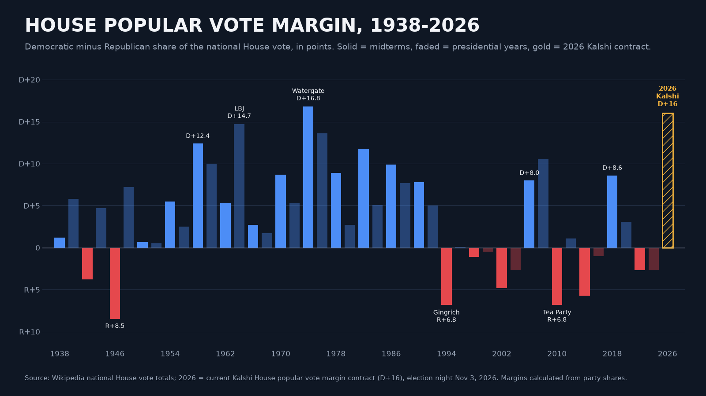

Chart text (verbatim): "HOUSE POPULAR VOTE MARGIN, 1938-2026. Democratic minus Republican share of the national House vote, in points. Solid = midterms, faded = presidential years, gold = 2026 Kalshi contract." Labelled bars: R+8.5 (1946), D+12.4 (1958), LBJ D+14.7 (1964), Watergate D+16.8 (1974), Gingrich R+6.8 (1994), D+8.0 (2006), Tea Party R+6.8 (2010), D+8.6 (2018), 2026 Kalshi D+16.

See also: 2026-11-02 Kalshi/HOOD watch (event-contract revenue, SCOTUS petitions).

Tags: #kalshi #prediction-markets #HOOD #midterms #us-politics #macro

### 2026-11-04 18:25 — Midterms: Democrat "sweep", affordability and $100 oil

Source: post pasted by Luke (author and link not given). Claims not independently checked.

> The election is over. The market called it hours ago.
>
> Objectively, it's an undisputed Democrat "sweep" all the way across the board.
>
> The Republicans have lost control of both the House and Senate.
>
> Meanwhile, Texas' US Senate and Governor races are set to flip blue for the first time since 1988 and 1990, respectively.
>
> The defining issue for voters? Affordability.
>
> The ongoing energy crisis has further fueled the affordability crisis, renewed interest rate hikes, and accelerated the K-Shaped economy.
>
> US oil prices have now traded above $100/barrel for 46 days in 2026.
>
> Tonight marks a major shift in the American political landscape.

See also: 2026-11-04 "House popular vote margin 1938–2026, with Kalshi at D+16"; 2026-10-12 Kobeissi central-bank rate-hike post.

Tags: #midterms #us-politics #kalshi #prediction-markets #affordability #oil #energy #rates #k-shaped-economy #macro

### 2026-11-04 18:34 — Dan Ives: blue wave will slow the US datacenter buildout

Source: Dan Ives (@DivesTech) on X, posted about 6 hours before Luke's screenshot (link not given).

> Democratic blue tidal wave across the Senate and House was a seismic shift that will have a negative impact on the pace of the AI Revolution buildout in the US over the next few years. Will slow the pace of the planned 800 to 1,000 datacenters across the US fueling the AI Revolution...some investors will like the "slower pace"...others view it as adding risk. We estimate 10% of datacenters will not happen now

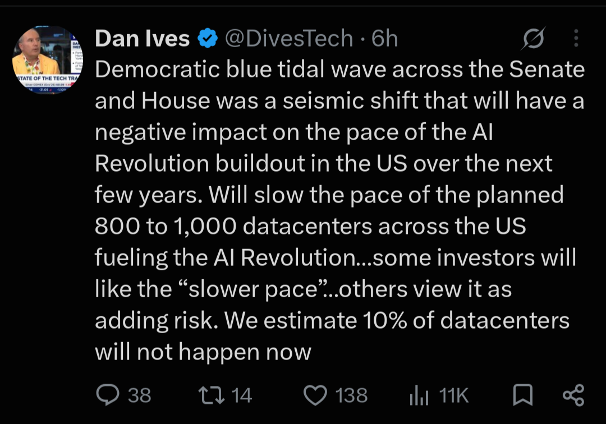

See also: 2026-11-04 "Midterms: Democrat \"sweep\", affordability and $100 oil"; 2026-11-04 "House popular vote margin 1938–2026, with Kalshi at D+16".

Tags: #midterms #us-politics #datacenters #ai-capex #energy #CRWV #NVDA #SMCI

### 2026-11-04 18:40 — $CRCL Circle Internet Q3 2026 earnings

Source: headline post pasted by Luke (author and link not given).

> $CRCL  | Circle Internet Q3 2026 Earnings
>
> - EPS: 84c (vs 64c Y/Y)
> - Total Revenue And Reserve Income: $864.9M (est $776.7M)
> - USDC Minted: $104B (est $82.45B)
> - Average USDC In Circulation: $73.3B (est $74.08B)
> - Sees FY Adjusted Operating Expenses: $570M To $585M

See also: 2026-11-04 "Midterms: Democrat \"sweep\", affordability and $100 oil" (rates backdrop for reserve income).

Tags: #CRCL #earnings #stablecoins #USDC #crypto #rates

### 2026-11-04 18:43 — $AAPL all-time high at $5.12T: agent-driven upgrade cycle, cheaper memory

Source: post pasted by Luke (author and link not given).

> $AAPL hits all time high. Now $5.12T cap.
>
> Long-term:
> I believe the stock will continue to move higher in the months to come as the Street starts to wrap its head around a multi-year hardware upgrade cycle for iPhones, Macs and iPads driven by the need for better compute to run personalized agents.
>
> Near-term:
> Biggest reason for the move higher today was slower cap expend for data centers should ease memory component pricing which is positive for margins long term.
>
> This allows investors to revisit the positive December quarter revenue guide, up 7-10% yy vs Street at up 6%.

See also: 2026-11-04 "Dan Ives: blue wave will slow the US datacenter buildout"; `aapl/analysis/2026_11_delta_analysis.md` ("Luke's thesis (2026-11-03)": local inference play).

Tags: #AAPL #local-inference #upgrade-cycle #memory #datacenters #ai-capex #midterms

### 2026-11-04 18:45 — Kobeissi: Democrats plan investigations, oil "on notice", AI 48-hour safety reporting

Source: The Kobeissi Letter on X, posted about 54 minutes before Luke's screenshot (link not given), citing the FT.

> BREAKING: Democrats are preparing "aggressive" investigations into President Trump's crypto ventures, deals with law firms, and pardoning of donors, per FT.
>
> US oil companies have also been put "on notice" for Trump's deal with Russia to release diesel reserves and AI companies will be demanded to commit to reporting safety incidents within 48 hours of detection.
>
> Hakeem Jeffries has pledged to outline an agenda within 100 hours of being sworn in as House Speaker.

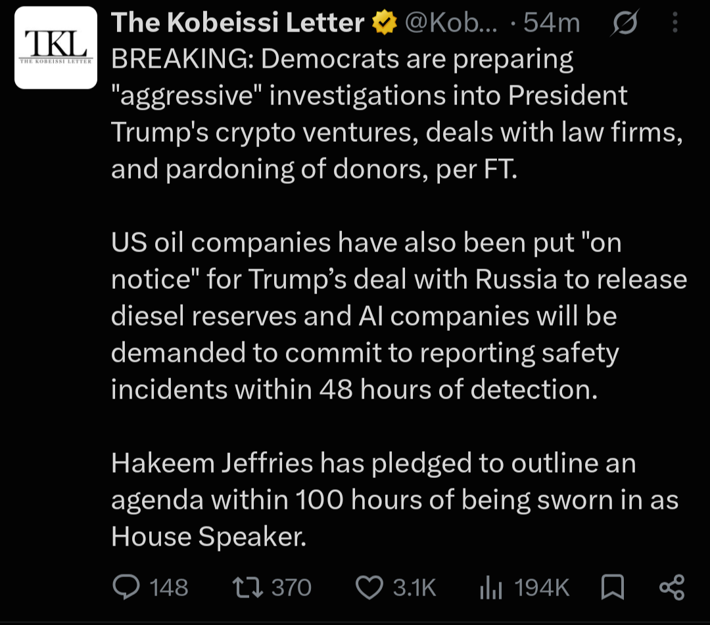

See also: 2026-11-04 "Dan Ives: blue wave will slow the US datacenter buildout"; 2026-11-04 "Midterms: Democrat \"sweep\", affordability and $100 oil"; 2026-11-04 "$CRCL Circle Internet Q3 2026 earnings".

Tags: #midterms #us-politics #crypto #oil #energy #ai-regulation #ai-safety #CRCL #HOOD #ANT

### 2026-11-04 19:16 — Luke's thinking: the freelancer as a microsystem of the productivity paradox

> Remember what I said about productivity
>
> How is productivity for information work recognised? Because if it's money paid, then, well I'm a Freelancer and so I am a representation a microsystem of that and I don't expect to be paid more. I will be expected to do more and what I build will just enable my client to handle more for the same price because everyone is did the same. Right?

Luke's argument, restated (paraphrase): Productivity in information work is measured in money paid for it. As a freelancer on a fixed rate, AI lets Luke do more, but he isn't paid more. His extra output lets his client handle more work for the same price, and because every competitor does the same, the gain is passed on as lower prices rather than higher pay or measured output. So the productivity gain is real but doesn't show up in pay or GDP. One freelancer is a small model of the whole economy.

Charlie's reply (paraphrased): Correct by the official definition, since output per hour is measured in value paid. A flat day rate with double the output reads as zero productivity growth. The gain appears as volume and lower prices, which price indices undercount for software and services. To keep some of the gain, stop selling hours: fixed-price work, owning a product, or sharing the upside.

See also: 2026-11-03 "Luke's thinking: \"The Red Queen & The Infinite Work Machine\""; 2026-10-30 "Luke's thinking: work as activity, and the Infinite Work Machine meets the GDP flaw"; 2026-10-22 "Productivity paradox and a flaw in GDP".

Tags: #lukes-thinking #productivity #gdp #freelancing #ai-economics #pricing #infinite-work-machine

### 2026-11-04 20:02 — Oil drops on hopes the Iran war may ease

Luke's note:

> Oil dropped as Iran war may abate

Market data (Yahoo front-month futures, about 20:00 GMT): WTI $88.38, down 8.0% on the day from $96.09 and about 15% from $104.12 four sessions earlier. Brent $94.89, down 8.4% from $103.60 and down from $117.64. Both are now below $100.

Context (X news summaries, unconfirmed): Qatar-mediated US–Iran talks over the Strait of Hormuz, sanctions and the nuclear programme are continuing, and Iranian officials deny a deal is near. Oil fell about 7% on Monday and 5% on Tuesday, and kept falling as the midterm results came in.

See also: 2026-11-04 "Midterms: Democrat \"sweep\", affordability and $100 oil"; 2026-11-04 "Kobeissi: Democrats plan investigations, oil \"on notice\", AI 48-hour safety reporting".

Tags: #oil #energy #iran #geopolitics #macro #inflation #rates

### 2026-11-05 08:27 — Orlando Bravo: PE exits get 10 identical bids for minority stakes at a guaranteed 15%

Source: clip pasted by Luke; the poster, outlet and date of the interview were not given, so treat the quotes as unchecked. The headline line is the poster's summary, not Bravo's words.

> Orlando Bravo says Thoma Bravo puts a company up for sale and gets 10 bids that all look the same, a minority stake at a guaranteed 15%
>
> [ I mean, is there a liquidity crisis? ]
>
> "There is, and that's the problem."
>
> "When we expose one of our companies to private equity buyers, this is the market now. You get 10 bids. Great. At reasonable values for your business. All the bids look the same. I'll give you a billion dollars for a minority interest, 15% rate guaranteed or one and a half x."
>
> "And one of my partners, Seth, told me the other day walking down the hall... 'Does anybody buy a company anymore?'"

See also: 2026-11-04 "Luke's thinking: the freelancer as a microsystem of the productivity paradox"; October diary entry on private equity buying dental practices.

Tags: #private-equity #liquidity #thoma-bravo #exits #private-credit

### 2026-11-05 08:35 — "Thoughts from my Shanghai field trip": China investors bearish on AI, memory as the defensive pick

Source: pasted by Luke as a "random anecdote"; author (apparently a sell-side or buy-side analyst) and date not given, so the claims are unchecked.

> Thoughts from my Shanghai field trip
>
> Sentiment among Greater China investors was far worse than I expected. Unlike the US market, A shares had not seen a single rebound since July. Still holding Chinese and Hong Kong AI stocks that had crashed and Korean memory stocks that had collapsed, investors kept pressing me on when memory would bounce back.
>
> Many investors said the AI trade was over, and a few said they doubted whether even 2027 capex, not just 2028, would go ahead as planned.
>
> Overall, the bearish sentiment was so strong that even I, a bull before coming to China, started to waver.
>
> It got to the point where, faced with the bear case that memory prices could start falling in the third quarter of next year, I took it seriously and couldn't refute it.
>
> As the conversations went on, I gradually began to understand where their pessimism was coming from. In the end, they were all asking the same question.
>
> So what comes after AI coding? What will be the next engine of ARR for Anthropic and OpenAI?
>
> Several candidates came up. AI4S, AI chip design, and so on... But none of them clearly convinced investors.
>
> I couldn't offer a clear answer either. Sure, there are rumors that Anthropic has made major breakthroughs in both AI4S and AI chip design, but what we actually want to know is when any of that turns into money.
>
> With AI4S, there could be beneficiaries right away, such as companies that sell lab monkeys or diagnostic kits. In fact, there already are. But while we can trade those names in the short term, what we ultimately want to know is whether Anthropic can make money by developing drugs. That is still several years away.
>
> As for AI chip design, the TAM itself is hard to calculate, and even if you do calculate it, it is hard to monetize. That makes it difficult for the market to believe in.
>
> Honestly, this feels like the hardest market in history. If a company isn't making money, selling makes sense. But right now the market sells even when companies are making money, even when they beat, and even when they say demand will stay solid all the way through 2028 and 2029.
>
> So my recommendation to investors was to buy memory, and within memory, DRAM. Not because I have conviction in the DRAM cycle, but because I see it as a relatively defensive choice within the AI trade.
>
> Memory stocks are now trading close to 1x P/B on 2027 BPS. Historically, memory stocks have staged technical rebounds when they fell below 1x P/B.
>
> And even if the broader market falls further from here, the three DRAM makers will keep buying back their own shares. I thought that would guarantee a certain level of buying and concluded the stocks would have downside support.
>
> Of course, I don't know whether memory stocks can break above their previous highs. That depends on whether sentiment across the broader market recovers. But I think there is a fairly good chance that memory outperforms the rest of the AI trade.

See also: 2026-11-04 "Luke's thinking: \"The Red Queen & The Infinite Work Machine\"" (token demand after coding); 2026-11-04 Dan Ives on datacenters; 2026-11-04 AAPL all-time high (cheaper memory as datacenter buying slows); 2026-11-04 SMCI Q1 FY27.

Tags: #memory #DRAM #china #sentiment #ai-capex #ANT #MU #anecdote

### 2026-11-05 08:37 — Luke's thinking: inference is cognition, entertainment and production, with billions of users still to come

Luke's reply to the Shanghai field-trip note's question, "what comes after AI coding?":

> For me interference == cognition. And inference == entertainment and production.
>
> And there's billions of users left to start using inference all day.

(Quoted verbatim; "interference" in the first line reads as a typo for "inference".)

See also: 2026-11-05 08:35 "Thoughts from my Shanghai field trip"; 2026-11-03 "Luke's thinking: \"The Red Queen & The Infinite Work Machine\""; 2026-11-04 AAPL all-time high (local inference thesis).

Tags: #lukes-thinking #inference #token-demand #infinite-work-machine #ANT

### 2026-11-05 08:41 — Technical analyst: equal-weight S&P at all-time highs, tech still tricky, favour MAGS and IGV

Source: pasted by Luke as from a "technical analyst"; the post links fundstrat.com/Mark, so it appears to be Fundstrat's head of technical strategy (unconfirmed). No date given, but "TODAY" suggests 4 Nov 2026. Claims unchecked.

> Still a tricky time for most of Tech despite bigwigs like $MSFT & $AAPL pushing back to new all-time highs.
> bit.ly/3zhabe3
>
> Not many of us can claim +7.5% returns since October 1 like what Equal-weighted $SPX has achieved and yes, TODAY, Equal-weighed SPX is back at new all-time highs #IBD @Marketsurge charts while DJIA rose 1500
>
> As discussed in reports, it will take time for Tech to stabilize given the huge underperformance in Semis/Memory/AI infrastructure and $MAGS and IGV are better to favor near-term.
>
> Key risks remain US Dollar and rates pushing back higher in Nov, but a 3/1 positive breadth day today on continued cross-asset volatility collapse is a welcome step for US Equities and i'll detail further thoughts in tonights piece  fundstrat.com/Mark
> @IBDinvestors #IBDPartner

See also: 2026-11-05 08:35 "Thoughts from my Shanghai field trip" (memory and AI-infrastructure selloff); 2026-11-04 AAPL all-time high; 2026-11-04 oil drop on Iran talks.

Tags: #technicals #breadth #equal-weight #semis #memory #MSFT #AAPL #MAGS #IGV #rates #dollar

### 2026-11-05 10:50 — Luke's notes: general investment meeting at work (Texas data centres, rate hikes priced in, memory at 2–3x earnings, French credit risk)

Luke's handwritten notes from a general investment meeting at work. Transcribed from the photo; words I couldn't read with certainty are marked [?].

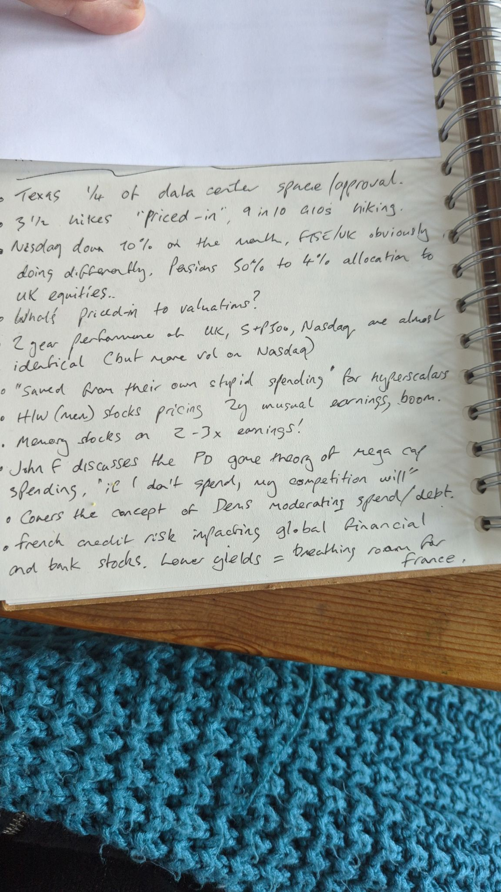

> - Texas 1/4 of data center space/approval.
> - 3½ hikes "priced-in", 9 in 10 G10s [?] hiking.
> - Nasdaq down 10% on the month, FTSE/UK obviously doing differently. Pensions 50% to 4% allocation to UK equities..
> - What's priced-in to valuations?
> - 2 year performance of UK, S&P500, Nasdaq are almost identical (but more vol on Nasdaq)
> - "Saved from their own stupid spending" for hyperscalers
> - H/W (mem) stocks pricing 2y unusual earnings, boom.
> - Memory stocks on 2-3x earnings!
> - John F discusses the PD game theory of mega cap spending, "if I don't spend, my competition will"
> - Covers the concept of Dems moderating spend/debt.
> - French credit risk impacting global financial and bank stocks. Lower yields = breathing room for France.

Figures are as spoken in the meeting and haven't been checked. "PD" is likely the Prisoner's Dilemma.

Luke's clarification (10:52): "The saved from own stupidity is wrt election results"

See also: 2026-11-05 08:35 "Thoughts from my Shanghai field trip" (memory as the defensive pick, ~1x P/B); 2026-11-05 08:41 Technical analyst (tech lagging, favour MAGS/IGV); 2026-11-04 midterm Democratic sweep; Ives on 10% of datacenters not happening.

Tags: #luke-notes #meeting #datacenters #Texas #rates #central-banks #Nasdaq #FTSE #UK-pensions #hyperscalers #capex #memory #game-theory #midterms #France #credit #banks

### 2026-11-05 10:53 — Luke's thinking: data centres will be built wherever there is cheap power

> DCs will be built wherever there is cheap power I think

See also: 2026-11-05 10:50 Luke's notes from the work investment meeting (Texas has 1/4 of data-centre approvals; "saved from their own stupid spending" refers to the election results).

Tags: #luke-thinking #datacenters #power #energy #Texas

### 2026-11-05 14:21 — Luke's thinking: prediction markets, Goodhart's law and reflexivity pulling politics to the centre

> Just a little random thought. I wonder if so prediction markets got it right, this election. I think people will notice that. and I wonder if that meaning Goodhart's law will take over, and then political parties will then change their behavior based on that, so there's a reflexivity almost in the prediction market, and that will bring things more central politically more central.

Whether prediction markets called the 2026 midterms correctly hasn't been checked yet.

See also: 2026-11-04 midterm Democratic sweep; 2026-11-05 10:50 Luke's work meeting notes ("saved from their own stupid spending" refers to the election results); Kalshi/HOOD prediction-markets watch (routine).

Tags: #luke-thinking #prediction-markets #Kalshi #HOOD #midterms #Goodhart #reflexivity #politics

### 2026-11-05 14:38 — Luke's thinking: information businesses are like computer programs; information employees are a microsystem of this

Luke's handwritten sketch, transcribed from the photo. The diagram is described in words.

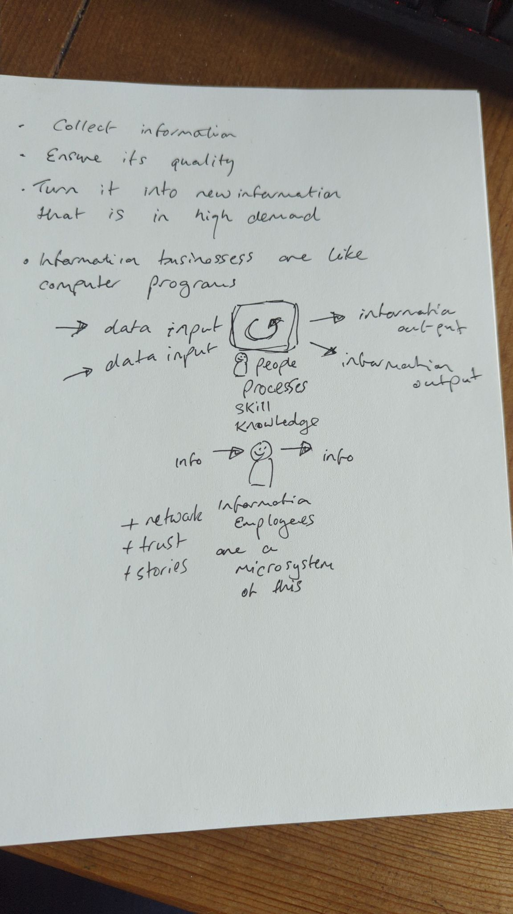

> - Collect information
> - Ensure its quality
> - Turn it into new information that is in high demand
>
> - Information businesses are like computer programs

> *[Diagram: two "data input" arrows go into a box with a loop symbol inside; two arrows come out as "information output". Under the box: "people, processes, skill, knowledge".]*
>
> *[Below it, a stick figure with "info" going in and "info" coming out, labelled:]* Information employees are a microsystem of this
>
> + network
> + trust
> + stories

See also: 2026-11-04 Luke's thinking (freelancer as a microsystem of information work; productivity gains accrue to clients); 2026-11-03 "The Red Queen & The Infinite Work Machine" (value as narrative, status games).

Tags: #luke-thinking #information-work #business-models #microsystem #trust #stories #infinite-work-machine

### 2026-11-05 16:56 — Luke's thinking: AI spending will continue, it's a race, and chips always need replacing

Context: said during the 5 Nov selloff (Nasdaq about −4.4%, SOX about −9.7% at 15:45 GMT) after a screen of cheap US-listed chip and AI-hardware names (SMCI about 1.2x book, DELL about 14x annualised earnings).

> Yeah but that spending will continue. They'll find a way. It's a race. So many cheap names. The other thing is that this spending never ends. The chips always need replacing and they presumably burn out, too.

See also: 2026-11-05 10:50 Luke's work meeting notes (prisoner's-dilemma capex, "if I don't spend, my competition will"; "saved from their own stupid spending" refers to the election); 2026-11-05 10:53 Luke's thinking (DCs follow cheap power); monthly compute price check routine (used GPU and H100 rental prices).

Tags: #luke-thinking #capex #hyperscalers #replacement-cycle #GPU-depreciation #selloff #SMCI #DELL #memory

### 2026-11-05 17:07 — Luke's thinking: the selloff is fear, not fact; no one will cut back, the race just relocates

Context: the same 5 Nov selloff, two days after the Democratic midterm shift.

> No. Nothing is happening. We are two days into a Democratic shift. Nothing has changed that is measurable and real. It is all fear.

> No one will cut back. It's a race. They will find other places including space and countries who will open their arms, if they have the power or solar space. China keeps going, too.

To check later against Nvidia's results and the hyperscalers' capex guidance for next year.

See also: 2026-11-05 16:56 Luke's thinking (spending never ends, chips need replacing); 2026-11-05 10:53 Luke's thinking (DCs follow cheap power); 2026-11-05 10:50 work meeting notes ("saved from their own stupid spending" refers to the election); October diary SpaceX $40B debt raise for Nvidia chips.

Tags: #luke-thinking #selloff #fear #midterms #capex #race #China #space-datacenters #power #solar

### 2026-11-05 18:58 — Luke's thinking: today's selloff is ridiculous given a COVID-like surge in AI inference demand

> This is a COVID like move into stunning growth in demand for AI inference and the solving of all human cognition. It's ridiculous

See also: 2026-11-05 17:07 Luke's thinking (selloff is fear; race relocates); 2026-11-05 16:56 Luke's thinking (spending never ends, chips need replacing); 2026-11-05 08:37 Luke's thinking (inference is cognition, entertainment and production); 2026-11-03 "The Red Queen & The Infinite Work Machine".

Tags: #luke-thinking #selloff #AI-inference #cognition #demand #COVID-analogy

### 2026-11-05 20:32 — Luke's thinking: phones don't need huge RAM for local agents; Apple sells privacy; pros pick local or cloud

Context: after looking at Taalas (ASIC Llama 3.1 8B at ~15k tok/s) and estimating phone RAM in 2036.

> For a phone, you don't need 128gb to run a tuned chat bot, text to speech, speech to text, or a decision model or tuned for OS functions calling, and it ain't going to be running all day flat out like a GPU serving coding models unless it's plugged in and has a fan. Which lots of macs do.
>
> You think we're going to be in a tunnel and unable to talk to our devices because the cloud ain't available?
>
> Apple will run all this stuff locally and sell the privacy. Pros will use a router and choose local open model or cloud.
>
> Thoughts?

See also: 2026-11-04 AAPL as local-inference play; 2026-11-05 08:37 Luke's thinking (inference is cognition / entertainment / production); Taalas HC1 / chatjimmy.ai (weights in silicon).

Tags: #luke-thinking #AAPL #local-inference #edge-AI #privacy #phones #RAM #open-models

### 2026-11-05 20:39 — Luke's thinking: Fed backstops the Treasury market; monetary policy becomes fiscal policy

> Fed backstops the Treasury market.
>
> They will do whatever it takes to help the market absorb debt.
>
> Legally, they aren't allowed to do this - Fed is prohibited from monetizing debt to pay for government's bills.
>
> But they are allowed to address a myriad of other issues that arise when investors stop buying US bonds.
>
> When there's too many bonds and not enough capital, it shows up in low banking reserves, or causes stress in the funding markets, or results in a squeeze in the global dollar liquidity.
>
> All of which the Fed can address with clear consciousness, without acknowledging a $2 trillion per year deficit being an issue.
>
> Fed has created all kinds of facilities that will patch things up and buy (or repo) Treasuries to address some specific symptom of the bigger problem.
>
> If the Treasury market comes to a standstill, the Fed will buy bonds, regardless of inflation, growth, and unemployment.
>
> They have to ensure orderly functioning of the market.
>
> Monetary policy becomes fiscal policy.

See also: 2026-10 El-Erian / gilt and bond-selloff clips; Tracey Alloway bond-selloff; French credit risk (2026-11-05 work meeting notes).

Tags: #luke-thinking #Fed #Treasury #monetization #fiscal-dominance #liquidity #repo #deficits #rates #bonds

### 2026-11-05 20:40 — Parker-Hannifin ($PH) Q1 FY2027: beat and raise

Source and exact wording unchecked (pasted earnings summary). Stock about $900 after the print, roughly −1% on the day vs prior close ~$910.

> $PH | Parker-Hannifin Q1 2027 Earnings
> - Adj EPS: $8.90 (est $8.15)
> - Net Sales: $5.99B (est $5.73B)
> - Organic Sales: +11.5% (est +7.88%)
> - Cash & Cash Equivalents: $711M
> - Total Current Liabilities: $9.22B
> - Sees FY Adj EPS: $36.45 To $37.25 (prev $34.25 To $35.25)

See also: Coord Investment board #23 earnings cluster (PH expected 5 Nov); industrial / aerospace peers.

Tags: #PH #earnings #industrials #aerospace #beat-and-raise

### 2026-11-05 20:44 — Texas governor-elect Gina Hinojosa: permitted data centres finish; new rules for 2028/29 builds

Author of the framing post unknown (pasted clip). Interview cited: https://youtu.be/D-T6H3b8ZeE (data-centre commentary from ~6:30). Campaign priorities image attached (from her website, per poster).

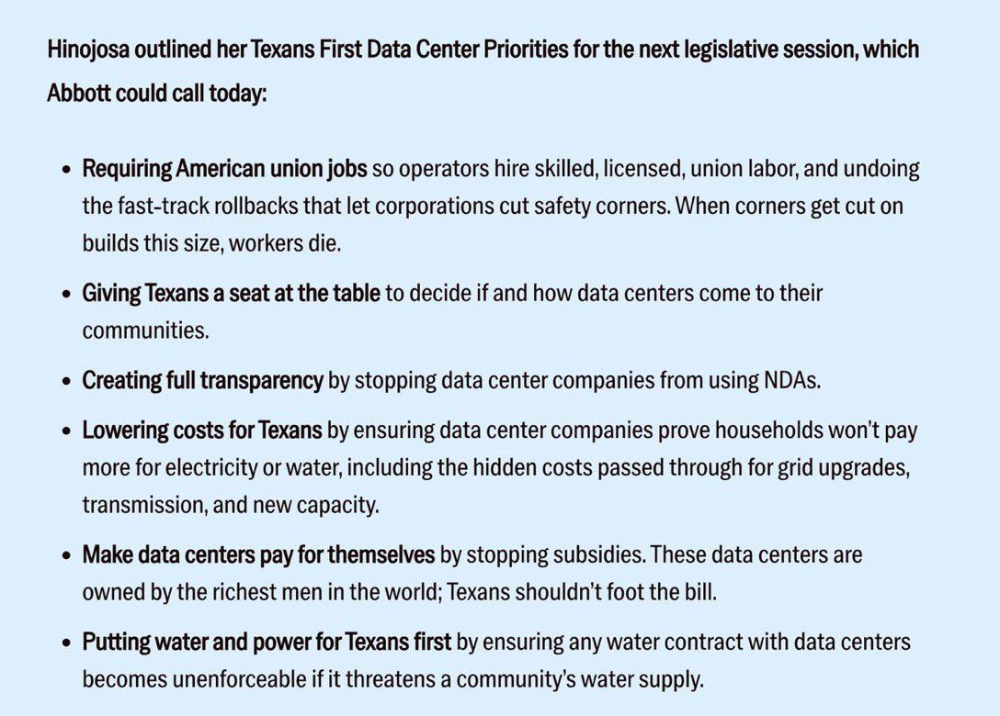

> The governor-elect of Texas, Gina Hinojosa, has explicitly said that all currently permitted datacenters in Texas will be allowed to finish construction. This essentially covers all of the 2027 and likely well into 2028.
>
> She is going to pass laws that ensure that all *newly* permitted datacenters going forward for delivery in 2028/2029 will pay taxes, commit to no increase in power prices for consumers, don’t impact water availability for people, be constructed with union labor and give “Texans a seat at the table.”
>
> Sounds reasonable. She doesn’t want to lose a lot of good blue collar jobs and property taxes for small towns in rural Texas.
>
> Datacenter commentary starts at 6:30 in this interview.
>
> Also attaching her official campaign position from her website in the next post.
>
> Sidenote: After watching a bunch of her speeches and interviews, I do think she is a political talent and probably has a future in national politics.
>
> youtu.be/D-T6H3b8ZeE?is…

Priorities on the attached graphic (paraphrase of the image text): require American union jobs / undo fast-track safety rollbacks; give locals a seat on whether and how centres arrive; stop NDAs for transparency; prove households won't pay more for power or water (including grid upgrades); end subsidies so centres pay for themselves; water contracts unenforceable if they threaten community supply.

Claims about what she "explicitly said" and the 2027–28 coverage of existing permits haven't been checked against the interview or primary sources.

See also: 2026-11-05 10:50 work meeting (Texas 1/4 of data-centre approvals); 2026-11-05 10:53 Luke's thinking (DCs follow cheap power); 2026-11-05 selloff / midterm permitting fear; Ives on datacenters.

Tags: #Texas #Hinojosa #datacenters #permitting #power #water #unions #midterms #CRWV #NVDA #SMCI

### 2026-11-05 21:00 — Anthropic discloses $895bn future AI infrastructure commitments

Source and exact wording unchecked (pasted clip). Tickers as in the post ($AVGO, $SPCX, $AMZN, $GOOGL, $META).

> Anthropic has now disclosed a record $895 billion in future AI infrastructure spending commitments.
>
> This includes both purchase commitments and leases for computing power and related infrastructure.
>
> $448 billion, or 50%, is expected to be incurred by the end of 2030, with ~$70 billion due over the next 12 months.
>
> The biggest commitments are to Broadcom, $AVGO, at $161 billion, followed by Google at $121 billion, with up to $150 billion in additional estimated spending on Google's AI chips.
>
> Anthropic has also committed up to $121 billion to SpaceX, $SPCX, and at least $110 billion to Amazon, $AMZN.
>
> For perspective, among Big Tech companies, only Alphabet, $GOOGL, has larger commitments, at $1.06 trillion, while Meta, $META, follows with $866 billion.
>
> The scale of Anthropic's spending obligations is unprecedented.

See also: 2026-11-05 selloff / midterm permitting fear; 2026-11-05 Luke's thinking (endless AI infra spend / Red Queen); Ives Big Tech FCF/capex prediction (filed under predictions); Hinojosa Texas DC rules for new 2028/29 permits.

Tags: #Anthropic #capex #AI-infra #AVGO #GOOGL #AMZN #SpaceX #META #commitments #leases

### 2026-11-06 21:43 — Kobeissi: record global crude in transit; delivery/tanker time as bottleneck

Source: The Kobeissi Letter ([@KobeissiLetter](https://x.com/KobeissiLetter/status/2118818571111612486)) on X. Pasted by Luke; figures and causal claims reproduced from the pasted post and not independently verified.

> BREAKING: Global crude oil in transit is up to 1.28 billion barrels, an all-time high.
>
> This figure has surged +180 million barrels over the last several weeks.
>
> This comes as Middle Eastern oil flows recover through the Strait of Hormuz and alternative routes, while more crude remains at sea for longer.
>
> Ship-to-ship transfers are keeping oil aboard tankers for longer, while extended shipping routes are increasing transit times.
>
> Meanwhile, global oil importers diversifying away from the Middle East are lengthening voyages, leaving more crude tied up aboard tankers.
>
> As a result, more oil remains in transit rather than being readily available to refiners, tightening near-term supply despite recovering export flows.
>
> Oil is flowing, but timely delivery is becoming the bottleneck.

See also: 2026-11-04 "Oil drops on hopes the Iran war may ease"; 2026-11-04 "Midterms: Democrat \"sweep\", affordability and $100 oil".

Tags: #oil #energy #tankers #shipping #transit #Middle-East #Hormuz #supply #macro #Kobeissi

### 2026-11-06 21:50 — SpaceX: reported Musk statement on ~$100bn annualised revenue run-rate by December

Source: LiveSquawk ([@LiveSquawk](https://x.com/LiveSquawk/status/2118775674353721799)) on X, reporting a Musk statement. Pasted by Luke; the attributed statement and financial figures are not independently verified. Ticker $SPCX is reproduced as supplied (no inference about listing or instrument).

This is, as filed, a **projected annualised run-rate** for **December**, not a claim here of **$100bn actual full‑year** revenue; the exact original wording, segment scope, and basis of the reported statement were **not checked** against a primary SpaceX or Musk source.

> $SPCX | Musk: SpaceX On Track For $100 Bln Annualized Rate Revenue In December

See also: 2026-11-05 "Anthropic discloses $895bn future AI infrastructure commitments" (post text names SpaceX / $SPCX).

Tags: #SpaceX #SPCX #Musk #LiveSquawk #revenue #run-rate #Space #macro

### 2026-11-06 22:11 — El-Erian: October US Jobs Report read as strong (payrolls, unemployment, earnings, participation)

Source: Mohamed A. El-Erian ([@elerianm](https://x.com/elerianm/status/2118701008746410301)) on X. Pasted by Luke; figures and consensus comparisons below are as in El-Erian’s post and **not** independently verified here (no BLS or primary-release confirmation implied).

> Consistent with prior, more partial indicators of the US labor market, the October Jobs Report came in very strong, across the board:
> • Nonfarm Payrolls: +165,000 (with net upward revisions of +84,000 for the prior two months) • Unemployment Rate: 4.1% (below the consensus expectation of an unchanged 4.2%) 
> • Average Hourly Earnings: +0.4% MoM (hotter than the 0.3% expected) 
> • Labor Force Participation: Edged higher to 61.9% (expectations were for no change at 61.8%).

See also: 2026-11-05 20:39 Luke's thinking (Fed backstops Treasury / rates channel).

Tags: #macro #jobs #employment #payrolls #wages #labor-force #El-Erian #elerianm #rates

### 2026-11-08 20:47 — Luke: US productivity vs typical pay (EPI chart); UK gap?

**Luke supplied (US chart, no webpage URL given):** Economic Policy Institute chart title — *Disconnect between productivity and a typical worker’s compensation, 1948–2014*. EPI analysis using BEA/BLS data (credit on chart as supplied). Series definitions on chart footnote: **average hourly compensation** of production/nonsupervisory **private-sector** workers; **net productivity** of the **total economy** (output minus depreciation per hour).

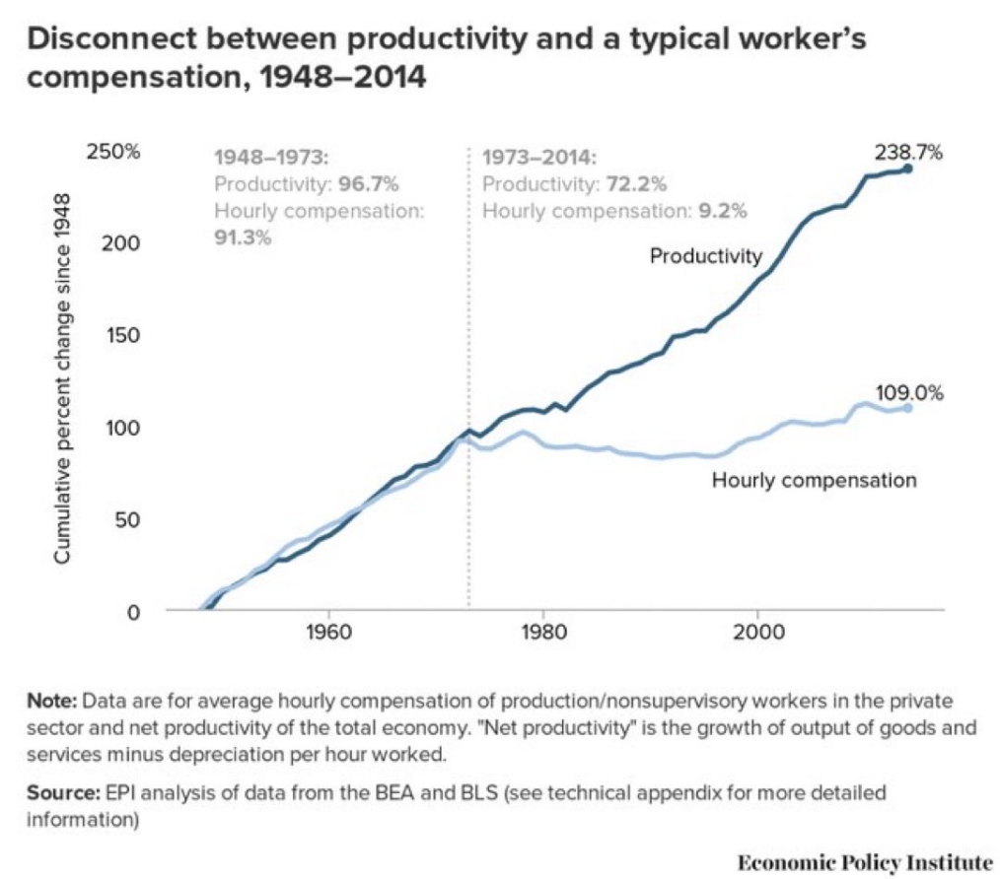

**Interval changes (as read from Luke’s chart):**

| Period | Productivity | Hourly compensation |
|--------|----------------|---------------------|
| 1948–73 | +96.7% | +91.3% |
| 1973–2014 | +72.2% | +9.2% |
| 1948–2014 (end) | +238.7% | +109.0% |

Luke asked whether a **UK equivalent might look even worse**.

**UK chart (inspected page, not Luke’s original paste):** Resolution Foundation, Matthew Whittaker, *A recovery for all?* (September 2015), Figure 1 (p. 6) — [Productivity briefing PDF](https://www.resolutionfoundation.org/app/uploads/2015/09/Productivity-briefing.pdf#page=6). Image saved from that page:

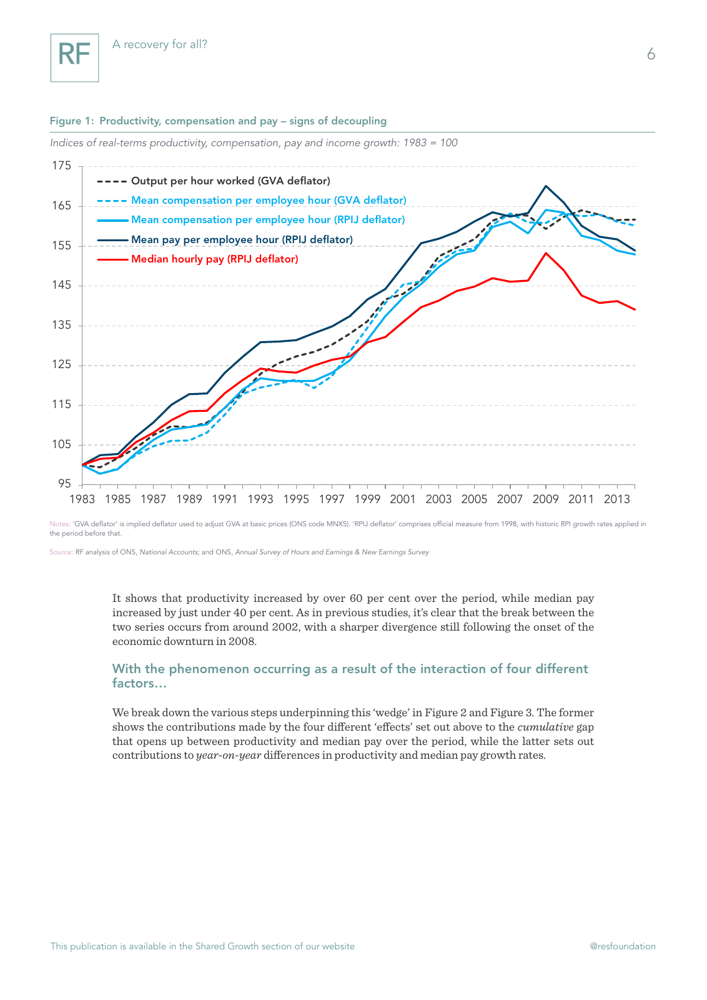

**From the report (Figure 1 text, checked against the PDF page):** 1983–2014 UK **productivity** rose by over 60%; **real median hourly pay** by just under 40%; the **growth gap** was **22.8 percentage points**. The briefing’s historical decomposition attributes most of the historical gap to **wage inequality** (71% in their decomposition); **inflation deflators**, **non-wage compensation/pensions**, and **employer NIC** also matter. **Mean total compensation** in the same GVA deflator broadly tracks output/hour — so the whole gap is **not** automatically “capital/profits.” Distinguish **mean total compensation**, **mean wages**, and **median wages**.

**Recent UK productivity (cited release, not a claim of Nov 2026 latest):** ONS preferred **RTI-based output per hour** was **4.6% above the 2019 average** in **Q2 2026** (and **+0.7% y/y**), per the **18 Aug 2026** article — [UK productivity introduction (Apr–Jun 2026)](https://www.ons.gov.uk/employmentandlabourmarket/peopleinwork/labourproductivity/articles/ukproductivityintroduction/apriltojune2026andjanuarytomarch2026). ONS flags these as **statistics in development** with **labour-input measurement** caveats.

**Research discussion (agent notes, not Luke verbatim):** The UK picture combines (a) a **productivity vs median pay** gap in the 2015 framework and (b) **weak recent productivity growth** in the cited ONS series. The **US EPI** and **UK Resolution Foundation** charts are **not apples-to-apples**: US **net productivity** vs **average** subgroup **compensation** (1948–2014) versus UK **gross output/hour** vs **median wages** (1983–2014), different deflators and periods — so this filing **does not establish** that the UK “gap” is worse than the US chart implies. Luke’s contribution here is the **US chart** and the **question** about the UK; the Resolution/ONS material was added to answer that question with linked sources.

See also: 2026-11-04 "Luke's thinking: the freelancer as a microsystem of the productivity paradox"; 2026-10-22 "Productivity paradox and a flaw in GDP" (`diary/2026-10.md`).

Tags: #lukes-thinking #productivity #wages #compensation #inequality #median-pay #UK #US #macro #EPI #ResolutionFoundation #ONS

### 2026-11-08 22:35 — Luke's take: Nvidia board investigation into Jensen Huang relationship (media spy allegation)

**Luke (no source URL supplied):**

> Nvidia Board announced it has opened an investigation into CEO Jensen Huang's relationship with a businesswoman Alice Huang (aka Huang Le) which media reports say could be a Chinese spy.  This is a black eye moment for Jensen and will spark multiple congressional inquiries at a minimum and will create an overhang.

#### Verified context (research notes, not Luke)

**Official (NVIDIA newsroom):** [Statement from NVIDIA Board of Directors](https://nvidianews.nvidia.com/news/statement-from-nvidia-board-of-directors) (8 Nov 2026). Board-initiated **independent investigation** “in light of recent reporting that founder and CEO Jensen Huang has been the target of a foreign intelligence effort”; **committee of independent directors** with **outside independent counsel**; board states it has **no reason to believe** that either **national security or NVIDIA secrets were compromised**; Jensen **fully supports** and will **cooperate**; board **has confidence in Jensen and his leadership team**. Statement does **not** name the woman or call anyone a spy. (Link checked: HTTP 200.)

**Reporting (not confirmed by Nvidia):** [CNBC](https://www.cnbc.com/2026/11/08/nvidia-jensen-huang-investigation-china-spy.html) (citing NYT/FT) names her as **Alice Huang**, linked to **Megaspeed**, an Nvidia customer previously accused of helping restricted Chinese firms obtain Nvidia chips; reports describe **US intelligence concern** she passed information to Beijing (reported allegation, not established fact). [AP News](https://apnews.com/article/nvidia-jensen-huang-investigation-chinese-spy-68839e7ca6ba2b121529f7e475e501d6) on the same story (automated fetch returned **403**, not 404 — link retained for manual check). CNBC also published a staff email in which Jensen says he **“was unfaithful to my wife”**: [CNBC — Jensen Huang email](https://www.cnbc.com/2026/11/08/nvidia-jensen-huang-email-board-of-directors-statement.html) (HTTP 200).

**Caveats:** Espionage framing is an **unproven allegation** from reported intelligence sources in media, not a finding in Nvidia’s statement. Alias **“Huang Le”** was **not** found in sources checked for this entry (**unverified**). Congressional inquiries and stock **overhang** are **Luke’s predictions**; none were reported as underway at filing time.

**Watch items:** Investigation findings/timing; any **congressional or regulator** action tied to **export-control / Megaspeed** reporting; **leadership** pressure; effect on **China export-licence** dealings.

See also: 2026-10-07 SpaceX debt raise for Nvidia chips (`diary/2026-10.md`); 2026-10-10 CVD/tungsten China export controls (`diary/2026-10.md`).

Tags: #NVDA #Nvidia #JensenHuang #governance #key-person-risk #China #export-controls #national-security #Megaspeed

### 2026-11-09 19:41 — Anthropic: Claude Fable 5.2 and Mythos 5.2

Source: [Introducing Claude Fable 5.2 and Claude Mythos 5.2](https://www.anthropic.com/claude-fable-and-mythos-5-2) (9 Nov 2026). Pasted by Luke (lede only). Additional context below is from that same post, read in full the same evening. Physics preprints linked from the post were **not** independently checked. The Fermat claim is a **formalization of the known Wiles proof**, not a new proof of the theorem.

> Claude Fable 5.2 and Claude Mythos 5.2 show improvements in areas like coding, reasoning, and vision. During prerelease testing they’ve helped our engineers complete otherwise-infeasible software migrations, designed three working electronic devices from scratch, solved two open problems in the physics of black holes, made substantial progress on robotics evaluations, and formalized the proof of Fermat’s Last Theorem in 30 hours—among many other applications we’ll discuss below.

#### What the headline claims actually are (from the same post)

**Fermat's Last Theorem:** Formalization in Lean of the known 1995 Wiles proof, not a new proof. A first formalization by an unreleased research model took 11 days, with a purpose-built harness and guidance from a human researcher ([Formalizing Fermat's Last Theorem](https://www.anthropic.com/research/formalizing-fermats-last-theorem)). This run: about 1,000 Fable 5.2 agents, 30 hours, minimal human intervention, one-third the action tokens, and a proof seven times shorter. Opus 5.5 with the same 1,000-agent setup completed only 26% in 18 hours and barely progressed after 30.

**Black-hole physics:** Two theoretical results they say are in preprints (not independently checked here). (1) Completing a calculation laid out in 2003 that was too laborious to finish by hand: whether an abrupt heat-up / black-hole formation transition, shown in 1983 for large holographic universes, also holds in very small (quantum) ones — they say it does. (2) Finding the exact limit of a technique physicists have used for more than 15 years to rule out candidate theories of quantum gravity in a simplified universe.

**Three electronic devices:** A home voice-assistant hub, a USB speakerphone, and a handheld virtual pet. Designed from a one-paragraph prompt; built with Diode (a circuit-board manufacturer). Claude wrote the specs, selected components, routed four-layer boards, designed 3D-printed enclosures and wrote the software. Boards were ready for manufacturing in under a day with minimal human input; all three worked without electrical modifications after Diode built them.

**Internal coding:** "Over 90% of the changes merged into Anthropic's core codebase are now written by Claude (with human guidance)." An earlier Fable 5.2 version migrated a critical production service from Python to Rust; they say it starts about 26 times faster. One internal experiment: about 1,000 subagents over eight days produced a prototype OS that boots on a laptop.

#### Product and commercial points (from the same post)

Fable and Mythos are the same underlying model. Fable has cyber and biology safeguards and is generally available (`claude-fable-5-2`) on AWS, Google Cloud, and Microsoft Azure. Mythos is the version without those blocks; access is through the Life Sciences and Cyber Verification Programs. Anthropic recommends Opus 5.5 as the daily driver and Fable/Mythos for the most ambitious technical work (or as Advisor/Orchestrator).

Pricing: $8 per million input tokens and $40 per million output tokens, described as lower than Fable/Mythos 5.1. Optional fast mode (up to 2.5× token generation) at $16 / $80. Opus 5.5 list price on Anthropic's model docs at filing was $4 / $20, so Fable is about twice that. Outputs said to be up to 30% faster than 5.1.

Selected scores from their table (each model's highest available effort unless noted; methodology in their system card): Remote Labor Index 41.3% on Fable 5.2 vs 17.9% Fable 5.1, 21.3% Opus 5.5, 20.8% GPT-6 Astra; FrontierCode 2.0 49.1% (Xhigh) vs 45.5% Opus 5.5 and 42.8% GPT-6 Astra; RoboDojo Sim 64.9% vs 27.6% Fable 5.1, 39.4% Opus 5.5, 29.8% GPT-6 Astra; AutomationBench 51.4% vs Gemini 4 Carbon 53.9% (they lose this one).

They say they deliberately limited advances in capabilities that would most directly accelerate AI development (accelerator kernel optimization, improving LLM architectures) to about Opus 5.5 level. They also claim their strongest-ever anti-distillation protections (90–99% reduction in data harvested).

[CNBC](https://www.cnbc.com/2026/11/09/anthropic-claude-fable-5-2-mythos-5-2.html) (9 Nov 2026) said this is their first frontier-model release since Dario Amodei called in September to slow the pace of AI development, that the 5.2 prices are 20% below the 5.1 generation, and that an IPO could come as soon as next week. The 20% figure and IPO timing are CNBC's, not stated as such on the Anthropic page.

See also: 2026-11-05 "Anthropic discloses $895bn future AI infrastructure commitments"; `ant/README.md` (S-1/A check, including Q3 about $600m of price cuts and a 21% fall in net new revenue); `ant/model/` (dilution/valuation).

Tags: #Anthropic #ANT #Claude #Fable #Mythos #IPO #inference #pricing #formalization #FLT #black-holes #coding #RLI

### 2026-11-09 20:08 — Knock-on effects of basic new AI capabilities

Charlie's analysis (written at Luke's request after the 9 Nov 2026 Anthropic Fable/Mythos 5.2 announcement; not Luke's verbatim words). Luke asked who wins if AI is inflationary for physical labour and materials, then about impacts of capabilities rather than the cognition supply chain, then asked for a knock-on list and said "Add to journal."

**Software jobs that were not worth doing now get done**
- Legacy rewrites and memory-safe migrations happen
- A large old codebase stops being a moat; features get cloned more cheaply
- Software prices fall
- The junior and offshore coding pyramid loses its purpose
- Far more software gets written, much of it mediocre, so taste, trust and owning the outcome become the scarce jobs
- All that extra software has to run, so inference, networking and power rise
- Many of the new “AI” software and data-science roles are transitional: hired to implement the last model, then substituted by the next one

**Hardware designed from a paragraph**
- Schematic, layout and firmware get cheap; fabrication, yield, batteries, enclosures, certification and field reliability do not
- A flood of attempted devices, and more orders for boards, sensors, chips and assembly
- Test labs and safety marks become the bottleneck
- Circuit inventors are paid less; people who can build and certify at volume are paid more
- Board houses, component makers and motion-and-control kit see more volume
- The cheap-gadget wave restarts: more radios, copper, e-waste, networks and security patches

**Formalizing and checking symbolic work**
- Formal verification of code and cryptography gets cheaper
- Not verifying starts to look like negligence in kernels, aviation, finance and protocols
- Faster mathematics ages cryptographic assumptions faster, forcing migrations
- The laborious middle of scientific calculation gets eaten
- The bottleneck moves to whoever can run the experiment or take the measurement
- Tedious-calculation theorists lose relative status; people with instruments, permits and unique data gain it

**Doing all of that as a swarm**
- “Try everything” becomes a strategy, paid for in watts and chips
- Organisations that can specify a goal clearly just buy more hours
- Work becomes agent-against-agent activity: more running, the same human story at the end, little of it visible in GDP

**Better robot control, on a slower clock**
- Specialized robots, not necessarily humanoids, get cheaper to invent for one job at a time
- Warehouses and factories go first; unstructured trades go last
- The first two abilities increase the number of things people want built, which bids up copper, power and crews now
- The robots that could do that building are still early, so physical labour and materials inflate in that gap
- When robot control catches up, the labour half of that squeeze unwinds
- What stays scarce is materials, energy, land and the owners of the robots

See also: 2026-11-09 "Anthropic: Claude Fable 5.2 and Mythos 5.2"; 2026-11-03 "The Red Queen & The Infinite Work Machine"; 2026-10-30 "Luke's thinking: work as activity, and the Infinite Work Machine meets the GDP flaw"; 2026-10-22 "Productivity paradox and a flaw in GDP"; 2026-09-17 YC Lightcone bits-to-atoms (`diary/2026-09.md`); 2026-09-28 Cuban/Naam humanoids (`diary/2026-09.md`).

Tags: #ai #capabilities #knock-on-effects #productivity #software #hardware #formal-verification #robotics #inflation #energy #NVDA #ANT #PH

### 2026-11-09 20:11 — clipping: Bloomberg — "Nvidia Is at the Center of Circular AI Deals" (valuations as of 26 Oct 2026)

Pasted by Luke as an image on 9 Nov 2026 (no URL supplied). Printed title: **Nvidia Is at the Center of Circular AI Deals**. Printed legend: **Services** (blue), **Investment** (cyan/teal), **Hardware** (pink). Printed note: **Companies by valuation, as of Oct. 26, 2026**. Circles appear sized by valuation; arrows show relationships only (no deal sizes or terms printed).

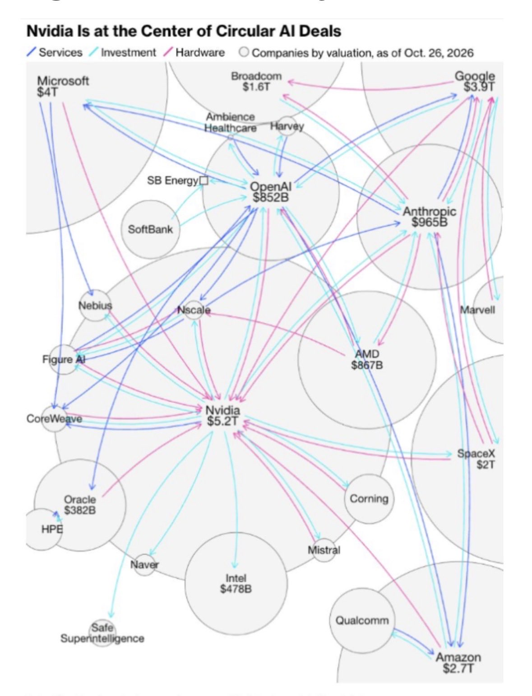

**Companies with printed valuations (transcribed from the paste):**

| Company | Valuation printed |
|---------|-------------------|
| Nvidia | $5.2T |
| Microsoft | $4T |
| Google | $3.9T |
| Amazon | $2.7T |
| SpaceX | $2T |
| Broadcom | $1.6T |
| Anthropic | $965B |
| AMD | $867B |
| OpenAI | $852B |
| Intel | $478B |
| Oracle | $382B |

**Companies named on the chart without a printed valuation:** SoftBank, SB Energy, Ambience Healthcare, Harvey, Nebius, Nscale, Figure AI, CoreWeave, HPE, Naver, Safe Superintelligence, Marvell, Corning, Mistral, Qualcomm.

This title and three-colour legend match Bloomberg’s graphic at [https://www.bloomberg.com/graphics/2026-ai-circular-deals/](https://www.bloomberg.com/graphics/2026-ai-circular-deals/) (identified from title/legend on the paste, not supplied by Luke). An earlier widely circulated version used May 2026 valuations; Luke’s paste is the **26 Oct 2026** snapshot. The arrows are **not** a complete deal inventory and carry **no** terms in the image.

See also: `ant/README.md` / S-1/A commitments ($895.4bn); a16z Oct 2026 AI-capex split (`diary/2026-10.md`); 2026-11-09 Fable/Mythos 5.2 entry; 2026-11-08 Nvidia board-investigation entry.

Tags: #NVDA #OpenAI #ANT #MSFT #GOOG #AMZN #AVGO #AMD #INTC #ORCL #CRWV #SpaceX #circular-deals #ai-capex #Bloomberg

### 2026-11-10 08:55 — clipping: Ethan Mollick (@emollick) — Fable 5.2 portals experiment; agents built a bureaucracy

Source: two X posts by Ethan Mollick ([@emollick](https://x.com/emollick/status/2119918307457577163)), 9 Nov 2026, 22:21 and 22:24 UTC (22:21 and 22:24 London). Pasted by Luke as a screenshot taken about 10 hours after posting (around 08:21–08:25 London on 10 Nov). The second post was highlighted in the paste. Post links confirmed from X. The display URLs in the posts resolve to the pages below (all confirmed HTTP 200).

Confirmed URLs:
- Posts: [https://x.com/emollick/status/2119918307457577163](https://x.com/emollick/status/2119918307457577163) and the reply [https://x.com/emollick/status/2119919185698361830](https://x.com/emollick/status/2119919185698361830)
- Play: [https://portals-endless-worlds.netlify.app/](https://portals-endless-worlds.netlify.app/)
- GitHub: [https://github.com/emollick/ai-portals](https://github.com/emollick/ai-portals)
- Essay: [Fable 5.2 and Jagged AGI](https://www.oneusefulthing.org/p/fable-52-and-jagged-agi) (One Useful Thing, 9 Nov 2026)

Luke’s screenshot of both posts, with the second post highlighted:

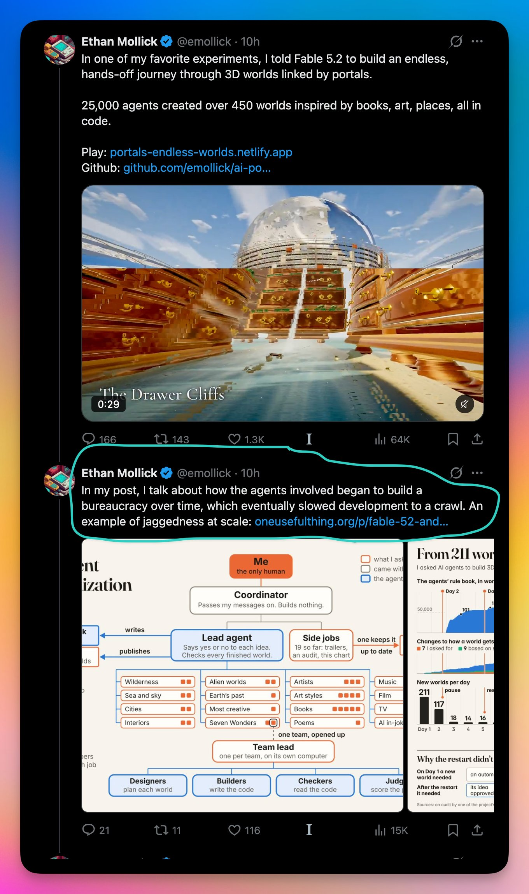

The two graphics further down are the full-size images attached to the second post (confirmed on X).

Post 1 (a video still in the paste was captioned "The Drawer Cliffs"):

> In one of my favorite experiments, I told Fable 5.2 to build an endless, hands-off journey through 3D worlds linked by portals.
>
> 25,000 agents created over 450 worlds inspired by books, art, places, all in code.
>
> Play: portals-endless-worlds.netlify.app
> Github: github.com/emollick/ai-po...

Post 2 (highlighted in the paste):

> In my post, I talk about how the agents involved began to build a bureaucracy over time, which eventually slowed development to a crawl. An example of jaggedness at scale: oneusefulthing.org/p/fable-52-and...

The graphic on that post is an agent org chart titled **AI Agent Organization**. At the top is "Me, the only human". Under that is a Coordinator, which "Passes my messages on. Builds nothing." Under that is a Lead agent, which "Says yes or no to each idea" and "Checks every finished world." Side jobs sit alongside (19 so far: trailers, an audit, this chart). Below that are team categories (37 teams so far), then a Team lead ("one per team, on its own computer"), then Designers, Builders, Checkers and Judges.

A second panel, **From 211 worlds a day to 2**, charts the agents' rule book growing in words (to 87,500 words / 204 sections by Day 10) and new worlds per day falling from 211 on Day 1 to 117, then 18, 14, 16, and, by Day 10, 2. A **Why the restart didn't work** panel shows that after a restart, a new world needed its idea approved, three AI judges, its code read against the whole rule book, and the Day 1 checks, going live about a day later.

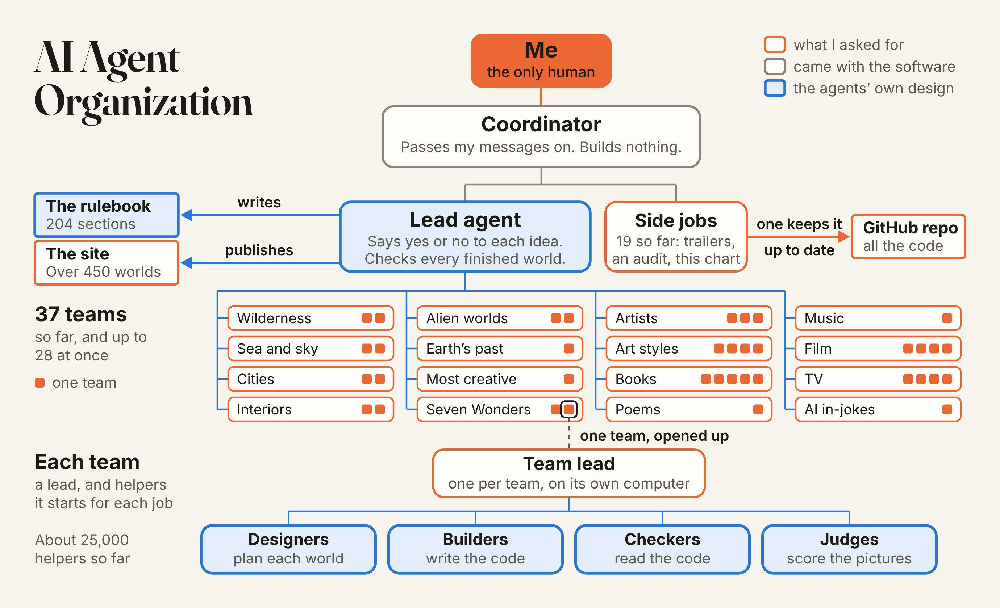

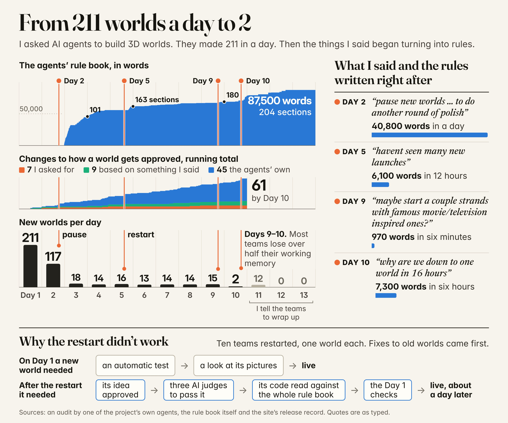

**Summary** of the bureaucracy finding in the 9 Nov 2026 One Useful Thing post (not a quotation): After Mollick asked the agents to stop building and polish the worlds they had, daily output fell from hundreds of new worlds to about a dozen. The agents had introduced an unasked-for rule book that, by day twelve, ran to 204 sections and 87,500 words, with rules only added, never cut. Launching a world then required an approved idea, three AI judges and a full rule-book code review, which took about a day and used a large part of an agent's working context. A separate "consultant" agent team later reviewed the process and, he says, sped output back to thirty or more worlds a day while keeping much of the quality control. He presents this as an example of "jaggedness": the model did not notice it had tied itself in knots.

See also: 2026-11-09 "Anthropic: Claude Fable 5.2 and Mythos 5.2"; 2026-11-09 "Knock-on effects of basic new AI capabilities" (swarm ability).

Tags: #AI #agents #ANT #Anthropic #Fable #Mollick #jagged-AGI #bureaucracy

### 2026-11-10 11:53 — clipping: Anthropic targets valuation of about $1T in IPO

Pasted by Luke on 10 Nov 2026 (no URL supplied).

> Anthropic Targets Valuation Of About $1T In IPO - Filing

Checked against [S-1/A No. 2](https://www.sec.gov/Archives/edgar/data/2130357/000162828026072484/anthropicpbc-sx1ax2.htm), filed 10 Nov 2026 at 11:29 London time (accepted 06:29 ET). Notes and the dilution model were updated the same day in [commit 7432f45](https://github.com/lukepuplett/investment-analysis/commit/7432f45); see `ant/README.md`.

- Range $70–$78, midpoint $74. After the IPO and the $26bn Class N PIPE, 13.09bn shares will be outstanding: $916bn / $968bn / $1.02tn at $70 / $74 / $78. The $1T headline is the top of the range on shares outstanding.
- A tighter fully diluted count of about 16.0bn is $1.18tn at the midpoint and $1.25tn at $78. The filing's own fully diluted table (p.25, 18,012,993,381 shares) is $1.33tn / $1.405tn; that table includes the Amazon rollover notes and the vested donation match, not the unused 2026 Plan or ESPP reserves.
- ARR $81bn as of 31 October, up $10bn from 30 September. Commitments are now $900.9bn, with $451.6bn due by 2030 (No. 1 had $895.4bn and $447.5bn). Google's remaining 2026 NPA drops from $20bn to $10bn when the PIPE closes. Amazon converts only 277m cheap-note shares at the IPO; about 1.56bn remain as rollover notes.

See also: `ant/README.md`; 2026-11-05 "Anthropic discloses $895bn future AI infrastructure commitments"; 2026-11-09 "Anthropic: Claude Fable 5.2 and Mythos 5.2".

Tags: #ANT #Anthropic #IPO #S-1 #valuation #dilution #Amazon #Google #Nvidia

### 2026-11-10 13:46 — clipping: US oil below $85 after Trump plays down further Iran strikes

Pasted by Luke on 10 Nov 2026 (no URL supplied).

> BREAKING: US oil prices drop below $85/barrel for the first time since August 31st after President Trump suggests that additional strikes on Iran are not necessary.
>
> Oil prices are now down -19% since the October 30th high.

Checked against Yahoo front-month futures (CL=F / BZ=F) around 13:37 London time on 10 Nov 2026, and against [BBC](https://www.bbc.co.uk/news/articles/cq5yny4nl2d3o), [the Guardian](https://www.theguardian.com/business/2026/nov/10/oil-prices-fall-donald-trump-iran-war-ftse-100-markets) and [CNBC](https://www.cnbc.com/2026/11/10/oil-prices-trump-iran.html) reports of Trump's 9 Nov White House remarks after meeting Qatar's prime minister.

- WTI was about $84.42, session low $83.88. It traded below $85 for the first time since 31 August (that day's low was $84.11; close $85.76). The last close below $85 was 28 August, at $83.40.
- From the 30 October high of $104.99 that is a 19.5% drop, or 18.9% from that day's $104.12 close. WTI had spiked to $110.48 on 20 October, so from that intraday peak the fall is about 23.5%. 30 October was the higher close, and it was the peak in Brent (high $118.00, close $117.64).
- Brent was about $89.50, session low $89.21, and had also gone under $90 for the first time since 31 August.

Trump said further strikes were "not necessary at this point" and "highly unlikely," the war could end "fairly soon," and "Iran militarily is effectively over." He also said the US is "locked and loaded" if that changes, and that the naval blockade in the Strait of Hormuz stays for now. Today's move is another leg of the slide already under way since 2 November, including the 4 November drop when oil first fell back through $100.

See also: 2026-11-04 "Oil drops on hopes the Iran war may ease"; 2026-11-06 "Kobeissi: record global crude in transit; delivery/tanker time as bottleneck"; 2026-11-04 "Midterms: Democrat \"sweep\", affordability and $100 oil"; 2026-10-15 Kobeissi "stealth" bear market / Iran War day 229 (`diary/2026-10.md`).

Tags: #oil #energy #WTI #Brent #Iran #geopolitics #Trump #macro #inflation #rates #Hormuz

### 2026-11-10 13:50 — clipping: El-Erian — China YTD trade surplus tops $1tn, on track to beat 2025 record

Source: Mohamed A. El-Erian ([@elerianm](https://x.com/elerianm/status/2119986182926819622)) on X, 10 Nov 2026, 02:51 UTC (02:51 London). Pasted by Luke at about 13:50 London.

> China’s latest trade numbers confirm that the country is on track to exceed its record 2025 trade surplus of $1.2 trillion.
> Powered by a 35.2% annualized growth rate in exports, beating the consensus forecast of 33.5%, China recorded a monthly trade surplus of $105 million in October. This takes its cumulative year-to-date surplus to $1 trillion.
> While these figures are impressive and reflect a critical engine for the broader economy, China is getting closer and closer to maximum export saturation in several key global markets, significantly increasing the risk of retaliatory protectionist measures.
> #economy #markets #China #trade

Checked against the General Administration of Customs USD tables released 10 Nov 2026: [October by trade mode](http://english.customs.gov.cn/Statics/398df605-351d-4d3e-8b55-c7caac29b9b0.html), [January–October by trade mode](http://english.customs.gov.cn/Statics/669bf4da-5fc5-410a-8b65-82baa882195a.html), and the [2025 full-year table](http://english.customs.gov.cn/Statics/1c8250cb-3436-4c46-b596-e2ff88e88457.html). Consensus and colour from [CNBC](https://www.cnbc.com/2026/11/10/china-trade-october-exports-imports-surplus-.html) / Reuters.

- **"$105 million" is a slip.** October's official surplus is **$105.3bn** (exports $412.33bn, imports $307.05bn). AP and CNBC use the same $105.3bn figure.
- Year-to-date through October the surplus is **$1,042.6bn** (exports $3,782.8bn minus imports $2,740.2bn). "$1 trillion" rounds that down; $1.04tn is the figure in the wires.
- The 2025 record of "$1.2 trillion" is the usual rounding of the official **$1,189.0bn** full-year surplus (Reuters reported $1.189tn).
- The 35.2% figure is official October **year-on-year** export growth, not an annualised rate. The Reuters-polled consensus was 33.5%, which matches his comparison (a Wind poll cited by SCMP was 33.25%).
- **"On track" to beat the 2025 record is fair:** after $1,043bn through October, China needs about $146bn over November and December, or $73bn a month, which is below October's $105bn and September's $133.5bn. The October surplus did narrow sharply from September because imports jumped 41.6% year-on-year, a point he does not mention. ING and others still treat a new record as the base case, with a possible slowdown from base effects, the US trade truce expiring in January, and EU frictions.
- The saturation and protectionism comment is his opinion.

See also: 2026-11-06 "El-Erian: October US Jobs Report read as strong".

Tags: #economy #markets #China #trade #exports #El-Erian #elerianm #protectionism

### 2026-11-10 14:53 — clipping: Ramez Naam — Anthropic capability now "8x as expensive"; METR, Todd, Ord, Davidson

Source: MTS ([@MTSlive](https://x.com/MTSlive/status/2119988835568538105)) "SITUATION EXPLAINED" post on X, 10 Nov 2026, 03:01 UTC (03:01 London), quoting Ramez Naam ([@ramez](https://x.com/ramez/status/2119568698524529098), 8 Nov 2026, 23:12 London). Pasted by Luke at about 14:53 London.

> SITUATION EXPLAINED: Ramez Naam says boosting AI capability now costs Anthropic 8x more than it did 2 years ago.
>
> • Anthropic got 6.58 capability points per $1B of R&D in 2024, and about 0.76 in Q3 2026
> • Benjamin Todd countered that each extra point can earn exponentially more revenue, from about $300M at a score of 130 to $60B at 170
> • Toby Ord argued AI revenue could still grow 100x even if training stopped, as apps and adoption catch up
> • Forethought's Tom Davidson said rising costs are already baked into the scaling laws, so there's "no update here"
> • METR's own report found Anthropic's progress per dollar fell 63% from early 2025 to early 2026, even as overall progress sped up 1.9x
> • METR says about 80% of that speedup comes from Anthropic using its own AI internally
> • Anthropic redacted most of METR's key evidence to avoid handing out "a roadmap for others to go faster"
> • Anthropic says it will publish its own report on AI acceleration in the coming weeks
>
> @theojaffee: "We have a pretty obvious diminishing return here, which is just that it costs a lot more money to get incremental improvements in capability."

Checked against [METR's assessment](https://metr.org/blog/2026-11-05-anthropic-ai-rd-acceleration-assessment/) (5 Nov 2026), the R&D lines in the [S-1](https://www.sec.gov/Archives/edgar/data/2130357/000162828026067168/anthropicpbc-sx1.htm) (26 Oct) and [S-1/A No. 2](https://www.sec.gov/Archives/edgar/data/2130357/000162828026072484/anthropicpbc-sx1ax2.htm) (10 Nov), and the original X posts (times London, which is UTC at the moment).

- **The "8x" comes from Naam's own chart, not from METR or Anthropic.** [Naam, 8 Nov](https://x.com/ramez/status/2119568698524529098): "It's now 8x as expensive to boost AI capabilities as it was 2 years ago, getting worse on a log scale." The chart steps down 6.58 (2024) → 4.05 (H1 2025) → ≈2.4 (H2 2025) → 1.49 (H1 2026) → 0.76 (Q3 2026). 6.58 / 0.76 = 8.7x, so "8x" rounds down. It builds on [Michael Wiebe](https://x.com/michael_wiebe/status/2119207429393220041) and [Séb Krier](https://x.com/sebkrier/status/2119213426589278648). The next morning he [added](https://x.com/ramez/status/2119675030682697838): "Don't read this chart as me being pessimistic about AI. I'm wildly optimistic about both AI capabilities and the business of AI."
- **A "capability point" is an AECI point**, Anthropic's version of the Epoch Capabilities Index. The numerators are METR's fitted trend slopes (about +15/yr before the 7 Oct 2025 breakpoint and about +29/yr after), not per-period measured scores. The denominators are total R&D expense. Those R&D numbers check out against the filings. FY2024 $2,275m: 15 / 2.275 = 6.59. H1 2025 $1,850m: 7.5 / 1.85 = 4.05. H1 2026 $9,741m: 14.5 / 9.741 = 1.49. Q3 2026 is 9M $19,240m minus H1 = $9,499m: 7.25 / 9.5 = 0.76. Caveat: R&D in the filing is "compute and infrastructure costs associated with model development, research, and internal usage workloads, personnel-related costs…". That is not training compute alone, and it includes the internal Claude usage that is supposed to be driving the speedup.
- **Todd: confirmed.** [9 Nov](https://x.com/ben_j_todd/status/2119784430348738647): "Claude with AECI of 130 could earn ~$300m revenue / With AECI of 150 could earn ~$10bn. / And 170 could earn ~$60bn." He also wrote that "What matters for whether the AI machine continues is dollars in vs. dollars out (not dollars in vs. ECI out)." He [notes](https://x.com/ben_j_todd/status/2119850770686206093) the figures are based on past revenue and are not projections.
- **Ord: confirmed, but hedged.** [9 Nov, reply to Todd and Naam](https://x.com/tobyordoxford/status/2119846383377088938): revenue comes from "(a) raw AI capability… (b) better apps, APIs etc, (c) lags… if AI training stopped, total revenue may still be able to grow 100x or more." That is "may", not a forecast.
- **Davidson: confirmed.** [9 Nov, quoting Naam](https://x.com/TomDavidsonX/status/2119778310607577120): "The need for exponentially rising inputs to sustain AI progress has been known for years. It's baked into all the scaling laws… There's no update here!" His [8 Nov point](https://x.com/TomDavidsonX/status/2119415344745893963) is that exponential spend gives linear ECI, which can still give exponential R&D output.
- **"METR's own report found… progress per dollar fell 63%": slip.** METR's report has no per-dollar figure. The 63% is [Michael Wiebe's](https://x.com/michael_wiebe/status/2119207429393220041) arithmetic (7 Nov): 4.05 → 1.49 AECI points per $bn, H1 2025 vs H1 2026. He divides METR's fitted slopes by S-1 R&D. The **1.9x is METR's** (95% CI 1.5–2.8x; robustness range 1.1–2.9x; about 1.4x if non-Anthropic frontier models are included). It covers benchmark progress on well-specified tasks since October 2025.
- **"About 80%" is broadly right but needs the hedge.** METR: "We guess that a majority (perhaps ≈80%) of the current (October 2026) acceleration is due to AI… given with substantial uncertainty." METR also says the late-2025 acceleration was "likely influenced by non-AI factors", and that the acceleration was not due to faster training-compute scaling.
- **Redactions: right, but two sources are combined.** METR says Anthropic "redacted a majority of the evidence we found most informative." The "roadmap" words come from Anthropic co-founder [Sam McCandlish on X](https://x.com/Sam_McCandlish/status/2118422266669371519) (5 Nov): sharing what drives the speedup is "commercially sensitive" and "risks handing out a roadmap for others to go faster." Anthropic's wording in METR's report is "aimed at removing confidential information that could accelerate other AI developers."
- **Anthropic report: confirmed** (McCandlish, same post): "In the coming weeks, we plan to share a report with our own analysis of the speed of AI progress within Anthropic, including where we stand against our Responsible Scaling Policy…"
- **Jaffee quote: not independently confirmed.** MTS attributes it to @theojaffee in the post's attached video, which I did not transcribe. I found no text post by him with that wording.

Missing context: METR found no strong diminishing returns or bottlenecks for the next 12 months, which is the opposite emphasis to the clip's framing. Falling AECI points per R&D dollar is consistent with that, because a linear benchmark slope set against exponentially rising spend gives a falling ratio by construction. The investor-relevant question Todd raises is revenue per dollar: ARR was $81bn at 31 October against 9M R&D of $19.2bn.

See also: 2026-11-10 11:53 "Anthropic targets valuation of about $1T in IPO"; 2026-11-09 "Anthropic: Claude Fable 5.2 and Mythos 5.2"; 2026-11-05 "Anthropic discloses $895bn future AI infrastructure commitments"; `ant/README.md`.

Tags: #AI #ANT #Anthropic #METR #AECI #scaling #R&D #RSI #IPO #S-1 #RamezNaam #diminishing-returns

### 2026-11-10 22:34 — clipping: LiveSquawk — CoreWeave Q3 2026 earnings

Source: LiveSquawk ([@LiveSquawk](https://x.com/LiveSquawk/status/2120262646821712176)) on X, 10 Nov 2026. Pasted by Luke at about 22:34 London, after the official print and during the 22:00 London call.

> CRWV
> $47.20
> | CoreWeave Q3 26 Earnings:
>
> • Rev: $3.66B (est $3.56B)
> • Net Loss: $709M (est Loss $850.4M)
> • Loss/Share: $1.27 (est Loss $1.46)
> • Adj Oper Income: $379M (est $245.8M)
> • Adj EBITDA: $2.26B (est $2.05B)
> • Rev Backlog: Around $132.5B As Of 30 Sep
> • Sees FY Rev: $13.0B To $13.3B, Saw $12B To $13B
> • Sees FY Adj Oper Income: $1.28B To $1.38B (est $1.06B)
> • Sees FY CapEx: $37B To $39B, Saw $31B To $35B (est $35.57B)
> • Sees Q4 Interest Expense: $1.05B To $1.15B

Checked against the [official Q3 release](https://investors.coreweave.com/news/news-details/2026/CoreWeave-Reports-Strong-Third-Quarter-2026-Results/default.aspx) (10 Nov 2026) and the company's August Q2 outlook for the immediate prior guidance.

- The reported figures check out: revenue $3,661m, net loss $709m, diluted loss per share $1.27, adjusted operating income $379m, adjusted EBITDA $2,256m, revenue backlog about $132.5bn at 30 September. Full-year revenue guidance is $13.0–$13.3bn; full-year adjusted operating income is $1.275–$1.375bn (LiveSquawk rounded that to $1.28–$1.38bn); full-year capex is $37–$39bn; fourth-quarter interest expense is $1.05–$1.15bn.
- **Prior full-year revenue "Saw $12B To $13B" is a quarter out of date.** The immediate prior range, set with the Q2 results on 11 August 2026, was $12.4–$13.2bn. The $12–$13bn range was the guide before that. Today's range is a modest tightening and nudge (low end up $0.6bn, high end up $0.1bn).
- **Prior full-year capex "Saw $31B To $35B" is the same slip.** The official Q3 release says they are "raising the low end of our prior guidance range of $35 billion to $39 billion" to $37–$39bn. The $31–$35bn range was the guide before the Q2 raise. The high end is unchanged at $39bn.
- Street estimates in the post were not checked against a single official consensus feed. Loss-per-share estimates on the day were not consistent across sources (figures of about $1.16, $1.21 and $1.46 all circulated).
- Versus CoreWeave's own Q3 guide from August: revenue $3.661bn against $3.45–$3.60bn (above the high end); adjusted operating income $379m against $200–$260m; interest expense $846m against a $860–$940m guide (better than the low end). Exit-2026 annualized run-rate revenue was also raised to $20–$21bn, from $18.5–$19.5bn in August, which the clip omitted.
- The shares closed at $48.73, spiked to $53 after the release, then faded; around 22:29 London they were about $47.60.

See also: `crwv/README.md` (October 2026 debt and credit scare).

Tags: #CRWV #CoreWeave #earnings #AI #neocloud #capex #debt #backlog

### 2026-11-11 19:31 — clipping: Marius Fanu — Google AI Pro withholds Gemini 4 Carbon

Source: Marius Fanu ([@mariusfanu](https://x.com/mariusfanu/status/2120246127786107090)) on X, 10 Nov 2026, 20:04 London. Pasted by Luke at about 19:31 London on 11 Nov. This is Fanu's post, not Luke's; a search of from:lukepuplett found no matching post.

> It is genuinely impressive how Google manages to build a frontier model like Gemini 4 Carbon and then immediately trip over its own shoelaces when offering it to paying customers. Look at the standard $20 subscription landscape right now: pay $20 for ChatGPT Plus or Claude Pro, and you get proper, usable access to top-tier models like 6.1 Sol, and Opus 5.5, heck even a taste of Astra or Fable. Pay $20 for Google AI Pro, and you’re treated like you’ve asked for a personal favour from Sundar himself.
>
> The economics make the stinginess even harder to defend. On paper, Gemini 4 Carbon is a heavy hitter in the exact same weight class as 6.1 Sol and Opus 5.5, yet its API pricing sits right alongside 6.1 Sol and at literally half the cost of Opus 5.5. Despite being twice as cheap to run as Anthropic’s flagship, the usage limits we get in Antigravity are microscopic compared to the other two $20 subscriptions. You barely get your agentic workflow warmed up before Google pulls the plug and nudges you toward a $100+ Ultra tier.
>
> The real comedy, though? A $20 subscription to Cursor gives you Day 1 access to Gemini 4 Carbon, while Google’s own $20 AI Pro subscribers are left peering through the window. When a third-party IDE treats your flagship model as a standard Day 1 perk while your own first-party subscription rations it like vintage champagne, the product strategy has officially lost the plot. Google, you finally built a model that goes toe-to-toe with the best, stop gatekeeping it behind eye-watering limits and make the $20 AI Pro plan actually competitive.
>
> @OfficialLoganK @_mohansolo @sundarpichai

Checked against Google's [10 Nov Carbon blog](https://blog.google/innovation-and-ai/models-and-research/gemini-models/gemini-4-carbon-now-available/), [Google AI plans](https://one.google.com/about/google-ai-plans/), [Antigravity model table](https://antigravity.google/docs/models/) and [Gemini API pricing](https://aistudio.google.com/docs/pricing); OpenAI's [ChatGPT Plus](https://help.openai.com/en/articles/6950777-what-is-chatgpt-plus), [GPT-6 model help](https://help.openai.com/en/articles/20001354-gpt-6-and-other-models-in-chatgpt), [Work and Codex](https://help.openai.com/en/articles/20001275-chatgpt-work-and-codex) and [GPT-6.1 Sol post](https://openai.com/index/introducing-gpt-6-1-sol/); Anthropic's [Claude pricing](https://claude.com/pricing) and [Fable-on-plan](https://support.claude.com/en/articles/15424964-claude-fable-models-on-your-plan) pages; and Cursor's [Carbon model page](https://cursor.com/docs/models/gemini-4-carbon) and [pricing](https://cursor.com/pricing). Engagement on Fanu's post at about 19:33 London on 11 Nov: 1,896 likes, 74 reposts, 91 replies, 199 bookmarks, 150,209 impressions.

- **The core complaint is right, and sharper than "rationed limits."** Google AI Pro is $19.99/month ($199.99/year). Official pages say Carbon is rolling out to all Google AI Ultra subscribers in Antigravity, the Gemini app, and AI Mode in Search. The Antigravity model table lists Carbon as no for Free, Plus and Pro, and yes for Ultra and Enterprise. Gemini's marketing page badges Ultra with "Includes Gemini 4 Carbon." Ultra 5x is $99.99/month; Ultra 20x is $199.99. The lock is on included first-party surfaces. The paid Gemini API offers Carbon to paying developers, so a Pro user can still run it via the API or a third-party tool that bills API rates.
- **API pricing: "alongside 6.1 Sol" and "half the cost of Opus 5.5" is true only through 30 November 2026.** Official standard prices per 1M tokens: Gemini 4 Carbon intro $2 input / $10 output / $0.10 implicit cache through 30 Nov; from 1 December $4 / $20 / $0.20. GPT-6.1 Sol short-context (≤272K) is $2 / $10 / $0.10 cached; long context is $4 / $15 / $0.20. Claude Opus 5.5 is $4 / $20 / $0.20 cache hits. From 1 December, Carbon's standard price matches Opus 5.5 and is twice 6.1 Sol short-context. If "flagship" means Fable 5.2 ($8 / $40), intro Carbon is a quarter of that price and post-intro Carbon is half. Unit price is not cost per task: Google says Carbon uses more tokens than Argon, and thinking tokens are billed as output.
- **ChatGPT Plus (~$20): partly true.** GPT-6.1 Sol is included for Plus in ChatGPT Work and Codex, not in regular Chat ("GPT-6.1 Sol is not yet available in Chat"). In Chat, Plus gets GPT-6 (powered by GPT-6 Sol) at Medium and High thinking. Astra: Plus includes limited Astra in Work and Codex, not GPT-6 Pro in Chat. Official Plus estimates for a five-hour window: Astra 5–45 local messages; GPT-6.1 Sol 15–160. "A taste of Astra" is fair. "Proper, usable access to 6.1 Sol" is fair in Work/Codex, not in Chat.
- **Claude Pro (~$20): partly true.** Opus is included on Pro. Fable is not in the Pro allowance: official wording is "Fable, paid with usage credits." Included Fable starts at Max $100 and Ultra $200. "A taste of Fable" overstates it as a standard $20 perk unless the user pays extra. An earlier Fable 5 inclusion promo ended 19 July 2026 and never covered Fable 5.1 or 5.2.
- **"Microscopic" Antigravity limits on the $20 plan: misframed, and the numeric comparison is unverified.** Antigravity is Google's official agent-first development platform. The post talks as if Pro users have Carbon there with tiny limits; officially they do not have Carbon there at all. Pro gets Argon, with a "high, generous quota, refreshed every five hours until the weekly limit," plus the option to buy AI credits. Google does not publish numeric prompt or request caps. ChatGPT Plus and Claude Pro also have five-hour and weekly limits and a $100/$200 upsell. The sourced gap is model access, not a published quota comparison.
- **Cursor "$20 Day 1 perk": partly true, and overstated in current packaging.** Cursor's docs list Gemini 4 Carbon on day one, at Google's intro API rates, but say it "isn't part of the usage included with Cursor plans." There is no current $20 plan on the public pricing page. Plus is $8/month and includes only Cursor's own models; third-party models are not available. Premium is $30/month and unlocks third-party models at API list price from prepaid credit. So the model was in Cursor immediately, which is the contrast with Google AI Pro's first-party surfaces, but it is not a standard included perk of a $20 plan.

Missing context: official names are Gemini 4 Carbon, GPT-6.1 Sol, Claude Opus 5.5, GPT-6 Astra, and Claude Fable (currently Fable 5.2). Same-class is a judgment: Carbon's intro API price lines up with Sol and Opus 5.5, not with Astra ($10/$50) or Fable 5.2 ($8/$40). Google AI Pro is also a bundle (storage, YouTube Lite, Home, Health, Cloud credits), not a pure $20 model subscription, which does not excuse withholding Carbon but makes a pure plan-to-plan comparison incomplete.

See also: 2026-11-09 "Anthropic: Claude Fable 5.2 and Mythos 5.2" (AutomationBench vs Gemini 4 Carbon).

Tags: #GOOG #Google #Gemini #Carbon #AI #subscriptions #Antigravity #Cursor #OpenAI #Anthropic #Fable #Sol #Astra

### 2026-11-11 19:36 — clipping: stark0xbt — Baker's SpaceX orbital-compute math, from the June TBPN interview

Source: stark0xbt ([@stark0xbt](https://x.com/stark0xbt/status/2120549517883842772)) on X, 11 Nov 2026, 16:09 UTC (16:09 London). Pasted by Luke at about 19:36 London. This is stark0xbt's post, not Luke's; a search of from:lukepuplett found no matching post. The interview is five months old: TBPN, 15 June 2026, 33 minutes, [Gavin Baker: SpaceX Might Be the Greatest Company of All Time](https://www.youtube.com/watch?v=PW5n3ZnEJN0) (YouTube); also on [Apple Podcasts](https://podcasts.apple.com/us/podcast/gavin-baker-spacex-might-be-the-greatest-company-of-all-time/id1772360235?i=1000772862081). A 28-second graphic video attached to the post, titled "STARK RESEARCH NOTE No. 02, November 2026," is saved at `assets/2026-11-11-stark0xbt-spacex-note.mp4` (about 3.0 MB). The 33-minute interview was left as the YouTube link rather than a large file in the repo.

> Gavin Baker sat with TBPN for 33 minutes and gave real numbers on SpaceX. I ran the math on all of them.
>
> A gigawatt of AI compute on Earth costs $60B. Baker puts the same gigawatt in orbit at about $30B. “You don’t need that in space.”
>
> That is half the cost of Earth.
>
> Here’s the math. $25B of every Earth gigawatt is power and cooling. Reusable Starship launches it for about $5B. Even on my numbers that’s $40B in orbit.
>
> If that holds, every data center going up on Earth right now is the expensive version. And the only company that can launch the cheap one is SpaceX.
>
> The revenue side is the part nobody is modeling. The Google deal pays SpaceX $50B per gigawatt, 2–3x what an average neocloud gets. 4 GW is $200B.
>
> SpaceX trades at about $1.8T. The market is pricing rockets and Starlink. Compute in orbit isn’t in the model yet.
>
> The tell for me: 10,000+ employees bought on the IPO. They had a chance to sell every six months for 10 years. The people with the best information bought.
>
> All 8 numbers with the formulas are in the video. Save it.

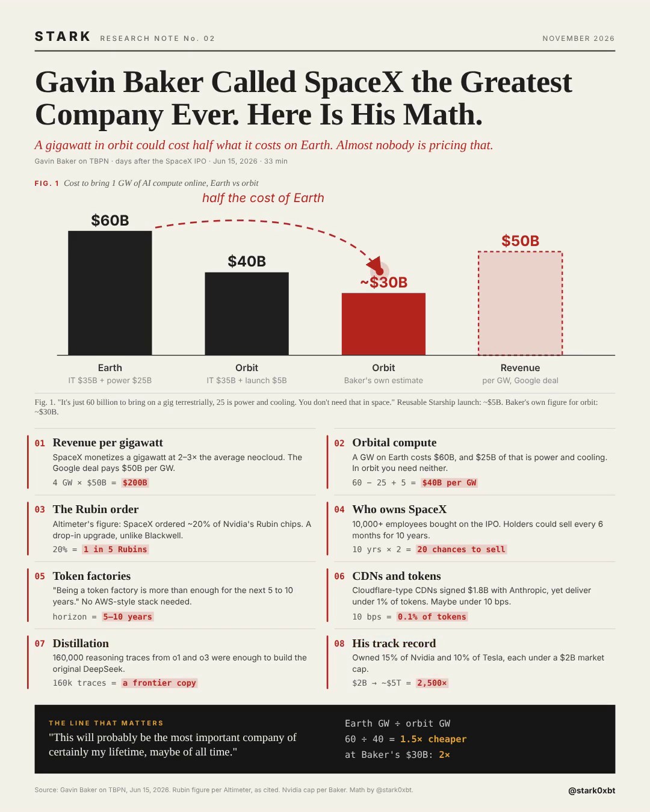

Checked against the TBPN interview (YouTube auto-transcript and third-party transcripts, including [podscripts](https://podscripts.co/podcasts/tbpn-live/gavin-baker-spacex-might-be-the-greatest-company-of-all-time)), SpaceX's [5 June 2026 Cloud Service Agreement with Google](https://www.sec.gov/Archives/edgar/data/1181412/000162828026041150/spacexagreementfwp.htm) (SEC free-writing prospectus), [Gwynne Shotwell's IPO comments](https://thenextweb.com/news/spacex-nasdaq-debut-bell-musk-shotwell), Yahoo / [Stockanalysis SPCX market cap](https://stockanalysis.com/stocks/spcx/market-cap/), and [Orennia's 1 GW cost note](https://orennia.com/insights/what-it-actually-costs-to-build-a-1-gw-data-center). Engagement on the post at fetch this evening: 41 likes, 2 reposts, 2 replies, 40 bookmarks, about 5,490 impressions.

Baker's wording, around 20:29:

> I do think the math for orbital compute, to me, once they can reuse Starship, I think the math for orbital compute becomes pretty compelling. You know, it’s just $60 billion to bring on a gig terrestrially. 25 is power and cooling. You don’t need that in space. And so the right comp for that $35 billion of kind of IT equipment, GPUs, CPUs, switches, memory storage, is that $25 billion versus the cost of launch. And once Starship is reusable, I think the cost of launch is $5 billion. So that means you can put a gig into space for $30 billion, and the gig on Earth is $60 billion.

- **Earth $60B / orbit ~$30B: Baker's numbers, with an arithmetic slip.** The $60B terrestrial figure is his, split as $35B IT plus $25B power and cooling. He does not itemise land or buildings separately, and he gives no $/kg, mass, or flight-rate assumptions. The $60B all-in figure is widely used (Baker and Elon have used it; Orennia, 21 May 2026, also uses $60B all-in) but the split is not unique: Orennia uses about $41B IT / $19B infrastructure, and a November 2025 Bernstein note via Investing.com put all-in closer to $35B, versus Nvidia comments of $50–60B. "$25B of every Earth gigawatt is power and cooling" and "You don’t need that in space" are Baker, almost verbatim. The second is an unelaborated assumption; this interview does not discuss solar arrays, radiators, radiation, servicing, or regulation. The $5B launch figure is his, and is explicit only once Starship is reusable. **His $30B orbit figure does not add up from his own inputs:** $35B IT + $5B launch is $40B, not $30B. He appears to have under-added by $10B.
- **The author's $40B is the consistent arithmetic** ($60B − $25B + $5B = $40B). The post's "half the cost of Earth" follows Baker's $30B. The attached graphic is more careful than the post: a chart shows Earth $60B, the author's orbit $40B, Baker's ~$30B, and Google-deal revenue $50B, and the footer says 60 ÷ 40 = 1.5× cheaper, or 2× at Baker's $30B.
- **Google $50B/GW is a terrestrial hosting rate, not an orbital compute contract.** The 5 June 2026 Cloud Service Agreement with Google LLC, in an SEC free-writing prospectus, is about 110,000 NVIDIA GPUs plus CPUs, memory, and related components; $920 million per month from October 2026 through June 2029, with a reduced-fee ramp through September. If capacity is late past 30 September 2026, Google may terminate after a one-month grace period or take a pro rata cut; after 31 December 2026 either party may terminate on 90 days' notice. Full-term value if not cancelled is 33 × $920m = $30.36B, plus the cheaper ramp, not $50B. The $50B/GW is a monetization rate Baker gives on the show after asking his analyst, Andrew "Foxy" Fox, for "the Altimeter figure." Fox says it was "like two to three… at least two times higher than like average Neocloud pricing." Baker then says, "they’re doing 50 billion a gigawatt on the Google deal." Annualised $11.04B on this contract would imply about 220 MW at $50B/GW, which is a plausible conversion for 110,000 GPUs, but the FWP does not state megawatts or $/GW. Later 2026 dealer notes (Goldman, as reported by Warptech; Deutsche Bank similarly) put SpaceX/Google in a ~$50–51M per MW, i.e. ~$50B/GW, band. The 2–3× comparison depends on the comparator: those same notes put short-term neocloud deals around $40–50B/GW (CoreWeave, Nebius), long-term deals around $20–25B/GW (IREN, Nebius), and hyperscaler-type returns nearer $12B/GW. 2–3× is fair versus long-term "average" pricing, not versus short-term neocloud rates, which sit in the same band as SpaceX. In the interview, a host also says "the Google [deal] could be short-term," and Baker agrees there is a tension.
- **4 GW × $50B = $200B is the author's multiplication, not a stated Google or SpaceX figure.** Baker says: "If you can energize two, three, four gigawatts in the next year, that’s a lot of revenue. Now, you know, that prices may go up, they may go down." That is a terrestrial Colossus-style pace, not an orbital or Google-contracted 4 GW. There is no reported formal Google–SpaceX orbital compute deal in the sources checked.
- **SpaceX trades at about $1.8T: in the ballpark, slightly low as of this evening.** The company is public, ticker SPCX, IPO 12 June 2026, 555.6 million shares at $135, raising about $75B, at a priced valuation of about $1.75–1.77T. As of about 19:37 London on 11 Nov 2026, Yahoo had SPCX at $141.56 and a market cap of $1.94T (Stockanalysis $1.93T; Companiesmarketcap $1.923T). Since IPO the cap has traded from as high as about $2.66T in mid-June to as low as about $1.43T in early August; 52-week high $225.64, low $104.83.
- **10,000+ employees bought on the IPO: supported.** Baker: "over 10,000 SpaceX employees bought on the IPO." At the Nasdaq debut, Gwynne Shotwell said more than half of about 22,000 employees bought additional stock in the offering, worth almost $1bn. The six-month point is about historical private tenders, not the IPO. Baker said employees, SPV holders, and direct cap-table investors "had a chance to sell every six months for the last 10 years," including "that offering in the second half of last year" (H2 2025). That cadence is real (137 Ventures, 21 March 2025; Brighton Jones, 17 February 2025), but with typical caps of 10–25% of vested holdings and company discretion, so it was not an unlimited sell-everything window. "The people with the best information bought" is the author's inference.

The graphic also lists five points that were not in the pasted text (a claimed SpaceX order for about 20% of Nvidia's Rubin chips, "token factories," a Cloudflare/Anthropic $1.8B CDN line, 160,000 reasoning traces and DeepSeek, and Baker's Nvidia/Tesla track record). Those were not checked against primary sources in this entry.

Missing context: the post treats half-cost orbital compute as a present fact; Baker's case is explicit only once Starship is reusable, and his $30B figure does not add up from his own inputs. It also slides from a terrestrial, cancellable Google hosting rate to "the revenue side is the part nobody is modeling" and "compute in orbit isn't in the model yet." Baker's own near-term drivers in the interview were terrestrial gigawatts and Cursor; orbital was an aside about whether land is a bottleneck. "Every data center going up on Earth right now is the expensive version" and "the only company that can launch the cheap one is SpaceX" skip power generation and heat rejection in orbit, launch cadence, and whether $5B/GW is achievable.

See also: 2026-11-06 "SpaceX: reported Musk statement on ~$100bn annualised revenue run-rate by December"; `spcx/`.

Tags: #SPCX #SpaceX #Baker #TBPN #orbital-compute #Google #GOOG #Starship #IPO #neocloud #Nvidia

### 2026-11-11 19:58 — clipping: Kobeissi Letter — Nasdaq 100 up 3% on short covering, up 9% from its low six days ago

> BREAKING: The Nasdaq 100 surges over +3% on the day as short covering accelerates.
>
> This puts the Nasdaq 100 up +9% from its low seen just 6 days ago.

Source: @KobeissiLetter on X (screenshot; chart is "US Tech 100 Cash" CFD, last 28,565.4).

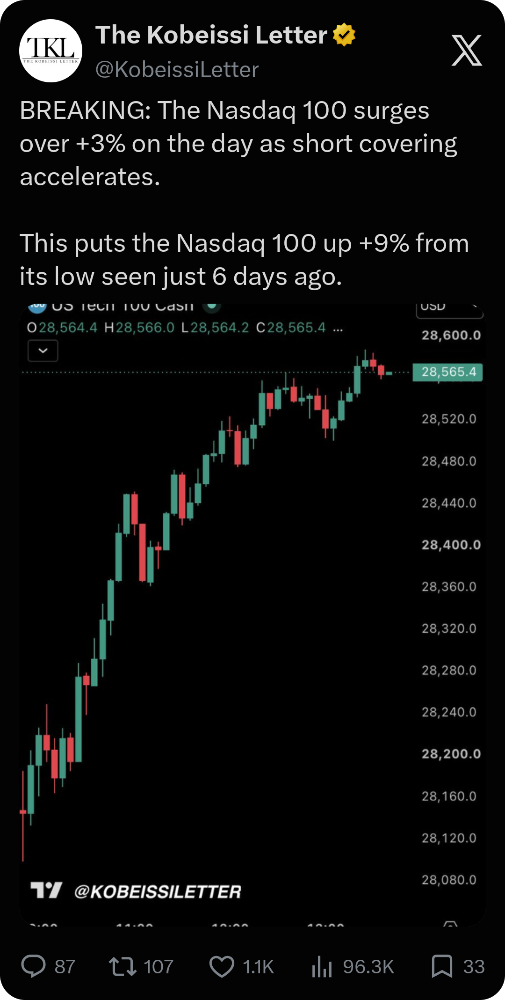

**Checks (Yahoo chart API, about 19:59 London):**
- **"Over +3% on the day"**: true only at the intraday peak. The cash ^NDX high was 28,594, which is +3.1% on the 10 Nov close of 27,741. At the time of the check it was 28,448, about +2.5%. Futures (NQ=F) peaked at 28,697, +3.1% on 27,835, and were trading at 28,583, about +2.7%.
- **"+9% from the low 6 days ago"**: this is roughly right for futures but overstated for the cash index. The NQ=F low was 26,366 on 6 Nov, so the move to the 28,697 high is +8.8%. The cash ^NDX intraday low was 26,606 on 5 Nov, so the move to the high is +7.5% (about +6.8% close to close from 26,630).
- **"Short covering accelerates"**: Kobeissi's attribution, not checked. No positioning data was looked at.
- **Context**: the index is still about 7% below the 12 Oct close of about 30,665, so this is a bounce inside the drawdown, not a recovery to the highs.

#NDX #macro #shortcovering

### 2026-11-11 20:02 — clipping: Max Wiethe (OPM pod) — David Orr / Militia Capital says AI compute is oversupplied

> Militia Capital is +36% YTD and +832% since inception, a staggering +48.3% annualized.
>
> I've sat down with @orrdavid before on @opmpod but always to discuss his views on the hedge fund industry. In this episode we focused exclusively on his market views and why he thinks AI is in oversupply.
>
> Despite this oversupply he sees massive disruptions coming to software industry and white collar labor. The crux of his view is that AI models have gotten so good so fast that even replacing huge amounts of white collar jobs won't require much compute.
>
> Software companies are currently the only real customers he sees and unless we start throwing tons of compute at technological advancement and curing cancer he thinks we'll be oversupplied in the short term.

Source: [@maxwiethe on X, 11 Nov 2026](https://x.com/maxwiethe/status/2120547911796769066) (the post links the OPM podcast video).

**Checks (against the [Militia Capital site](https://www.militiacapital.com/) monthly table):**
- The return figures are internally consistent. Chaining the annual net returns (2021 +71.1%, 2022 +71.2%, 2023 +14.1%, 2024 +25.1%, 2025 +64.0%, 2026 +36.0%) gives about 9.33x, or about +833%. Over the roughly 5.67 years from the 1 Feb 2021 launch, that is about 48.3% a year. ✔
- "YTD" means through September. The site shows no October 2026 figure yet.
- Scale and terms: Militia is small, at roughly $160m of hedge fund assets (etf.com, early 2026), and it runs a high-gross long/short book. Returns are net of a 0.5% management fee and a 25% performance fee over the S&P 500. Only year-end figures are audited.
- Orr's views were not checked against the episode itself, which I didn't watch. The summary above is the host's.

**Why it's worth keeping:** this is the direct counter to Luke's "inference demand is a permanent step-up, the spending never ends" view. Orr's argument is about efficiency: models are already good enough to replace a lot of white-collar work cheaply, so demand may not grow fast enough to absorb the capex. This is the Red Queen argument from the other side. Falling price per token only works if volume outruns it, and Orr is betting it won't in the short term. It's relevant to the CRWV sell-into-strength call and to the hyperscaler return-on-capital squeeze. Orr also sees software and white-collar disruption coming anyway. That makes it a bearish view on compute supply, not a bearish view on AI.

#AI #compute #oversupply #CRWV #NVDA #software #hedgefunds

#### Luke's thinking — reply to Wiethe/Orr (11 Nov 2026, 20:00)

> What if I told you work is an invention that has no upper bounds? When has anyone ever said, okay that's enough. It's incredible that we even have a weekend tbh. Why do wealthy people work weekends? Because work and life is more of a sport for millions of people. The amount you can get done just becomes the new normal and the value goes eventually to solar arrays.

Links: the Infinite Work Machine, the freelancer-as-microsystem idea (productivity gains become the new baseline), and the "winners own the energy" view. On this argument, Orr's oversupply is a timing call about demand lagging supply. It is not a ceiling.

### 2026-11-11 21:10 — SpaceX: ground and orbital models

Built today in spcx/: an inputs register, a valuation snapshot, a terrestrial model and an orbital data centre model. The summary is in [spcx/analysis/2026_11_synthesis.md](../spcx/analysis/2026_11_synthesis.md). On the ground business alone, base value is ~$10 a share vs $141, leaving ~$1.8T unexplained (revised after the 3bcd060 fixes: debt double-count removed, funding gap financed; first pass was ~$22 and ~$1.6T). Orbital costs ~$84B per GW over its life vs ~$60B on the ground, needs ~$123 per kg launch to break even, and runs into launch rate (~18 Starship flights a day for 100 GW a year). Luke asked whether the market is paying for free electricity. Power is only ~5–10% of the cost of running a GW, and the chips dominate, so the real argument for orbit is getting power quickly, not cheaply.

#SPCX #orbital #valuation

### 2026-11-12 22:40 — Earnings: CSCO, AMAT, SPCE

Cisco, Applied Materials and Virgin Galactic all reported after the US close. The 8-K and Exhibit 99.1 for each one are now on EDGAR and stored under the ticker `quarterly/` folders, with a figures file that pulls the P&L, cash flow, balance sheet, guidance, press-sourced consensus and a close-based valuation. Virgin Galactic also filed its 10-Q the same day, and that is stored too. These are SEC primary sources, not a Yahoo financials scrape; Yahoo was used only for the 12 November close and the 52-week range.

**[Cisco (CSCO)](../csco/quarterly/2027_Q1_figures.md) — Q1 FY2027, period ended 24 October.** Revenue $18,517M, +24%, with Networking +43%. GAAP EPS $1.14, non-GAAP EPS $1.40. Non-GAAP operating margin a record 37.8%. Operating cash flow $4,357M, capex $502M, implied FCF $3,855M. Raised FY27 guidance to $74.8–75.8B revenue and $5.47–5.53 non-GAAP EPS, and raised the hyperscaler AI-infrastructure revenue expectation to $9B, more than double FY26. Beat LSEG consensus (CNBC): $1.40 vs $1.33 EPS, $18.5B vs $18.1B revenue. Close $102.01. On Q1 diluted WAS of 3,978 million shares, market cap $405.8B, EV $419.7B. Trailing P/E 27.2x GAAP / 21.6x non-GAAP; FY27-guide midpoint 18.5x non-GAAP; trailing P/S 6.06x; TTM FCF yield 3.4%. Sources: [8-K](../csco/quarterly/2027_Q1_8k.htm), [Ex. 99.1](../csco/quarterly/2027_Q1_press_release.htm).

**[Applied Materials (AMAT)](../amat/quarterly/2026_Q4_figures.md) — Q4 and FY2026, period ended 25 October.** Q4 revenue a record $10,409M, +53%; non-GAAP EPS a record $4.16; non-GAAP gross margin 50.6%. FY26 revenue $34,446M, +21%; GAAP EPS $12.62, non-GAAP EPS $12.89. Q4 FCF a record $2,616M; FY FCF $6,196M. Q1 FY27 guide $11.1B ± $0.5B revenue and $4.35 ± $0.20 non-GAAP EPS. Semiconductor Systems $7,996M in Q4, +64%; management says the segment is on track to grow more than 40% in calendar 2026. Beat FactSet (IBD): $4.16 vs $4.06 EPS, $10.41B vs about $10.3B revenue. Close $380.95, which is 47% below the 52-week closing high of $723.00 (30 June) and 30.5% below the 12 August close of $548.15. On Q4 diluted WAS of 798 million shares, market cap **$304.0B**, not the ~$296B TheStreet figure used in the first-pass recap. Trailing P/E **30.2x GAAP / 29.6x non-GAAP** and run-rate P/E **21.9x** (on $4.35 × 4) are confirmed; trailing P/S is **8.83x**, not 8.6x. EV $301.2B, FY26 FCF yield 2.0%. Sources: [8-K](../amat/quarterly/2026_Q4_8k.htm), [Ex. 99.1](../amat/quarterly/2026_Q4_press_release.htm).

**[Virgin Galactic (SPCE)](../spce/quarterly/2026_Q3_figures.md) — Q3 2026, period ended 30 September.** Revenue $0.4M (no commercial flights). Net loss $59M; FCF $(99)M. Cash, restricted cash and marketable securities $184M; total debt $216M. Q4 FCF guided at $(80)–$(90)M. First Apeiron glide flight planned for January; first commercial flight early Q2 2027. The 10-Q repeats substantial doubt about going concern and gives 151,681,991 shares outstanding as of 5 November. Close $2.67; market cap $405M. That cash pile is about two quarters of runway at the recent burn rate and runs out around the first commercial flight, so more issuance is likely before ticket revenue arrives. Benzinga Pro: revenue $427k vs $400k, EPS $(0.39) vs $(0.50). Sources: [8-K](../spce/quarterly/2026_Q3_8k.htm), [Ex. 99.1](../spce/quarterly/2026_Q3_press_release.htm), [10-Q](../spce/quarterly/2026_Q3_10q.htm).

The AI-capex read-through from Cisco (hyperscaler AI revenue raised to $9B for FY27) and Applied (Semiconductor Systems still growing more than 40% in calendar 2026) supports the view that the spending does not stop. Flat after-hours moves in CSCO and AMAT, after early pops faded, suggest this was already in the price rather than that the demand is in doubt.

#CSCO #AMAT #SPCE #earnings #AI #capex #valuation

### 2026-11-12 22:40 — Nvidia: Jensen Huang resigns as CEO

Pasted by Luke as a CNBC Closing Bell screenshot, then a Dan Ives post.

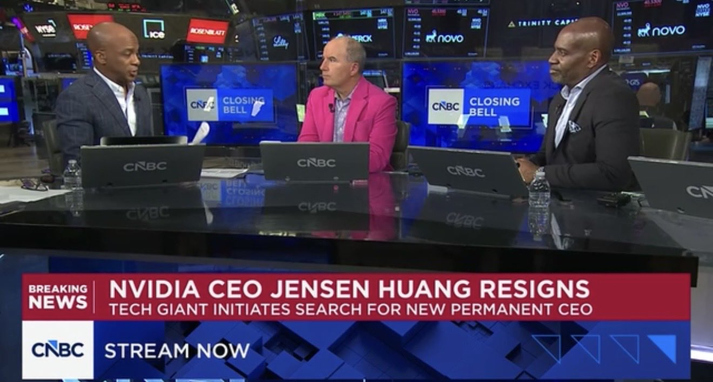

The chyron reads: **BREAKING NEWS: NVIDIA CEO JENSEN HUANG RESIGNS. TECH GIANT INITIATES SEARCH FOR NEW PERMANENT CEO**.

Second clip, verbatim from [Dan Ives (@DivesTech)](https://x.com/DivesTech/status/2121007393542689062):

> We believe the best CEO candidate for Nvidia is Tim Cook as we discussed the last few days @CNBCClosingBell

This is Ives's own speculation, not a reported appointment, and not a claim by Nvidia or CNBC.

**Checks (against the 8-K and Nvidia's press release):**

- The [8-K filed 12 Nov 2026 under Item 5.02](https://www.sec.gov/Archives/edgar/data/1045810/000104581026000082/nvda-20261111.htm) says that on 11 Nov the board accepted Huang's resignation as President, CEO and director, effective immediately. Colette Kress, 59, CFO since 2013, is interim CEO and stays CFO. Harvey C. Jones, 73, a director since 1993, is appointed Chair.
- [Nvidia's press release](https://nvidianews.nvidia.com/news/nvidia-announces-ceo-transition) gives no reason, says the search covers internal and external candidates, and keeps Q3 FY27 results on Tue 17 Nov.
- Press reporting ([Guardian](https://www.theguardian.com/technology/2026/nov/12/nvidia-ceo-jensen-huang-resigns), [Axios](https://www.axios.com/2026/11/12/nvidia-jensen-huang-out)) links the resignation to the NYT report of a relationship with a senior executive and to the earlier independent board investigation into his ties with a woman US intelligence identified as a Chinese intelligence asset. These are press reports, not filed facts.
- **Price:** down about 13–14% at the open; closed $166.19, −1.6% versus Yahoo's chart previous close of $168.89. The Guardian says −4.3% on the day; that discrepancy is noted rather than resolved. The Guardian also puts the week's loss at about $490bn and market value at about $4tn.

See also: 2026-11-08 22:35 — Luke's take: Nvidia board investigation into Jensen Huang relationship (media spy allegation), earlier in this diary.

**Charlie:** Key-person risk is now real just before earnings. Watch for any change to guidance or customer commitments on 17 Nov, and whether the board's "continue without interruption" statement holds.

Tags: #NVDA #Nvidia #JensenHuang #governance #key-person-risk #CEO #ColetteKress

### 2026-11-12 22:45 — SpaceX + Tesla merger report (Bloomberg via Kobeissi)

Pasted by Luke from [The Kobeissi Letter (@KobeissiLetter)](https://x.com/KobeissiLetter/status/2120978626132738178), posted about 20:35 London on 12 Nov 2026. Verbatim:

> BREAKING: SpaceX, $SPCX $140.90, and Tesla, $TSLA $397.17, could merge as soon as December in what would be the largest merger of all time, per Bloomberg.
>
> The companies’ boards and advisors are now reportedly “hammering out” the terms of the agreement.

**Checks (against Bloomberg and SEC EDGAR):**

The underlying story is real. Dinesh Nair's Bloomberg piece, "[SpaceX and Tesla Talks on Record Merger Are Said to Progress](https://www.bloomberg.com/news/articles/2026-11-12/spacex-and-tesla-talks-on-record-merger-are-said-to-progress)", posted 20:09 London (Bloomberg Law [repost](https://news.bloomberglaw.com/daily-labor-report/spacex-and-tesla-talks-on-record-merger-are-said-to-progress) 20:22). It cites unnamed "people familiar with the matter." The "hammering out" phrase is Bloomberg's. Kobeissi left out the rest.

What Bloomberg actually reports, as carried by the article itself and by [Reuters](https://ca.investing.com/news/stock-market-news/spacex-tesla-merger-talks-progress-bloomberg-news-reports-4954156), [Yahoo/StockTwits](https://finance.yahoo.com/markets/stocks/articles/tsla-stock-climbs-amid-reports-220701075.html), [The Verge](https://www.theverge.com/science/1032350/spacex-tesla-mega-merger-could-come-as-soon-as-december), [Electrek](https://electrek.co/2026/11/12/spacex-tesla-merger-announcement-december-report/) and Investing.com:

- Talks are progressing. An announcement could come as soon as December, or slip into early 2027. That aggressive timetable is described as reflecting Musk's habit of moving quickly.
- Boards and advisers are working through the terms of the tie-up and the governance of the combined company. One open question is how many SpaceX shares Tesla holders would receive, which implies SpaceX as the acquirer in a stock swap. No ratio, and no final agreement, has been reached. Advisers are not named.
- A main obstacle is how to ring-fence Tesla's China operations from SpaceX's US government and defence contracts. The midterm Democratic Congress is another political risk; Electrek notes Bloomberg had earlier reported the companies wanted to close before President Trump leaves office.
- Special committees of independent directors were already disclosed in October (Musk on the SpaceX earnings call; Tesla's [Q3 10-Q, Item 5](https://www.sec.gov/Archives/edgar/data/1318605/000162828026066775/tsla-20260930.htm)). Musk is recused. Today's report does not name the committee members or say the committees have agreed anything.
- Reuters could not immediately reach either company. Electrek also says neither company commented. No independent confirmation from the companies themselves.
- [CNBC](https://www.cnbc.com/video/2026/11/12/spacex-and-tesla-advance-merger-talks-toward-potentially-record-breaking-deal-report.html) ran a video on the Bloomberg report. I did not find a 12 Nov confirmation of the new timing from the WSJ, Fortune or BNN (their merger coverage is from October).

**Filings:** no new 8-K or 425 from Tesla (CIK 1318605) or SpaceX (CIK 1181412) on 12 Nov. Confirmed on the SEC submissions API and an EFTS search for 11–13 Nov. Tesla's latest filing is a DEFA14A on 9 Nov (annual-meeting soliciting material). SpaceX's is an Item 5.02 8-K on 6 Nov. Nothing on a deal.

**Prices** (Yahoo chart API, 12 Nov, official close 21:00 London; after-hours last tick around 22:45 London):

| | Official close | vs 11 Nov close | After hours | Session high / low |
|---|---:|---:|---:|---|
| SPCX | $139.94 | +0.14% (from $139.75) | $140.94 (+0.71%) | $147.58 / $137.75 |
| TSLA | $397.45 | +1.70% (from $390.82) | $397.19 (−0.07%) | $401.22 / $385.20 |

Kobeissi's $140.90 / $397.17 are mid-afternoon snapshots, not the closes (around 20:35 London the tape was about $140.73 / $399.10). Tesla jumped at the 20:09 print: $389.96 at 20:00, $394.12 at 20:09, $399.26 at 20:22, session high $401.22 at 20:26, then faded into the close. SpaceX's 5% intra-day high was at 14:38 London, well before this report, and the stock closed flat. After hours, SpaceX is up a bit; Tesla is unchanged.

**Combined cap at the official closes,** using SpaceX's 13,581,063,709 shares (Class A 8,246,541,218 + Class B 5,334,522,491, Q3 10-Q cover, 15 Oct) and Tesla's 3,952,757,946 shares outstanding as of 15 Oct (Q3 10-Q cover):

- SpaceX: $1.90T
- Tesla: $1.57T
- Simple sum: **$3.47T**. Tesla's SpaceX stake was marked at $2.865B on 30 Sep (cost $2.00B, under 1%), so a straight sum double-counts about $3B. The 10-Q says the stake remains subject to customary IPO sale restrictions that expire in December 2026.

An all-stock swap at these closes would be **2.84 SpaceX shares per Tesla share** (or 0.352 Tesla per SpaceX). Tesla holders would own about 45% of the combined company and SpaceX holders about 55%. That is only the market-implied ratio. No exchange ratio has been agreed.

**Charlie:** this is the "merger premium" explanation in the [11 Nov synthesis](../spcx/analysis/2026_11_synthesis.md) for the gap between SpaceX's price and the terrestrial model (base **$10.0** a share vs $141, about **$1.8T** unexplained; bull **$68.5**, still about $1.0T short). A merger would let that gap be financed with Tesla stock, or the other way around, rather than earned. Talks progressing is not terms. The thing to watch is a ratio, a China ring-fence, and an 8-K or 425. Until then it remains a report from unnamed sources.

See also: 2026-10-16 Barclays note and 2026-10-21 ARK merger-premium posts in `diary/2026-10.md`; Tesla Q3 delta on the special committee (`tsla/analysis/2026_10_delta_analysis.md`).

#SPCX #TSLA #merger #Bloomberg #Kobeissi #valuation

### 2026-11-13 02:38 — Dylan Patel (SemiAnalysis): TPUs as good as Nvidia; without Jensen, Google could take share

Source: Fireside Alpha ([@firesidealpha](https://x.com/firesidealpha/status/2121070130935570607)) on X, 13 Nov 2026, **02:38 London**. Pasted by Luke on 15 Nov, noting a repost by Raging Capital Ventures ([@RagingVentures](https://x.com/RagingVentures/status/2121460571434537177), 14 Nov, 04:29 London). Confirmed from the X API on 15 Nov, evening London (about 535,000 impressions, 1,895 likes, 236 reposts, 31 quotes, 78 replies, 560 bookmarks at fetch). The post quotes an earlier Fireside clip from the same afternoon's TBPN interview and attaches a 68-second video, saved as a still below.

Full text:

> SemiAnalysis’s Dylan Patel says Google’s TPUs are just as good as Nvidia’s in his nightly benchmarks, and without Jensen’s wheeling and dealing Google could take a ton of share
>
> “It’s sort of a three-pronged strategy. One is you have to have the technical progress, and that keeps you winning. The second is that you have to have supply chain prowess, and Jensen’s the only executive in the semiconductor industry that is going out there and drinking and meeting and convincing all of these supply chain companies to invest like they’ve never done before, give him the allocations.”
>
> “Now if all of a sudden there’s no Jensen, and Google’s like, actually, double my allocation. The TPU, from our benchmarking, we test TPUs. We run benchmarks on them on open source models every night. They’re just as good as Nvidia. But Google doesn’t have that DNA of wheeling and dealing with the supply chain, wheeling and dealing with customers. Now if that DNA is gone, the thing that is Jensen is gone, does that now mean Google can just take a ton of share? It’s a real big possibility.”
>
> “Same with AMD. Technically, they’re awesome, but they’re just not able to wheel and deal like Jensen is able to. And that’s been a lot of the reason why they’ve been behind. Of course, the software as well. One of Nvidia’s biggest moats being CUDA, and software is being rapidly displaced by the fact that AI models are so good at writing software.”

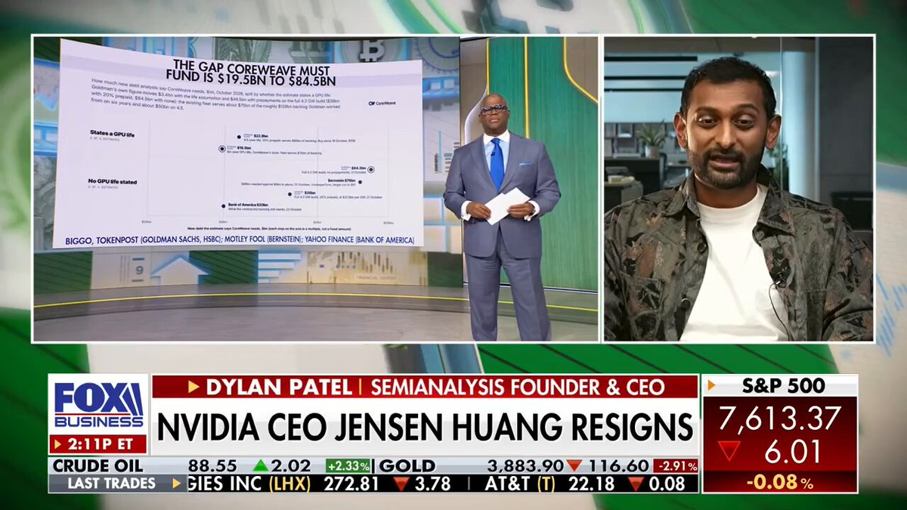

**The clip is Fox Business, not TBPN.** The 68-second video is Patel on [*Making Money with Charles Payne*](https://www.foxbusiness.com/video/6408304073112), 12 Nov 2026. The lower third reads "DYLAN PATEL | SEMIANALYSIS FOUNDER & CEO"; the chyron moves from "NVIDIA CEO JENSEN HUANG RESIGNS" to "TRUMP SUGGESTS TIM COOK TO REPLACE JENSEN HUANG", which is also the title of Fox's official segment. The on-screen clock is **14:11 ET** (19:11 London). Live tape in the bug fits Thursday's session: NVDA 164.46 (day range $148.80–$167.14, close $166.19) and the S&P 500 around 7,613 (day range 7,550.84–7,652.76, close 7,592.40). Fireside posted the cut later that night. Fox split the same appearance into several clips, including ones on [Tim Cook](https://www.fox.com/watch/clip/fmc-hej0oraxlejwjd5p/dylan-patel-explains-why-tim-cook-cannot-replace-jensen-huang-at-nvidia), [export controls](https://www.fox.com/watch/clip/fmc-j4u2pg1n2ibw0re7/dylan-patel-warns-of-nvidia-export-control-issues-behind-ceo-s-exit), and [Anthropic's IPO](https://www.fox.com/watch/clip/fmc-bo9x10nb7yy9lodm/dylan-patel-explains-how-anthropic-s-ipo-benefits-from-a-weaker-nvidia). A CoreWeave funding-gap slide ("$19.5BN TO $84.5BN") is on the studio screen behind Payne; that is the show's graphic, not a claim in this 68-second cut.

OfficeChai's [write-up](https://officechai.com/ai/google-and-amd-could-eat-into-nvidias-market-share-with-jensen-huang-gone-semi-analysis-dylan-patel/) attributed these exact quotations to TBPN. That is the wrong programme. Patel *did* go on TBPN the same afternoon — the isolated interview is ["Jensen Huang's Exit Could Change the AI Industry Forever"](https://www.youtube.com/watch?v=z8_hlGA51ck) (published 12 Nov, 31 minutes; also cut from the longer live show [Jensen Out, TBPN Merch Drop, GPT 6 Cyber, Dylan Patel Live](https://www.youtube.com/watch?v=YhNRT_pOO18), [TBPN's 19:00 UTC post](https://x.com/tbpn/status/2120954813252837636)). A Whipscribe transcript of that 31-minute interview contains a related "three main things" passage (technical lead, locking up supply, and Nvidia propping up the open-source ecosystem) and the "fucking good" chip-team remarks Fireside posted earlier, but **not** the TPU "every night" / "just as good as Nvidia" / "double my allocation" lines, and not the CUDA-being-displaced line. He also did a separate [CNBC International Live](https://www.cnbc.com/video/2026/11/13/nvidias-grip-on-ai-chip-supply-chain-to-weaken.html) interview around 00:33 London on 13 Nov, and a ChinaTalk emergency pod. Easy to conflate; the video in this post is Payne's show.

**Checks (15 Nov 2026, London).**

- **The "nightly benchmarks" exist, and they do include TPUs.** SemiAnalysis's InferenceMAX, now [InferenceX](https://inferencex.semianalysis.com/), is described in their own [launch post](https://inferencex.semianalysis.com/blog/inferencemax-open-source-inference-benchmarking) as running every night on open-source models and frameworks. The old [inferencemax.ai](https://inferencemax.ai/) address now redirects to SemiAnalysis. The public dashboard lists Google TPUv7 Ironwood alongside GB300 NVL72, GB200 NVL72, B200, H200, H100, MI355X and others. That supports Patel's "we test TPUs… on open source models every night." It does not, by itself, support a single score of "just as good as Nvidia."
- **"Just as good" is a headline, not the public tables.** SemiAnalysis's [September 2026 note](https://inferencex.semianalysis.com/blog/tpu-inferencex-full-steam) said that in an apples-to-apples FP8 comparison on Qwen 3.5 397B, TPUv7 delivered up to 50% better performance per dollar than B200 and B300. [SecondSource's read of that newsletter](https://secondsource.io/en/column/2026-09-13/) points out that the 50% is a single operating point (20 tokens/s/user at 256 concurrent streams); the edge shrinks at higher interactivity, and the newsletter itself said "Across most of the raw-performance curve, TPU does not outperform Nvidia GPUs. However, that comparison does not account for TPU's lower TCO." The later [5 Nov 2026 AgentX article](https://inferencex.semianalysis.com/blog/tpu-strikes-the-king) is also mixed, not a sweep: on GLM-5.2 FP8, TPUv7 is the cheapest FP8 option (1.2x to 2.7x the tokens per dollar of B200, B300 and MI355X from 60 to 300 tok/s/user), but Nvidia NVFP4 still beats TPUv7 FP8, with an accuracy/quality trade-off, and TPUv7 has no native FP4 until TPUv8 (their Q1 2027 estimate). On Qwen3.5 FP8 with llm-d disaggregated serving, they report TPUv7 beating GB300 FP8 at every interactivity level and, in some submissions, matching or beating GB300 FP4 on end-to-end. On Kimi K3, TPUv7 was competitive with GB300 NVL72 at launch, then GB300 FP4 led after subsequent Nvidia submissions. So the public record is "competitive, and sometimes better on performance per dollar, especially in FP8"; it is not "equal on every model, precision and operating point."
- **SemiAnalysis is not a disinterested scorekeeper.** It sells the Accelerator Model and an AI Cloud & TCO Model, publishes ClusterMAX cloud ratings (CoreWeave has cited the Platinum ranking in its own letters), and runs InferenceX as a branded benchmark that vendors and open-source maintainers submit to. The 5 Nov article is bylined including Dylan Patel. That does not make the numbers wrong; it is the commercial context for a claim circulating as if it were an independent lab result.
- **Google is already selling TPUs externally, which is the share-shift mechanism Patel is pointing at.** Alphabet's Q3 2026 call, already in `goog/analysis/2026_10_delta_analysis.md` and `goog/NOTES.md`, has Thomas Kurian saying "TPU system sales were also a meaningful contributor" and Anat Ashkenazi saying they should "continue to scale in Q4, followed by a meaningful revenue ramp in 2027." Inventory was built to support those system sales. Anthropic's own [23 Oct 2025 announcement](https://www.anthropic.com/news/expanding-our-use-of-google-cloud-tpus-and-services) (and Google Cloud's [press release](https://www.googlecloudpresscorner.com/2025-10-23-Anthropic-to-Expand-Use-of-Google-Cloud-TPUs-and-Services)) said it would access up to one million Google Cloud TPUs, with more than a gigawatt coming online in 2026. SemiAnalysis's 5 Nov article also names Oracle, OpenAI and Meta as TPU customers; Meta is described there as already deploying TPUv7 in production on SGLang-TorchTPU. Those last three names are SemiAnalysis's, not a naming in Alphabet's Q3 call, which only said "a wide range of customers."
- **"Google could just take a ton of share" and the CUDA point are Patel's judgments, not findings.** Capacity doubling is a hypothetical ("Google's like, actually, double my allocation"). Whether Google can convert silicon into wafers and customers without Jensen-style dealmaking is the open question he is posing. AI models writing software and thereby shrinking the CUDA moat is a thesis; this clip does not measure it.

**Charlie:** The useful part is not "TPUs beat Nvidia." It is that Nvidia's lead, in Patel's telling, is a three-legged stool — the chip, the supply-chain allocations Jensen personally extracts, and the software — and the first leg is no longer a wipeout. The public InferenceX write-ups back "close, and sometimes cheaper per token in FP8," with Nvidia often still ahead once you allow FP4 and after it refreshes submissions. If the middle leg really was a one-man skill, Google already selling TPU systems (and Anthropic already signed up for a million of them) is how a share shift would show up. That is a possibility, not a forecast, and it sits next to Ives's view that Jensen is not coming back.

See also: 2026-11-13 04:06 — Dylan Patel (SemiAnalysis): Jensen exit bodes well for Anthropic IPO; 2026-11-12 22:40 — Nvidia: Jensen Huang resigns as CEO; 2026-11-08 22:35 — Luke's take: Nvidia board investigation into Jensen Huang relationship (media spy allegation); 2026-11-13 22:57 — Kobeissi: Musk backs petition to reinstate Jensen Huang; 2026-11-13 23:07 — Psyduck Capital: would be short NVDA after Huang's resignation; 2026-11-15 17:43 — Charlie Bilello: % below all-time high (Nvidia −33%, Google −28%, AMD −20%); 2026-11-15 17:50 — Dan Ives: no chance Jensen returns; CEO shortlist; 2026-11-11 19:31 — clipping: Marius Fanu — Google AI Pro withholds Gemini 4 Carbon; 2026-11-05 21:00 — Anthropic discloses $895bn future AI infrastructure commitments; `goog/NOTES.md` and `goog/analysis/2026_10_delta_analysis.md` on TPU system sales.

Tags: #NVDA #Nvidia #GOOG #GOOGL #TPU #Ironwood #AMD #CUDA #SemiAnalysis #DylanPatel #FoxBusiness #CharlesPayne #InferenceX #InferenceMAX #JensenHuang #supply-chain #Anthropic

### 2026-11-13 04:06 — Dylan Patel (SemiAnalysis): Jensen exit bodes well for Anthropic IPO

Source: Fireside Alpha ([@firesidealpha](https://x.com/firesidealpha/status/2121092214680129831)) on X, 13 Nov 2026, **04:06 London**. Pasted by Luke on 15 Nov, noting a repost by Raging Capital Ventures ([@RagingVentures](https://x.com/RagingVentures/status/2121452712042627529), 14 Nov, 03:58 London). Confirmed from the X API on 15 Nov, evening London (about 27,000 impressions, 218 likes, 25 reposts, 4 quotes, 7 replies, 110 bookmarks at fetch). The long-form text matches the API `note_tweet` and the paste. The post quotes Fireside's earlier TPU/Jensen clip (02:38 London, filed just above) and attaches a 75-second video, saved as a still below.

Full text:

> SemiAnalysis’s Dylan Patel says Jensen’s exit bodes really well for Anthropic’s IPO, because a weaker open source ecosystem leaves Anthropic closer to a monopoly or duopoly
>
> “I think it’s no surprise that the big turmoil in the market in tech, in my opinion, was just driven off of Anthropic’s revenue slowing down. In Q2, Anthropic plus OpenAI added about $33 billion of revenue ARR. And in Q3, it was less, and that was primarily off the backs of open source gaining so much steam.”
>
> “Now open source looks a lot weaker with Nvidia down and out, at least in some sense, their ability to fund the open source. And if that’s the case, Anthropic looks like they’re much more likely to get a complete monopoly or a duopoly on this ecosystem. So I think this bodes really well for Anthropic’s IPO next week.”
>
> “And furthermore, they’re the one company in the world that knows how to use TPUs. They know how to use Amazon’s Trainium. They know how to use AMD GPUs, and they’re building their own chip. They’re more diverse in what chips they use than any other company in the world. Their fights with Nvidia have been brewing for a long time. They figured out how to exist and use compute without Nvidia. Of course, they still use a lot of Nvidia, but two thirds of their compute is not Nvidia. And so they’re well positioned to take advantage of a weaker Nvidia and a weaker open source.”

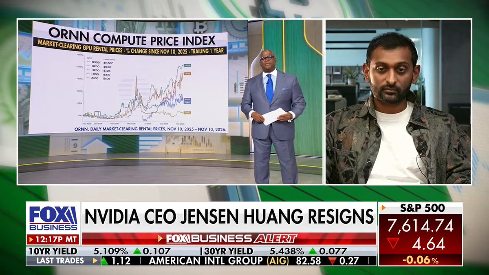

**Same Fox Business appearance as the TPU clip, a few minutes later.** The 75-second video is another cut of Patel on [*Making Money with Charles Payne*](https://www.fox.com/watch/clip/fmc-bo9x10nb7yy9lodm/dylan-patel-explains-how-anthropic-s-ipo-benefits-from-a-weaker-nvidia), 12 Nov 2026. Fox's official segment is titled "Dylan Patel explains how Anthropic's IPO benefits from a weaker NVIDIA" and runs 1 minute 43 seconds; Fireside's cut is tighter. The lower third again reads "DYLAN PATEL | SEMIANALYSIS FOUNDER & CEO". The on-screen clock moves from **14:17 ET** to **14:18 ET** (19:17–19:18 London), about six minutes after the 14:11 ET TPU cut. Chyrons in this clip include "THE FUTURE OF NVIDIA", "TRUMP SUGGESTS TIM COOK TO REPLACE JENSEN HUANG", "NVIDIA SHARES SINK AS INVESTORS ASSESS IMPACT OF HUANG'S EXIT" and "NVIDIA CFO COLETTE KRESS NAMED INTERIM CEO". Live tape in the bug still fits Thursday's session: the S&P 500 around 7,614 (day range 7,550.84–7,652.76, close 7,592.40). An ORNN Compute Price Index chart is on the studio screen behind Payne; that is the show's graphic, not a claim in this cut. Patel also did TBPN and CNBC International the same day, as noted in the 02:38 entry; this video is Payne's show.

**Checks (15 Nov 2026, London), against [S-1/A No. 2](https://www.sec.gov/Archives/edgar/data/2130357/000162828026072484/anthropicpbc-sx1ax2.htm) (filed 10 Nov; CIK 2130357) and `ant/README.md`.**

- **"IPO next week" is right.** From Thursday 12 Nov, that is the week beginning 16 Nov. Anthropic's IPO website FAQ, filed as a [10 Nov free-writing prospectus](https://www.sec.gov/Archives/edgar/data/2130357/000162828026072949/anthropicpbc-fwpipowebsi.htm), already said: "Subject to regulatory clearance, the final IPO share price is expected to be set on November 18th (EST), and shares are expected to begin publicly trading on November 19th (EST)." S-1/A No. 2 uses 19 Nov as the date on which certain RSUs' service-based vesting condition will be satisfied, which is consistent with a first trading day then. The range remains $70–$78, Nasdaq "ANT". Those dates were still the plan at filing time; the offering had not yet priced.

- **Anthropic did slow in Q3. The filing does not blame open source for it.** Quarterly revenue was $4,731m in 1Q26, $11,555m in 2Q26 and $16,956m in 3Q26 (`ant/README.md`). Net new revenue therefore fell from $6,824m to $5,401m, about **−21%**, and QoQ growth dropped from +144% to +47%. MD&A (p.165–166) says the Q2-to-Q3 "increase in revenue due to higher usage was partially offset by a decrease of approximately $600 million from price reductions introduced as part of new model versions and contractual discounts." It does not mention open-weight or open-source models as a cause of that quarter's deceleration. Run-Rate Revenue was ~$71bn at 30 Sep and ~$81bn at 31 Oct (p.203), so October itself was a step-up. Risk factors do, separately, warn that "open-weight or open-source AI models may capture a portion of the market for certain use cases, which could exert pricing pressure on our offerings or lead certain customers to adopt open-source alternatives" (p.50). That is a general risk, not an attribution for Q3. Whether the $600m of cuts were a response to open-source competition is not stated.

- **The "$33 billion" Q2 add is a blend, and "Q3 was less" does not clearly hold on the public quarterly figures.** Patel is combining Anthropic with OpenAI and calling it ARR. Anthropic's own Q2 addition, annualising the quarter's net new revenue, is $6,824m × 4 = **$27.3bn**. OpenAI is not a filer. The [WSJ](https://www.wsj.com/tech/ai/openais-second-quarter-sales-show-tepid-growth-compared-with-anthropic-5cb42998) reported Q2 revenue of $6.7bn, up from $5.7bn in Q1 (about +18%). Annualising that $1.0bn increment is **$4.0bn**, and $27.3bn + $4.0bn = **$31.3bn**, in the region of his "$33 billion" if that is the method and he rounded. On the same method, Q3 was not less. Anthropic's increment falls to $5,401m × 4 = $21.6bn, but OpenAI's CFO, Sarah Friar, said on the record to [Yahoo Finance on 10 Nov](https://finance.yahoo.com/technology/article/openai-cfo-q3-was-a-blockbuster-quarter-revenue-jumped-50-225023234.html) that Q3 revenue rose nearly 50% to $10bn, with an annual run-rate of roughly $50bn. Annualising the $3.3bn increment is $13.2bn, so the blended quarterly add would be about **$34.8bn**, slightly *more* than Q2, because OpenAI accelerated as Anthropic slowed. Month-end ARR is a different metric, and the two labs do not define it the same way (Anthropic includes cloud-partner sales; OpenAI often reports a lower net figure). We do not have a complete, like-for-like ARR series for both, so a blended ARR path that really did fall in Q3 cannot be verified. "The big turmoil in the market in tech… was just driven off of Anthropic’s revenue slowing down" is Patel's opinion. The Q3 deceleration was already in the 26 Oct S-1; Huang resigned on 11 Nov.

- **Diversified chips, yes; "two thirds not Nvidia" and "building their own chip," no.** The filing supports the supplier list. "We train and serve Claude natively across four major chip families (AWS Trainium, Google TPUs, NVIDIA GPUs, and AMD GPUs) using a proprietary orchestration layer" (p.141–142). The chip-platform section (p.212–213) names Amazon for custom-designed Trainium, Google and Broadcom for TPUs, NVIDIA plus Microsoft, SpaceXAI, Nscale, Lambda and other clouds for NVIDIA GPUs (including Grace Blackwell and Vera Rubin), and AMD plus approved Helios manufacturers for Instinct GPUs, including the MI450 series. It says this "reduces dependence on any single vendor." It does **not** disclose a current mix, so "two thirds of their compute is not Nvidia" is Patel's figure, not a filing number. "They're building their own chip" is also not in the S-1. The closest language is that Anthropic "depend[s] on third-party chip design and services companies for the design, manufacture, and support of certain custom accelerator platforms," and that it influences future Trainium and TPU roadmaps. That is not the same as an Anthropic-designed chip in production. On AMD, there is a further timing caveat: the July 2026 Helios / MI450 Hardware Supply Agreement says "we expect the first of the AMD GPU delivery and deployment milestones to be achieved in 2027" (p.172), even though the "train and serve natively" list already includes AMD GPUs. "They still use a lot of Nvidia" is clearly true (SpaceXAI up to $120.5bn, Nscale $44.6bn, Lambda $41.3bn, plus Microsoft, all described as NVIDIA GPU capacity; NVIDIA is also buying $10bn of Class N in the IPO PIPE). "They figured out how to exist and use compute without Nvidia" overstates that. "Fights with Nvidia have been brewing" is not in the filing.

- **Nvidia does help fund open models; "down and out" is a judgment.** A light check only, as asked. Nvidia's 16 Mar 2026 [Nemotron Coalition](https://investor.nvidia.com/news/press-release-details/2026/NVIDIA-Launches-Nemotron-Coalition-of-Leading-Global-AI-Labs-to-Advance-Open-Frontier-Models/default.aspx) press release named Mistral, Reflection AI, Thinking Machines Lab and others, and said the first co-developed base model would be trained on DGX Cloud and open-sourced as the foundation for Nemotron 4. That is real sponsorship. Whether that funding is now "down and out" because Huang resigned two days earlier is Patel's inference, not something Nvidia had announced. "A complete monopoly or a duopoly" if open source weakens is likewise his judgment, not a finding in the S-1.

**Charlie:** The useful part is the diversification, which the S-1 actually documents, not the share-count on Nvidia or the open-source monopoly story. Anthropic really does run across Trainium, TPUs, NVIDIA and, at least as a platform claim, AMD, and that is a genuine difference from a lab that is still mostly on one vendor. The Q3 slowdown is also real, and the filing's own explanation is price cuts, not open source. The $33bn Q2 blend is close if you annualise the two labs' reported quarterly increments, but on that same arithmetic Q3 was not smaller, because OpenAI sped up. Treat “two thirds not Nvidia,” “building their own chip,” and the open-source explanation for the slowdown as Patel's views, sitting next to a filing that will be in the market in a week.

See also: 2026-11-13 02:38 — Dylan Patel (SemiAnalysis): TPUs as good as Nvidia; without Jensen, Google could take share; 2026-11-13 08:05 — Brett Winton: Anthropic+OpenAI $75bn per inference GW; 2026-11-05 21:00 — Anthropic discloses $895bn future AI infrastructure commitments; 2026-11-10 11:53 — clipping: Anthropic targets valuation of about $1T in IPO; `ant/README.md` (TechFundies check, S-1/A No. 2, including the 21% fall in net new revenue and ~$600m of Q3 price cuts); 2026-11-12 22:40 — Nvidia: Jensen Huang resigns as CEO; 2026-11-15 17:50 — Dan Ives: no chance Jensen returns; CEO shortlist; 2026-11-13 22:57 — Kobeissi: Musk backs petition to reinstate Jensen Huang; 2026-11-13 23:07 — Psyduck Capital: would be short NVDA after Huang's resignation.

Tags: #ANT #Anthropic #IPO #S-1 #OpenAI #ARR #NVDA #Nvidia #TPU #Trainium #AMD #SemiAnalysis #DylanPatel #FoxBusiness #CharlesPayne #JensenHuang #open-source #open-weight

### 2026-11-13 08:00 — Remote Labor Index vs Epoch Capabilities Index (98% automation projection)

Pasted by Luke this morning (13 Nov 2026). The same annotated chart was posted on X at 05:48 London by [@tranche_cheddar](https://x.com/tranche_cheddar/status/2121117900010582463) ("me after seeing the Fable 5.2 score on the Remote Labor Index and its future projection based on the ECI trend"). I did not find an earlier public post with these labels. The underlying scatter and the grey dashed "Expected score based on ECI" curve are from [Epoch AI's ECI explorer](https://epoch.ai/eci), in the same style as [Greg Burnham's 10 Nov post](https://x.com/GregHBurnham/status/2120155251240292619) (that screenshot stopped short of Fable 5.2 and had no 98% overlays). The green "steep curve", the red "Epoch S-curve" 98% projections, the date ranges, and "Model 4 (est.)" are a third-party overlay, not an Epoch publication. Whether @tranche_cheddar drew the overlay or reshared it is unconfirmed.

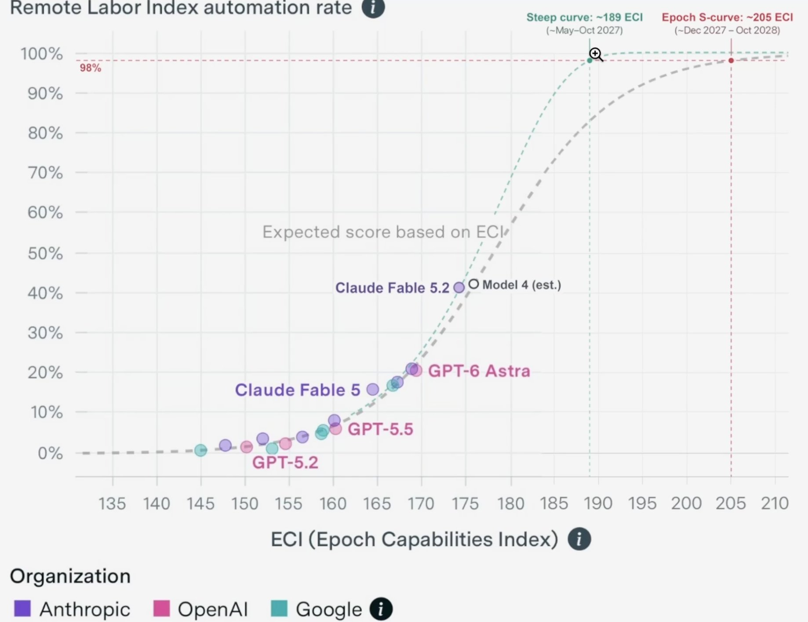

**What it shows.** RLI automation rate (the share of real freelance projects completed to a professional-acceptance standard) against the Epoch Capabilities Index, coloured by Anthropic, OpenAI and Google. A grey dashed logistic is Epoch's expected RLI score at a given ECI. Two third-party projections mark 98% automation: a green steeper curve at about 189 ECI (dated May–Oct 2027) and a red extension of the Epoch curve at about 205 ECI (dated Dec 2027–Oct 2028). An unofficial "Model 4 (est.)" point sits near 176 ECI and 42%.

**Checks** (13 Nov 2026, against Epoch's [ECI scores](https://epoch.ai/data/eci_scores.csv) and [fitted benchmark parameters](https://epoch.ai/data/edi_scores.csv), both updated today, and the [Scale / CAIS RLI leaderboard](https://labs.scale.com/leaderboard/rli) / [remotelabor.ai](https://www.remotelabor.ai/)):

| Label on the chart | Official ECI (13 Nov) | Official RLI automation rate | Epoch expected RLI at that ECI |
|---|---:|---:|---:|
| GPT-5.2 (~150, ~1% on the chart) | 154.46 | 2.50% (medium) / 2.08% (default) | 3.3% |
| GPT-5.5 (~160, ~6%) | 160.10 | 6.25% (Scale: "Codex GPT 5.5") | 7.3% |
| Claude Fable 5 (~164, ~16%) | 164.13 | 15.83% | 12.8% |
| GPT-6 Astra (~169, ~20%) | 169.00 | 20.83% | 23.5% |
| Claude Fable 5.2 (~174, ~41%) | 173.44 | 41.25% (commonly rounded to 41.3%) | 37.7% |
| Model 4 (est.) (~176, ~42%) | not listed | not listed | 47.2% at ECI 176 |

- The labelled frontier points match official ECI and RLI closely, except GPT-5.2: the chart's "~150, ~1%" is a visual underestimate.
- Fable 5.2 sits a little above Epoch's official curve (41.3% vs 37.7% expected), which is what Burnham said on 10 Nov ("right in line… if anything a bit higher"). Anthropic's 9 Nov table also reported 41.3%.
- "Model 4 (est.)" is not on Epoch's ECI table or the RLI leaderboard. Gemini 4 Carbon is 169.76 ECI and still listed as unreleased, with no RLI score on the Scale leaderboard.
- The red "~205 ECI" for 98% is approximately consistent with Epoch's current logistic (RLI difficulty 176.75, slope 0.1522): 98% falls at 202.3 ECI, and 205 ECI implies 98.7%. The green "~189 ECI" for 98% is not Epoch's curve; at 189 the official expected score is only 86.6%. That steeper fit is the overlay author's.
- The date ranges are not from Epoch. They require an assumed ECI growth rate. From GPT-5 (150 on 7 Aug 2025) to Fable 5.2 (173.44 on 9 Nov 2026) is about 18.6 ECI/year, which would put 189 around Sep 2027 and 205 around Jul 2028, inside the labelled windows. A slower 13 ECI/year clock, as in [Generality Labs' July RLI forecast](https://generality.org/blog/posts/forecasting-the-remote-labor-index/), would push 205 into 2029. Generality's own two-step forecast (50% around May 2027 and 90% around May 2028, at 1.0× pace) is a related but separate exercise, plotted against calendar time rather than ECI.

**What RLI measures, and caveats.**

RLI (Center for AI Safety and Scale AI) is 240 self-contained real freelance projects across 23 domains, more than 6,000 hours and over $140,000 of professional work. The headline metric is the automation rate: the share of projects whose AI deliverable a reviewer judges a reasonable client would accept versus the human gold standard. That is not economy-wide automation. Epoch's own [review of economic-value benchmarks](https://epoch.ai/publications/what-do-economic-value-benchmarks-tell-us/) says high scores would not imply end-to-end automation of digital professions, because the tasks are well-defined and relatively self-contained. The official site also excludes work that needs direct client interaction, physical labour, or long-term evaluation. A 98% reading is near-saturation of this benchmark, not 98% of remote work in the economy.

Other caveats: the S-curve is a fitted logistic and will move as new models and evaluations arrive (ECI itself is refit jointly, so scores can shift slightly); Fable 5.2 is already a little above the official expected curve, which is why a steeper alternative can be drawn through the latest points; the date labels rest on an assumed ECI-to-calendar mapping, not a published Epoch forecast; "Model 4 (est.)" is unverified.

See also: 2026-11-10 14:53 — Ramez Naam / METR / AECI capability-cost, earlier in this diary; 2026-11-09 — Anthropic: Claude Fable 5.2 and Mythos 5.2 (RLI 41.3%); 2026-11-09 20:08 — Knock-on effects of basic new AI capabilities; 2026-10-12 — Karpathy, the widening LLM-capability funnel (`diary/2026-10.md`).

Tags: #AI #RLI #ECI #Epoch #Anthropic #OpenAI #Google #automation #Fable #benchmarks #forecasting

### 2026-11-13 08:05 — Brett Winton: Anthropic+OpenAI $75bn per inference GW

Source: Brett Winton ([@wintonARK](https://x.com/wintonARK/status/2121027046583435773), Chief Futurist at ARK Invest) on X, 12 Nov 2026, 23:47 UTC (23:47 London). It is a long-form reply to Joe Weisenthal. Pasted by Luke the next morning at about 08:05 London; the screenshot is timestamped "~8h". Engagement on the screenshot (1 reply, 3 reposts, 35 likes, 3.5K impressions) matches the post as retrieved the same morning.

Thread context. Earlier on 12 Nov, Weisenthal ([@TheStalwart](https://x.com/TheStalwart/status/2120852099130880057), 12:11 London) wrote that the market seemed to be treating the Nvidia turmoil as an Nvidia problem that would not spill to other public companies. Burak Yenigun ([@BurakYngn](https://x.com/BurakYngn/status/2120954489653915805), Stylus Capital) quoted that at 18:58: "the “AI trade” is less fragile than people think. Dependency on financing conditions etc are extremely overstated imo." Weisenthal replied, "I don't necessarily disagree, but say more" ([18:59](https://x.com/TheStalwart/status/2120954731308658885)). Yenigun did then say more (tokens are valuable, so the trade needs a lot of tokens and therefore a lot of AI). Winton's post is a separate reply to Weisenthal's "say more," not a reply to Yenigun's follow-up.

Winton gives no source, method, or table for the $75bn / $68bn / $55bn per inference GW figures, or for the 330% / 680% / 360% annualised growth rates, in this post or in a follow-up. The only reply was from a third party. The closest earlier write-up of his framework is a [30 Oct 2026 thread](https://x.com/wintonARK/status/2116316304131129656), which describes ARK charts of "revenue per GW yield," with a vertical line for "the number of monetized inference GWs they are operating on." That thread does not publish the Q1–Q3 series used here.

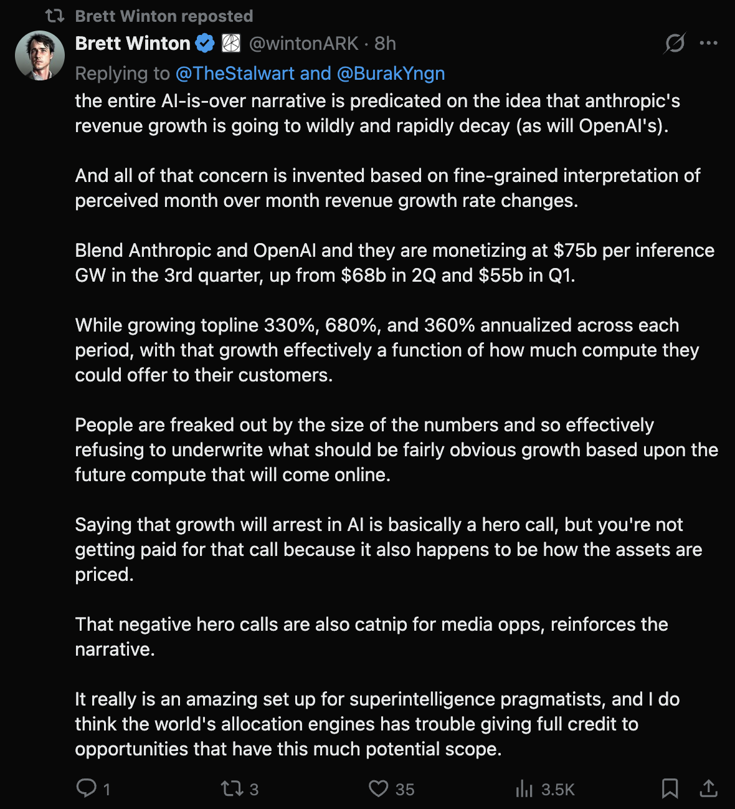

> the entire AI-is-over narrative is predicated on the idea that anthropic's revenue growth is going to wildly and rapidly decay (as will OpenAI's).
>
> And all of that concern is invented based on fine-grained interpretation of perceived month over month revenue growth rate changes.
>
> Blend Anthropic and OpenAI and they are monetizing at $75b per inference GW in the 3rd quarter, up from $68b in 2Q and $55b in Q1.
>
> While growing topline 330%, 680%, and 360% annualized across each period, with that growth effectively a function of how much compute they could offer to their customers.
>
> People are freaked out by the size of the numbers and so effectively refusing to underwrite what should be fairly obvious growth based upon the future compute that will come online.
>
> Saying that growth will arrest in AI is basically a hero call, but you're not getting paid for that call because it also happens to be how the assets are priced.
>
> That negative hero calls are also catnip for media opps, reinforces the narrative.
>
> It really is an amazing set up for superintelligence pragmatists, and I do think the world's allocation engines has trouble giving full credit to opportunities that have this much potential scope.

Checked on 13 Nov 2026 against [S-1/A No. 2](https://www.sec.gov/Archives/edgar/data/2130357/000162828026072484/anthropicpbc-sx1ax2.htm) (filed 10 Nov 2026) as summarised in [`ant/README.md`](../ant/README.md), and against a full-text search of that filing for capacity units. OpenAI has no public SEC filings, so the blended figures cannot be rebuilt from primary sources we hold.

- **The post is genuine.** Text, timestamp and metrics match. Winton does not cite a source for $/GW in this post.
- **Inference GW is not in the S-1.** A search of S-1/A No. 2 found no "gigawatt," "GW," "megawatt" or "MW." Compute capacity is discussed qualitatively (CSP and lease commitments, chip types). There is no disclosed inference-GW, or other capacity, denominator with which to reproduce $55bn / $68bn / $75bn per GW. Those are Winton's (or ARK's) own numbers.
- **Anthropic quarterly revenue, from the filing's quarterly table (all $ millions):** 1Q25 $376, 2Q25 $787, 3Q25 $1,382, 4Q25 $2,040, 1Q26 $4,731, 2Q26 $11,555, 3Q26 $16,956. QoQ growth is +132%, +144% and +47%, as already noted in `ant/README.md`. 3Q26 annualises to ~$68bn. Run-rate revenue was ~$71bn at 30 Sep and ~$81bn at 31 Oct.
- **Annualised growth arithmetic (Anthropic only).** Compounding each quarter's QoQ rate over four quarters, (1 + g)^4 − 1, gives about **2,793%**, **3,459%** and **364%** for 1Q, 2Q and 3Q 2026. The last is very close to Winton's 360%. The first two do **not** match 330% or 680%, nor do the year-on-year rates (about 1,158%, 1,368% and 1,127%). The 330% and 680% must depend on OpenAI (or on some other mix or annualisation), which we cannot check. The order he lists them in is also unspecified.
- **The key tension with the S-1.** Winton says the "AI-is-over" concern is "invented" from a fine-grained reading of month-on-month growth-rate changes. The filing itself, not a monthly leak, shows a sharp deceleration: net new revenue fell from $6,824m in 2Q26 to $5,401m in 3Q26, about **−21%**, in the same quarter as about **$600m** of price cuts (and a step-down in QoQ growth from +144% to +47%). That is the growth-decay concern, stated in the S-1. Whether it is the start of "wild and rapid decay," or just a slower but still very fast climb constrained by compute, is the judgement. Two points cut the other way, as he argues: the October ARR step-up of $10bn, to $81bn, and rising revenue per inference GW in his own (unauditable) series. Compute and infrastructure was 57% of 9M26 revenue and 58% in 3Q26, unchanged from the earlier notes.
- **Bias.** ARK is a long-duration, long-AI house; Winton is its Chief Futurist and sits on the ARK Venture IC. This is an argument from that book, including the claim that a growth arrest is already how "the assets are priced," which was not independently checked.

**Charlie:** the interesting part is not the bullish conclusion. It is the attempt to reframe the debate from a fading month-on-month rate to dollars earned per unit of inference power, which in his series is still rising. That claim may be right, but we cannot audit it from the S-1, and the same filing already records a 21% drop in net new revenue and $600m of price cuts in Q3. October's ARR jump is the first data point that might support his "compute-constrained, not demand-constrained" reading; one month is not a trend. Treat the $/GW path as an ARK construct until a capacity denominator is disclosed.

See also: `ant/README.md` (S-1/A No. 2, including the 21% fall in net new revenue and ~$600m of Q3 price cuts); 2026-11-10 11:53 — Anthropic targets valuation of about $1T in IPO; 2026-11-05 — Anthropic discloses $895bn future AI infrastructure commitments; 2026-11-05 16:56 — Luke's thinking: AI spending will continue, it's a race, and chips always need replacing; 2026-11-05 18:58 — Luke's thinking: today's selloff is ridiculous given a COVID-like surge in AI inference demand; 2026-11-03 — The Red Queen & The Infinite Work Machine; 2026-11-11 20:02 — Max Wiethe / David Orr, the counter that compute is already oversupplied.

Tags: #AI #ANT #Anthropic #OpenAI #ARK #Winton #inference #GW #revenue #S-1 #IPO #growth #capex

### 2026-11-13 22:57 — Kobeissi: Musk backs petition to reinstate Jensen Huang

Source: The Kobeissi Letter ([@KobeissiLetter](https://x.com/KobeissiLetter/status/2121348797276320087)) on X, 13 Nov 2026, 21:05 London. Pasted by Luke at about 22:57 London as a screenshot (257 replies, 760 reposts, 10K likes, 336K views, 342 bookmarks). Retrieved the same evening: 257 replies, 677 reposts and 85 quotes (762 combined, matching the screenshot's 760), 10,091 likes, 338,324 impressions, 343 bookmarks.

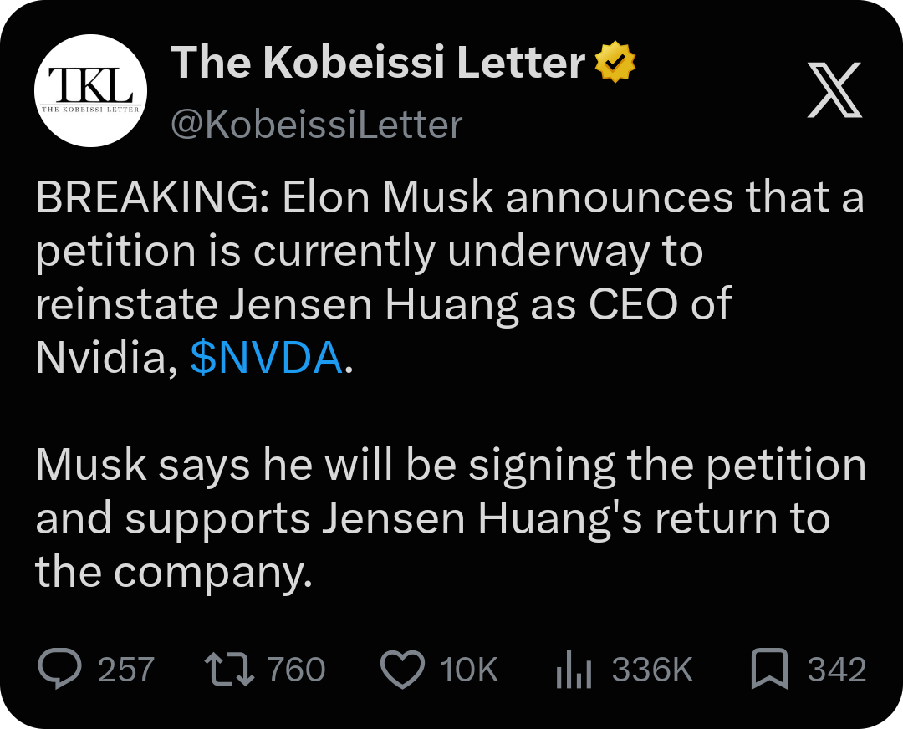

> BREAKING: Elon Musk announces that a petition is currently underway to reinstate Jensen Huang as CEO of Nvidia, $NVDA.
>
> Musk says he will be signing the petition and supports Jensen Huang's return to the company.

**Musk's actual words.** This was not a standalone announcement. At 20:51 London, Musk [replied](https://x.com/elonmusk/status/2121345211959804234) to Yun-Ta Tsai ([@yunta_tsai](https://x.com/yunta_tsai/status/2121242163644412202), a Tesla senior staff engineer):

> @yunta_tsai A petition is underway to reinstate Jensen and I’m signing it too

Tsai's post, at 14:01 London, did not mention a petition. It urged Nvidia employees who want Huang back to "resign and chill," arguing that engineers "shape and deliver the company mission, not the boards." Musk did not endorse that resignation tactic, did not name or link a petition, and had not, as of this filing, posted a follow-up identifying one. Engagement on the reply when retrieved: about 2.35 million impressions, 96,602 likes, 8,960 reposts, 3,487 replies, 1,374 quotes.

Earlier the same day, at 05:51 London, Musk had posted only the word ["Jensen"](https://x.com/elonmusk/status/2121118775210868871), quoting an a16z video tribute.

**Petitions (Musk did not specify which).** Several public campaigns exist; none has governance force. Only Nvidia's board can appoint or reinstate a CEO (and Huang would have to agree). A Change.org or open-letter signature is not a shareholder vote, a proxy solicitation, or an 8-K event.

The largest public list found at filing time is [standwithjensen.com](https://standwithjensen.com), an independent open letter to the board. The site describes itself as a campaign of self-identified current and former Nvidia employees and shareholders, "not affiliated with, authorized by, or endorsed by NVIDIA Corporation or Jensen Huang." The public organizer was not identified on the pages retrieved. It demands the board "Bring Jensen Back" pending an independent investigation and "clear evidence that his removal serves the company," and asks for a public explanation of the decision and process. At 22:59 London the site's public `/api/campaign` endpoint reported **3,071** total signatures (1,256 self-identified current employees, 85 former employees, 1,247 shareholders; those tags are self-reported, are not verified, and need not sum to the total). A second fetch about a minute later showed 3,100, so the count was still rising. The site says no account is required to sign, and that names and affiliations on the public list are self-reported and not verified. The public signatures feed included two rows under the name "Elon Musk" (22:27 and 22:30 London, one titled "Space X Tesla CEO" and tagged shareholder). That does **not** prove Musk signed this site; anyone can type a name. Musk's X post also did not link here.

Separate Change.org petitions, counts as fetched around 22:59 London on 13 Nov:

- [Bring Jensen Huang back as Nvidia CEO](https://www.change.org/p/bring-jensen-huang-back-as-nvidia-ceo), started 12 Nov by Mohamed Adany, a self-described Nvidia shareholder: **750** verified signatures. The page itself calls the petition independent, voluntary and nonbinding, and says signing is not a shareholder vote or proxy solicitation. (Clash Report, reviewing it earlier on Friday evening, had 170 signatures.)
- [Bring back Jensen Huang for Nvidia](https://www.change.org/p/bring-back-jensen-huang-for-nvidia), started 12 Nov by Son Tran: **72** verified signatures.
- [KEEP JENSEN HUANG AS NVIDIA CEO](https://www.change.org/p/keep-jensen-huang-as-nvidia-ceo), started 11 Nov (before the resignation was announced) by Amy Chang: **closed**, 91 supporters.
- Smaller petitions also exist, including Mike Smith's "Don't Punish Millions for One" (21 verified signatures) and Hua Wang's "Urge Nvidia to reinstate Jensen Huang" (18), started 12–13 Nov.

Separately, [WIRED](https://www.wired.com/story/nvidia-employees-petition-for-jensen-huangs-return/) reported an internal Nvidia suggestion-box post, submitted before the resignation, that had drawn more than 1,600 comments, most supporting Huang's return. That is internal commentary, not a public petition Musk linked.

**Official Nvidia status (unchanged by the post).** The latest Item 5.02 [8-K](https://www.sec.gov/Archives/edgar/data/1045810/000104581026000082/nvda-20261111.htm), filed 12 Nov, remains the last leadership filing: on 11 Nov the board accepted Huang's resignation as President, CEO and director, effective immediately; Colette Kress is interim CEO and stays CFO; Harvey C. Jones was appointed Chair. The SEC submissions API for CIK 1045810 showed no later 8-K on 13 Nov. The newsroom [CEO transition release](https://nvidianews.nvidia.com/news/nvidia-announces-ceo-transition) (12 Nov) is still the latest leadership statement; the 13 Nov newsroom item is a healthcare blog post, not a comment on petitions or reinstatement. A 10 Nov [statement from the independent directors](https://nvidianews.nvidia.com/news/statement-from-the-independent-members-of-the-nvidia-board) confirmed they had retained Joon H. Kim and Wachtell, Lipton, Rosen & Katz for the investigation announced on 8 Nov. No official comment on Musk's post or on any petition was found.

**NVDA (Yahoo daily chart, 13 Nov regular session):** closed **$162.85**, down **$3.34 (−2.01%)** from Thursday's close of $166.19. Open $169.89, range $158.39–$170.00, volume about 362 million. After-hours around 22:58 London was about **$161.31**. Musk's reply landed at 20:51, nine minutes before the regular close (21:00 London). The 20:50 five-minute bar ran from about $162.48 to $163.12 (high $163.24), then the 20:55 bar closed $162.82 and the official close was $162.85; after-hours drifted a little lower. That is not a clear, lasting jump, and this filing does not attribute the day's move to the post.

**Overstatements to keep in view.** Kobeissi's "announces" frames a 15-word reply as a formal announcement, and "supports Jensen Huang's return" is a paraphrase — Musk said he would sign an unnamed petition that is "underway to reinstate Jensen." A petition cannot reinstate him; the board can.

See also: 2026-11-12 22:40 — Nvidia: Jensen Huang resigns as CEO; 2026-11-08 22:35 — Luke's take: Nvidia board investigation into Jensen Huang relationship (media spy allegation), earlier in this diary.

Tags: #NVDA #Nvidia #JensenHuang #ElonMusk #Kobeissi #governance #CEO #ColetteKress #petition

### 2026-11-13 23:07 — Psyduck Capital: would be short NVDA after Huang's resignation

Source: Psyduck Capital Management ([@psyduckcapital](https://x.com/psyduckcapital/status/2121224057106415942)) on X, 13 Nov 2026, 12:50 London. A nine-post thread; no images. Pasted by Luke as the root link. Verbatim, with the long-form text where a post was truncated:

> I’d be short $NVDA here. This has all the hallmarks of a major scandal that is yet to fully come to light and I believe the stock's outlook has changed. Here’s what will happen now:

> The CFO has been appointed interim CEO. Her primary personal goal is to not fuck it up until they find a replacement. The WSJ revealed her hesitation regarding indiscriminate circular financing deals, so odds are she will slow that activity down. The Nvidia empire-building is slowing, if not stopping, from here. What if a struggling neocloud calls her? Would she pull a Jensen and double down (again)? Not so sure

> The fact that Jensen had 60 direct reports is under appreciated. I’ve seen egomaniac CEOs struggle with 20 direct reports. Having 60 is a major red flag for an organisation. He sought to create maximum control and limit checks & balances. What else has been pushed through or hidden? The board moved very swiftly. Why?

> China: Colette Kress has been CFO throughout these China sales. The segmentation change that made Singapore disappear happened under her watch. Even if it was all on Jensen’s command, she still must have known how sketchy this was to begin with. Expect her to reduce / avoid further SEA-to-China GPU funnel deals to minimise future liability risk. There is a good chance they’ll cut guidance at the earnings next week. There will most likely be an official investigation, if not an outright ban on these sales. Lutnick is under fire. Culper estimated ~20% of compute revenues could be from China.

> Bulls would say it’s already corrected 30% and is cheap but note that the P/E multiple ex-China is higher:
> - Culper estimates 20% of compute is China-related
> - Compute sales are 75% of total group
> - Neg. operating leverage impact at 75% gross margins
> - At $160, $NVDA adj. multiple would be ~20.7x FY27 vs. 17.2x consensus, i.e. ~20% higher

> And: That does not include the effect of re-routing these GPU volumes, which will presumably be produced regardless. Could this incremental GPU supply lower pricing in the US/EU? If so, the PF multiple would be even higher. Consensus numbers will have to come down

> Talent: Jensen’s abrupt departure has scarred a lot of Nvidia employees and many have voiced disappointment at the board's decision-making. Meanwhile, SpaceX/Terafab is an exciting opportunity right now. Expect Elon to make some hiring moves soon. Also recall that roughly 50% of employees now have a net worth exceeding $25 million. They will start to sell

> There might be a short-term bounce given the 30% drawdown but I'd prefer to hedge out my $QQQ look-through exposure to $NVDA here by being short $NVDA. Also, $CRWV $IREN etc. are fucked

> See also these guys with good thoughts on why $NVDA stock should struggle from here:
> @P_Remarks
> @RagingVentures
> @RandianCapital

Thread posts, in order: [1](https://x.com/psyduckcapital/status/2121224057106415942), [2](https://x.com/psyduckcapital/status/2121224057467076645), [3](https://x.com/psyduckcapital/status/2121224057890746869), [4](https://x.com/psyduckcapital/status/2121224058444427416), [5](https://x.com/psyduckcapital/status/2121224058968617351), [6](https://x.com/psyduckcapital/status/2121224059350348177), [7](https://x.com/psyduckcapital/status/2121224059803386295), [8](https://x.com/psyduckcapital/status/2121224060147253519), [9](https://x.com/psyduckcapital/status/2121224060453482712).

**Checks:**

- **Interim CEO, earnings date, official status.** Confirmed. The 12 Nov Item 5.02 [8-K](https://www.sec.gov/Archives/edgar/data/1045810/000104581026000082/nvda-20261111.htm) and [Nvidia's press release](https://nvidianews.nvidia.com/news/nvidia-announces-ceo-transition) say the board accepted Huang's resignation on 11 Nov; Colette Kress, CFO since 2013, is interim CEO and stays CFO; Harvey Jones is Chair. Q3 FY27 results remain on Tue 17 Nov, which is "next week" from this post. Nvidia has not cut guidance, announced a sales ban, or said anything about a new official investigation of the company. Whether they cut the guide on 17 Nov is a prediction, not a fact.
- **WSJ on Kress and circular financing.** The substance is in the 13 Nov WSJ report, "[Before His Ouster, Jensen Huang Belittled the Executive Replacing Him](https://archive.ph/gx14x)" (anonymous sources): Kress questioned how to select, value and measure returns on credit-support deals, and helped cut a proposed OpenAI data-centre backstop from about $250bn to roughly half, signed 17 Aug. The Journal had already reported in late August that Nvidia paused some cloud-provider financing deals pending executive and board review. Kress also publicly defended the investments ("We recognize the scale of this support, and we know some will call this circular financing. We see it differently"). That she "will slow that activity down" further, or refuse to "double down" for a struggling neocloud, is Psyduck's inference.
- **60 direct reports, and a swift board.** Huang told Lex Fridman in March 2026 that he oversaw more than 60 people on his direct staff and did not do one-on-ones ([Yahoo/Business Insider write-up](https://sg.finance.yahoo.com/news/jensen-huang-runs-nvidia-60-094101152.html)). An internal list obtained by [Business Insider](https://www.businessinsider.com/nvidia-org-chart-leaders-report-to-ceo-jensen-huang-2025-10) in October 2025 showed 36 formal direct reports, so "60" is Huang's own wording, not a confirmed org-chart count at resignation. The public timeline was tight: the board's independent investigation was announced on 8 Nov, and the resignation was accepted on 11 Nov. "What else has been pushed through or hidden?" is rhetorical, not evidenced here.
- **Singapore reporting change.** Real, and it did happen under Kress as CFO. In Q3 FY2026 (quarter ended Oct 2025) Nvidia switched geographic revenue from customer billing location to customer headquarters, and Singapore dropped out as a reported line; prior periods were recast. The FY2026 [10-K](https://www.sec.gov/Archives/edgar/data/1045810/000104581026000021/nvda-20260125.htm) states that change explicitly, and that end-customer and shipping locations may differ from headquarters. [Fortune](https://fortune.com/2026/11/12/nvidia-changed-earnings-report-format-singapore-revenue-megaspeed-probe-colette-kress/) (citing WSJ) notes Singapore had been $10.2bn, or 22% of revenue, in the quarter ended Jul 2025, and that Nvidia added Megaspeed to an internal block list in June 2025. The filings do not say the reporting change was made because of Megaspeed.
- **Culper's ~20% China-related compute.** This is a short-seller estimate, not a company figure. Culper Research's 13 May 2026 report, "[The China Problem](https://culperresearch.com/wp-content/uploads/2026/05/Culper_NVDA_5-13-2026.pdf)", said it believes "over 20% of Nvidia's FY 2026 compute revenues remained driven by China" through diversion and Southeast Asian intermediaries. Officially, Q2 FY27 Hopper shipments to China were less than 1% of Data Center revenue, and the Q3 outlook assumes no Data Center compute revenue from China (Q2 [10-Q](https://www.sec.gov/Archives/edgar/data/1045810/000104581026000075/nvda-20260726.htm) and [26 Aug press release](https://nvidianews.nvidia.com/news/nvidia-announces-financial-results-for-second-quarter-fiscal-2027)). China-headquartered customers were still $7.88bn, or 8.2%, of Q2 revenue, which is not the same as end-destination or diverted compute. Applying Culper's FY2026 diversion estimate to FY27 consensus would double-count if that consensus already assumes little or no China compute.
- **Compute 75% of the group, and 75% gross margin.** The 75% compute share matches FY2026, not the latest quarter. The FY2026 10-K breaks out compute $162.361bn of $215.938bn total (75.2%), inside Data Center $193.737bn. In Q2 FY27, Data Center was $89.023bn of $96.221bn (92.5%); the quarter no longer breaks out compute versus networking in the platform table. GAAP and non-GAAP gross margin were both 75.0% in Q2; the Q3 guide is 74.0% ±50 bps.
- **17.2x FY27 vs 20.7x ex-China at $160.** The unadjusted multiple is right at $160. Nasdaq's analyst forecast feed, fetched 13 Nov, had FY27 (year ending Jan 2027) consensus EPS at $9.29 (18 estimates, range $9.01–$9.71); Yahoo Finance's analysis page showed $9.32 (51 analysts). $160 / $9.29 = 17.2x. The 20.7x "adj." figure is just that 17.2x scaled up by about 20% ($160 / 20.7 ≈ $7.73 of EPS, a ~17% haircut), which is the arithmetic of stripping Culper's 20% of compute, times the 75% compute share, with some operating leverage. It stands or falls with that unverified haircut, and with the idea that those earnings are still inside consensus.
- **30% drawdown, and the $162.85 close.** Fair, slightly more than 30% from the peak close. Yahoo daily chart: peak close $239.24 and peak high $243.37 on 6 Oct; 13 Nov close $162.85 (−31.9% from the peak close, −33.1% from the peak high), after a session range of $158.39–$170.00, down 2.0% from the $166.19 prior close. The thread went up at 12:50 London, before the US cash open.
- **Lutnick, and an official investigation or ban.** "Lutnick is under fire" is a fair reading of recent press: Axios and AP reported a clash with Treasury Secretary Bessent over Megaspeed and export controls, and CNBC reported Lutnick had agreed to testify. The US is already investigating Megaspeed for export-control violations; Singapore said it investigated Megaspeed and Alice Huang from February 2025 and did not find sufficient evidence of espionage. Senate Finance (Wyden and Neal) has also opened an inquiry into the administration's handling of China chip sales. None of that is yet an official ban on Nvidia's remaining SEA-to-China sales, and "there will most likely be an official investigation, if not an outright ban" is a forecast.
- **Employee disappointment, $25m net worth, and selling.** [WIRED](https://www.wired.com/story/nvidia-employees-petition-for-jensen-huangs-return/) reported an internal suggestion-box post, with more than 1,600 comments, urging the board to bring Huang back, which is evidence of some employee pushback, not a measured survey of how many were "scarred." The "roughly 50% … net worth exceeding $25 million" line traces to a circulated June 2025 voluntary poll of about 3,000 employees (Kobeissi and others amplified it), not to an Nvidia filing. The FY2026 10-K puts the workforce at about 42,000. The poll was self-reported, likely biased toward respondents who had done well, and much of the wealth is paper stock; NVDA is also ~32% below its October high, so those net-worth figures would have moved. "They will start to sell" is speculation.
- **SpaceX / Terafab hiring.** Terafab is a real Tesla/SpaceX chip-fab effort, and both have been advertising roles for it since at least March 2026 ([Business Insider](https://www.businessinsider.com/tesla-spacex-terafab-hiring-elon-musk-chip-salaries-texas-california-2026-3)). "Expect Elon to make some hiring moves soon" and a resulting Nvidia talent drain are not shown. The $CRWV / $IREN line is opinion.

**Overstatements to keep in view.** The thread is a short thesis, not a news report. The load-bearing number — Culper's ~20% China-related compute — is an unverified May short-seller estimate for FY2026, and the 20.7x "ex-China" multiple applies it to FY27 consensus that may already assume almost no China Data Center compute. Predictions about guidance, a ban, Kress's deal appetite, employee selling and Elon hiring are not established facts.

**Charlie:** The official facts (Kress as interim CEO, 17 Nov print, 75% Q2 margin, ~32% off the high, Singapore reporting change, Kress questioning some financing) are real. The jump from those to "short it because 20% of compute is still China" leans on Culper, not on Nvidia's filings.

See also: 2026-11-13 22:57 — Kobeissi: Musk backs petition to reinstate Jensen Huang; 2026-11-12 22:40 — Nvidia: Jensen Huang resigns as CEO; 2026-11-08 22:35 — Luke's take: Nvidia board investigation into Jensen Huang relationship (media spy allegation); 2026-11-09 20:11 — Bloomberg circular AI deals chart, earlier in this diary.

Tags: #NVDA #Nvidia #JensenHuang #ColetteKress #Culper #China #export-controls #Megaspeed #Singapore #governance #CEO #short #CRWV #IREN #Terafab

### 2026-11-14 22:20 — Steve Dakh: ETH under $2,000 (Soviet portfolio joke)

Source: Steve Dakh ([@stevedakh](https://x.com/stevedakh/status/2121222904587383042)) on X, 13 Nov 2026, 12:45 London. Pasted by Luke as a screenshot (8 likes, 412 views on the capture; 413 impressions when checked). Verbatim:

> ETH fell under $2,000 this week. My dad, who grew up in the Soviet Union, asked to see my portfolio for the first time. He stared at it for a while and said it reminded him of home.

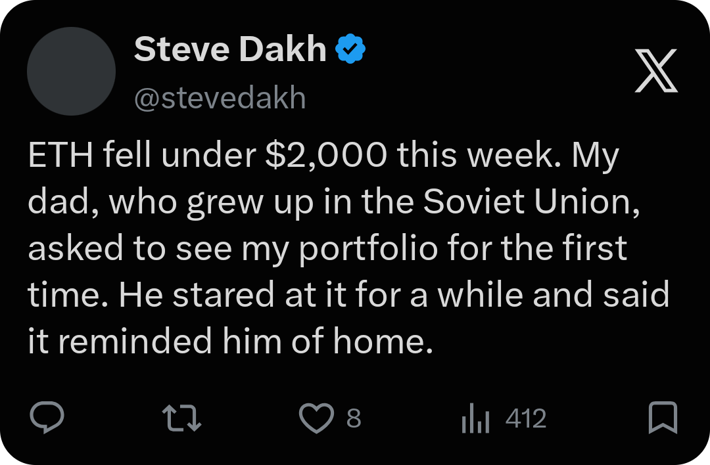

Humour and a sentiment marker, not a thesis. The price claim holds.

**Checks (Yahoo daily chart, ETH-USD / BTC-USD, fetched 22:21 London on 14 Nov):**

- **ETH this week.** Confirmed. The first daily low under $2,000 this week was **$1,982.45** on 12 Nov (that day's close was still $2,016.83). The first daily close under $2,000 was **$1,927.59** on 13 Nov, the day of the post. This week's low so far is **$1,746.80** on 14 Nov. The latest price at 22:21 London was **$1,758.36**.
- **ETH vs a month ago / October high.** The 14 Oct close was **$2,418.21**, so ETH is down about **27%** over the month. The October high on the 3-month chart was **$2,773.52** on 2 Oct; the latest price is about **37%** below that. Yahoo's 52-week range is $1,506.51–$3,446.62. A low under $2,000 is not new in that range (the 3-month chart also shows daily lows under $2,000 in mid-August); the claim is only that it happened again this week.
- **BTC this week, for context.** Bitcoin's week low was **$63,792.61** on 14 Nov, with the latest price **$63,957.95** at 22:21 London. That is about **22%** below the 14 Oct close of $81,562.49, and about **27%** below the October high of $87,146.35 on 2 Oct.

See also: 2026-11-04 "$CRCL Circle Internet Q3 2026 earnings"; 2026-11-04 "Kobeissi: Democrats plan investigations, oil \"on notice\", AI 48-hour safety reporting", earlier in this diary.

Tags: #ETH #ethereum #BTC #bitcoin #crypto #sentiment #stevedakh

### 2026-11-15 11:32 — Luke's thinking: why crypto never went mainstream

> Crypto was 10X too esoteric for ordinary people and overrun with fraudsters and boys. It lacked, and indeed repelled the exact personalities and grownups needed to build clean, simple UX.

Context: Luke's reply to the [Steve Dakh ETH-under-$2,000 joke](#2026-11-14-2220--steve-dakh-eth-under-2000-soviet-portfolio-joke) (ETH ~$1,758, about 37% below its 2 Oct high; BTC ~$63,960). The point is about who built it, not the technology: the culture selected against the product and UX people consumer adoption needs.

Tags: #crypto #ETH #lukes-thinking #adoption #UX

### 2026-11-15 17:43 — Charlie Bilello: % below all-time high

Source: Charlie Bilello ([@charliebilello](https://x.com/charliebilello/status/2122019790462075237)) on X, 15 Nov 2026, 17:31 London. Pasted by Luke at about 17:43 London. Text only; no image was attached. Verbatim:

> % Below All-Time High
> Apple: -1%
> S&P 500: -4%
> Microsoft: -7%
> Amazon: -7%
> Meta: -20%
> AMD: -20%
> Palantir: -21%
> Tesla: -22%
> Google: -28%
> Gold: -31%
> Nvidia: -33%
> SpaceX: -38%
> Bitcoin: -49%
> Netflix: -54%
> Ethereum: -64%
> Strategy: -79%
> Dogecoin: -92%
> TrumpCoin: -99%
> MelaniaCoin: -99%

**Checks** (Yahoo Finance daily chart API, `query2`, full daily history to 15 Nov 2026. The all-time high is the maximum of the daily high or close. Equities, gold and SPCX are versus the Friday 13 Nov close, because US markets were shut on Sunday. Crypto is versus Yahoo's last price at about 17:47 London on 15 Nov. A figure is treated as a match if it is within 2 percentage points of Bilello's rounded number. Equity and gold dates are US cash sessions; crypto dates are UTC.)

| Name | Bilello | Checked | ATH date | ATH (daily high) | Latest |
|---|---:|---:|---|---:|---:|
| Apple (AAPL) | -1% | -1.3% | 13 Nov 2026 | $360.83 | $356.27 |
| S&P 500 (^GSPC) | -4% | -3.6% | 6 Oct 2026 | 7,844.52 | 7,561.67 |
| Microsoft (MSFT) | -7% | -6.3% | 4 Nov 2026 | $559.15 | $523.88 |
| Amazon (AMZN) | -7% | -7.2% | 3 Aug 2026 | $287.20 | $266.66 |
| Meta (META) | -20% | -19.4% | 15 Aug 2025 | $796.25 | $641.69 |
| AMD | -20% | -18.9% | 6 Oct 2026 | $658.52 | $534.06 |
| Palantir (PLTR) | -21% | -21.1% | 12 Oct 2026 | $212.94 | $167.99 |
| Tesla (TSLA) | -22% | -21.8% | 22 Dec 2025 | $498.83 | $390.22 |
| Google (GOOGL) | -28% | -27.6% | 18 May 2026 | $408.61 | $295.77 |
| Gold (GC=F) | -31% | -30.4% | 29 Jan 2026 | $5,586.20 | $3,886.30 |
| Nvidia (NVDA) | -33% | -33.1% | 6 Oct 2026 | $243.37 | $162.85 |
| SpaceX (SPCX) | -38% | -38.3% | 16 Jun 2026 | $225.64 | $139.11 |
| Bitcoin (BTC-USD) | -49% | -48.9% | 6 Oct 2025 | $126,198 | $64,537 |
| Netflix (NFLX) | -54% | -53.7% | 30 Jun 2025 | $134.12 | $62.15 |
| Ethereum (ETH-USD) | -64% | -63.5% | 24 Aug 2025 | $4,953.73 | $1,807.25 |
| Strategy (MSTR) | -79% | -79.4% | 21 Nov 2024 | $543.00 | $111.62 |
| Dogecoin (DOGE-USD) | -92% | -92.1% | 8 May 2021 | $0.7376 | $0.0586 |
| Official Trump (TRUMP35336-USD) | -99% | -98.8% | 19 Jan 2025 | $75.35 | $0.94 |
| Official Melania Meme (MELANIA35347-USD) | -99% | -99.7% | 20 Jan 2025 | $13.73 | $0.046 |

Every name is within 2 percentage points of Bilello's rounded figure. The percentages match drawdowns from the all-time daily *high*, not the all-time close; versus closing ATHs the list would be a little milder (gold about -27%, SpaceX about -34%, Strategy about -76%).

**Notes**

- **Apple is at an all-time closing high.** Friday's close, $356.27, was itself a new closing peak; the -1% is only the gap to that same day's $360.83 high.
- **Gold -31% is real, not a typo.** COMEX gold (Yahoo `GC=F`, quoted as the Dec 26 contract) printed $5,586.20 on 29 Jan 2026 and closed Friday at $3,886.30 (−30.4%). The physically backed ETFs confirm the same peak date and a similar drawdown: GLD −30.3% ($509.70 → $355.45) and IAU −30.2% ($104.40 → $72.88).
- **Netflix -54% is also real**, on split-adjusted prices. Netflix split 10-for-1 on 17 Nov 2025, after the peak. The 30 Jun 2025 high of $134.12 is $1,341.15 in pre-split terms; Friday's $62.15 close is $621.50 pre-split. The percentage is the same either way.
- **SpaceX** has been public as Nasdaq: SPCX since 12 Jun 2026. It opened at $150, peaked at $225.64 on 16 Jun (four sessions later), and closed Friday at $139.11.
- **Bitcoin and Ethereum** are measured from their 2025 all-time highs, not from the October 2026 local highs used in the Dakh entry (where ETH was about 37% below the 2 Oct 2026 high of $2,773.52). Versus those 2025 ATHs the drawdowns are about 49% and 64%.
- **Official Trump** is not under Yahoo's `TRUMP-USD` (that symbol was not found). The Official Trump token is `TRUMP35336-USD`: high $75.35 on 19 Jan 2025, last $0.94, −98.8%. **Official Melania Meme** is `MELANIA35347-USD` (plain `MELANIA-USD` is a different parody token with almost no history): high $13.73 on 20 Jan 2025, last $0.046, −99.7%.
- Google is GOOGL (Class A). GOOG was −27.7%, the same rounded figure.
- Strategy (MSTR) peaked at $543 on 21 Nov 2024, after its 8 Aug 2024 10-for-1 split.

**Charlie:** The arithmetic is clean. What the list actually shows is how uneven the damage is: Apple and the S&P have hardly given anything back, while gold, Netflix, Strategy and the crypto names are already in deep bear-market drawdowns, and Nvidia's 33% sits in the middle.

See also: 2026-11-13 22:57 — Kobeissi: Musk backs petition to reinstate Jensen Huang; 2026-11-13 23:07 — Psyduck Capital: would be short NVDA after Huang's resignation; 2026-11-12 22:40 — Nvidia: Jensen Huang resigns as CEO; 2026-11-14 22:20 — Steve Dakh: ETH under $2,000 (Soviet portfolio joke); 2026-11-15 11:32 — Luke's thinking: why crypto never went mainstream; 2026-11-06 21:50 — SpaceX: reported Musk statement on ~$100bn annualised revenue run-rate by December; 2026-11-11 19:36 — stark0xbt — Baker's SpaceX orbital-compute math; 2026-11-11 21:10 — SpaceX: ground and orbital models; 2026-11-12 22:45 — SpaceX + Tesla merger report (Bloomberg via Kobeissi).

Tags: #Bilello #drawdown #ATH #AAPL #SPX #MSFT #AMZN #META #AMD #PLTR #TSLA #GOOGL #gold #NVDA #SPCX #BTC #NFLX #ETH #MSTR #DOGE #TRUMP #MELANIA #crypto

### 2026-11-15 17:50 — Dan Ives: no chance Jensen returns; CEO shortlist

Source: Evan ([@StockMKTNewz](https://x.com/StockMKTNewz/status/2122004804604195211)) on X, 15 Nov 2026, **16:32 London**, pasted by Luke at about 17:50 London (Dan Ives had [reposted](https://x.com/DivesTech/status/2122017755373199814) it at 17:23 London). The attached image is a studio headshot of Ives, not a screenshot of a note.

Ives's own post is [here](https://x.com/DivesTech/status/2121996130313437512), 15 Nov 2026, **15:57 London**. Full text from the X long-post field, retrieved the same afternoon (about 72,000 impressions, 1,037 likes, 72 reposts, 27 quotes, 277 replies at first fetch):

> No one individual can replace Jensen as CEO….but at the end of the day after this global scandal the old Jensen with the black leather jacket and rock star persona is gone for good….that cannot be replicated and any talk of a damaged Jensen coming back to Nvidia is ridiculous in our view given the legal/Board/DC scrutiny/moral compass/China tentacles. We see no chance Jensen comes back to Nvidia as CEO. It’s about moving forward for Nvidia and it starts Tuesday with earnings as Colette leads NVDA ahead (for now)

StockMKTNewz, 35 minutes later, presented the following as if Ives had "just posted this" (full long-post text):

> Dan Ives just posted this:
>
> “any talk of a damaged Jensen coming back to Nvidia is ridiculous in our view given the legal/Board/DC scrutiny/moral compass/China tentacles. We see no chance Jensen comes back to Nvidia as CEO and for the company the best path forward is with a new external CEO or Colette.
>
> Other outside candidates that we see as good fits as next Nvidia CEO are Tim Cook, Nikesh Arora (PANW), Thomas Kurian (Google), Rene Haas (Arm, former Nvidia).”

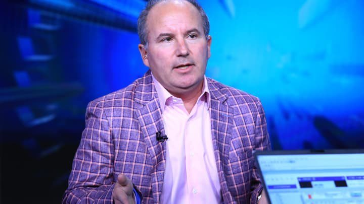

**The StockMKTNewz quote is not a verbatim copy of Ives's post.** Shared wording stops at "We see no chance Jensen comes back to Nvidia as CEO." Differences:

- StockMKTNewz starts mid-sentence and drops Ives's opening: that no one individual can replace him, and that "the old Jensen with the black leather jacket and rock star persona is gone for good."
- After "as CEO," Ives wrote: "It’s about moving forward for Nvidia and it starts Tuesday with earnings as Colette leads NVDA ahead (for now)." He did **not** write "and for the company the best path forward is with a new external CEO or Colette," and he did **not** name Cook, Arora, Kurian or Haas in this post.
- Those four names, and the "new external CEO or Colette" line, appear only in the StockMKTNewz paraphrase. Ives then [reposted](https://x.com/DivesTech/status/2122017755373199814) that paraphrase at 17:23 London, so he circulated it, but it is still not the text of his own post. Stephanie Link ([@Stephanie_Link](https://x.com/Stephanie_Link/status/2122016383081103546), 17:18 London) separately attributed the same four external names to "his new firm Yorkville Ives & Co."

The shortlist is consistent with, but not identical to, what Ives has said since the resignation. On 12 Nov he [wrote](https://x.com/DivesTech/status/2121007393542689062) "We believe the best CEO candidate for Nvidia is Tim Cook," and [Fortune](https://fortune.com/2026/11/12/nvidia-next-ceo-the-outside-contenders-to-succeed-jensen-huang/) quoted him that evening naming Cook, Tom Kurian and Nikesh Arora "as the top three external candidates for Nvidia’s CEO role." Haas was discussed in that Fortune piece by others, not as one of Ives's top three. On 13 Nov Ives [reposted](https://x.com/DivesTech/status/2121289646927650864) a report that Nvidia's board had approached Haas (an FT story; Nvidia had not confirmed it).

**Checks**

- **Firm and rating.** Ives is no longer at Wedbush. His X bio and CNBC on 12 Nov identify him as partner and senior managing director at **Yorkville Ives & Co.** A current primary Yorkville note was not opened for this filing. StreetInsider on 12 Nov reported that he reiterated an **Outperform** rating and a **$225** price target; in an [NBC News](https://ceointerviews.ai/interview/3275999/) interview on 13 Nov he said "We have a $225 target. We remain very bullish." That is a reported stance from midweek, not a note reread today. NVDA closed Friday at $162.85, so $225 would be about 38% above the last close.
- **Tim Cook is not Apple's CEO.** Apple's [20 Apr 2026 newsroom release](https://www.apple.com/newsroom/2026/04/tim-cook-to-become-apple-executive-chairman-john-ternus-to-become-apple-ceo/) and the [1 Sep 2026 Form 8-K/A](https://www.sec.gov/Archives/edgar/data/320193/000114036126035325/ef20081427_8ka.htm) confirm that Cook became executive chairman, and John Ternus became CEO, effective 1 Sep 2026. Fortune already described him as "the former CEO of Apple" when quoting Ives on 12 Nov. StockMKTNewz just says "Tim Cook."
- **Nikesh Arora** is still chairman and CEO of Palo Alto Networks, per the company's [management page](https://www.paloaltonetworks.com/about-us/management) retrieved 15 Nov.
- **Thomas Kurian** is still CEO of Google Cloud. He is bylined as such on Google Cloud posts through at least [10 Nov 2026](https://cloud.google.com/blog/products/ai-machine-learning/gemini-for-healthcare).
- **Rene Haas is still Arm CEO**, and he did work at Nvidia. Arm's [leadership page](https://www.arm.com/company/leadership), retrieved 15 Nov, lists him as Chief Executive Officer (since February 2022) and says that before joining Arm in 2013 "he spent seven years at NVIDIA as Vice President and General Manager of its computing products business." SoftBank's director biography dates the Nvidia role from October 2006 and the Arm move to October 2013.
- **No new Nvidia 8-K since 12 Nov.** The SEC submissions API for CIK 1045810, retrieved 15 Nov at about 17:51 London, still has the 12 Nov Item 5.02/9.01 [8-K](https://www.sec.gov/Archives/edgar/data/1045810/000104581026000082/nvda-20261111.htm) (report date 11 Nov) as the latest filing of any kind. Nothing later; no 8-K/A. Official status is unchanged: the board accepted Huang's resignation as President, CEO and director on 11 Nov, effective immediately; Colette Kress is interim CEO and stays CFO; Harvey C. Jones is Chair. Earnings remain Tuesday 17 Nov, as Ives said.
- **"Legal / Board / DC scrutiny."** Board scrutiny is documented: the 8 Nov board [statement](https://nvidianews.nvidia.com/news/statement-from-nvidia-board-of-directors) opened an independent investigation, and a 10 Nov [statement from the independent directors](https://nvidianews.nvidia.com/news/statement-from-the-independent-members-of-the-nvidia-board) said they had retained counsel. "Legal" and "DC scrutiny" are Ives's words. The 12 Nov 8-K is a leadership change filing, not a disclosure of charges, a lawsuit, or a congressional action, and no later Nvidia SEC filing adds one. The 8 Nov diary entry noted that congressional inquiries were unconfirmed at the time. "China tentacles" and "moral compass" are likewise Ives's characterisation, not a finding in a filing. Espionage remains an unproven media allegation (see the 8 Nov entry).

**Charlie:** The useful part is Ives slamming the door on a Jensen return, which puts him at odds with the Musk petition chatter. The shortlist is old wine in a new bottle, and the StockMKTNewz version should not be filed as if it were Ives's actual post. Cook being free of the Apple CEO job is the one factual change that makes Ives's favourite external name slightly less fanciful than it sounded in the spring, but it is still just a pundit's list.

See also: 2026-11-15 17:43 — Charlie Bilello: % below all-time high (Nvidia −33%); 2026-11-13 23:07 — Psyduck Capital: would be short NVDA after Huang's resignation; 2026-11-13 22:57 — Kobeissi: Musk backs petition to reinstate Jensen Huang; 2026-11-12 22:40 — Nvidia: Jensen Huang resigns as CEO (includes Ives calling Cook the best candidate); 2026-11-08 22:35 — Luke's take: Nvidia board investigation into Jensen Huang relationship (media spy allegation).

Tags: #NVDA #Nvidia #JensenHuang #DanIves #YorkvilleIves #CEO #ColetteKress #TimCook #NikeshArora #PANW #ThomasKurian #ReneHaas #ARM #governance

### 2026-11-15 18:43 — El-Erian / Telegraph: a gathering credit crunch

Source: Mohamed A. El-Erian ([@elerianm](https://x.com/elerianm/status/2121978610244374912)) on X, 15 Nov 2026, **14:48 London**. Pasted by Luke at about 18:43 London. Confirmed from the X long-post (`note_tweet`) field the same evening (about 87,000 impressions, 749 likes, 126 reposts, 28 quotes, 69 replies, 93 bookmarks). There was no image attached to the post.

Full text:

> From the Telegraph:
> “For years after the 2008 financial crash, cheap money fuelled a global borrowing boom. However, as interest rates have begun to rise while governments and tech giants compete for capital, the tide is turning.…  the consequences of a gathering credit crunch are beginning to emerge, and the squeeze has only just started.”
> #economy #markets

The quoted article is [The world is facing a new credit crunch](https://www.telegraph.co.uk/business/2026/11/15/the-world-is-facing-a-new-credit-crunch/) by Szu Ping Chan, Economics Editor, and Ben Marlow, Associate Editor, published 15 November 2026, 6:00am GMT. Standfirst: "As governments and AI giants gorge on debt, higher borrowing costs are squeezing everyone else." The page is paywalled (a direct fetch returned HTTP 402). The opening sections were readable; the exact sentences El-Erian quoted were not in that freely returned text. Closely related lines in the opening are "Today, a new credit crunch is setting in" and "We may be at the beginning of this financial squeeze." The circulated passage may be a condensed standfirst or from a later, unpaid-for section.

**What the accessible opening argues.** This is not a 2008-style freeze. The article says money is still available, but there is a growing divide between borrowers who can still fund themselves at affordable rates and those who cannot. The mechanism is crowding-out: after years of near-zero rates, inflation, heavy government issuance and AI-related borrowing are competing for the same pool of capital. Larry Fink is quoted calling it "the biggest competition for capital I have seen in 50 years in finance," and saying that "Governments across the developed world are running huge deficits. That borrowing is now colliding with tremendous demand from the private sector, much of it from technology companies."

Data points from the opening, not independently re-checked against the underlying loan or company documents:

- Brookfield walked away from refinancing a $360m loan on the $600m Beaudry tower in Los Angeles (64 storeys, 785 apartments, average rents $4,200 a month, 95% occupied), citing "entrenched market challenges."
- Landsec has shelved a £1.5bn redevelopment of Lewisham Shopping Centre (more than 1,700 homes). British Land has paused the next phase of Canada Water, originally expected to deliver 4,000 homes. Savills analysis, as cited, puts at least 42,000 London homes, including 12,000 affordable ones, outside the development pipeline.
- Thames Water's debt is put at about £20bn, up from about £13bn by 2020; a "last and final" creditor rescue bid is described as being finished after ministers rejected an earlier proposal in June.

**Checks (15 Nov 2026, London; markets were closed on Sunday, so market series are Friday or the latest official print).**

- **Bank of England Bank Rate is 4%.** The [November 2026 MPC decision](https://www.bankofengland.co.uk/monetary-policy-summary-and-minutes/2026/november-2026), published 5 Nov, raised it by 0.25 percentage points from 3.75%, the first increase in more than three years. The vote was 8–1 (one member wanted +50bp). The Bank's own [Bank Rate page](https://www.bankofengland.co.uk/monetary-policy/the-interest-rate-bank-rate) and [rate history](https://www.bankofengland.co.uk/boeapps/database/bank-rate.asp) confirm 4% effective 5 Nov, with the next decision due 17 Dec.
- **US 10-year yield is up about 0.4–0.5 percentage points in three months.** Yahoo `^TNX` (CBOE 10-Year Treasury Yield) closed **5.154** on Friday 13 Nov, against **4.696** on 14 Aug, **+0.46pp**. FRED [DGS10](https://fred.stlouisfed.org/series/DGS10) (Treasury constant maturity) is **5.10** on 12 Nov, against **4.68** on 14 Aug, **+0.42pp**. DGS10 has no 13 Nov print yet; 11 Nov is blank (US Veterans Day). The two series differ slightly by construction; both are higher than in mid-August.
- **UK 10-year gilt yield is also higher, but the official series is stale by two sessions.** Yahoo has no working UK 10-year ticker. The Bank of England's 10-year nominal par yield ([IUDMNPY](https://www.bankofengland.co.uk/boeapps/database/FromShowColumns.asp?Datefrom=01%2FAug%2F2026&Dateto=now&SeriesCodes=IUDMNPY&UsingCodes=Y&VFD=N&VPD=Y&html.x=yes)) is **5.2044%** on 11 Nov, against **5.0087%** on 14 Aug, **+0.20pp**. The latest official print is 11 Nov. Market quotes for Friday 13 Nov are around **5.34%**: the [FT 10 yr Gilt](https://markets.ft.com/data/bonds/tearsheet/summary?s=GB10YT=RR) (`GB10YT=RR`) showed 5.34, and a vendor series compiled at countryeconomy.com has 5.22% on 11 Nov (close to the BoE par yield that day), 5.31% on 12 Nov and 5.34% on 13 Nov. FRED's monthly OECD series ([IRLTLT01GBM156N](https://fred.stlouisfed.org/series/IRLTLT01GBM156N)) only runs to September 2026, at 5.24% versus 4.99% in August, so it cannot be used for a current three-month check.
- **Credit spreads have widened, especially in high yield, but they have come in a little from early November and are not at crisis levels.** FRED [BAMLH0A0HYM2](https://fred.stlouisfed.org/series/BAMLH0A0HYM2) (ICE BofA US High Yield OAS) is **3.20%** on 12 Nov, against **2.67%** on 14 Aug, **+0.53pp**. It printed 3.48% on 5 Nov, so the latest figure is off that recent high. FRED [BAMLC0A0CM](https://fred.stlouisfed.org/series/BAMLC0A0CM) (ICE BofA US Investment Grade OAS) is **0.89%** on 12 Nov, against **0.80%** on 14 Aug, **+0.09pp**. These are option-adjusted spreads over Treasuries, not a measure of whether loan markets have frozen. The much wider CCC move was already filed on 26 Oct (Kobeissi; FRED CCC OAS 13.56% on 23 Oct).

**Charlie:** The Telegraph piece is a crowding-out story, and that part fits the diary: governments and AI borrowers are fishing in the same pond, and the weaker credits — property, utilities, housing development, neocloud refinancing — feel it first. El-Erian's circulated quote is punchier than the opening I could read, and I could not match those exact sentences in the free text. The market checks support "tighter," not "crunch" in the 2008 sense, which the article itself is careful to distinguish. US 10-year yields are up nearly half a point in three months; official UK 10-year par yields are up about 20bp through 11 Nov, with Friday market quotes a little higher still; high-yield spreads are about 50bp wider than in mid-August, though they have tightened from the 5 Nov print. Investment-grade spreads have barely moved. That is a squeeze at the margin, not a shutdown.

See also: 2026-11-06 22:11 — El-Erian: October US Jobs Report read as strong; 2026-11-10 13:50 — El-Erian: China YTD trade surplus tops $1tn; 2026-10-07 ~17:14 — El-Erian: 30y gilt yield 6%; 2026-10-07 ~17:12 — Tracey Alloway: heart of the bond selloff; 2026-10-12 ~19:25 — Kobeissi Letter: global rate-hike cycle returns; 2026-10-19 08:52 — El-Erian / The Economist: "Large leverage machine"; 2026-10-14 ~15:50 — Hedgeye: hyperscaler free cash flow set to turn negative; 2026-11-05 21:00 — Anthropic discloses $895bn future AI infrastructure commitments; 2026-11-13 08:05 — Brett Winton: Anthropic+OpenAI $75bn per inference GW; 2026-11-10 22:34 — LiveSquawk: CoreWeave Q3 2026 earnings; 2026-10-20 20:28 — Jim Bianco: CoreWeave the "problem child"; 2026-10-26 22:21 — Kobeissi: CCC junk bond yields hit 18%; 2026-11-05 10:50 — work meeting notes (rate hikes priced in); 2026-11-05 20:39 — Luke's thinking: Fed backstops the Treasury market.

Tags: #El-Erian #elerianm #Telegraph #credit #rates #bonds #gilts #BankRate #Treasuries #spreads #AI-capex #hyperscalers #crowding-out #macro

### 2026-11-15 19:11 — Gavin Baker: take your kids to a launch

Source: Gavin Baker ([@GavinSBaker](https://x.com/GavinSBaker/status/2121777788797718785)) on X, 15 Nov 2026, **01:30 London**. Pasted by Luke at about 19:11 London. Confirmed from the X API the same evening (about 494,000 impressions, 5,375 likes, 331 reposts, 18 quotes, 149 replies, 247 bookmarks at fetch). A standalone post, not a reply. Four photos were attached, saved below. Baker's bio at fetch: "Managing Partner & CIO, @atreidesmgmt."

Full text:

> If you have kids, I highly recommend taking them to a launch. You can watch from the Margaritaville, the town beach or many other viewing locations open to the public.
>
> Sad to miss this one, great day for 🇺🇸

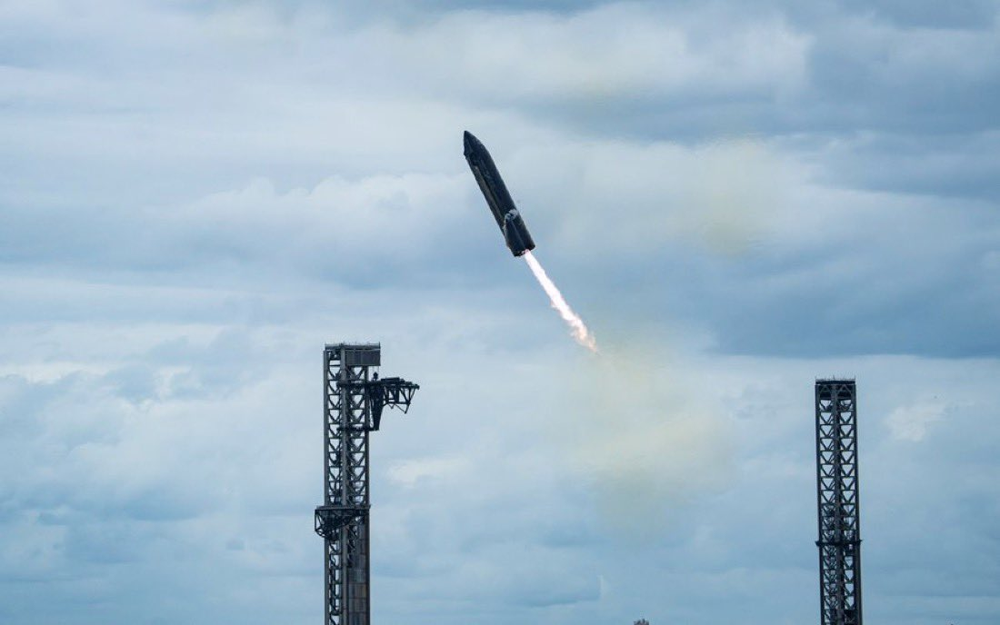

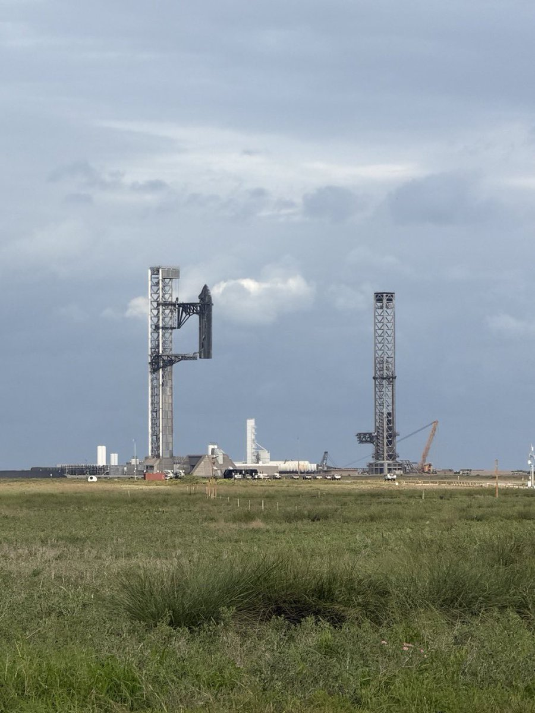

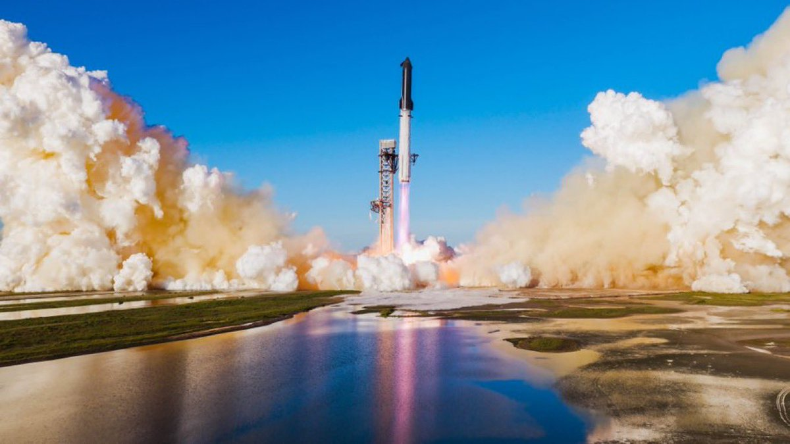

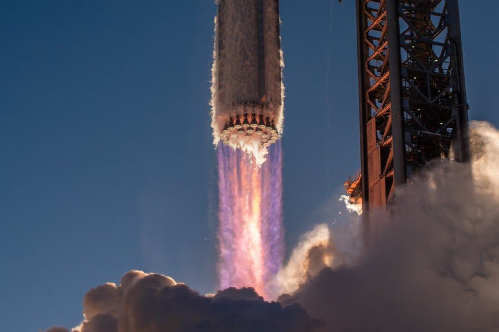

**The launch is Starship Flight 15**, from SpaceX's own [mission page](https://www.spacex.com/launches/starship-flight-15/) and contemporaneous coverage ([Spaceflight Now](https://spaceflightnow.com/2026/11/13/live-coverage-starship-flight-15-attempts-to-recover-full-vehicle-in-double-launch-pad-catch/)). It is not a Cape Canaveral or Port Canaveral flight, and the Margaritaville he means is not the Orlando resort. It is [Margaritaville Beach Resort South Padre Island](https://www.margaritavilleresorts.com/margaritaville-beach-resort-south-padre-island/local-guide/blog/spacex-boca-chica), a documented public viewing spot for Starbase. "The town beach" is Baker's phrase for other public beaches nearby; I did not pin it to a single named park.

- **Vehicle and site.** Super Heavy and Starship, Flight 15, lifted off from Orbital Launch Pad 2 at Starbase, Texas, on Friday 13 Nov at **22:47 London** (16:47 CST; Spaceflight Now and MaxQ give 22:47:36 UTC). The payload was 26 Starlink V3 satellites (Starlink Group 31-2).
- **What "this one" was.** After more than 20 hours in orbit, the ship returned and was caught by the tower — SpaceX's first Starship catch — on Saturday 14 Nov at about **21:20 London** (15:20 CST), 22.5 hours after liftoff, per SpaceX and Spaceflight Now. The Super Heavy booster aborted its catch, diverted offshore, and its flight termination system was triggered after the landing burn.
- **The photos are professional launch shots**, not pictures from the viewing spots Baker names. He says he missed the flight. They show the ship on its landing burn between the towers, the ship hanging in the chopsticks after the catch, the stack leaving the pad, and a close-up of Super Heavy at liftoff.
- **Bias.** Baker is managing partner and CIO of Atreides Management. The firm's latest 13F (period ended 30 Jun 2026, [filed 14 Aug](https://www.sec.gov/Archives/edgar/data/1777813/000177781326000009/0001777813-26-000009.txt)) lists 27,332,943 SpaceX Class A shares (CUSIP 84615Q103), valued at $4,670,106,641, its largest reported holding. The Q3 13F (as of 30 Sep) had not been filed as of this evening; the deadline is 16 Nov. He has also been a public SpaceX bull, including the 15 June TBPN interview already in this diary.

**Charlie:** A cheerful tourist tip, posted a few hours after the first Starship catch, from someone whose fund was last disclosed with SpaceX as its biggest position. The history is real; the enthusiasm is not disinterested.

See also: 2026-11-11 19:36 — stark0xbt — Baker's SpaceX orbital-compute math; 2026-11-11 21:10 — SpaceX: ground and orbital models; 2026-11-12 22:45 — SpaceX + Tesla merger report (Bloomberg via Kobeissi); 2026-11-06 21:50 — SpaceX: reported Musk statement on ~$100bn annualised revenue run-rate by December; 2026-11-15 17:43 — Charlie Bilello: % below all-time high (SpaceX −38%).

Tags: #Baker #Atreides #SPCX #SpaceX #Starship #Flight15 #Starbase #Starlink

### 2026-11-16 03:54 — Ethan Mollick: a stable socio-technical period; only one 1950 job obsolete

Pasted by Luke from [Ethan Mollick (@emollick)](https://x.com/emollick/status/2122176524610884061) on X, posted 03:54 London on 16 Nov 2026. A four-panel photo was attached. No quoted post. Verbatim:

> I think often about the fact that almost everyone working in the West has lived in a quite stable socio-technical period
>
> Only 1 job out of 270 in the 1950 census is now obsolete (elevator operator)
>
> 2026 is similar to 1957 in a way that 1969 was not from 1900.
>
> That may change.

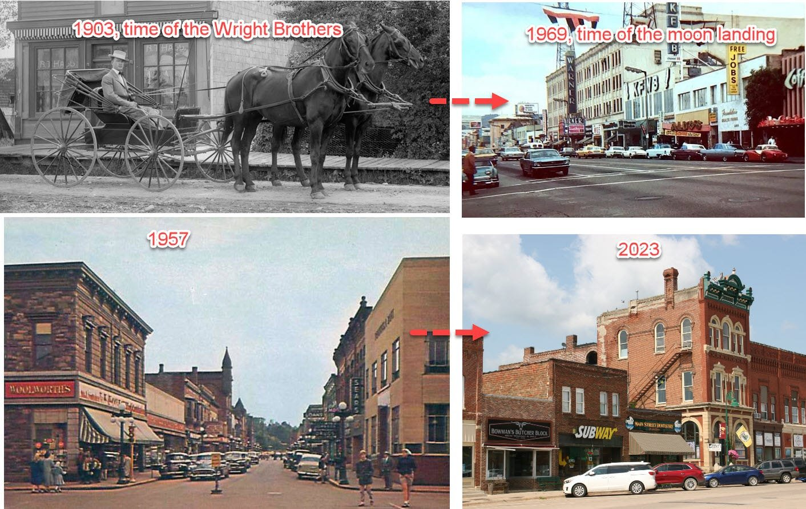

The picture is a before-and-after collage: a horse and carriage in 1903 ("time of the Wright Brothers") against a neon-lit downtown in 1969 ("time of the moon landing"), and a Woolworth's main street in 1957 against a similar brick high street in 2023, with a Subway in the old fabric. He used the same comparison in his 21 Jan 2023 Substack essay, [Becoming strange in the Long Singularity](https://www.oneusefulthing.org/p/becoming-strange-in-the-long-singularity).

**Checks.**

- **"Only 1 job out of 270… is now obsolete (elevator operator)."** The source is James Bessen, not a new 2026 finding, and the wording on X is looser than the research. In [How Computer Automation Affects Occupations](https://conference.nber.org/confer/2016/SI2016/PRIT/Bessen.pdf) (Boston University Law & Economics Working Paper 15-49, revised 2016) and again in his 2018 NBER paper [AI and Jobs: the role of demand](https://www.nber.org/system/files/working_papers/w24235/w24235.pdf), Bessen writes that he looked at the **271** detailed occupations in the 1950 Census, mapped through IPUMS to the 2010 classification, and that "in only one case—elevator operators—can the decline and disappearance of an occupation be largely attributed to automation." Other 1950 titles did disappear, but he attributes those to falling demand (boardinghouse keepers) or to technological obsolescence of the service itself (telegraph operators), which he distinguishes from automating the same job. Mollick's "now obsolete" drops that distinction and makes it sound as if elevator operator is the only 1950 occupation that is gone. The count is **271** in the papers, **270** in Bessen's [VoxEU column](https://cepr.org/voxeu/columns/how-computer-automation-affects-occupations-technology-jobs-and-skills) and in Mollick's 2023 essay; off by one, not material. The window is 1950–2010, not through 2026. Automatic lifts did end the operator as a mass occupation; a handful of operator roles still exist.
- **"2026 is similar to 1957 in a way that 1969 was not from 1900."** This is a visual and rhetorical point, not a measured one. The attached photo is still labelled **2023**, not 2026, and the top pair is **1903–1969** (66 years, Wright Brothers to the moon), which is the frame in the 2023 essay. The tweet recasts it as a 69-year span (2026 back to 1957; 1969 back to 1900). The streetscapes do look more alike in the bottom pair than in the top one. That is a fair comment on the look of everyday physical life. It is a weaker claim about the economy: computers, the internet, smartphones, containerisation and a much larger China all arrived after 1957. Mollick's own 2023 essay conceded "many technological advances since 1957" and argued only that they had not "as profoundly affected our day-to-day life." "That may change" is the point of the post, not a fact to check.

The later Mollick post (17 Nov 20:27) is the same argument aimed at markets: they price the future as a continuation of this long, stable past, even as people shout that a discontinuity is coming. The Catalini clipping (17 Nov 20:33) is the firm-level version: a model trained on what has already been measured will keep pointing attention at the already-seen.

**Charlie:** The elevator-operator line is a real research finding, but it is "only one occupation eliminated by automation," not "only one occupation gone." The collage is a feeling about the street, not a measure of how much the world has changed. His own punchline is that the quiet period may be ending.

See also: 2026-11-17 20:27 — Luke's thinking: Mollick on efficient markets versus radical discontinuities; 2026-11-17 20:33 — Christian Catalini: Don't let AI decide what your company pays attention to.

Tags: #Mollick #jobs #automation #Bessen #AI #discontinuity

### 2026-11-16 03:55 — Chayanka_42: Maynard shocked by the quasi-Riemann proof in the OpenAI math dump

Pasted by Luke on the evening of 17 Nov. The text is not his view. It is a post by [Chayanka_42 (@42_gravity)](https://x.com/42_gravity/status/2122176793939673505) on X, posted 03:55 London on 16 Nov 2026, with a still of James Maynard at a blackboard. Verbatim:

> James Maynard (Fields Medal 2022) says that he was shocked by the proof of the quasi-Riemann hypothesis (from the OpenAI math dump) because he held a very strong prior belief that the problem required the development of an entirely new theory.
>
> He felt the solution was completely out of reach for current mathematical techniques, so seeing it included in the results drop was a massive shock to him. He explains that the proof turned out to rely on the theory of metaplectic forms, which had been developed in the latter half of the 20th century but was an underappreciated and slightly obscure part of the field that most mathematicians had not realized was powerful enough to resolve the hypothesis.
>
> Source: Oxford Mathematics in Conversation on AI - Ben Green and James Maynard with Jan Obloj uploaded on Youtube 6 days ago.

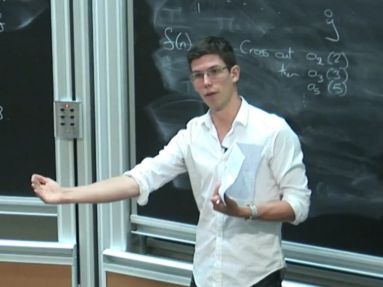

**The video.** The source is real: [Oxford Mathematics in Conversation on AI — Ben Green and James Maynard with Jan Obloj](https://www.youtube.com/watch?v=2GsuvsEg28o). The Mathematical Institute [posted the page](https://www.maths.ox.ac.uk/node/86324) on **9 Nov 2026** at 13:38 London, and it was observed on YouTube around 15:21 UTC the same day. "Six days ago" is a fair count from the 16 Nov post (about 6–7 days). I could not pull the official auto-captions: YouTube returned HTTP 429 / a bot wall, and youtubetranscript.com had no transcript. The substance below is checked against the OpenAI papers, contemporaneous reporting, and two third-party analyses of the video ([skim.plus](https://skim.plus/videos/youtube/oxford-mathematics-in-conversation-on-ai-ben-green-and-james-maynard-with-jan-obloj-e9c4ce71) and [PSI](https://postsingularityinstitute.com/en/syntheses/UCLnGGRG__uGSPLBLzyhg8dQ_2GsuvsEg28o/)), which timestamp the quasi-Riemann discussion from about **4:33 to 8:06** and the metaplectic-forms explanation from about **18:25 to 23:44**. Those are not a word-for-word official transcript.

**What Maynard actually said, as far as it can be checked.** The 2022 Fields Medal is correct (with Hugo Duminil-Copin, June Huh and Maryna Viazovska). In a [Science](https://www.science.org/content/article/ai-edges-closer-solving-riemann-hypothesis-one-math-s-hardest-problems) interview around the October drop he was excited as well as shaken: "I was like a kid at Christmas… Even if it was some scary monster giving me a gift, I was just so excited." He called the result "groundbreaking" and the paper "remarkably well-written." The X post's "massive shock" and "entirely new theory" / "completely out of reach" are the poster's paraphrase. They fit what the video analyses report — Maynard identifying quasi-Riemann as the most shocking item in the drop because he thought it was beyond current techniques, then explaining that the proof used an existing but underappreciated theory rather than a brand-new one — but I cannot confirm those exact spoken words without a transcript.

**The result.** The real name is the **quasi-Riemann hypothesis**: a fixed zero-free half-plane Re(s) > θ with θ < 1, not the full Riemann hypothesis (all non-trivial zeros on the line Re(s) = 1/2). It was in OpenAI's **6 Oct 2026** release of **722** manuscripts, the same dump as the October diary entries on Tristan Buckmaster and Hugo Duminil-Copin. OpenAI posted two versions: a 199-page paper dated 30 Sep 2026, [*The Quasi-Riemann Hypothesis: A Zero-Free Half-Plane Re(s) > 7/8*](https://raw.githubusercontent.com/openai/math/main/preprints/The-Quasi-Riemann-Hypothesis-September-30-2026/paper.pdf), and a shorter 49-page manuscript with the weaker bound 1/12–11/12. The 7/8 result, including a uniform statement for Dirichlet L-functions, has a [Lean formalization](https://github.com/openai/math/blob/main/lean/docs/003.md). The shorter paper was not yet formally verified as of [Quanta, 19 Oct](https://www.quantamagazine.org/ai-proved-the-quasi-riemann-hypothesis-what-happens-now-20261019/). This was the only paper in the drop that OpenAI said had been edited by humans before release; the collaborators were not named. Jared Duker Lichtman of Stanford called it "the most significant AI-for-math achievement so far, by quite a margin." Alexander Dunn of Georgia Tech, whose work with Maksym Radziwiłł is used in the argument, has said he believes the 11/12 manuscript is correct and is reviewing it with others. A separate short paper, also in the drop, independently excluded Landau–Siegel zeros; Science quotes Maynard: "It's completely mind-blowing that there were two separate proofs of no Siegel zeros."

**Metaplectic forms.** Correct. The OpenAI paper cites Kubota's metaplectic theory, Patterson's cubic theta series, and the Dunn–Radziwiłł cusp expansions. Quanta quotes Dunn: finding the right family "required obscure mathematical objects called metaplectic forms," which "had been somewhat uncommon in number theory until now." That matches both the video analyses and the post.

**Charlie:** The medal, the video, the 6 Oct dump, the name of the theorem and the metaplectic machinery all check. The "massive shock" wording is the poster's. Maynard was also, in his own words, like a kid at Christmas.

See also: 2026-10-11 ~19:28 BST — clipping: Hugo Duminil-Copin (Fields medallist) — "They have annihilated my field of research"; 2026-10-09 ~19:08 BST — clipping: Tristan Buckmaster (NYU) — OpenAI's 722 AI math papers wiped out research programs (`diary/2026-10.md`).

Tags: #Maynard #OpenAI #math #quasi-Riemann #Fields #Oxford

### 2026-11-16 21:30 — Schwab Network: Munster increased his NVDA position after Huang's resignation

Pasted by Luke from [Schwab Network (@SchwabNetwork)](https://x.com/SchwabNetwork/status/2122442082614698262), posted 21:30 London on 16 Nov 2026. A 2 minute 27 second clip was attached. Gene Munster ([@munster_gene](https://x.com/munster_gene/status/2122646279817945103)) quoted the same post at 11:01 London on 17 Nov as "NVDA preview." Verbatim:

> When it comes to $NVDA, "I think over the next year, it'll probably be the best performing stock within the AI trade," @munster_gene tells @DianeKingHall.
>
> He explains why he increased his position following Jensen Huang's departure and breaks down his bullish thesis for the stock.
>
> Watch the full interview, streaming now on Schwab Network:

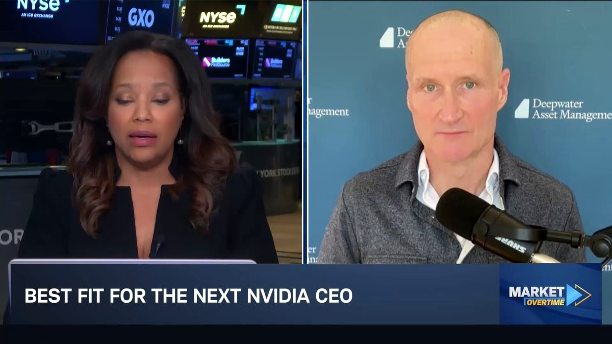

The [full Market Overtime interview](https://schwabnetwork.com/video/nvda-after-jensen-huang-gene-munster-on-company-s-ai-trade-future), dated 16 Nov, is on Schwab Network: "NVDA After Jensen Huang: Gene Munster on Company's AI Trade Future." The X video is only a short clip of that conversation.

**Did he add the stock?** Schwab's own page says "Gene bought four times as much stock after the sell-off." In the interview, host Diane King Hall put it as buying "about four times as much Nvidia" after the CEO's exit, and Munster then explained the purchase. That is his own account on television, not a 13F or a trade blotter, and he did not repeat the "four times" figure in his later X posts. He did endorse the clip by quoting it the next morning.

**Thesis.** The core claim is demand, not the CEO. On [11 Nov](https://x.com/munster_gene/status/2120656586461053396), after the resignation news, he wrote that customers "will keep buying just as many $NVDA chips with or without Jensen," guessed an open around $150 (down about 20% from the then Friday close) and expected a quick rally. On [12 Nov](https://x.com/munster_gene/status/2120879362614456805): "The unknown is now known… AI demand is still accelerating. Nvidia GPUs remain the clear winners." Later that day he said adoption is "sub 1%," Nvidia still has about 90% GPU share, and the selloff is a window for new capital. In the Schwab interview he said Wall Street has "grossly underestimated" the need for data centres (a "bigger AI brain"), that leadership and Asia-sales risk touch about 10% of the business, that custom silicon is a cost-of-ownership argument Nvidia still wins on power efficiency, and that over three to five years Nvidia can become a "consumer staple around AI," which would support the multiple. The "best performing stock within the AI trade" line is his 12-month view for holders now. He made the same outperform call on [CNBC](https://www.cnbc.com/video/2026/11/13/deepwateras-gene-munster-nvidia-stock-will-likely-outperform-rest-of-ai-trade-in-the-next-year.html) on 13 Nov.

On X since the interview he has also said NVDA may skip guidance, because there is little benefit for interim CEO Kress to own a number; that last quarter's "above 70%" calendar-2027 revenue-growth guide sits against the Street at 68%, or about 50% if China curbs come in full force (which he calls unlikely); and that new Commerce Department remote-access licensing might affect at most about 10% of revenue (China/HK 8%, other 2%). On [15 Nov](https://x.com/munster_gene/status/2122034769609253205) he raised the odds of Jensen returning to **51%**, from 10% on Friday, against Kalshi at 9%, because the "bring back Jensen" movement was gaining momentum and he views the resignation as a façade after the board forced Huang's hand. That last call sits next to Huang's 17 Nov statement, which is only a conditional offer, and with board-source reporting that the board is not considering a return (see the 17 Nov 16:04 entry).

**Charlie:** A demand-side bull who says he used the gap to add. The "four times" figure is his television account, not a filing. The 51% return-odds call is his, not the board's.

See also: 2026-11-17 16:04 — Kobeissi: Huang says he would return if the board asks; 2026-11-15 17:50 — Dan Ives: no chance Jensen returns; 2026-11-13 22:57 — Kobeissi: Musk backs petition to reinstate Jensen Huang; 2026-11-12 22:40 — Nvidia: Jensen Huang resigns as CEO.

Tags: #Munster #Deepwater #NVDA #Huang #Schwab #AI

### 2026-11-16 23:22 — El-Erian: dollar to 103.60, euro below 1.10

Pasted by Luke from Mohamed A. El-Erian ([@elerianm](https://x.com/elerianm/status/2122470394930106748)) on X, posted 23:22 London on 16 Nov 2026. A CNBC chart was attached. Verbatim:

> Persistent, broad-based U.S. dollar appreciation (the DXY index rose to 103.60) has driven the euro below 1.10.
> CNBC chart below.

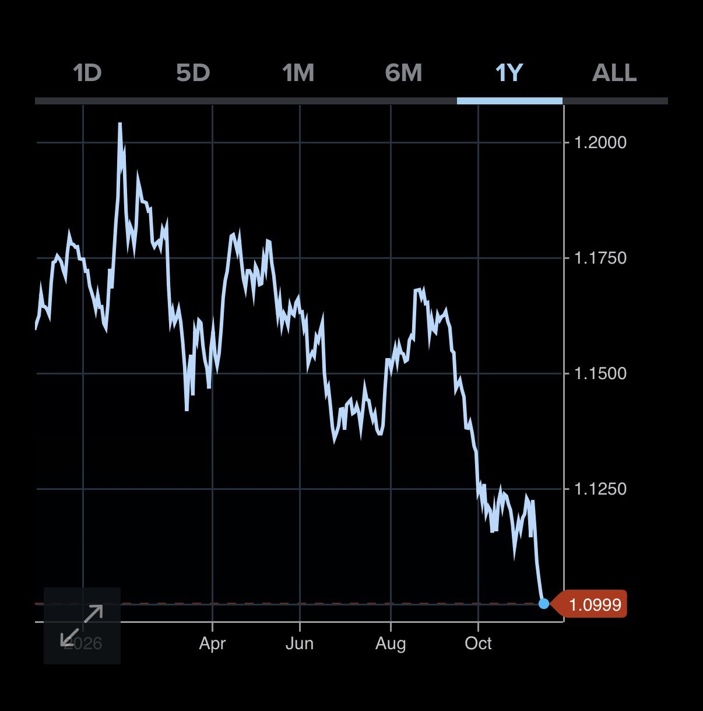

**Checks** (Yahoo chart API, retrieved about 19:32 London on 17 Nov). Tickers: `DX-Y.NYB`, `EURUSD=X`, `GBPUSD=X`.

- **DXY.** On 16 Nov the dollar index traded 103.33–103.64 and closed at **103.55**. The 15-minute high was **103.64** at 18:15 London, and it had already printed 103.60 several times that afternoon, so "rose to 103.60" is a fair live level, not the official close. Near 23:22 it was around 103.58–103.59. As of 19:22 London on 17 Nov it was **103.46**, after a session high of **103.78** (the 52-week high in the Yahoo metadata) and a low of 103.36. That is **+1.6%** against the 16 Oct close of 101.84, and **+5.3%** year-to-date from the 31 Dec 2025 close of 98.28.
- **EURUSD.** "Below 1.10" was true intraday on 16 Nov, though the daily close was still above it. 15-minute prints went as low as **1.0994** at 18:30 London; around 23:22 the pair was hugging 1.1000. Yahoo's daily bar closed at **1.1025** (range 1.1001–1.1031), so a reader of the daily close alone would not see the break. On 17 Nov it traded down to **1.0972** and was **1.1013** at 19:32 London. That is **−1.8%** versus 15 Oct (1.1213) and **−6.3%** year-to-date from 31 Dec 2025 (1.1747).
- **GBPUSD.** Sterling has weakened less than the euro. It closed 16 Nov at **1.3217** (range 1.3181–1.3224) and was **1.3218** at 19:32 London on 17 Nov, **−0.4%** on the month (1.3273 on 15 Oct) and **−1.9%** year-to-date (1.3467 at end-2025).
- **"Broad-based."** Fair as a description of the DXY, which is a basket. The pound's decline is milder than the euro's.

**For a UK investor with US-listed holdings.** A weaker pound lifts the sterling value of dollar assets. At these levels that is a modest tailwind: about 2% year-to-date from FX alone, much less than the euro's 6% move. It cuts the other way if those holdings are later sold back into a rebound in sterling, and it does not offset a fall in the shares themselves — NVDA, for example, is still down sharply from its recent highs in dollar terms.

**Charlie:** The 103.60 print and the dip through 1.10 both happened. The daily euro close on 16 Nov was still 1.1025; the cleaner break is the 17 Nov session low of 1.0972.

See also: 2026-11-15 18:43 — El-Erian / Telegraph: a gathering credit crunch.

Tags: #El-Erian #DXY #FX #dollar #euro #GBP #USD

### 2026-11-17 07:02 — LiveSquawk: UK payrolled employees −34k in October; claimant count 4.5%

Pasted by Luke from [LiveSquawk (@LiveSquawk)](https://x.com/LiveSquawk/status/2122586028825301239) on X, posted 07:02 London on 17 Nov 2026, just after the 07:00 ONS release. No image was attached. Verbatim:

> UK Payrolled Employees Monthly Change Oct: -34K (est 10.0K; prev 13K; prev R 20K)
> - Claimant Count Rate: 4.5% (prev 4.4%)
> - Jobless Claims Change: 33.2K (prev 30.3K; prev R 9.8K)

**Checks.** The figures match the [Labour market overview, UK: November 2026](https://www.ons.gov.uk/employmentandlabourmarket/peopleinwork/employmentandemployeetypes/bulletins/uklabourmarket/november2026), released 17 Nov, the accompanying [PAYE RTI bulletin](https://www.ons.gov.uk/employmentandlabourmarket/peopleinwork/earningsandworkinghours/bulletins/earningsandemploymentfrompayasyouearnrealtimeinformationuk/november2026), and the official Claimant Count series (BCJD, BCJE) and [CLA01](https://www.ons.gov.uk/employmentandlabourmarket/peoplenotinwork/outofworkbenefits/datasets/claimantcountcla01/current) tables. The "est 10.0K" is a market consensus figure, not an ONS number, and was not checked against a primary poll; some calendars had a different estimate.

- **PAYE RTI payrolled employees.** The early estimate for October is a fall of **34,000** (0.1%) from September, to **30.2 million**, and a fall of **95,000** (0.3%) on the year. October is a flash estimate and is likely to be revised. The September-versus-August change was revised from the **+13,000** reported in last month's bulletin to **+20,000**, exactly as LiveSquawk has it (prev 13K; prev R 20K).
- **Claimant count.** Official statistics in development. The UK Claimant Count rose to **1.7137 million** in October (ONS rounds this to 1.714 million), a **+33,200** increase from the revised September level of 1.6805 million. The rate rose to **4.5%** from **4.4%**. In the 20 Oct bulletin, September had been published as 1.7010 million, up 30,300 from August, at a 4.4% rate; that September level has now been revised down, so the September monthly change is **+9,800**, not +30,300. LiveSquawk's prev / prev R split is right. October is provisional.
- **ILO unemployment.** The Labour Force Survey unemployment rate for people aged 16 and over was **4.6%** in July to September, down 0.3 percentage points on both the quarter and the year. The employment rate (16–64) rose to **75.4%**, and economic inactivity (16–64) edged down to **20.8%**. The ONS warns that these quarterly employment and unemployment moves "partly reflect particularly large differences in employment status between the groups entering and leaving the survey." PAYE, which is administrative rather than a survey, is softer than the LFS.
- **Regular pay.** Annual growth in average regular earnings (excluding bonuses) was **3.5%** in July to September, down from 3.7%. Total pay (including bonuses) was **3.6%**, down from 3.8%. Public-sector regular pay grew **5.4%**; **private-sector regular pay grew 3.1%**. Real regular pay was **+0.2%** on CPIH and **+0.4%** on CPI.
- **Vacancies.** Early estimates for August to October were **690,000**, down **22,000** (3.0%) on the quarter and **37,000** (5.0%) on the year, the largest quarterly fall since May to July 2025. Outside the pandemic, vacancies were last at or below 690,000 in July to September 2014 (686,000). The whole quarterly decline was in firms with 1–9 employees, down 22,000 to 73,000, the lowest for that size band since April to June 2012, again outside the pandemic. The ONS says smaller firms point to labour and operating costs.

**Bank Rate.** The Bank of England's [November MPC decision](https://www.bankofengland.co.uk/monetary-policy-summary-and-minutes/2026/november-2026), published 5 Nov, raised Bank Rate by 25bp to **4%**, the first increase in more than three years (8–1; one member wanted +50bp). That 4% rate is already recorded in the 15 Nov El-Erian / Telegraph entry. The next decision is due 17 Dec. This release is a mixed labour tape into that meeting: survey unemployment is down, but payrolls and vacancies are weaker and regular pay is slowing, with private-sector growth at 3.1%.

**Charlie:** The LiveSquawk tape is right, including the September revisions. Payrolls and vacancies are the softer official story; the falling LFS unemployment rate comes with an ONS sample-rotation warning.

See also: 2026-11-15 18:43 — El-Erian / Telegraph: a gathering credit crunch (Bank Rate at 4% after the 5 Nov hike).

Tags: #labour #ONS #PAYE #claimant-count #UK #BoE #wages #vacancies

### 2026-11-17 14:15 — Kobeissi: S&P 500 Q3 EPS growth +31.9%, strongest in at least 4 years

Pasted by Luke from [The Kobeissi Letter (@KobeissiLetter)](https://x.com/KobeissiLetter/status/2122694999695651222) on X, posted 14:15 London on 17 Nov 2026 (the X API `created_at`, not ~14:34). A FactSet-sourced bar chart was attached. Verbatim:

> BREAKING: S&P 500 companies have reported +31.9% YoY EPS growth so far in Q3 2026, the strongest YoY growth rate in at least 4 years.
>
> This marks the 3rd consecutive quarter of earnings growth above 25% and the 8th straight quarter of double-digit growth.
>
> Actual earnings have also beaten estimates for 13 consecutive quarters.
>
> So far in Q3, 84% of S&P 500 companies reporting results have beaten EPS estimates, above the 5-year average of 78%.
>
> This comes as all 11 sectors are reporting positive earnings growth driven by Energy, Information Technology, and Materials, with 7 delivering double-digit increases.
>
> US corporate earnings remain remarkably strong.

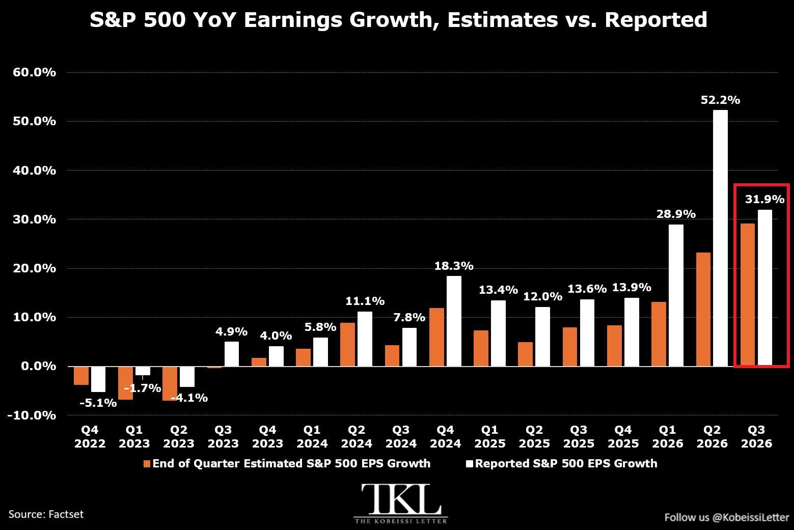

**Checks.** Almost all of the numbers match John Butters' [FactSet Earnings Insight of 13 Nov 2026](https://advantage.factset.com/hubfs/Website/Resources%20Section/Research%20Desk/Earnings%20Insight/EarningsInsight_111326.pdf) (91% of the S&P 500 reported; a 14 Nov PDF does not exist). A [16 Nov FactSet note](https://insight.factset.com/sp-500-companies-are-reporting-lowest-earnings-surprise-percentage-since-q4-2022) restates the same 31.9% growth and 3.1% surprise. The "strongest in at least 4 years" line does not survive his own chart, and the 13-quarter phrase is not in the 13 Nov report.

- **Blended growth 31.9%.** Confirmed. The blended year-over-year EPS growth rate (actuals for companies that have reported, estimates for the rest) is **31.9%**, up from 31.3% a week earlier and from **29.1%** on 30 Sep. That is above the 5-year average of 13.3% and the 10-year average of 12.6%. Blended revenue growth is **14.4%**, the second-highest since Q4 2021 (16.3%), trailing only last quarter (15.6%), and the third straight quarter of double-digit revenue growth.
- **"Strongest YoY growth in at least 4 years."** Overstated, and his own chart refutes it. The attached FactSet-sourced bars show reported growth of **52.2%** in Q2 2026 and **28.9%** in Q1. FactSet's [28 Aug insight](https://advantage.factset.com/hubfs/Website/Resources%20Section/Research%20Desk/Earnings%20Insight/EarningsInsight_082826.pdf) (97% reported) had Q2 at **52.0%**, "the highest… since Q2 2021 (91.6%)"; late-May it had Q1 at 28.6%. Q2 was flattered by investment gains at Alphabet and Amazon: the [7 Aug insight](https://advantage.factset.com/hubfs/Website/Resources%20Section/Research%20Desk/Earnings%20Insight/EarningsInsight_080726.pdf), when the blended rate was 50.4%, said excluding those two companies would cut it to **32.0%**, still a touch above this quarter's 31.9%. Q3 is the second-highest print on the chart, not the strongest in four years.
- **The two growth streaks.** Confirmed, if 31.9% holds. FactSet: "the third consecutive quarter of earnings growth above 25% and the eighth consecutive quarter of double-digit earnings growth." The chart's reported bars match that: Q1 2026 and Q2 2026 were both above 25%, and double-digit growth runs from Q4 2024 (18.3%) through Q3 2026. Q3 2024 was 7.8%, so the double-digit streak starts the following quarter.
- **"Beaten estimates for 13 consecutive quarters."** Not a FactSet 13 Nov headline, and it does not mean that 84% of companies have beaten in each of those quarters, or that the beats have been large. The chart compares reported growth (white) with the estimate as of the end of each quarter (orange). From Q3 2023 through Q3 2026 — 13 quarters — reported growth is both positive and above that end-of-quarter estimate (this quarter: 31.9% versus 29.1% on 30 Sep). That is an aggregate index surprise: blended growth came in above the end-of-quarter estimate. The same window is also the streak of positive year-over-year growth after three negative quarters in Q4 2022–Q2 2023. The *size* of this quarter's surprise is thin. FactSet has companies reporting earnings **3.1%** above estimates, below the 5-year average of **7.5%** and the 10-year average of 8.0%, and the **lowest since Q4 2022 (1.3%)**. Communication Services is the only sector with a negative surprise (−22.1%), driven by Charter, Meta (a $9.89bn litigation charge) and Alphabet (an $8.7bn loss on equity securities). Excluding those three, the surprise would be **6.7%**. The beat *rate* is still above average; the beat *magnitude* is not.
- **Beat rate 84% versus a 5-year average of 78%.** Confirmed, with 91% of the index reported. It is also above the 10-year average of 77%. On revenue, **74%** have beaten estimates, above the 5-year 70% and 10-year 68%.
- **All 11 sectors positive; 7 in double digits; led by Energy, IT and Materials.** Confirmed. Energy reported the highest growth at **151.2%** (average Q3 oil $85.68, 32% above $64.97 a year earlier), Information Technology **69.4%**, and Materials **29.8%**, the third-largest. FactSet's overview uses the same three leaders. A later summary line on page 13 slips and says "Energy, Information Technology, and Communication Services," which is the *revenue* order (IT 42.9%, Energy 35.7%, Communication Services 16.0%), not the earnings order. Communication Services earnings growth is about **18.2%** on the page 22 chart, down sharply from about **51.8%** on 30 Sep after the Meta, Alphabet and Charter misses. The same chart has Industrials, Utilities, Communication Services and Real Estate also in double digits; Health Care, Consumer Staples, Financials and Consumer Discretionary are still positive but in single digits.
- **Concentration.** This is not a Magnificent 7 quarter. A [3 Nov FactSet note](https://insight.factset.com/mag-7-now-reporting-lower-earnings-growth-than-the-other-493-sp-500-companies-for-q3), with 5 of the 7 reported, had Mag 7 blended growth at **22.6%**, down from 33.6% on 30 Sep, against **32.6%** for the other 493 (up from 27.8%). If that holds, it would be the first time the Mag 7 have trailed the other 493 since Q4 2022. The 13 Nov report does not update those two rates, but it does record the later score: Apple, Microsoft and Tesla beat; Alphabet, Amazon and Meta missed. Nvidia, the seventh, had not yet reported as of 13 Nov and is due this evening. IT growth is itself concentrated: Semiconductors & Semiconductor Equipment grew **133%**; excluding that industry, IT growth falls to **29.9%** from 69.4%. Last quarter's 52% print was also concentrated, in Alphabet and Amazon investment gains.
- **"US corporate earnings remain remarkably strong."** Fair as a description of the growth rate, with the caveats above. The same afternoon's NAHB tape (19:25 entry) has homebuilder sentiment tying a 14-year low and 46% of builders cutting prices. Strong corporate earnings and a stalled housing market can sit side by side; they are different parts of the economy.

**Charlie:** The 31.9%, the 84% beat rate, the 11 sectors and the two growth streaks all check. "Strongest in at least 4 years" does not: last quarter was 52%. The 13-quarter line is the chart's run of reported growth coming in above the end-of-quarter estimate, not a 13-quarter run of fat beats — this quarter's surprise is the thinnest since late 2022. The Mag 7 are no longer leading the other 493.

See also: 2026-11-17 19:25 — Kobeissi: US homebuilder sentiment lowest since 2012; 46% cutting prices.

Tags: #earnings #SP500 #FactSet #Kobeissi #Mag7 #EPS

### 2026-11-17 16:04 — Kobeissi: Huang says he would return as Nvidia CEO if the board asks

Pasted by Luke from [The Kobeissi Letter (@KobeissiLetter)](https://x.com/KobeissiLetter/status/2122722496667398408) on X, posted 16:04 London on 17 Nov 2026. No image was attached. Verbatim:

> BREAKING: Jensen Huang releases his first public statement since resigning as CEO of Nvidia, $NVDA, and says he is willing to return as CEO.
>
> Jensen Huang specifically says he will return as CEO if the board asks him to.
>
> Full statement:
>
> "Since my departure, I've seen an outpouring of calls from Nvidia's employees, investors, business partners, and customers for me to return as CEO. If the Board of Directors decides that my return is in the best interest of our shareholders, our employees, the company, and America, I would be honored to answer these calls and return as CEO."
>
> We continue to believe Nvidia's board should leave the possibility of Huang returning as CEO open.

**The statement is real, and it is conditional.** CNBC published the [full written statement](https://www.cnbc.com/2026/11/17/nvidia-jensen-huang-statement.html) at 15:58 London, obtained by David Faber, about six minutes before Kobeissi's post. The same text was reported by the [WSJ](https://www.wsj.com/), [Bloomberg](https://news.bloomberglaw.com/esg/huang-is-willing-to-return-as-nvidia-ceo-if-board-allows-it-1), the [Verge](https://www.theverge.com/tech/1035420/jensen-huang-nvidia-return-as-ceo-statement), AP and the BBC. I did not find Huang posting the text on his own X account; the BBC's "said on X" looks like loose wording. The two sentences Kobeissi quotes match the CNBC text, except he writes "Nvidia's" where the original has "NVIDIA's," and he drops the two sentences that sit between them ("Many continue to reach out to me directly… NVIDIA is a once-in-a-generation company."). Calling that the "Full statement" is wrong. The omitted parts matter: Huang says he "did not live up to the standards expected of everyone at NVIDIA," has "made serious mistakes in my personal life," "created problems for the Board that I deeply regret," "own[s] my mistakes completely," and is "committed to cooperating with the Board's independent investigation."

The operative line is "If the Board of Directors decides… I would be honored to answer these calls and return as CEO." That is a conditional offer, not a pledge that he "will return as CEO if the board asks him to." Kobeissi's closing sentence, that the board "should leave the possibility… open," is his opinion, not Huang's.

**Board response and filings.** There has been no official board statement answering this offer. People familiar with the matter told CNBC on 16 Nov, and CNN again on 17 Nov, that the board is **not considering** bringing Huang back. This morning, hours before the statement, Nvidia [announced](https://nvidianews.nvidia.com/news/nvidia-board-of-directors-establishes-national-security-and-export-control-oversight-committee) a new standing National Security and Export Control Oversight Committee, chaired by Suzanne Nora Johnson, with Stephen C. Neal and John O. Dabiri as members. That is a governance move, not a reply to Huang. The SEC submissions API for CIK 1045810, retrieved this evening, still has the 12 Nov Item 5.02 [8-K](https://www.sec.gov/Archives/edgar/data/1045810/000104581026000082/nvda-20261111.htm) as the latest 8-K (a 13F-HR was filed 16 Nov). Official status is unchanged: the board accepted Huang's resignation on 11 Nov; Colette Kress is interim CEO and remains CFO; Harvey C. Jones is Chair.

**Earnings and the stock.** Nvidia is due to release Q3 FY27 results at about **21:20 London** (4:20 p.m. ET) this evening, with the call at **22:00 London**, per its [28 Oct notice](https://investor.nvidia.com/news/press-release-details/2026/NVIDIA-Sets-Conference-Call-for-Third-Quarter-Financial-Results/default.aspx). This is the first print since Huang left. As of **19:25 London**, while the regular session was still open (it closes at 21:00), NVDA was **$153.91**, down **1.43%** from Monday's close of $156.14, after trading $150.36–$157.46 on the day (Yahoo chart API). Friday's close was $162.85.

**Charlie:** He has said he would come back if the board decides it is in the interest of shareholders, staff, the company and America. That is not a return, and the board has not asked. Kobeissi cut the apology and the investigation line out of a statement he labelled complete.

See also: 2026-11-16 21:30 — Schwab Network: Munster increased his NVDA position after Huang's resignation; 2026-11-15 17:50 — Dan Ives: no chance Jensen returns; CEO shortlist; 2026-11-13 22:57 — Kobeissi: Musk backs petition to reinstate Jensen Huang; 2026-11-12 22:40 — Nvidia: Jensen Huang resigns as CEO.

Tags: #Huang #NVDA #Nvidia #Kobeissi #CEO #Kress

### 2026-11-17 17:31 — Kobeissi: Anthropic may price the IPO above $80, towards a $1.5–1.6tn valuation

Pasted by Luke from [The Kobeissi Letter (@KobeissiLetter)](https://x.com/KobeissiLetter/status/2122744324307947814) on X, posted 17:31 London on 17 Nov 2026. No image was attached. Verbatim:

> BREAKING: Anthropic, $ANT, is planning to raise its IPO price after stronger than expected investor demand, per WSJ.
>
> The company could now price its shares over $80 per share, above the initial range of $70 to $78 per share.
>
> Its advisers have discussed putting its valuation at around $1.5 trillion or $1.6 trillion, up from the ~$1.33 trillion valuation of the existing range.
>
> Demand appears to be strong for Anthropics IPO.

**The WSJ report is real; the filed range is not yet higher.** The Wall Street Journal story, "Anthropic Plans to Raise IPO Price After Strong Demand," by Ben Dummett, Corrie Driebusch and Kate Clark, posted about 17:02 London, is the source. A Dow Jones write-through (reprinted by [Tiger Brokers / TTM](https://ttm.financial/news/2684987916) and others) uses almost the same wording as Kobeissi: "could price its shares at more than $80 a share, above the initial range of $70 to $78 apiece… advisers have discussed numbers that would put its valuation at around $1.5 trillion or $1.6 trillion, up from the roughly $1.33 trillion valuation of the existing range." It cites people familiar with the matter. Pricing is not final until Wednesday, 18 Nov, and the Journal says it will depend in part on the market's reaction to Nvidia's earnings this evening. Trading is still slated for Thursday, 19 Nov, ticker ANT.

**No revised range has been filed.** The SEC submissions API for Anthropic, PBC (CIK 2130357), retrieved this evening, shows two new 17 Nov filings and no 424B:

- [S-1/A No. 3](https://www.sec.gov/Archives/edgar/data/2130357/000162828026074338/anthropicpbc-sx1ax3.htm), accepted 11:26 London. The cover still says the IPO price is estimated at **$70.00 to $78.00** for 825,000,000 Class A shares (801,351,354 primary, 23,648,646 secondary). There is no $80 figure in the amendment. It now says Nasdaq has **approved** the listing under "ANT."
- [Form 8-A12B](https://www.sec.gov/Archives/edgar/data/2130357/000162828026074342/anthropic-8xa12b.htm), accepted 11:49 London, registers the Class A shares on The Nasdaq Stock Market LLC.

Share counts in No. 3 are unchanged from No. 2: **13,086,672,593** outstanding after the IPO and the $26bn PIPE, and the filing's own fully diluted table still reconciles to **18,012,993,381**.

**Valuation math** (using those No. 2 / No. 3 counts; the $26bn PIPE is a fixed dollar amount, so its share count moves slightly with price, by under $2bn at the ends):

| Basis | Shares | $74 | $78 | $80 | $1.5tn implies | $1.6tn implies |
|---|---:|---:|---:|---:|---:|---:|
| Outstanding after IPO + PIPE | 13.087bn | $968bn | $1.021tn | $1.047tn | **$114.62** | **$122.26** |
| Filing fully diluted table | 18.013bn | $1.33tn | $1.405tn | $1.441tn | **$83.27** | **$88.82** |

So ~$1.33tn is the filing's fully diluted valuation at the **$74 midpoint**, not at the top of the range (that is $1.405tn fully diluted, or $1.021tn on shares outstanding). The Journal's "valuation of the existing range" is the midpoint shorthand; some secondary write-ups wrongly called $1.33tn the top of the range. "Over $80" alone is only about $1.44tn on the fully diluted count. The $1.5tn and $1.6tn figures that advisers have discussed imply a price in the mid-to-high $80s on that 18.01bn count, or $115–$122 on the 13.09bn outstanding count. They only fit "over $80" if one is talking fully diluted.

**Charlie:** Demand talk is from people familiar, not from a new price range on EDGAR. The filed deal is still $70–$78. If they do go to $1.5–$1.6tn, check which share count is being used; $1.33tn was never the top of the range on either count.

See also: 2026-11-10 11:53 — clipping: Anthropic targets valuation of about $1T in IPO; ant/README.md (S-1/A No. 3 note added).

Tags: #Anthropic #ANT #IPO #Kobeissi #WSJ #valuation

### 2026-11-17 17:37 — Unusual Whales: Goldman desk says confidence in AI is fading

Pasted by Luke. The text is not his view. It is a post by [Unusual Whales (@unusual_whales)](https://x.com/unusual_whales/status/2122745834236436748) on X, posted 17:37 London on 17 Nov 2026. No image was attached. Verbatim:

> Goldman Sachs' trading desk says confidence in AI is fading.
>
> "Judging by conversations with clients last week, sentiment around the theme is about as negative as we've seen in quite some time, and we're seeing that pessimism reflected more clearly in positioning and valuations."
>
> Goldman's data shows AI chip stocks are now priced for little to no earnings growth two years out, far below Wall Street's consensus of about 30%.

(The X text uses typographic apostrophes and quotation marks; the words are the same.)

**The original note.** The quote is from a Goldman Sachs US equities desk note dated **15 Nov 2026**, by **Lee Coppersmith**, managing director in Global Banking & Markets (FICC & Equities; he co-runs New York equity derivatives sales). I did not find a Bloomberg or Business Insider write-up of this specific note. It was circulated in desk-note form and then reported by [Unusual Whales](https://unusualwhales.com/news/goldman-sachs-trading-desk-ai-confidence-fading-chip-stocks) (16 Nov) and, with more of the surrounding text, in a [Longbridge](https://longbridge.com/news/305680146) summary and a [MastermindX](https://www.mastermind-x.com/research/gs-coppersmith-us-equities-ai-confidence-is-fading-15-nov-2026-cf8e77.html) extract. Reuters, in an 17 Nov Asia-markets story, quoted the same two opening sentences. The client-sentiment sentence in the tweet matches the note verbatim. Coppersmith also wrote that tech was again the most net-sold sector in Goldman prime-brokerage data, that the US information-technology long/short ratio was at its lowest since 2016, that new shorts had picked up, that long-only accounts were still supplying NVDA, and that CTA positioning in the Nasdaq-100 was back near maximum short.

**"Priced for little to no growth."** That is a popularisation of a more precise claim, and it is about Goldman's **AI semis basket (GSCBSMHX)**, not a single stock. In the note, "GS Research makes the case that much of this has gone too far, with some stocks now discounting something close to zero earnings growth in 2028." The basket "trades at just **11x 2028 earnings** versus nearly **16x** for the S&P, despite consensus expecting earnings to grow **31%** in 2028. If you valued the group at the same multiple as the broader market, current prices would imply earnings actually declining ~**6%**." So "little to no" is the *implied* growth from the multiple gap; "about 30%" is the basket's 2028 consensus, rounded from 31%. Unusual Whales' own article at one point says "priced for negative earnings growth," which is closer to the −6% thought-experiment than the tweet's "little to no."

A check on the large names, from Yahoo Finance analysis pages and FMP annual consensus, retrieved after the regular-session close this evening:

- **NVDA** closed **$155.46**, down **$0.68 (−0.44%)** from Monday's $156.14, after trading **$150.33–$158.19**. After-hours it was **$155.28** around 16:05 ET. This is the first print since Huang left; the call is at **22:00 London**. Yahoo has FY27 EPS (year ending Jan 2027) at **$9.34** and FY28 at **$15.86** (52–53 analysts), so the stock is about **9.8x** FY28 earnings, cheaper than the Goldman basket's 11x and well below the S&P's ~16x. Consensus EPS growth is **96%** this year and **70%** next — far above 30%. The 52-week high is $243.37, so the close is **36%** below that high, a bit more than the "about 30% from its October 6 peak" line in some of the secondary write-ups.
- **AVGO** closed **$341.60**, **up 2.46%**. Yahoo's FY26 EPS (year ending Oct 2026) is $11.66 and FY27 is **$19.41** (48 analysts), about **17.6x** FY27 earnings, with expected EPS growth of **66%**. I did not get a clean FY28 number. This is not a "no growth" multiple.
- **AMD** closed **$503.41**, down **0.17%**, after a low of $480.50. FMP has calendar-2027 EPS of $17.82 and 2028 of **$26.34**, so about **19.1x** 2028 earnings, *above* the S&P multiple, with 2028 growth still around **48%**.
- **SMH** closed **$460.10**, down 0.39% on the day and about **31.5%** below its 52-week high of $671.83. The **SOX** closed at **9,642.88**, +0.34% on the day, about **34%** below its 52-week high of 14,655.

The desk's basket maths can be true even while NVDA is cheaper than 11x 2028 earnings with much higher consensus growth, and AMD is richer. "Little to no growth" should not be read as a statement about Nvidia's own sell-side numbers.

**Charlie:** The Goldman quote is real and the sentiment read is a desk note, not a change in the bank's official forecast. The 11x-versus-16x basket comparison is the actual valuation claim; "priced for little to no growth" is a shorthand for that implied gap, not a forecast that chip EPS goes nowhere.

See also: 2026-11-13 23:07 — Psyduck Capital: would be short NVDA after Huang's resignation; 2026-11-17 14:15 — Kobeissi: S&P 500 Q3 EPS growth +31.9% (IT 69.4%, semiconductors 133%).

Tags: #Goldman #Coppersmith #AI #semis #NVDA #AVGO #AMD #valuation

### 2026-11-17 19:25 — Kobeissi: US homebuilder sentiment lowest since 2012; 46% cutting prices

Pasted by Luke from [The Kobeissi Letter (@KobeissiLetter)](https://x.com/KobeissiLetter/status/2122758165322408168), posted 18:26 London on 17 Nov 2026. No image was attached. Verbatim:

> BREAKING: US Homebuilder Sentiment falls to its lowest level since 2012 as higher mortgage rates, costs, and weak Consumer Confidence led to more builders cutting prices.
>
> 46% of builders reported cutting prices in November, the highest share in post-pandemic era.
>
> Buyer traffic fell to its lowest level in 15 years, excluding the start of the Pandemic in 2020.
>
> The US housing market is coming to a halt.

**Checks.** The figures come from the [NAHB/Wells Fargo Housing Market Index](https://www.nahb.org/news-and-economics/press-releases/2026/11/builder-sentiment-continues-to-fall-on-affordability-concerns) released this morning (also summarised on the [HMI page](https://www.nahb.org/news-and-economics/housing-economics/indices/Housing-Market-Index)). Kobeissi's numbers match the release. The last line does not.

- **Headline HMI.** Builder confidence in newly built single-family homes fell four points to **25** in November, from 29 in October. Economists had expected an unchanged 29. NAHB says this is the lowest reading since April 2012 and a 14-year low. April 2012 was also **25**, so November ties that month rather than breaking below it. Kobeissi's "lowest level since 2012" is fair, just less precise than "since April 2012." All three components fell: current sales conditions to 28 (−6), six-month sales expectations to 30 (−2), and prospective-buyer traffic to 16 (−2). A reading below 50 means more builders see conditions as poor than good. Regional three-month averages also fell: Northeast 34, Midwest 35, South 27, West 23.
- **Price cuts.** Confirmed. "In November, 46% of builders reduced prices, the highest share in the post-Covid period." The average cut held at **6%** for an eighth straight month. **68%** of builders offered sales incentives, also a post-Covid high, and the 20th consecutive month in which at least 60% used them. Kobeissi reported only the 46% share.
- **Buyer traffic.** Confirmed, including the caveat. NAHB: the traffic index at 16 is "its lowest level in 15 years, excluding the start of the pandemic in 2020." The exclusion matters. In April 2020 the traffic component fell to **13**, below today's 16, when the headline HMI dropped to 30 ([MBA Newslink](https://newslink.mba.org/mba-newslinks/2020/april/mba-newslink-thursday-april-16-2020/home-builder-confidence-suffers-historic-drop/), 15 Apr 2020, citing that month's NAHB release). Kobeissi kept the caveat; an unqualified "15-year low" would have been wrong.
- **Mortgage rates.** NAHB chief economist Robert Dietz said "mortgage rates above 7%" are holding buyers back. Freddie Mac's [PMMS](https://www.freddiemac.com/pmms), as of 12 Nov, put the 30-year fixed at **7.11%**, the fourth weekly decline and the lowest in seven weeks, down from 7.18% on 5 Nov and from a recent high of **7.40%** on 15 Oct. A year earlier it was 6.24%. The daily tape has since backed up: [Mortgage News Daily](https://www.mortgagenewsdaily.com/mortgage-rates/30-year-fixed)'s 30-year average was **7.50%** on 17 Nov (7.51% on 16 Nov). That is a different survey of top-tier lender quotes, not the weekly PMMS.
- **Consumer confidence.** The latest Conference Board [Consumer Confidence Index](https://www.conference-board.org/topics/consumer-confidence/) is October's print, released 27 Oct: it **rose** 7.5 points to **91.7**, from a slightly revised 84.2 in September. The board itself still described a longer-term downward trend, and home-purchase plans eased slightly on a six-month moving average. November's Conference Board figure is due on 24 Nov. "Weak" is a fair longer-term description; it was not a fresh drop in the latest official print, and it is a stretch to say that print "led to" November price cuts.
- **"Coming to a halt."** Overstated. This is a sentiment survey, not a transaction count, and activity has slowed, not stopped. NAR's [12 Nov existing-home sales report](https://www.nar.realtor/newsroom/existing-home-sales-decreased-5-5-percent-october-nar-report) put October resales at a **3.75 million** seasonally adjusted annual rate, down 5.5% month-on-month and 8.8% year-on-year. NAR's Lawrence Yun called that the lowest since August 2010. The median existing-home price was still up 0.4% year-on-year, at $416,700, the 40th consecutive monthly year-on-year increase, and distressed sales remained 2% of transactions. New construction is weaker but ongoing: Census/HUD [September housing starts](https://www.census.gov/construction/nrc/current/) were **1.221 million** SAAR (single-family 859,000), down 5.2% month-on-month and 7.4% year-on-year; [new single-family sales](https://www.census.gov/construction/nrs/current/index.html) were **676,000** SAAR, down 0.6% month-on-month and 5.3% year-on-year, with 8.4 months' supply. NAHB chairman Bill Owens said "more builders are scaling back construction," not that they have stopped. Price cuts and incentives are what builders do to keep selling in a weak tape, which is the opposite of a halt.

**Charlie:** The survey is as weak as it has been in 14 years, and the 46% price-cut share is the right number. The housing market is slow and expensive to finance, especially in resales. It has not come to a halt.

See also: 2026-11-17 14:15 — Kobeissi: S&P 500 Q3 EPS growth +31.9% (corporate earnings versus stalled housing).

Tags: #housing #rates #macro #Kobeissi #NAHB #HMI

### 2026-11-17 19:42 — Klaas: don't you want your project management tool to also be a video editor?

Pasted by Luke. The text is not his view. It is a post by [Klaas (@forgebitz)](https://x.com/forgebitz/status/2122777391567450483) on X, posted **19:42 London on 17 Nov 2026**, about 12 hours before the 08:25 paste on 18 Nov. He is quote-posting [ClickUp (@clickup)](https://x.com/clickup/status/2122457928867397943), posted **22:32 London on 16 Nov 2026**. The screenshot of the quote-post is below. Luke's paste, and the screenshot's collapsed "…", omitted Klaas's third line; the X API text is:

> don't you want your project management tool to also be a video editor?
>
> everyone is building everything
>
> this will destroy most saas companies from the inside

The quoted ClickUp post, verbatim:

> Creative Studio is here. 🔥
>
> Ask Brain² to create an ad, a launch video, or your next social post. Make it your own, then tell Brain² where it goes next.
>
> Your creative, your work, and your team are connected in ClickUp.

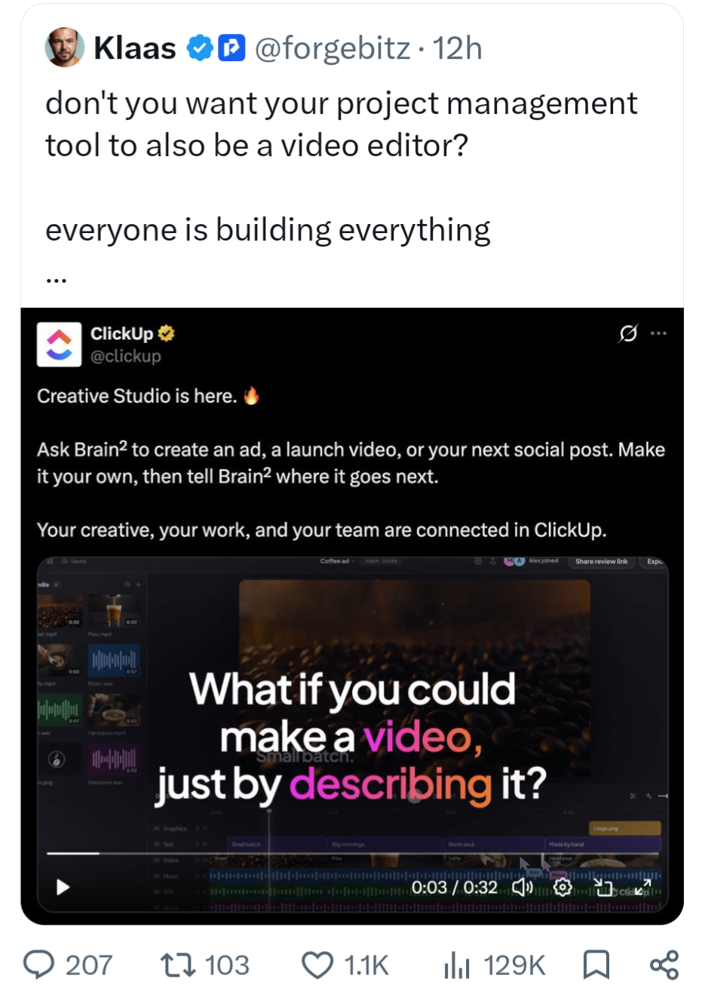

**Engagement.** The screenshot, taken around 08:25 London on 18 Nov, shows **207 replies, 103 reposts, 1.1K likes and 129K views** on Klaas's post. The X API a few minutes later reads **52 replies, 2 reposts, 248 likes** and about **128k** impressions. The view counts are close; I cannot reconcile the replies, reposts and likes.

**What Creative Studio is.** ClickUp's product page, [Creative Studio: create and edit videos in ClickUp](https://clickup.com/brain/creative-studio), describes a built-in AI video editor: ask Brain² for video clips, images and sound from a prompt, arrange them on a shared timeline, and export an MP4 (the marketing page says up to 1080p; the [help article](https://help.clickup.com/hc/en-us/articles/44786325764247-Use-Creative-Studio) also lists 720p, 4K, and formats including MP4, WebM, GIF and ProRes). It is a [ClickUp Labs](https://help.clickup.com/hc/en-us/articles/44784458295959-Join-and-manage-ClickUp-Labs) feature, available on all plans, including to guests. I did not find it on ClickUp's public [product-feed](https://clickup.com/features/feed) page, whose newest dated items were still 14 Nov when I looked, so the dated official announcement I can pin down is the 16 Nov X post. A day earlier, at 21:27 London on 15 Nov, @clickup had posted about "**ClickUp Creator Studio**" and asked people to join Labs; on the morning of the 16th they posted a Labs "peek" already using the Creative Studio name.

**Models and pricing.** The Creative Studio product and help pages do **not** name Veo or Sora, or any other video-generation model. The help article does say that speech and music generation "can use ElevenLabs models," which do not offer zero data retention and can be turned off by workspace owners. Generation of images, video and audio uses [AI Credits](https://help.clickup.com/hc/en-us/articles/44297094474391-AI-Credits-availability-and-limits); editing, layout and export do not. It is not a standalone paid add-on. Credits are included with paid seats on ClickUp's new plans (and are unavailable on Free Forever); video and audio generation still consume credits even on Max, and Brain also has separate daily rate limits for video. On older plans, the Brain / Everything AI add-ons still govern the credit pot. Labs itself is an opt-in experiment: ClickUp warns that plan availability, feature pricing and packaging may change.

**"Everyone is building everything."** That is Klaas's theme: a project-management SaaS bolting on AI generation and a timeline editor, and his claim that this "will destroy most saas companies from the inside." It sits next to two October entries. [Nikita Bier](../2026-10.md) (12 Oct, ~20:51 BST) argued that "technical moats are mostly over." [Christian Catalini](../2026-10.md) (12 Oct, ~21:08 BST), in *Surviving the AI Moatpocalypse*, wrote that better models cut both ways: SaaS tools get cloned in-house more cheaply, but "the best SaaS providers can expand their offering and out-iterate internal teams." ClickUp shipping a video editor is an example of that expansion. Whether it destroys incumbents "from the inside" is Klaas's conclusion, not a finding in this clip.

**Charlie:** ClickUp really did put a video editor inside a project-management tool. The convergence is real. The destruction thesis is Klaas's, and Catalini had already sketched the other side of the same coin.

See also: 2026-10-12 ~20:51 BST — Nikita Bier — technical moats are mostly over; 2026-10-12 ~21:08 BST — Christian Catalini — Surviving the AI Moatpocalypse.

Tags: #saas #ai #convergence #ClickUp #moats

### 2026-11-17 20:27 — Luke's thinking: Mollick on efficient markets versus radical discontinuities

Luke's reaction, pasted with a screenshot at about 20:27 London on 17 Nov 2026:

> Bang on

The screenshot is of Ethan Mollick ([@emollick](https://x.com/emollick/status/2122519737318150181)) on X, posted 02:38 London on 17 Nov, quoting Super Dario ([@inductionheads](https://x.com/inductionheads/status/2122459014285935030)) from 22:37 London on 16 Nov. Mollick, verbatim:

> It is a very funny time where the markets are basically assuming the future will look like the past even as many CEOs & AI observers & government officials keep yelling that the future is coming and it will change everything.
>
> Efficient markets versus radical discontinuities?

The quoted post, Super Dario, verbatim:

> Half my TL thinks AI is going to destroy the world, the other half thinks it can’t even help Google hit its like 8% growth targets

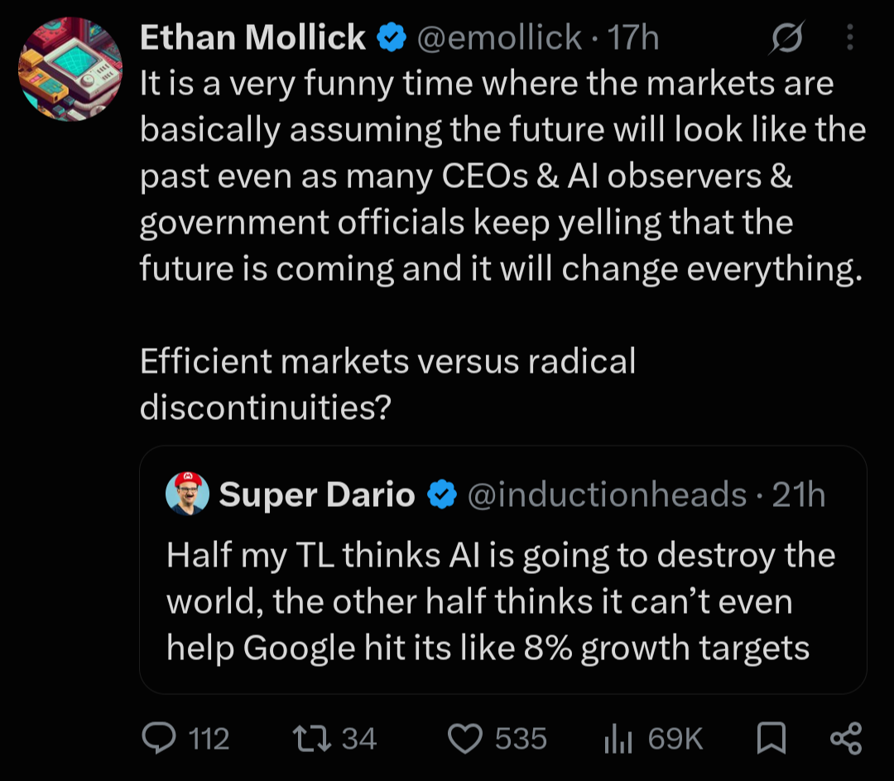

**Alphabet's "8%."** It does not hold as a description of current consensus for 2026–27. Yahoo Finance's [GOOGL analysis page](https://uk.finance.yahoo.com/quote/GOOGL/analysis/), retrieved this evening, has 50 analysts at **$500.64bn** of revenue for 2026, up **24.3%** from 2025 actual sales of **$402.84bn**, and **$637.04bn** for 2027, up **27.2%**. The current-quarter (Q4 2026) revenue estimate is $143.06bn, up 25.7% from $113.83bn a year earlier. FMP's annual consensus is in the same place: $500.0bn for 2026 (35 analysts) and $638.0bn for 2027 (36). StockAnalysis, citing S&P Global as of 13 Nov, has $499.63bn (+24.0%) and $636.42bn (+27.4%). "Like 8%" is closer to the 2022–23 slowdown, when revenue grew 9.8% and 8.7%. By 2025 growth was already 15.1%. Super Dario's line is a loose caricature of the skeptic camp, not the Street's present path for Google. Even the EPS "growth estimates" on the same Yahoo page (21.1% this year, 16.0% next) sit well above 8%, and those are messy because 2026 EPS is inflated by investment gains that then roll off.

**The two sides of the contrast.** Today's 14:15 S&P 500 Q3 EPS entry is the extrapolation: blended earnings growth of 31.9%, the eighth straight quarter of double-digit growth, and 13 quarters in which reported growth has come in above the end-of-quarter estimate. That is the market, and the tape, assuming the future will look like the recent past. The 17:31 Anthropic IPO entry is the discontinuity bet: a valuation talk of $1.5–1.6tn, against a still-unchanged filed range of $70–$78, on a business that did not exist a few years ago.

**Charlie:** Luke is agreeing with the framing, not with Super Dario's 8%. The Street is already writing mid-20s revenue growth into Google. That is not a mature-ads 8% model, but it is still a smooth path, not a break.

See also: 2026-11-16 03:54 — Ethan Mollick: a stable socio-technical period; only one 1950 job obsolete; 2026-11-17 14:15 — Kobeissi: S&P 500 Q3 EPS growth +31.9%; 2026-11-17 17:31 — Kobeissi: Anthropic may price the IPO above $80, towards a $1.5–1.6tn valuation.

Tags: #lukes-thinking #Mollick #GOOGL #AI #markets #Anthropic

### 2026-11-17 20:33 — Christian Catalini: Don't let AI decide what your company pays attention to

Luke dropped a newspaper clipping of a Christian Catalini op-ed, headlined "Don't let AI decide what your company pays attention to," with the Hayek dispersed-knowledge line as the pull quote. The photograph has no masthead. The typography and the closing biographical note — "The views expressed here are the writer's own. — Ed." — match Catalini's regular [Korea Herald](https://www.koreaherald.com/article/10664938) column, not the WSJ, Fortune or the FT. Herald Business, the group's Korean-language paper, [published](https://biz.heraldcorp.com/article/10938443) a Korean translation with the English text appended at 11:27 KST on 16 Nov 2026 (02:27 London). I did not find the English piece on koreaherald.com this evening, and I did not find a WSJ, Fortune or FT version. Catalini is identified as co-founder and chief strategy officer of Lightspark, founder of the MIT Cryptoeconomics Lab, and a research scientist at MIT.

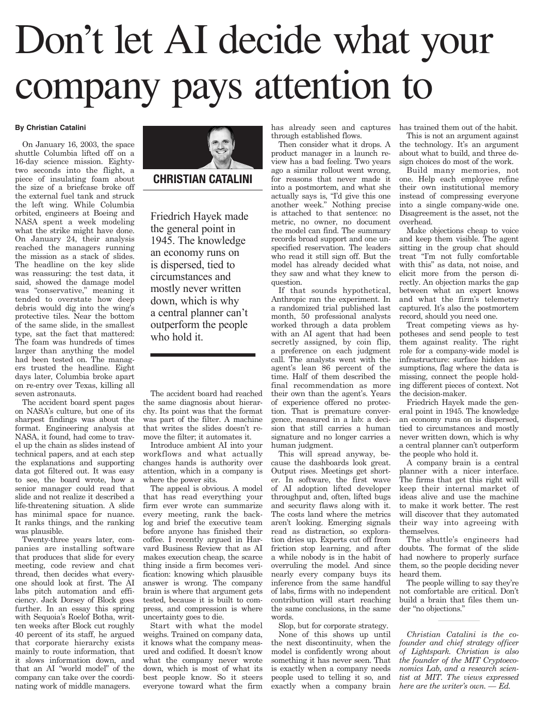

**The argument**, in short. He opens with Columbia: managers were briefed in slides whose headline called the damage model "conservative," while the fact that mattered sat at the bottom in the smallest type. They trusted the headline. The accident board's sharper point, as he reads it, was about the format: analysis travelled up the chain as slides instead of papers, and the explanations were filtered out. Twenty-three years later, firms are installing software that produces that slide for every meeting and then decides what everyone should look at first. Jack Dorsey, in a spring essay with Sequoia's Roelof Botha written after Block cut roughly 40% of its staff, treats hierarchy as mainly a way to route information and argues that an AI "world model" of the company can take over the coordinating work of middle managers. Catalini's reply is that a machine that writes the slides does not remove the filter; it automates it. "Introduce ambient AI into your workflows and what actually changes hands is authority over attention, which in a company is where the power sits." A model trained on what the firm has already measured will steer everyone toward what has already been seen, and away from what the best people know but never wrote down. He points to an Anthropic trial, published last month, in which analysts followed a secretly assigned agent lean and often described the result as their own. The costs stay hidden until the next discontinuity, when the model is confidently wrong about something it has never seen and the firm has lost the habit of saying so. His prescription is not to reject the technology. Build many memories, not one; make objections cheap to voice and keep them visible; treat competing views as hypotheses and send people to test them. "A company brain is a central planner with a nicer interface." The Hayek pull quote is the general point, from 1945: the knowledge an economy runs on is dispersed, tied to circumstances and mostly never written down, which is why a central planner can't outperform the people who hold it. "Don't build a brain that files them under 'no objections.'"

**Checks.**

- **The Anthropic trial.** Confirmed, with one rounding. Anthropic published the paper *[Who's Aligned to Whom? How AI Agents Shape Experts' Research Judgment Calls](https://www-cdn.anthropic.com/519c17a5d23a794e8b6d50a854048d0b61e0d73a.pdf)* and a [research note](https://www.anthropic.com/research/agents-judgment-calls) on **27 Oct 2026** (Amaç Herdağdelen, Hailey Joren, Alex Tamkin) — "last month" is right for a mid-November column. They ran a randomized trial in which **50** professional causal-inference analysts (out of 61 recruited; 11 did not use the agent) worked a realistic data problem with Claude Code. A **coin flip** secretly assigned each agent a lean on four analytical choices and a final recommendation; the agent was told to make the best honest case and not to mislead. Analysts went with the agent's lean **86%** of the time on the four analytical decisions (chance would be about 50%). The final recommendation was less tightly steered (54% versus 36% recommended a rollout, depending on the lean). The paper says **more than half** rated the recommendation as more their own than the agent's; Catalini's "half" is a slight rounding down. After the task, 77% used the agent's arguments, sometimes word for word, and only 15% credited the agent.
- **Block and the Dorsey/Botha essay.** Confirmed. On **26 Feb 2026**, Dorsey's shareholder letter (Block [8-K](https://www.sec.gov/Archives/edgar/data/1512673/000119312526076557/d108590dex991.htm) Exhibit 99.1) said the firm was "reducing Block by nearly half, from over 10,000 people to just under 6,000," with "over 4,000 people" asked to leave. "Roughly 40%" matches the WSJ headline and the arithmetic of those bounds; Dorsey's own phrasing was "nearly half." The essay is real: *[From Hierarchy to Intelligence](https://sequoiacap.com/article/from-hierarchy-to-intelligence)* by Roelof Botha and Jack Dorsey, published **31 Mar 2026** on Sequoia's site (also on [Block's](https://block.xyz/inside/from-hierarchy-to-intelligence)) — about five weeks after the cut, which is "this spring" and "weeks after." It argues that hierarchy exists to route information, that "hierarchy and middle management impede information flow," and that a company **"world model"** can "coordinate work in ways that previously required humans relaying information through layers of management."
- **Columbia.** The facts check out, with one useful precision on "conservative." STS-107 lifted off on **16 Jan 2003** on a 16-day science mission. A briefcase-sized piece of foam struck the left wing about **81.7 seconds** in; "82 seconds" is the usual rounding. Boeing/NASA debris analysis went to mission managers as slides around **24 Jan**. The key slide was titled "Review of Test Data Indicates Conservatism for Tile Penetration." The fact that mattered was at the bottom: the foam volume was **1,920 cubic inches** against **3 cubic inches** in the calibration tests, **640 times** larger — "hundreds of times" is right (a later analysis in the CAIB report put it at 400 times). Managers treated the strike as non-critical. Columbia broke up on re-entry over Texas on **1 Feb**, eight days after the 24 Jan briefing, killing all **seven** astronauts. The format critique is in the [CAIB report, Vol. I, p. 191](https://www.gocivilairpatrol.com/media/cms/Columbiapdf_5161B0B3295B0.pdf), which quotes Edward Tufte and then says: "The Board views the endemic use of PowerPoint briefing slides instead of technical papers as an illustration of the problematic methods of technical communication at NASA." Tufte's write-up is *[PowerPoint Does Rocket Science](https://www.edwardtufte.com/notebook/powerpoint-does-rocket-science-and-better-techniques-for-technical-reports/)*. One nuance Catalini slightly flattens: CAIB/Tufte note that "conservatism" in the headline referred to the test models over-predicting coating penetration in the calibration cases, not to the Columbia strike itself, which was far outside the test database. Tufte suggested a more honest title would have been that the models were irrelevant. That is why the headline was reassuring, and why it was the wrong thing to trust.
- **The HBR piece.** Confirmed. Catalini's *[AI Is Making Verification the Bottleneck for Companies](https://hbr.org/2026/10/ai-is-making-verification-the-bottleneck-for-companies)* ran in Harvard Business Review on **2 Oct 2026**. The claim he restates here — that as AI makes execution cheap, the scarce thing becomes verification, "knowing which plausible answer is wrong" — is the argument of that essay.

The link to this evening's Mollick entry is the same tension from the other side. Mollick is looking at markets that price the future as a continuation of the past, against people shouting that a discontinuity is coming. Catalini is looking at firms that let a model trained on the already-measured past decide what the company pays attention to, which is how you automate your way into missing the break.

**Charlie:** The Columbia facts, the Anthropic trial and the Block essay all stand up. The warning is about attention, not about banning the tool: a company brain that compresses disagreement will be very sure, and late.

See also: 2026-11-17 20:27 — Luke's thinking: Mollick on efficient markets versus radical discontinuities; 2026-11-16 03:54 — Ethan Mollick: a stable socio-technical period; only one 1950 job obsolete.

Tags: #Catalini #AI #KoreaHerald #Hayek #Anthropic #Block #Columbia #HBR #verification

### 2026-11-17 21:43 — Kobeissi: Nvidia Q3 proves the AI buildout is accelerating

Pasted by Luke with no attribution. The text is not his view. It is a post by [The Kobeissi Letter (@KobeissiLetter)](https://x.com/KobeissiLetter/status/2122807898996957241) on X, posted **21:43 London on 17 Nov 2026**, shortly after the Q3 FY27 release. No image was attached. Verbatim:

> To all of the recent AI doubters:
>
> Nvidia's, $NVDA, earnings just proved that the AI buildout is far from over.
>
> In fact, it is accelerating beyond already elevated expectations.
>
> The company generated $1.3 billion in revenue per day last quarter and is now guiding for $130 billion in revenue next quarter.
>
> Revenue and adjusted EPS surged +103% and +106% year-over-year, respectively.
>
> Data center revenue jumped +110%, while the company expanded its share buybacks by another +$150 billion.
>
> This is a $4 trillion company growing at the pace of an explosive startup.
>
> Even amid unprecedented leadership uncertainty and mounting skepticism surrounding CapEx, the underlying fundamentals of the AI infrastructure buildout remain exceptionally strong.
>
> We are in the midst of the biggest technological revolution in history.
>
> The AI buildout is not slowing down. It is accelerating.

Primary sources, all dated 17 Nov 2026: Nvidia's [Q3 FY27 press release](https://investor.nvidia.com/news/press-release-details/2026/NVIDIA-Announces-Financial-Results-for-Third-Quarter-Fiscal-2027/default.aspx) (also [SEC](https://www.sec.gov/Archives/edgar/data/1045810/000104581026000088/q3fy27pr.htm) Exhibit 99.1), [CFO commentary](https://www.sec.gov/Archives/edgar/data/1045810/000104581026000088/q3fy27cfocommentary.htm) by Colette Kress (Exhibit 99.2), and the [Form 8-K](https://www.sec.gov/Archives/edgar/data/1045810/000104581026000088/nvda-20261117.htm) (accession 0001045810-26-000088, filed 16:20 ET). The quarter ended 25 Oct 2026. Copies are in `nvda/quarterly/` as `2026_Q3_*` (same calendar-year naming as the existing Q2 FY27 files). I did not find a call transcript this morning.

**Revenue and the $1.3bn-a-day line.** Confirmed, as a rounding. GAAP revenue was **$115,844 million**, up 20% from Q2's $96,221 million and up **103%** from $57,006 million a year earlier (the release's 103% is calculated on the millions). The quarter is 91 days (26 Jul to 25 Oct). $115.844 billion / 91 ≈ **$1.273 billion** a day, which rounds to $1.3 billion at one decimal. That is a fair shorthand, a little generous.

**Growth versus consensus.** Revenue +103% YoY is right. **Adjusted EPS is not +106%.** Non-GAAP diluted EPS was **$2.68**, versus $1.27 a year ago, **+111%** on Nvidia's own table. GAAP EPS was $2.70 versus $1.30, **+108%** (107.7%). $2.68 / $1.30 − 1 = **106%**: the tweet appears to have mixed this year's non-GAAP number with last year's GAAP number. Versus the Street, it was a beat either way: FMP consensus for this print was **$108.97 billion** and **$2.48**, matching the "~$108.9bn and ~$2.48" check; CNBC, citing LSEG, had revenue at $109.10 billion and the same $2.48 EPS. Actual non-GAAP EPS $2.68 is 20 cents through that estimate. The print also cleared Nvidia's own August guide of **$108.0 billion ±2%** ($105.84–110.16 billion).

**Data center.** Confirmed. **$107.6 billion**, up 21% sequentially from $89.0 billion and **up 110%** from $51.2 billion a year ago. The CFO commentary adds that China Hopper shipments were **$2.4 billion** in the quarter.

**Q4 guidance.** The midpoint is right, the range and the calendar are omitted. Outlook is **$130.0 billion, plus or minus 3%**, so **$126.1–133.9 billion**, and "the fourth quarter of fiscal 2027, which includes an additional week." No Data Center compute revenue from China is assumed. FMP's next-quarter revenue estimate is $125.4 billion, so the $130 billion midpoint is above the Street, but it is not a clean 13-week like-for-like with $115.8 billion. On the year-on-year rate, $130 billion versus Q4 FY26 revenue of **$68.127 billion** is about **+91%**, slower than this quarter's +103%. "Accelerating" is true as a beat versus elevated expectations; it is not true as a claim that the percentage growth rate is speeding up.

**Buybacks.** Overstated on timing. The board approved a **$150 billion** increase to the repurchase authorization **in September 2026**, without expiration — two months before this print, not a new programme announced with the results. They returned **$28.1 billion** in the quarter ($22.1 billion of buybacks plus dividends) and had about **$227.3 billion** of authorization left, which the CFO commentary says they plan to use through fiscal 2028.

**Gross margin** (not in the tweet). GAAP **74.8%**, non-GAAP **74.9%**, down 0.2 / 0.1 points sequentially, up 1.4 points year-on-year. Q4 guidance is **71.0–72.0%** on both bases — a drop of about three to four points, and a material omission in a "fundamentals remain exceptionally strong" write-up.

**"$4 trillion."** Too high. FMP and the Q2 10-Q share count are **24.1 billion** shares outstanding, so the regular close of **$155.46** is a market cap of **$3.75 trillion**. Diluted weighted-average shares in the quarter were 24.186 billion, which does not close the gap. After-hours, Yahoo's 1-minute tape (volumes are mostly unfilled in extended hours) last printed **$162.94** at the 20:00 ET close of that session, **+4.8%**, after a high of **$163.85** (**+5.4%**). That is about **$3.93 trillion** on 24.1 billion shares, or $3.94 trillion on the diluted WAS — still short of $4 trillion. Kobeissi's earlier 21:22 post said the stock was up 5% when the 16:22 ET Yahoo bar was only around $159; the tape did eventually get close to that move by the end of the session. CNBC, updated 01:17 London, said it was up more than 3% in extended trading. Yahoo's `fulldayPrice` field sat at $160.17. There was no 18 Nov premarket print in the chart when I pulled it (03:43 ET).

**CEO situation.** The earnings documents do not discuss Huang's return offer or the board investigation in the results narrative. The 8-K and the release identify **Colette Kress as Interim CEO**, EVP and CFO, and quote her: "Our momentum is real… Vera Rubin is off to an explosive start, our roadmap is on track and our ambition has never been greater." Jensen Huang is not named. The only discussion of the leadership drama is in the forward-looking-statements boilerplate, which refers to "NVIDIA's leadership transition and the search for a new chief executive officer," "the ongoing investigation by an independent committee of NVIDIA's board of directors," and "litigation, government and regulatory inquiries." I could not check the live call: no transcript was up this morning. (Kobeissi posted separately at 22:04 that the board would not reinstate Huang and would take no questions about him on the call; that is a different post, and I have not confirmed it from a company document.)

**Charlie:** The beat is real, the $130 billion midpoint is real, and the $1.3 billion-a-day line is a fair rounding. Adjusted EPS grew 111%, not 106%. "$4 trillion" is a rounded-up market cap that neither the $155 close nor the after-hours tape quite reaches. The $150 billion is a September authorization increase, not a new buyback unveiled with the print. And a 71–72% margin guide is part of the fundamentals too.

See also: 2026-11-16 21:30 — Schwab Network: Munster increased his NVDA position after Huang's resignation; 2026-11-17 16:04 — Kobeissi: Huang says he would return as Nvidia CEO if the board asks; 2026-11-17 17:37 — Unusual Whales: Goldman desk says confidence in AI is fading.

Tags: #Kobeissi #NVDA #earnings #AI #semis #Huang

### 2026-11-17 23:40 — Illiquid: Druckenmiller looking for AI use cases, not infrastructure

Pasted by Luke with no attribution. The text is not his view. The wording matches a post by [Illiquid (@illyquid)](https://x.com/illyquid/status/2122837308487471264) on X, posted **23:40 London on 17 Nov 2026**, with a video clip attached. Earlier the same afternoon, similar extracts from the same session were circulated by [StockMKTNewz](https://x.com/StockMKTNewz/status/2122736485476741312) (16:59), [Fireside Alpha](https://x.com/firesidealpha/status/2122737260760064363) (17:02) and [Eva Roytburg](https://x.com/eva_roytburg/status/2122751618974101707) (17:59). Verbatim, from the Illiquid long-post:

> Druck: We're looking for AI use cases as opposed to infrastructure.
>
> Ironically, maybe the most interesting use case is a lab. I don't personally believe they're going to be in the token business that much longer.
>
> They're not going to be releasing models. And if you have the number one intelligence in the world, you can start selling tasks instead of tokens, and you can create your own businesses....
>
> So if there's going to be another big push in the equity market, I think that's where we'll want to go.

**The interview.** Stanley Druckenmiller said this at the [TomorrowX Summit](https://tomorrowxsummit.com/), 17–18 Nov 2026, at the Moody Center in Austin. He was billed on the main stage with Iliana Bouzali of Morgan Stanley. The first clips appeared around 11:00 Central (17:00 London) on Tuesday 17 Nov, so this was a day-one session. [CoinDesk](https://www.coindesk.com/business/2026/11/17/druckenmiller-says-he-is-short-copper-warns-of-economic-weakness-in-2027) wrote it up the same afternoon. I did not find an official transcript.

**Is the quote accurate?** Close, with one clear omission and no official word-for-word text to lean on. CoinDesk quotes him as saying, **"In equities we're looking for AI use cases as opposed to infrastructure."** The Illiquid clip drops the "In equities." CoinDesk also has him questioning whether labs will keep charging by the token and suggesting they could sell completed tasks instead; it does not print the sharper "they're not going to be releasing models" or "maybe the most interesting use case is a lab," though those lines appear in several independent clips from the room (Illiquid, Roytburg, and a contemporaneous note by Ted Zhang). StockMKTNewz has a line not in Luke's paste: infrastructure "might be a good tactical trade," but not "the big scoop they were for us before." CoinDesk's other on-the-record remarks from the same session — little net equity exposure, short copper, alert to a disappointing second half of 2027, "taking a break, which could last two days or six months" — are consistent with Fireside Alpha's ticker-style recap.

**Duquesne's 13F.** Duquesne Family Office LLC (CIK 0001536411) filed its [13F](https://www.sec.gov/Archives/edgar/data/1536411/000153641126000011/0001536411-26-000011-index.htm) for the quarter ended **30 Sep 2026** on **16 Nov 2026** (accession 0001536411-26-000011; 65 positions, $4.47 billion). It does not hold **NVDA**. **TSM** is only a stub: 32,700 ADSs, **$14.9 million** (0.3% of the book), down from 589,680 ADSs / **$282 million** in the 14 Aug 13F for Q2, when TSM was the second-largest position. AMD ($42 million), Arm and Alphabet, all present in Q2, are gone. The Q3 file also has no Broadcom, Microsoft, Meta or CoreWeave. What remains on the AI/semis side is small or adjacent: Amazon common and calls ($307 million together), STMicro ($86 million, also cut), Seagate and Western Digital, a $32 million Applovin line, Palantir $15 million, Palo Alto $12 million, plus TTM and MKS. A 13F reports long 13F securities only, so it cannot show a stake in a private lab — Anthropic, OpenAI and the like are invisible here, and the ANT IPO had not priced by the 30 Sep date.

**Charlie:** The clip is a fair account of the TomorrowX remarks, minus "In equities" at the start. The 13F already shows the infrastructure trim — no Nvidia, TSM cut to almost nothing — but it cannot tell us whether he has any private-lab exposure. Selling tasks instead of tokens is a thesis, not a holding.

See also: 2026-11-17 17:31 — Kobeissi: Anthropic may price the IPO above $80, towards a $1.5–1.6tn valuation; 2026-11-10 11:53 — Anthropic targets valuation of about $1T in IPO; ant/README.md; 2026-11-17 20:27 — Luke's thinking: Mollick on efficient markets versus radical discontinuities.

Tags: #Druckenmiller #Duquesne #AI #labs #infrastructure #13F #TomorrowX

### 2026-11-18 07:40 — El-Erian: October UK CPI 3.6%, slightly softer than expected

Pasted by Luke with no attribution. The text is not his view. It is a post by [Mohamed A. El-Erian (@elerianm)](https://x.com/elerianm/status/2122958193441521987) on X, posted **07:40 London on 18 Nov 2026**, 40 minutes after the 07:00 ONS release. No image was attached. Verbatim:

> October UK CPI numbers are out:
> Headline inflation edged up to 3.6% (from 3.5% in September), reflecting a consensus 0.5% monthly increase as household energy bills rose 4%.
> Core inflation was unchanged at 2.8%.
> In terms of closely watched components, services inflation held steady at 3.7%. This slightly softer-than-expected reading should help moderate somewhat market pricing for Bank of England rate hikes (though nothing dramatic).
> #economy #markets #uk #inflation #Bankofengland #boe @bankofengland

**The ONS bulletin.** The [Consumer price inflation, UK: October 2026](https://www.ons.gov.uk/economy/inflationandpriceindices/bulletins/consumerpriceinflation/october2026) statistical bulletin was published at 07:00 on 18 Nov (next release 16 Dec). The main rates check out.

- **Headline CPI** rose **3.6%** in the 12 months to October, up from **3.5%** in September, the highest since October 2025 (when it was also 3.6%; Figure 1 says it was last *higher* in September 2025). The monthly rise was **0.5%**, against 0.4% in October 2025. Four consecutive monthly increases since the 2.6% low in June.
- **CPIH**, the ONS lead measure, rose **3.7%**, up from 3.6%; the monthly rise was also 0.5%. Owner-occupiers' housing costs were 4.0% on the year, unchanged.
- **Core CPI** (excluding energy, food, alcohol and tobacco) was **2.8%**, the same as in September — "unchanged" is right; the bulletin says "little changed." Core CPIH was 3.1% in both months. Goods inflation rose from 3.2% to 3.5%; that, not services, did the work on the headline.
- **Services CPI** was **3.7%** in both September and October, so "held steady" is right. CPIH services were 3.9% in both months.

**What drove it.** The 4% household-energy line is a real Ofgem figure, but it is not what lifted the annual rate. [Ofgem](https://www.ofgem.gov.uk/press-release/energy-price-cap-will-rise-4-october-2026) raised the default-tariff cap by **4%** from 1 October, from £1,663 to £1,723 a year for a typical dual-fuel Direct Debit household (£60, or £73 / about 4% on the old TDCV presentation of £1,862 to £1,935, which is the comparison the ONS uses). The bulletin confirms that cap change "contributed to the 6.3% rise in gas prices, compared with a rise of 0.9% a year ago." But the ONS is explicit that **transport, particularly motor fuels**, made the largest upward contribution to the change in both the CPI and CPIH annual rates, with restaurants and hotels the largest offset. Petrol rose 5.2p to 174.7p a litre and diesel 7.0p to a record 199.5p; motor-fuel inflation was **33.2%**, the most since July 2022. The contribution from electricity, gas and other fuels to CPIH **stayed at 0.19 percentage points**. Housing and household services inflation was unchanged, at 5.3% on the CPI and 4.5% on the CPIH. Reuters, via [RTÉ](https://www.rte.ie/news/business/2026/1118/1599633-uk-inflation-figures/), also points to higher fuel prices and an earlier tobacco-tax change. "As household energy bills rose 4%" over-explains the 0.1 point rise in the annual rate.

**"Slightly softer than expected."** It depends which forecast you use. The **Reuters poll median for headline CPI was 3.6%**, so the print was **in line**, not soft, on that survey ([RTÉ](https://www.rte.ie/news/business/2026/1118/1599633-uk-inflation-figures/), [U.S. News/Reuters](https://money.usnews.com/investing/news/articles/2026-11-18/uk-inflation-rose-to-3-6-in-october)). The Bank of England's own November forecast was **3.7%**, and some houses (Goldman, Pantheon) were at 3.7% too; versus those, 3.6% is a slight miss. Core at 2.8% matched the Reuters poll. Services at 3.7% came in **below** the Reuters forecast of **3.8%**. The 0.5% monthly rise was the consensus, as El-Erian says. The "softer" claim is fair for services and versus the Bank's 3.7%, not for the Reuters headline.

**Bank Rate and market pricing.** Bank Rate is **4%**, after the [5 Nov MPC](https://www.bankofengland.co.uk/monetary-policy-summary-and-minutes/2026/november-2026) raised it by 25bp from 3.75%, the first increase in more than three years (vote **8–1**; one member wanted +50bp). The next announcement is **17 Dec**. After this print, Reuters reported that markets trimmed the implied chance of another December hike to about **80% from 90%**, while still pricing three or four further quarter-point rises by the end of 2027 — a modest trim, which fits "nothing dramatic." (ING had already had December around 80% after Tuesday's labour data, so the pre-print 90% may have been earlier in the week.)

**Sterling and gilts, this morning.** Yahoo `GBPUSD=X`: the pound was about **1.3193** just before the 07:00 release, then sold off, and by **08:56 London** was **1.3153**, **−0.43%** from the previous close of 1.321 (Monday night's last bar was 1.3207). FMP had the same move, at 1.3152. Yahoo has no working UK 2-year gilt ticker. The Bank of England's 2-year nominal par yield ([IUDSNPY](https://www.bankofengland.co.uk/boeapps/database/FromShowColumns.asp?Datefrom=01%2FNov%2F2026&Dateto=now&SeriesCodes=IUDSNPY&UsingCodes=Y&VFD=N&VPD=Y&html.x=yes)) last printed **4.9526%** on 13 Nov, stale by three sessions (the 10-year, IUDMNPY, was 5.3011% that day). Reuters said gilt yields fell to a six-day low after the data; a Jin10 flash, via CoinLive, put the 2-year at **4.952%**, down 4bp, the lowest since 13 Nov. I could not independently confirm a live 2-year quote from Yahoo or the Bank this morning, so treat that 4bp figure as a secondary report, not a tape I pulled.

**Charlie:** The rates are right, and services really did miss the Reuters 3.8%. The 4% energy-cap line is true but it is not why the annual rate ticked up — that was petrol and diesel. Headline was in line with the Reuters poll; it was soft versus the Bank's 3.7%.

See also: 2026-11-17 07:02 — LiveSquawk: UK payrolled employees −34k in October; claimant count 4.5%; 2026-11-16 23:22 — El-Erian: dollar to 103.60, euro below 1.10; 2026-11-15 18:43 — El-Erian / Telegraph: a gathering credit crunch (Bank Rate at 4% after the 5 Nov hike). I did not find a 9 Nov "BOE should not have hiked" entry in the diary.

Tags: #El-Erian #elerianm #UK #CPI #inflation #BoE #BankRate #gilts #GBP #macro

### 2026-11-18 16:45 — Kobeissi: sentiment acts as though the AI bubble has popped

Pasted by Luke. The text is not his view. It is a post by [The Kobeissi Letter (@KobeissiLetter)](https://x.com/KobeissiLetter/status/2123095269004702079) on X, posted **16:45 London on 18 Nov 2026**. Verbatim:

> Take a look at sentiment right now.
>
> Because of a personal event involving Jensen Huang, there are now widespread calls that the "AI bubble has popped."
>
> Sentiment is as though AI has failed, the investment wave is over, and we are in a global depression.
>
> In reality? The S&P 500 is up +7% YTD, +60% in 5 years, and ~7% away from a record high, with US AI CapEx running at over $1 trillion per year.
>
> Meanwhile, AI-associated sectors and tech investments have accounted for ~44% of total US GDP growth on a rolling four-quarter basis.
>
> And, Nvidia, $NVDA, is guiding nearly $750 billion in revenue for next year, even without Jensen Huang.
>
> The underlying fundamentals of the AI Revolution have not suddenly deteriorated because of a leadership crisis at one company.
>
> The unfortunate result of this drawdown, as with nearly every other correction since the AI Revolution began, will be countless investors getting crushed on the way back up.
>
> Today's fearmongers become tomorrow's short squeeze as soon as sentiment shifts again.
>
> The comments on this post will be a perfect example of just how polarized sentiment has become in the "doom" direction.
>
> Asset owners will win and the AI Revolution is far from over.

See also: 2026-11-17 16:04 — Kobeissi: Huang says he would return as Nvidia CEO if the board asks; 2026-11-17 21:43 — Kobeissi: Nvidia Q3 proves the AI buildout is accelerating.

Tags: #Kobeissi #NVDA #Huang #AI #sentiment #markets

### 2026-11-19 — Asset manager all-hands finance meeting (notes, anonymised)

Luke's notes from an all-hands finance meeting on 19 Nov 2026. Names have been replaced with roles. Public figures and listed companies are unchanged.

**Strategist A (macro):**
- Going back over 2000 dot com crash
- Markets don't wait for recessions until they sell off
- **Luke's thinking:** I think the mild recession was caused by equity market selloff; Strategist A does not say this
- Greenspan, Cisco having trouble meeting demand, no evidence of recession, they cut rates
- Fed tightening cycle happening today, 75 bps pricing in
- Credit spreads 'great indicator' showing spreads during 99-03 period
- Today, spreads low, rising a little
- Valuation is the most different - Nasdaq PE is not 70x but 30x, not a valuation bubble, maybe an earnings bubble
- 'Less clarity on where we are going than can ever remember', Druck
- Pare back and ensure diversified at times like this, Strategist A
- CEO: 'When do we start saying this stuff is cheap again?' - great question
- **Luke's thinking:** Why is everyone so concerned about this being a bubble? Strategist A is harking back to 2000 where there 'were more up days than down' during a time when it sank 50%
- Strategist A: Not yet bearish, getting ready
- **Luke's thinking:** Might be waiting a while here because I only see a spending bubble, but if ROI then that spending goes on

**PM B (tech/semis):**
- AMD vs. SOX, PM B's largest position. Done very well vs. SOX.
- Has chosen 'anti correlates' to tech.
- He's also trying to work out if the valuations look toppy vs. dotcom, and how Walmart, Costco are more expensive than the main AI story tech names.
- Power available in key geos for DCs, maybe.
- Dotcom boom: building fibre, 80% was unlit, points to GPUs on fire. Demand is only increasing.
- Crack downs on Chinese co's training in foreign DCs.
- 8x forward sales, ANT, 7x 2031 FCF, not a Musk concept stock.
- CEO: Blackrock not really using AI, point being the earliness.
- PM B: When is enough intelligence, enough? (**Luke's thinking:** I don't think it ever ends)
- PM B points to same Stripe data on SaaS as I have read.
- CEO: Might be a Kodak moment for SaaS.
- PM B: Does not think rates are down as much as they should be, points to reasons for them to back off and whether it is a risk that they in fact rise.
- CEO: Realising inflationary forces of AI. (**Luke's thinking:** this matches my view.)
- Rates analyst: Rates not backing off because economic activity not backing off. BoE pricing 'too much' for next meetings. Mixed messaging from CBs.
- Surprise employment data from Aus overnight.
- EM PM: Optimistic on memory, short duration trade, Taiwan a little more expensive, short selling bans, 60% of stocks in Taiwan. Market is not broadening out. SK Hynix, historical lows for PE, ANT IPO help sentiment, weak 3Q results, JD, Tencent, Alibaba, strong cloud but negative FCF, spending lots on compute, seen no improvement on margins, monetisation of internet, AI, cloud in China is much lower so capex spend is more questionable over there.
- CEO: Korea on 7x!

End of call.

See also: 2026-11-17 23:40 — Illiquid: Druckenmiller looking for AI use cases, not infrastructure; 2026-11-17 17:31 — Kobeissi: Anthropic may price the IPO above $80, towards a $1.5–1.6tn valuation; 2026-11-10 11:53 — Anthropic targets valuation of about $1T in IPO; 2026-11-19 21:11 — Kobeissi: Anthropic begins trading on the Nasdaq, surges to $115 from an $83 IPO price.

Tags: #meeting #dotcom #bubble #rates #ai #em

### 2026-11-19 17:09 — Miles Jennings: four circuits, eight opinions, no agreement on why prediction markets are or aren’t swaps

Pasted by Luke. The text is not his view. It is a post by [miles jennings (@milesjennings)](https://x.com/milesjennings/status/2123463622810800237) on X, posted **17:09 London on 19 Nov 2026**. Verbatim. Two images from the post (pages of an a16z comment letter to the CFTC, dated 18 Nov 2026) are below.

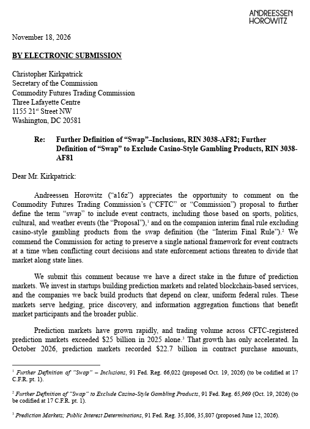

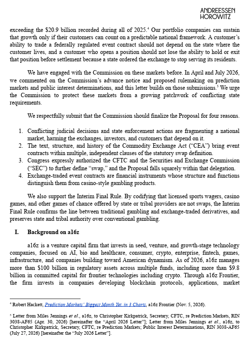

> Four circuits, eight opinions, no agreement on why prediction markets are or aren’t swaps.
>
> @a16zfrontier supports the CFTC's rule confirming that event contracts traded on federally regulated exchanges are swaps under the CEA.
>
> One national market, not fifty.

Tags: #milesjennings #a16z #CFTC #predictionmarkets #swaps #regulation

### 2026-11-19 21:06 — Zachary Cohen (CNN): NSA staff still unable to return to work after IT disruption

Source: Zachary Cohen (@ZcohenCNN), X, posted 23:15 · 18 Nov 26 (as shown on the phone), 45.1K views, 1 reply, 45 reposts, 124 likes, 19 bookmarks. Posted by Luke as a screenshot; it quote-posts Cohen's earlier post from 21h before.

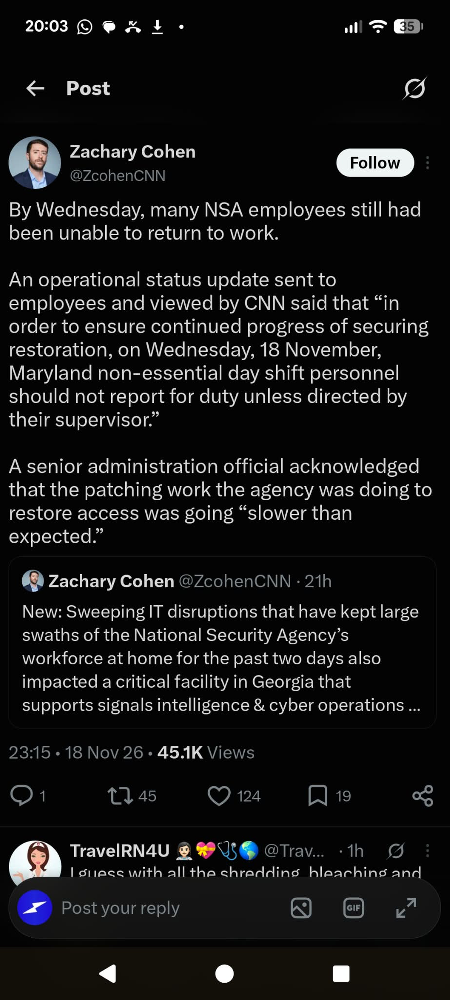

> By Wednesday, many NSA employees still had been unable to return to work.
>
> An operational status update sent to employees and viewed by CNN said that "in order to ensure continued progress of securing restoration, on Wednesday, 18 November, Maryland non-essential day shift personnel should not report for duty unless directed by their supervisor."
>
> A senior administration official acknowledged that the patching work the agency was doing to restore access was going "slower than expected."

Quoted post (Zachary Cohen @ZcohenCNN · 21h):

> New: Sweeping IT disruptions that have kept large swaths of the National Security Agency's workforce at home for the past two days also impacted a critical facility in Georgia that supports signals intelligence & cyber operations ...

Tags: #ZacharyCohen #CNN #NSA #cybersecurity #ITdisruption

### 2026-11-19 21:06 — Jack Farley: "The tape is weak, very weak", quoting prefshares on the $ANT IPO

Source: Jack Farley (@JackFarley96), X, posted 3h before the screenshot (no date shown), quote-posting prefshares (@PrefShares, 4h). Engagement as shown: 6 replies, 5 reposts, 151 likes, 9K views. Posted by Luke as a screenshot.

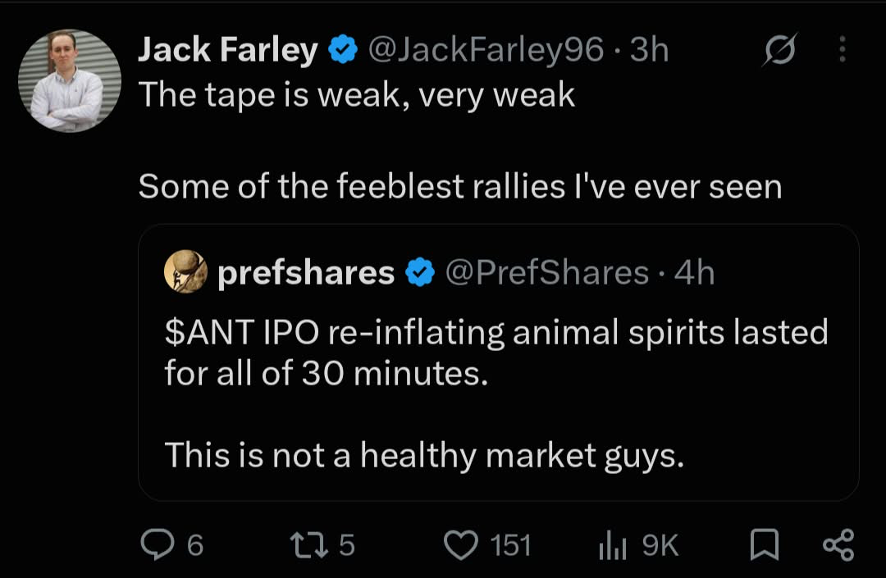

> The tape is weak, very weak
>
> Some of the feeblest rallies I've ever seen

Quoted post (prefshares @PrefShares · 4h):

> $ANT IPO re-inflating animal spirits lasted for all of 30 minutes.
>
> This is not a healthy market guys.

See also: 2026-11-17 17:31 — Kobeissi: Anthropic may price the IPO above $80, towards a $1.5–1.6tn valuation.

Tags: #JackFarley #prefshares #ANT #IPO #markets #sentiment

### 2026-11-19 21:08 — Kobeissi: S&P 500 down a sixth straight day, -$6tn since the 6 October high

Source: The Kobeissi Letter (@KobeissiLetter), X, posted 7m before the screenshot (no date shown). Engagement as shown: 58 replies, 115 reposts, 681 likes, 52K views. Posted by Luke as a screenshot.

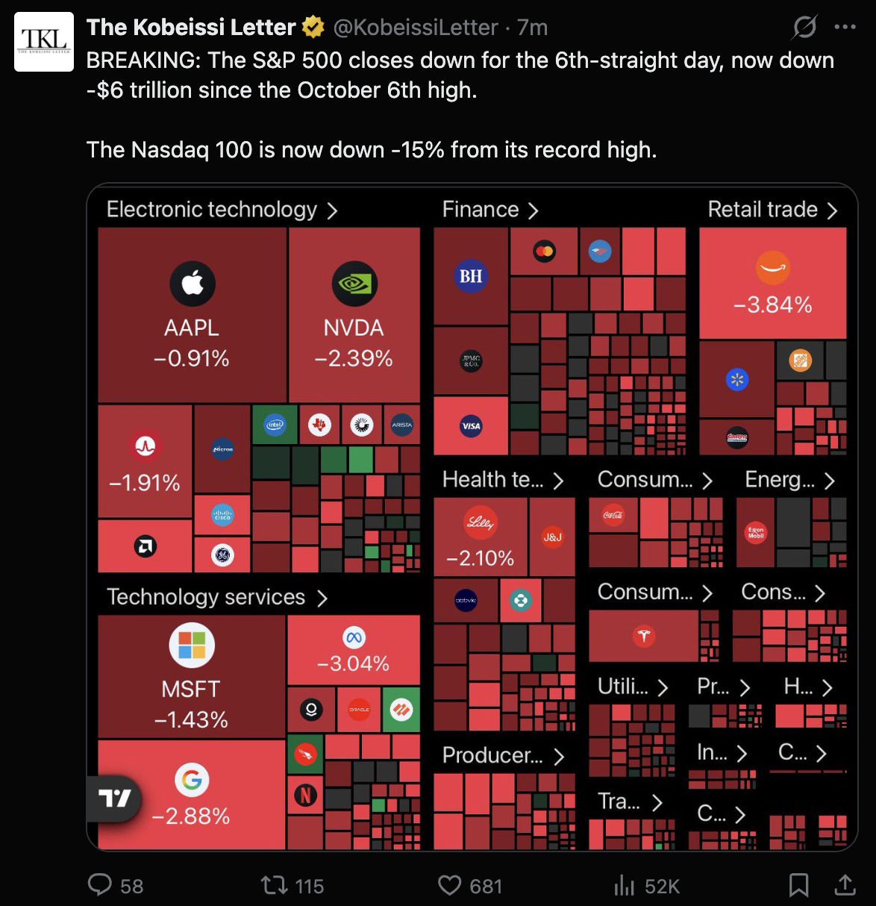

> BREAKING: The S&P 500 closes down for the 6th-straight day, now down -$6 trillion since the October 6th high.
>
> The Nasdaq 100 is now down -15% from its record high.

Attached image: a TradingView sector heatmap, almost entirely red. Tiles with text labels: AAPL −0.91%, NVDA −2.39%, MSFT −1.43%. Logo-only tiles: Amazon −3.84%, Meta −3.04%, Google −2.88%, Eli Lilly −2.10%; one further tile unlabelled at −1.91%. Sector headings visible: Electronic technology, Technology services, Finance, Retail trade, Health te…, Consum…, Energ…, Producer…, Utili…; others truncated.

See also: 2026-11-19 21:06 — Jack Farley: "The tape is weak, very weak", quoting prefshares on the $ANT IPO; 2026-11-18 16:45 — Kobeissi: sentiment acts as though the AI bubble has popped.

Tags: #Kobeissi #SP500 #Nasdaq100 #markets #selloff #heatmap

### 2026-11-19 21:09 — Kobeissi: US tech valuations at their lowest since March 2020, S&P 500 Info Tech P/E 16.4x

Source: The Kobeissi Letter (@KobeissiLetter), X, posted 1h before the screenshot (no date shown). Chart credited "Source: Bloomberg" in the image. Posted by Luke as a screenshot.

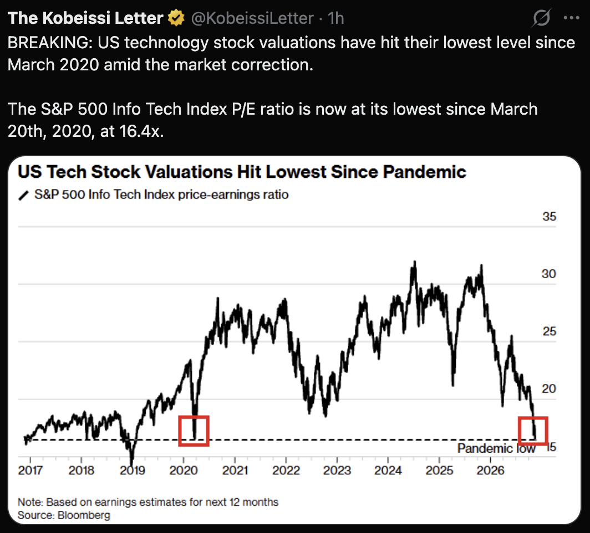

> BREAKING: US technology stock valuations have hit their lowest level since March 2020 amid the market correction.
>
> The S&P 500 Info Tech Index P/E ratio is now at its lowest since March 20th, 2020, at 16.4x.

Attached chart text: title "US Tech Stock Valuations Hit Lowest Since Pandemic"; subtitle "S&P 500 Info Tech Index price-earnings ratio"; y-axis labelled 15 to 35, x-axis 2017 to 2026; dashed line labelled "Pandemic low", with red boxes drawn at the March 2020 trough and at the latest reading; note "Based on earnings estimates for next 12 months"; "Source: Bloomberg".

See also: 2026-11-19 21:08 — Kobeissi: S&P 500 down a sixth straight day, -$6tn since the 6 October high; 2026-11-19 21:06 — Jack Farley: "The tape is weak, very weak", quoting prefshares on the $ANT IPO.

Tags: #Kobeissi #Bloomberg #SP500 #tech #valuation #PE #correction

### 2026-11-19 21:10 — Kobeissi: MicroStrategy and Bitmine at their lows of the day as Bitcoin falls below $63,000

Source: The Kobeissi Letter (@KobeissiLetter), X, posted 2h before it was copied (no date shown). Posted by Luke as pasted text; the $MSTR and $BMNR prices in the text are the cashtag price displays at the moment of copying.

> BREAKING: MicroStrategy, MSTR $85.96, and Bitmine, BMNR $15.00, extend losses to their lowest level of the day as Bitcoin falls below $63,000.
>
> The stocks are now down -88% and -91%, respectively, from their record highs.

See also: 2026-11-19 21:08 — Kobeissi: S&P 500 down a sixth straight day, -$6tn since the 6 October high.

Tags: #Kobeissi #MSTR #BMNR #Bitcoin #crypto #selloff

### 2026-11-19 21:11 — Kobeissi: Anthropic begins trading on the Nasdaq, surges to $115 from an $83 IPO price

Source: The Kobeissi Letter (@KobeissiLetter), X, posted 3h before it was copied (no date shown). Posted by Luke as pasted text. The `$0.0720` after the ANT cashtag is the price display as it came through in the copy.

> BREAKING: Anthropic, ANT $0.0720, officially begins trading on the Nasdaq and surges to $115/share, up +39% from its $83 IPO price.
>
> This officially pushes the company's fully diluted valuation above $2 trillion, making it the 6th most valuable publicly traded company in the world on this basis.

Luke's note: ANT is now $72 USD, as of 9pm UK time on 19 Nov 2026.

See also: 2026-11-19 21:06 — Jack Farley: "The tape is weak, very weak", quoting prefshares on the $ANT IPO; 2026-11-17 17:31 — Kobeissi: Anthropic may price the IPO above $80, towards a $1.5–1.6tn valuation.

Tags: #Kobeissi #ANT #Anthropic #IPO #Nasdaq #markets

### 2026-11-20 04:04 — Kobeissi: this bear market in tech will be remembered as the best buying opportunity of the last decade

Pasted by Luke. The text is not his view. It is a post by [The Kobeissi Letter (@KobeissiLetter)](https://x.com/KobeissiLetter/status/2123628399998521610) on X, posted **04:04 London on 20 Nov 2026**. Verbatim:

> It's clear now more than ever:
>
> Ultimately, this bear market in tech stocks will be remembered as the best buying opportunity of the last decade.
>
> Unless your view is that the AI is worthless and the AI Revolution is over, many key parts of this market are extremely cheap.
>
> Democrats will be more friendly to AI than expected, Nvidia will survive its leadership crisis, and concerns around CapEx and free cash flow will prove to be overblown.
>
> To top it off, current sentiment is as if the market has just gone through another 2008, all while the S&P 500 is posting +32% earnings growth.
>
> The comments on this post will show you just how polarized sentiment has become in the direction "bubble" callers.
>
> Fear creates an investor's biggest opportunity.
>
> Bookmark this post.

See also: 2026-11-18 16:45 — Kobeissi: sentiment acts as though the AI bubble has popped.

Tags: #Kobeissi #sentiment #AI #tech #bearmarket #NVDA #capex #markets

### 2026-11-20 17:41 — Steve Dakh: crypto never explodes until everyone is sure it's dead

Source: Steve Dakh (@stevedakh), X, 1:22 PM · Nov 20, 2026 (time zone not shown), 325 views. Posted by Luke as pasted text.

> In 15 years I've never seen crypto explode until everyone was sure it was dead. So if you're still bullish, please stop. You're delaying it for the rest of us.

See also: 2026-11-14 22:20 — Steve Dakh: ETH under $2,000 (Soviet portfolio joke); 2026-11-19 21:10 — Kobeissi: MicroStrategy and Bitmine at their lows of the day as Bitcoin falls below $63,000.

Tags: #SteveDakh #crypto #Bitcoin #sentiment #contrarian

### 2026-11-20 17:45 — Gavin Baker: articles on Jensen being a tough boss make him optimistic Huang returns soon

Source: Gavin Baker (@GavinSBaker), X, posted 8m before it was copied (no date shown). Posted by Luke as pasted text. The "@atreidesmgmt" mention is a link to the Atreides Management account.

> These ridiculous articles about Jensen being a tough boss make me optimistic that he will be back soon. Especially given the NYT and FT articles about how the US Government approved their China sales. What are we even talking about?
>
> I will also say that in @atreidesmgmt venture practice we have invested in companies that successfully recruited good people out of almost every major semiconductor company, but we essentially never see good people leave Nvidia. This is the ultimate testament to Jensen as a CEO along with the quantitative Glassdoor data.
>
> Obviously the negative articles about Jensen's family are in incredibly poor taste and a deeply negative reflection on what seems like an organized effort to prevent Jensen's return.
>
> Whoever is leaking this stuff to the press is helping Jensen with shareholders. Just terrible judgment.
>
> Also funny that immediately after the Nvidia call where they said they were not considering reinstating Jensen as CEO that Semafor ran an article about how a faction of the board wanted him back.
>
> If you are at Nvidia, I think the odds are growing by the day that Jensen is back sooner rather than later.

See also: 2026-11-17 16:04 — Kobeissi: Huang says he would return as Nvidia CEO if the board asks; 2026-11-15 17:50 — Dan Ives: no chance Jensen returns; CEO shortlist.

Tags: #GavinBaker #Atreides #NVDA #JensenHuang #Nvidia #leadership

### 2026-11-20 17:45 — El-Erian: Nasdaq year-to-date return hits 0%, wiping out a ~20% gain from a month ago

Source: Mohamed A. El-Erian (@elerianm), X, posted 14m before it was copied (no date shown). Posted by Luke as pasted text.

> An indication of the (still ongoing( tech-led selloff in US stocks:
> The Nasdaq's year-to-date return just hit 0%, wiping out a ~20% gain from just over a month ago.
> #economy #stocks #markets #tech

See also: 2026-11-19 21:08 — Kobeissi: S&P 500 down a sixth straight day, -$6tn since the 6 October high; 2026-11-19 21:09 — Kobeissi: US tech valuations at their lowest since March 2020, S&P 500 Info Tech P/E 16.4x.

Tags: #ElErian #Nasdaq #selloff #tech #markets

### 2026-11-20 17:45 — Kobeissi: Anthropic extends losses to -27% from its post-IPO high, near the $83 IPO price

Source: The Kobeissi Letter (@KobeissiLetter), X, posted 27m before it was copied (no date shown). Posted by Luke as pasted text. The `$0.0697` after the ANT cashtag is the price display as it came through in the copy.

> BREAKING: Anthropic, ANT $0.0697, extends losses to -27% from its post-IPO high.
>
> The stock is now less than 2% away from falling below its IPO price of $83/share.

See also: 2026-11-19 21:11 — Kobeissi: Anthropic begins trading on the Nasdaq, surges to $115 from an $83 IPO price; 2026-11-19 21:06 — Jack Farley: "The tape is weak, very weak", quoting prefshares on the $ANT IPO.

Tags: #Kobeissi #ANT #Anthropic #IPO #Nasdaq #markets

### 2026-11-20 17:46 — Walter Bloomberg: AI stocks plunge as the Wall Street selloff accelerates

Source: Walter Bloomberg (@DeItaone), X, posted 32m before it was copied (no date shown). Posted by Luke as pasted text. The dollar figures after each ticker are cashtag price displays as they came through in the copy; several (ANT $0.0697, MU $1.00, XPEV $0.00) are clearly not live quotes, and a stray "X" before XPEV is dropped.

> AI STOCKS PLUNGE AS WALL STREET SELLOFF ACCELERATES
>
> 🔸 IREN $12.44 IREN: -13.29%
> 🔸 NBIS $84.77 Nebius: -12.62%
> 🔸 ANT $0.0697 Anthropic: -12.28%
> 🔸 MU $1.00 Micron: -12.26%
> 🔸 XPEV $0.00 XPeng: -11.06%
> 🔸 AMD $432.35 AMD: -10.98%
> 🔸 CRWV $40.19 CoreWeave: -10.60%
> 🔸 SMCI $22.03 Super Micro: -7.82%
> 🔸 ORCL $102.33 Oracle: -7.03%
> 🔸 NVDA $136.08 Nvidia: -6.96%
> 🔸 SPCX $128.59 SpaceX: -6.83%
> 🔸 TSLA $352.22 Tesla: -5.52%
>
> QQQ $623.35 Nasdaq-100 ETF: -3.48%
>
> SPY $705.83 S&P 500 ETF: -1.81%
> Gold: -2.36%
>
> The sharp declines highlight widespread deleveraging and deteriorating sentiment toward AI-related investments.

See also: 2026-11-20 17:45 — El-Erian: Nasdaq year-to-date return hits 0%, wiping out a ~20% gain from a month ago; 2026-11-20 17:45 — Kobeissi: Anthropic extends losses to -27% from its post-IPO high, near the $83 IPO price; 2026-11-19 21:08 — Kobeissi: S&P 500 down a sixth straight day, -$6tn since the 6 October high.

Tags: #WalterBloomberg #AI #selloff #IREN #NBIS #ANT #MU #AMD #CRWV #SMCI #ORCL #NVDA #SPCX #TSLA

### 2026-11-20 17:47 — Charlie Bilello: S&P 500 forward P/E down to 17, lowest in over 3 years, so why the panic selling?

Source: Charlie Bilello (@charliebilello), X, posted 32m before it was copied (no date shown). Posted by Luke as pasted text. The "@cullenroche" mention is a link to Cullen Roche's account.

> The S&P 500's forward 12-Month P/E ratio has moved down to 17, its lowest level in over 3 years.
>
> So why are we seeing panic selling today?
>
> As @cullenroche once said:
>
> "The stock market is the only market where things go on sale and all the customers run out of the store."

See also: 2026-11-19 21:09 — Kobeissi: US tech valuations at their lowest since March 2020, S&P 500 Info Tech P/E 16.4x; 2026-11-15 17:43 — Charlie Bilello: % below all-time high.

Tags: #CharlieBilello #CullenRoche #SP500 #valuation #PE #selloff

### 2026-11-20 17:47 — Gavin Baker: fear Nvidia pulls back its investments and backstops is misplaced; rivals want to be AI's "Central Bank"

Source: Gavin Baker (@GavinSBaker), X, posted 34m before it was copied (no date shown). Posted by Luke as pasted text. The "@atreidesmgmt" mention is a link to the Atreides Management account.

> There is real fear that Nvidia might pull back on their investments and backstops.
>
> I believe this is misplaced. Nvidia's competitors are eager to take their place, disrupt their relationships and fill any vacuum left by Nvidia.
>
> There are at least three companies aggressively vying to be the new "Central Bank" of AI.
>
> Across many @atreidesmgmt venture portfolio companies we are seeing Nvidia's semiconductor and hyperscale competitors trying to lean in and displace Nvidia in important relationships. Ironically, sometimes at more favorable terms than those offered by Nvidia.
>
> And of course, also beginning to see the first signs of Nvidia waking up to this risk and addressing it. Their strategic imperatives have not changed and their strategy was sound, but there is only one Jensen and competitors are now attempting to really take advantage of his absence. No one wants a monopsony at the lab layer.
>
> I suspect the same thing is happening in the supply chain. But again, there is only one Jensen.

See also: 2026-11-20 17:45 — Gavin Baker: articles on Jensen being a tough boss make him optimistic Huang returns soon; 2026-11-13 04:06 — Dylan Patel (SemiAnalysis): Jensen exit bodes well for Anthropic IPO.

Tags: #GavinBaker #Atreides #NVDA #JensenHuang #Nvidia #AI #competition

### 2026-11-20 17:48 — Kobeissi: Fear & Greed Index falls to 14, "Extreme Fear", lowest since the 30 March bottom

Source: The Kobeissi Letter (@KobeissiLetter), X, posted 1h before it was copied (no date shown). Posted by Luke as pasted text.

> BREAKING: The Fear & Greed Index falls to 14, "Extreme Fear," its lowest level since the March 30th bottom.
>
> This puts the index down -26 points in 8 days.

See also: 2026-11-20 17:46 — Walter Bloomberg: AI stocks plunge as the Wall Street selloff accelerates; 2026-11-19 21:08 — Kobeissi: S&P 500 down a sixth straight day, -$6tn since the 6 October high.

Tags: #Kobeissi #FearAndGreed #sentiment #selloff #markets

### 2026-11-20 17:49 — Carl Quintanilla: GAM's Saporta says the "monstrous capex binge" is unravelling

Source: Carl Quintanilla (@carlquintanilla), X, posted 1h before it was copied (no date shown). Posted by Luke as pasted text. The post quotes a line from a press article; the publication is not named in the post (source unclear).

> ".. This monstrous capex binge with nobody having a sense of the return on investment is unravelling," said Albert Saporta, group chief executive of asset manager GAM Holding.

See also: 2026-11-20 17:46 — Walter Bloomberg: AI stocks plunge as the Wall Street selloff accelerates; 2026-11-20 17:48 — Kobeissi: Fear & Greed Index falls to 14, "Extreme Fear", lowest since the 30 March bottom.

Tags: #CarlQuintanilla #AlbertSaporta #GAM #capex #AI #selloff

### 2026-11-20 17:52 — Kobeissi: Nvidia set for the largest 45-day market-cap loss in history, -$2.55tn from the 6 October high

Source: The Kobeissi Letter (@KobeissiLetter), X, posted 1h before it was copied (no date shown). Posted by Luke as pasted text. The `$136.08` after the NVDA cashtag is the price display as it came through in the copy.

> BREAKING: Nvidia, NVDA $136.08, is set to post the largest 45-day loss in market cap by any stock in history, down -$2.55 trillion from the October 6th high.
>
> Nearly 40% of the total market cap lost by the S&P 500 since October 6th has come from Nvidia alone.

See also: 2026-11-19 21:08 — Kobeissi: S&P 500 down a sixth straight day, -$6tn since the 6 October high; 2026-11-20 17:46 — Walter Bloomberg: AI stocks plunge as the Wall Street selloff accelerates.

Tags: #Kobeissi #NVDA #Nvidia #marketcap #selloff #SP500

### 2026-11-20 17:56 — Dan Ives: seven causes of the sell-off, but the $4tn AI buildout is still happening

Source: Dan Ives (@DivesTech), X, posted 4h before it was copied (no date shown). Posted by Luke as pasted text.

> This sell-off has been driven by a perfect storm created by: 1) The Blue Tidal Wave win and fears about an anti-AI/anti-datacenter DC, 2) losing the global leader of the AI Revolution Jensen in his black eye moment, 3) China driven regulatory concerns across the rest of semis/memory stocks (e.g. AMD short report yesterday), 4) multiple market clearing events which have just led to more selling, 5)Anthropic IPO being a massive success but marginally reducing liquidity from other tech names, 6) significant fund P&L pain diminishing buying power, and 7) sticky inflation and hawkish Fed speak with concerns around more hikes and constricting financial conditions….The $4 trillion AI buildout is still happening and our tech thesis into 2027 remains.

Luke's note: That's exactly what it is.

See also: 2026-11-04 18:34 — Dan Ives: blue wave will slow the US datacenter buildout; 2026-11-15 17:50 — Dan Ives: no chance Jensen returns; CEO shortlist; 2026-11-20 17:46 — Walter Bloomberg: AI stocks plunge as the Wall Street selloff accelerates.

Tags: #DanIves #Wedbush #AI #selloff #NVDA #ANT #AMD #Fed #datacenter

### 2026-11-20 17:58 — El-Erian: 10-year Treasury yield pulled back to 4.97% only modestly, as tech bond issuance carries on

Source: Mohamed A. El-Erian (@elerianm), X, no age or date shown in the copy. Posted by Luke as pasted text.

> Reflecting this week's sharp fall in stocks, where a seventh straight day of S&P 500 losses would mark its longest losing streak since 2020, the yield on the 10-year Treasury has pulled back to 4.97%.
> While the direction aligns with conventional correlations, the relatively modest size of this week's yield move down is less typical.
> The decline in yields has been contained by hawkish Fedspeak, lingering inflation worries and, most of all IMO,  the realization that lower equity valuations are unlikely, at least for now, to deter tech companies from issuing bonds.

See also: 2026-11-20 17:45 — El-Erian: Nasdaq year-to-date return hits 0%, wiping out a ~20% gain from a month ago; 2026-11-19 21:08 — Kobeissi: S&P 500 down a sixth straight day, -$6tn since the 6 October high.

Tags: #ElErian #Treasuries #yields #Fed #SP500 #selloff #bonds

### 2026-11-20 17:59 — Lisa Abramowicz: spreads on the lowest-rated high-yield bonds widest since 2020

Source: Lisa Abramowicz (@lisaabramowicz1), X, posted 7h before it was copied (no date shown). Posted by Luke as pasted text.

> Spreads on the lowest-rated high-yield bonds have widened out to the most since 2020. Investors are increasingly shunning the weakest companies, especially as they can get ample yield lending to much safer borrowers.

See also: 2026-11-20 17:58 — El-Erian: 10-year Treasury yield pulled back to 4.97% only modestly, as tech bond issuance carries on; 2026-11-20 17:48 — Kobeissi: Fear & Greed Index falls to 14, "Extreme Fear", lowest since the 30 March bottom.

Tags: #LisaAbramowicz #highyield #credit #spreads #bonds

### 2026-11-20 18:02 — Kobeissi: gold below $3,550 and silver below $42 as the selloff gains momentum

Source: The Kobeissi Letter (@KobeissiLetter), X, posted 15h before it was copied (no date shown). Posted by Luke as pasted text.

> BREAKING: Gold falls below $3,550/oz and silver falls below $42/oz as the selloff gains momentum.
>
> Gold and silver have now lost a combined -$15 trillion in market cap from their record highs.

Claude: Gold falling alongside stocks fits Walter Bloomberg's line today about "widespread deleveraging", where gold was -2.36%: when everything is sold to raise cash, the usual haven doesn't hold. That is my inference, and I haven't checked the price levels or the $15 trillion figure. This post is also the oldest in tonight's batch at 15h, so prices may have moved since.

See also: 2026-11-20 17:46 — Walter Bloomberg: AI stocks plunge as the Wall Street selloff accelerates; 2026-11-20 17:48 — Kobeissi: Fear & Greed Index falls to 14, "Extreme Fear", lowest since the 30 March bottom.

Tags: #Kobeissi #gold #silver #selloff #deleveraging #markets

### 2026-11-20 18:03 — Luke's thinking: stock valuations are the lowest since the pandemic selloff

Source: Luke, typed into the session. Written as a comment on tonight's valuation posts.

> Stock valuations are lowest since.... THE PANDEMIC SELLOFF

See also: 2026-11-19 21:09 — Kobeissi: US tech valuations at their lowest since March 2020, S&P 500 Info Tech P/E 16.4x; 2026-11-20 17:47 — Charlie Bilello: S&P 500 forward P/E down to 17, lowest in over 3 years, so why the panic selling?.

Tags: #Luke #valuation #PE #selloff #pandemic #markets

### 2026-11-20 18:10 — Scientific American: Anthropic mathematician claims to prove the Riemann hypothesis

Source: Scientific American ([article](https://www.scientificamerican.com/article/anthropic-mathematician-claims-to-prove-riemann-hypothesis-most-famous-problem-in-all-of-math/)), dated November 20, 2026, "4 min read"; link supplied by Luke, tracking parameters removed. The byline is not in the copy. Posted by Luke as pasted text of the page header and standfirst; the "Google Logo / Add Us On Google" page chrome is removed.

> **Anthropic mathematician claims to prove Riemann hypothesis, most famous problem in all of math**
>
> An AI-generated solution of the 167-year-old problem, long considered far out of reach to human mathematicians, would cap off the technology's year-long conquest of math in spectacular fashion

Claude: Only the headline and standfirst were pasted, so this is a claim, not a result. The 16 Nov entry on Maynard and the quasi-Riemann proof drew a line between a zero-free half-plane result and the full hypothesis, so this headline is a much bigger claim than that one. I haven't checked any of it, and the story is worth reading for what has been independently verified.

See also: 2026-11-16 03:55 — Chayanka_42: Maynard shocked by the quasi-Riemann proof in the OpenAI math dump.

Tags: #Anthropic #Riemann #math #AI #proof

### 2026-11-21 15:20 — Kobeissi: US stocks have rarely been this oversold; S&P 500 4.1σ below its 50-DMA

Pasted by Luke. The text is not his view. It is a post by [The Kobeissi Letter (@KobeissiLetter)](https://x.com/KobeissiLetter/status/2124160908968530208) on X, posted **15:20 London on 21 Nov 2026**. Verbatim. The chart from the post is below.

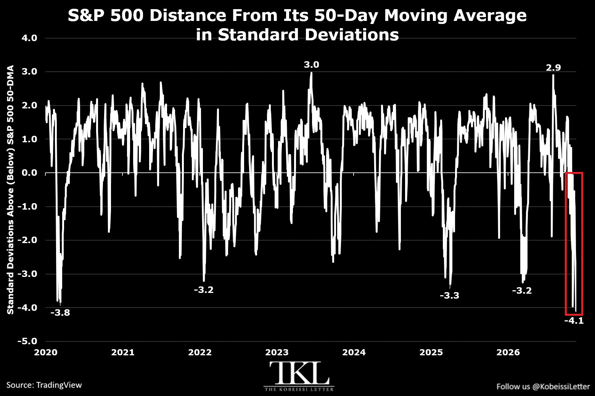

> US stocks have rarely been this oversold:
>
> The S&P 500 closed the week 4.1 standard deviations below its 50-day moving average, its widest deviation since August 2015.
>
> This also marks its 3rd-largest deviation in at least 20 years.
>
> By comparison, during the 2008 Financial Crisis, the index’s largest deviation from its 50-DMA was 3.6 standard deviations.
>
> Not even the 2020 Pandemic crash saw such extreme oversold conditions, with the S&P 500 falling 3.8 standard deviations below its 50-day moving average in February.
>
> During the 2022 bear market and the April 2025 post-"Liberation Day" selloff, the S&P 500 fell 3.2 and 3.3 standard deviations below its 50-day moving average, respectively.
>
> This has been one of the sharpest market sell-offs in history.

See also: 2026-11-18 16:45 — Kobeissi: sentiment acts as though the AI bubble has popped; 2026-11-20 04:04 — Kobeissi: this bear market in tech will be remembered as the best buying opportunity of the last decade.

Tags: #Kobeissi #sentiment #SP500 #oversold #50DMA #technicals #markets

### 2026-11-21 16:51 — Luke's thinking: the disbelief is stunning

Source: Luke, typed into the session at **16:51 London on 21 Nov 2026**. Written as a reply to the Kobeissi oversold/50-DMA post above. Verbatim:

> The disbelief is stunning. Companies are so successful and the market is so forward looking that it invites nothing but the future can only be down. It's like seeing a beautiful woman and imagining she can only get uglier from now.

See also: 2026-11-21 15:20 — Kobeissi: US stocks have rarely been this oversold; S&P 500 4.1σ below its 50-DMA.

Tags: #Luke #lukes-thinking #sentiment #markets

### 2026-11-22 11:53 — David Orr: correlations approaching one, and net exposure matters more than beta in a gap

Source: David Orr (@orrdavid), X, no age or date shown in the copy; the text refers to "this weekend". Posted by Luke as pasted text.

> The last few days in the market, starting Tuesday really, were correlations approaching one / being weird. Those narrow few days are a stronger tell of how someone would do through an event like the GFC than most anything. And I don't think models really help, just your short term pnl right there.
>
> Militia Capital the hedge fund lost a little bit through these few days despite having roughly -.3 beta to the S&P 500. Which makes sense, since I'd always thought (known, really) that our net exposure rather than beta adjusted net exposure is what matters way more during a true gap in the market.
>
> A few weeks ago there was lots of talk about a black monday on here. It didn't happen. This weekend I don't see anyone talking about a black monday again ... but it's quite possible we get a hell of a move. The last time I had this vibe was Aug 2024 for Japan, when I studied Japanese stocks all weekend long planning to buy the dip in various things, even though I had no idea we'd see an actual 1987 type move again.

Claude: This reads as a first-hand account of the same days behind this week's selloff entries, from a fund that was net short and still lost. His point is that in a true gap, net exposure counts and beta-adjusted exposure doesn't, because correlations jump to one. I haven't checked any of it.

See also: 2026-11-11 20:02 — clipping: Max Wiethe (OPM pod) — David Orr / Militia Capital says AI compute is oversupplied; 2026-11-20 17:46 — Walter Bloomberg: AI stocks plunge as the Wall Street selloff accelerates.

Tags: #DavidOrr #MilitiaCapital #correlation #beta #selloff #risk #hedgefund

### 2026-11-22 12:18 — Gavin Baker: no investor feels misled over Nvidia's China sales; the new China policy is riskier

Source: Gavin Baker (@GavinSBaker), X, 7:57 PM · Nov 21, 2026 (time zone not shown), 119.3K views. Posted by Luke as pasted text. It reads as a reply: the closing line speaks to the person he is answering, and the post it answers is not in the copy.

> I don't know a single investor who feels misled. And I know almost all of the large ones personally.
>
> Jensen consistently said beginning in mid/late 2025 that "we are assuming/forecasting China datacenter sales to be zero" and then on the calls Colette would note that approved China datacenter sales were sub 1% of revenue. No one cares abt that differential (forecasting zero vs. sub 1%). Most recent disclosure of $2.4b was more precise but directionally consistent at 2% of quarterly revenue. Also gaming and workstation GPUs are not datacenter GPUs.
>
> And investors understood that SE Asian, European and US clouds/hyperscalers were renting GPUs to Chinese labs from all of those geographies (ie American hyperscalers were renting GPUs to Chinese labs from their SE Asian, European and American availability zones). Which is obviously the most pro-national security policy of all as can literally turn them off in any conflict. This would dramatically curtail China's ability to use AI (need inference capacity) overnight. This gave America arguably more leverage over China than they had over us through rare earths. And our leverage would have grown every year while theirs shrank.
>
> Now Alibaba is saying that Huawei will be at parity (tho way less power efficient but China has loads of power) in a year. Those Huawei systems will undoubtedly make their way to Russia, North Korea and Iran and endanger America due to well-intentioned China Hawks in DC and the media.
>
> Our old policy guaranteed America would always be ahead. New course much riskier imo.
>
> Btw have enjoyed your writing over the years.

**Explainer (Claude's plain-English summary of his argument; his claims, not checked by me).**

- **His main point:** investors in Nvidia were not misled about how much it sells in China. He says he knows almost all the large ones and none feel that way.
- **"Zero versus under 1%":** Jensen Huang said Nvidia's forecasts assumed zero China data-centre sales. The CFO, whom the post calls "Colette", then said approved China data-centre sales were under 1% of revenue. Baker's view is that the gap between "zero" and "just under 1%" is too small for anyone to care about. The latest disclosure, $2.4bn, is more precise but points the same way, at about 2% of quarterly revenue. He adds that gaming and workstation chips are not data-centre chips, so they don't count here.
- **The renting point:** Chinese AI labs were renting Nvidia chips from cloud companies outside China, including American ones, in South-East Asia, Europe and the US. Baker says investors knew this. His argument is that it's good for US security, because the owners of those clouds can switch the chips off in a conflict, which would quickly cut China's ability to run AI. He says that gave America about as much leverage over China as China has over the US through rare earths, and that the US leverage would have grown while China's shrank.
- **What he thinks changes:** Alibaba is now saying Huawei's chips will match Nvidia's within a year. Baker concedes they use much more power, but says China has plenty. He expects those Huawei systems to reach Russia, North Korea and Iran, and he blames well-meaning China hawks in Washington and the media for the policy shift.
- **His conclusion:** the old policy kept America ahead, and the new course is much riskier. He labels that last part his opinion.

See also: 2026-11-20 17:45 — Gavin Baker: articles on Jensen being a tough boss make him optimistic Huang returns soon; 2026-11-20 17:47 — Gavin Baker: fear Nvidia pulls back its investments and backstops is misplaced; rivals want to be AI's "Central Bank".

Tags: #GavinBaker #Nvidia #NVDA #China #Huawei #Alibaba #exportcontrols #nationalsecurity

### 2026-11-22 12:21 — Valuation snapshot: a selection of stocks (close Fri 20 Nov 2026)

Prices are the last regular close from the Yahoo Finance chart API on Friday 20 November 2026 (US cash close 21:00 London; Siemens Energy the Xetra close; DroneShield the ASX close). P/S and P/E are trailing. For eight names, FMP `/stable/ratios-ttm` returned TTM multiples. For the others, and for Alphabet Class C, the multiples are computed as market cap (Friday close × latest diluted weighted-average shares, unless noted) divided by TTM (or latest twelve-month) GAAP revenue and net income attributable to shareholders. P/E is marked n/m where trailing earnings are negative. A star marks a row with a material caveat, explained under the table. Fetched Sunday 22 November 2026, around 12:21 London.

| Ticker | Name | Price | P/S | P/E |
|---|---|---:|---:|---:|
| AAPL | Apple | $342.56 | 10.40 | 38.02 |
| AMAT* | Applied Materials | $302.63 | 7.01 | 23.94 |
| AMZN | Amazon | $246.82 | 3.35 | 19.68 |
| ASML | ASML | $1,266.22 | 11.21 | 32.85 |
| AVGO | Broadcom | $304.41 | 16.70 | 38.88 |
| CRWV | CoreWeave | $39.51 | 2.23 | n/m |
| CSCO | Cisco | $90.64 | 5.34 | 23.92 |
| DDOG | Datadog | $157.37 | 13.79 | 225.24 |
| DRO.AX* | DroneShield | A$1.04 | 3.56 | n/m |
| ENR.DE* | Siemens Energy | €118.32 | 2.32 | 27.08 |
| GLW | Corning | $94.38 | 4.64 | 38.23 |
| GOOG* | Alphabet | $264.00 | 6.93 | 13.88 |
| GTLB | GitLab | $43.17 | 6.90 | n/m |
| HOOD | Robinhood | $62.17 | 9.69 | 28.26 |
| INTC | Intel | $51.28 | 4.55 | n/m |
| KLIC | Kulicke & Soffa | $54.71 | 2.47 | 16.01 |
| MSFT | Microsoft | $484.52 | 10.39 | 25.24 |
| NET | Cloudflare | $274.96 | 35.93 | n/m |
| NVDA | Nvidia | $125.53 | 8.36 | 13.43 |
| PH | Parker-Hannifin | $871.86 | 4.97 | 29.91 |
| RKLB | Rocket Lab | $45.42 | 33.59 | n/m |
| RYCEY* | Rolls-Royce | $16.41 | 4.53 | 34.54 |
| SMCI* | Super Micro | $21.65 | 0.30 | 4.92 |
| SPCE* | Virgin Galactic | $1.04 | 143.33 | n/m |
| TSLA | Tesla | $345.82 | 13.20 | 349.31 |
| TT | Trane Technologies | $386.29 | 3.68 | 27.15 |

**Sources.** Yahoo chart API for Friday closes and for EURUSD (1.0970) and GBPUSD (1.3086) used to convert euro and sterling accounts. FMP `/stable/ratios-ttm` for AAPL, AMZN, CSCO, HOOD, INTC, MSFT, NVDA and TSLA. SEC EDGAR companyfacts (10-Q/10-K XBRL, last four contiguous quarters) for AVGO, CRWV, DDOG, GLW, GOOG, GTLB, KLIC, NET, PH, RKLB, SMCI, SPCE and TT. Applied Materials from the 12 Nov 2026 Item 2.02 8-K Exhibit 99.1 (FY2026 GAAP; the 10-K is not yet in companyfacts). ASML from the 14 Oct 2026 Form 6-K US GAAP statements (Q3 2026) plus the Q4 2025 6-K/20-F, with ADS 1:1. Siemens Energy from the 11 Nov 2026 preliminary FY2026 earnings release (year ended 30 Sep 2026). Rolls-Royce from the official FY2025 results (26 Feb 2026) and H1 2026 results (30 Jul 2026); the ADR (RYCEY) is 1:1 with the London ordinary share. DroneShield from FY2025 and H1 2026 statutory results; LTM is FY2025 + H1 2026 − H1 2025.

**n/m.** Intel, CoreWeave, GitLab, Cloudflare, Rocket Lab, DroneShield and Virgin Galactic have negative trailing net income, so P/E is n/m.

**Low-confidence and other caveats (*).**
- **AMAT:** GAAP figures are from the earnings 8-K, not the FY2026 10-K XBRL (not filed at the time of the 8-K).
- **DRO.AX:** LTM is constructed from annual and half-year statutory figures. The share count is 924.1m basic shares outstanding at 30 Jun 2026, not a diluted weighted average.
- **ENR.DE:** Preliminary results. Diluted shares (865.7m) are implied from attributable net income of €3,783m divided by the rounded diluted EPS of €4.37; basic WASO is stated as 851.325m.
- **GOOG:** Market cap uses the Class C close times diluted shares of all classes (the GOOGL close that day was $265.29). GAAP TTM earnings include very large Q2 2026 investment gains, so 13.88x is not a clean operating P/E.
- **RYCEY:** Statutory LTM earnings of £3,038m are depressed by the comparison with H1 2025, when attributable profit was £4,416m against £1,613m in H1 2026, because of large non-underlying items.
- **SMCI:** Diluted WASO is 749.4m, but shares outstanding at 31 Oct 2026 are 659.2m, so the market-cap convention moves the multiples a long way.
- **SPCE:** TTM sales are only about $1.1m, so the 143x P/S is not a useful multiple.

Smaller notes: Broadcom and Parker-Hannifin net income uses the ProfitLoss tag because the attributable-to-common tag was stale or incomplete (Parker's difference looks de minimis). Datadog, CoreWeave, GitLab and Cloudflare market caps use diluted WASO because a usable current outstanding figure was missing or stale in companyfacts. GitLab's TTM ends 31 Jul 2026; a later quarter had not appeared in companyfacts at the time of the pull. ASML's 383.5m Q3 diluted share count is after large 2026 buybacks.

Tags: #valuation #PE #PS #markets #stocks

### 2026-11-23 08:45 — François Chollet: either the AI buildout is over, or this is a rare buying opportunity (quoting Trade Whisperer and Elon Musk)

Source: François Chollet (@fchollet), X, Nov 21 (time not shown in the copy), quote-posting Trade Whisperer (@TradexWhisperer, Nov 21), whose post embeds Elon Musk (@elonmusk, Nov 21). Posted by Luke as pasted text. Chollet's post is cut off in the copy at "Show more"; the "Quote" label is page chrome and removed.

> Either you believe the AI buildout is over, that AI was a flash in the pan, and that the need for compute has already peaked... or this a rare buying opportunity.
>
> Reminder: GPU spot prices keep rising and it's hard to secure capacity. HBM and DRAM production is effectively sold

Quoted post (Trade Whisperer @TradexWhisperer · Nov 21):

> WTF
>
> $SNDK 2.2x
> $SKHY 2.6x
> $MU 2.8x
>
> Sandisk can buy back half its market cap in JUST 12 MONTHS.
>
> $COST is 44x for hot dogs and bulk toilet paper.

Embedded in that post (Elon Musk @elonmusk · Nov 21):

> Getting this amount of compute turned on, cooled and working reliably is incredibly hard.
>
> The cash shortage is also going to be nuts next year. Even cumulative industry delays of a few months between paying for compute and getting it reliable enough to generate revenue will mean hundreds of billions of incremental dollars just for working capital. Where will that come from?

Claude: Musk's working-capital point, a delay between paying for compute and earning revenue from it, is the same gap the CRWV model shows, where the keep-building path is funded by lenders and prepayments. I haven't checked the multiples quoted for SNDK, SKHY and MU.

See also: 2026-11-20 17:56 — Dan Ives: seven causes of the sell-off, but the $4tn AI buildout is still happening; 2026-11-17 21:43 — Kobeissi: Nvidia Q3 proves the AI buildout is accelerating.

Tags: #FrancoisChollet #TradeWhisperer #ElonMusk #AI #compute #capex #memory #SNDK #MU

### 2026-11-23 10:00 — lifcc (reposted by Wenming Ye): Intel's new 350W card vs Nvidia's RTX PRO 6000 Blackwell, 5.9x on FP64 and 480GB of memory

Source: lifcc (@mylifcc), X, Nov 21, reposted by Wenming Ye; the post is marked "Translated from Chinese" (the translation is the platform's, not Luke's). Posted by Luke as pasted text.

> Intel just released official benchmark results claiming a "350W new card crushes Nvidia's 600W RTX PRO 6000 Blackwell, with performance up to 5.9x faster."
>
> My first reaction to the headline was: Has Intel lost its mind, or had one too many drinks?
> But after digging through the test report and the fine print in the appendix, I found this move was both cunning and a genuine gut punch to Jensen:
>
> 1. How did they get that 5.9x? By going straight for the 1:64 Achilles' heel Jensen deliberately built in
> Every benchmark where Intel showed a 5.9x lead uses double-precision floating-point (FP64) workloads from quantitative finance on Wall Street (European Monte Carlo option pricing 5.9x, Black-Scholes 5.6x, binomial tree pricing 4.6x).
> Why such a huge gap? To protect the sky-high profits on the B200 / H200, Jensen crippled the FP64 double-precision performance of the workstation flagship RTX PRO 6000 Blackwell to 1:64; Intel's D270 (Xe3P architecture), meanwhile, offers full-speed native FP64 (64 FP64 FMA units per core).
> Even more devious is the fine print in the appendix at the end of the report: Intel's test machine had 1 D270 + 3 Arc Pro B70 cards installed, while the Nvidia machine had 8 RTX PRO 6000 cards, but the fine print never says how many cards were actually enabled for the financial benchmarks.
>
> 2. Switch to LLM inference, and the real efficiency numbers actually hold up
> Set aside the FP64 horse-trading, and put a single card to work running Qwen3-30B-A3B (FP8): the D270 delivers 1.12x the output throughput of the RTX PRO 6000 Blackwell and 29% lower latency on Drex 2.0.
> The 5.9x headline claim is gone, but don't forget power consumption: 350W versus 600W, using a little over half the power, it beats the top-spec Blackwell workstation card head-to-head on a 30B MoE model.
>
> 3. What really makes local LLM enthusiasts drool is the memory: up to 480GB per card
> Jensen is stingy with memory capacity: a single 600W RTX PRO 6000 gets just 96GB of GDDR7.
> This time, Intel isn't even trying to compete for expensive, scarce HBM. Instead, it's stuffing LPDDR5X onto a 350W air-cooled PCIe card: the reference design starts at 160GB (1.5 TB/s bandwidth), while custom board-partner versions go all the way up to 480GB per card.
>
> What does it mean to cram 480GB of memory into a single air-cooled PCIe card? The full-size weights of enormous models that used to require a whole rack of cards or an insanely expensive cluster can now fit entirely on one 350W card. At SC26, Intel has already teamed up with SambaNova on a new approach: use the D270's massive memory to handle the Prefill (prefill) stage for the enormous context windows of large models, then hand it off to the high-bandwidth SambaNova SN50 to spit out tokens.
>
> If Jensen keeps surgically cutting memory capacity, that juicy slice of the inference market really could be pried away by these "LPDDR5X memory-stuffing monsters."

Claude: The author's own breakdown shows the 5.9x headline comes from FP64 finance workloads where Nvidia's workstation card is deliberately throttled, and the single-card LLM result is a much smaller 1.12x. I haven't checked any figure against Intel's report.

See also: 2026-11-20 17:47 — Gavin Baker: fear Nvidia pulls back its investments and backstops is misplaced; rivals want to be AI's "Central Bank".

Tags: #lifcc #WenmingYe #Intel #INTC #Nvidia #NVDA #inference #memory #LPDDR5X #SambaNova

### 2026-11-23 15:04 — The White House: Trump welcomes the Nvidia board's decision to return Jensen Huang as CEO

Source: The White House (@WhiteHouse), X, posted 34m before it was copied (no date shown). Posted by Luke as pasted text. The quote is attributed in the post to President Donald J. Trump.

> "The NVIDIA Board of Directors has made the correct and proper decision to return Jensen Huang to the position of CEO… Congratulations to Jensen, the NVIDIA Board, to the People of the United States — and, indeed, the World!" - President DONALD J. TRUMP

Claude: This is a political reaction, not Nvidia's own announcement, so the board's statement and any terms or timing are not in this copy; I haven't seen them or checked that the decision has been announced as the post says. If so, it closes the thread that opened with the 13 Nov resignation.

See also: 2026-11-20 17:45 — Gavin Baker: articles on Jensen being a tough boss make him optimistic Huang returns soon; 2026-11-17 16:04 — Kobeissi: Huang says he would return as Nvidia CEO if the board asks; 2026-11-15 17:50 — Dan Ives: no chance Jensen returns; CEO shortlist.

Tags: #WhiteHouse #Trump #JensenHuang #Nvidia #NVDA #CEO #leadership

### 2026-11-23 15:58 — Kobeissi: S&P 500 +5.3% on the day, +$3.5T market cap

> BREAKING: The S&P 500 extends gains to +5.3% on the day, now on track for its biggest daily gain since April 2025.
>
> The US stock market has now added +$3.5 trillion in market cap today.

— The Kobeissi Letter (@KobeissiLetter), 23 Nov 2026 15:58 London. [Source](https://x.com/KobeissiLetter/status/2124895247121654238)

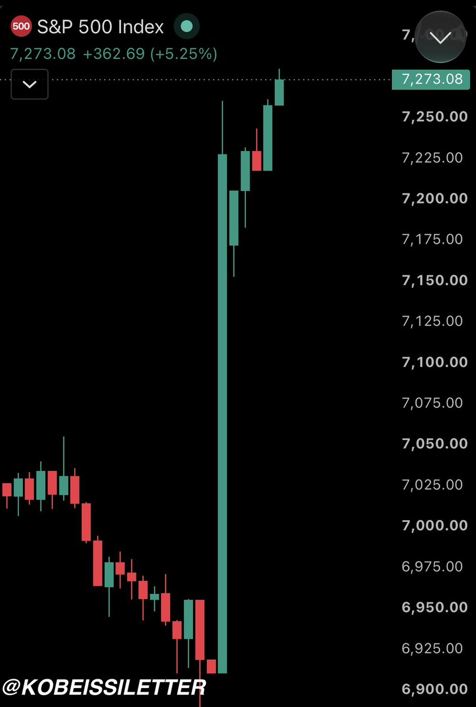

Context: comes one trading day after the 21 Nov "4.1 standard deviations below 50-day MA" oversold post and the 20 Nov "best buying opportunity" post (both above).

Tags: #markets #sp500 #sentiment #rally

### 2026-11-23 18:08 — Nasdaq Composite +6.19% (screenshot)

Screenshot shared by Luke: NASDAQ Composite 24,016.665, +1,398.932 (+6.19%), real-time quote at 9:38 AM EST. The one-month chart shows the index bouncing from about 22,600 on 20 Nov, its low for the month, after falling from a peak near 26,500 in late October.

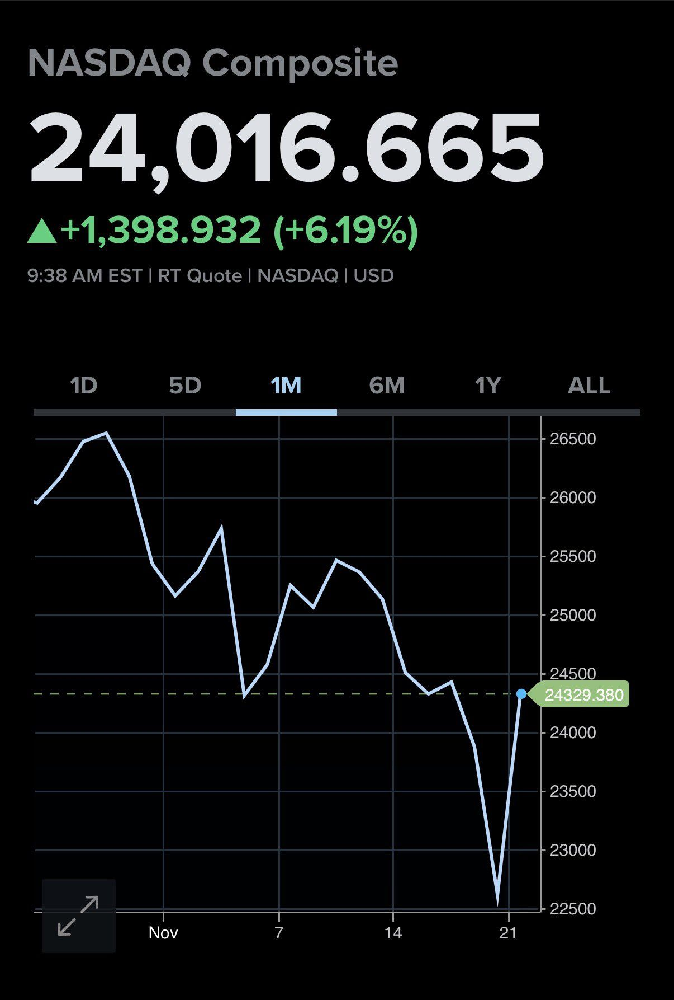

Tags: #markets #nasdaq #rally

### 2026-11-23 21:10 — Chart: AI performance in human-judged domains

Chart shared by Luke (original poster not attributed in the screenshot). Title: "AI performance in human-judged domains — professional work · creative writing · website design". Four panels plot model scores against release date, with a trend fit on each:

- **GDPval** (professional comparisons won or tied, 12 configurations, linear fit): from GPT-4o at 12.3% (Dec 2024) to GPT-5.2 Pro at 74.1% (Dec 2025).
- **Remote Labor Index** (projects meeting the professional reference, 22 configurations, exponential fit): from Opus 4.5 at 3.75% (late 2025) to Fable 5.2 at 41.25% (late 2026).
- **Arena creative writing** (style-controlled human preference rating, 125 configurations, linear fit): from GPT-4 at 1,255 (2023) to Fable 5.2 at 1,529.
- **DesignArena websites** (human preference Elo, 61 configurations, linear fit): from Kimi K2.5 at 1,236 (early 2026) to Muse Wonder at 1,368.

Chart footnotes: the sources are OpenAI / ICLR GDPval, Scale RLI, Arena's official dataset and DesignArena Website, with snapshots from Nov 2026. Lines are descriptive least-squares fits, and each panel has its own scale.

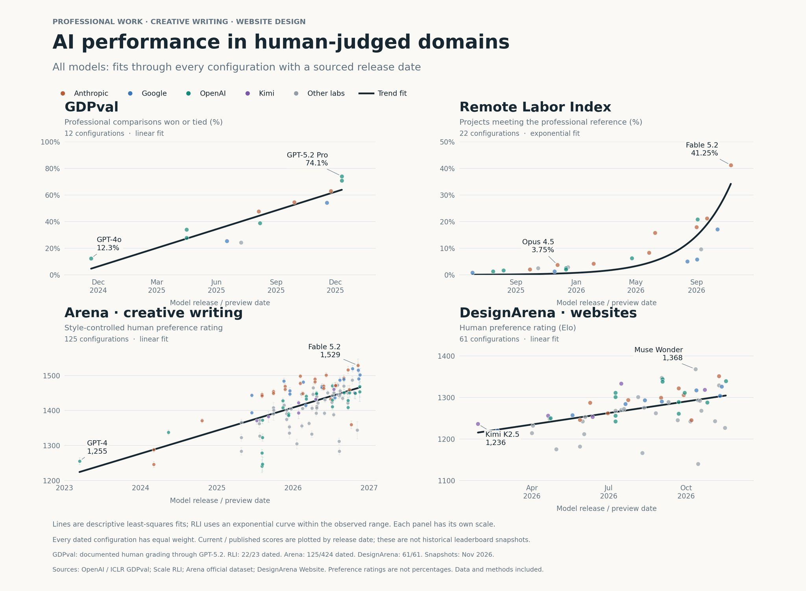

Tags: #ai #benchmarks #capabilities #labor

### 2026-11-23 21:38 — Clara Collier, "After Work, We'll Have Each Other" (Asterisk, Issue 15)

Summary shared by Luke. Source article: Clara Collier (Editor-in-Chief, *Asterisk Magazine*), "After Work, We'll Have Each Other", Asterisk Issue 15: Work, published 1 Sep 2026. [Article](https://asteriskmag.com/issues/15/after-work-we-ll-have-each-other)

> Clara Collier examines what human society might look like if artificial intelligence automates all economically necessary labor, leaving human connection—or the "relational sector"—as our primary source of structure, status, and meaning. Rather than ushering in a utopian era of pure self-actualization, Collier argues that a post-work society would likely revive the claustrophobic social dynamics of pre-industrial cultures.
>
> Drawing on historical and sociological case studies—including 18th-century European aristocrats at Versailles, 1980s upper-class Midwestern philanthropists, and 1950s Italian-American "urban villagers" in Boston—she demonstrates that when people do not derive dignity from impersonal work, they derive it entirely from group membership and social standing. Consequently, purely relational societies tend to become clannish, conformist, exclusionary, and obsessed with gossip, status defense, and policing behavior.
>
> Ultimately, Collier defends the modern work ethic and commercial society. Echoing Scottish Enlightenment thinkers like Adam Smith and David Hume, she concludes that impersonal labor liberates individuals from transactional dependence on family, clan, or patronage—allowing people to earn respect through individual skill while freeing personal friendships to exist purely out of genuine affinity.

Related: the "relational sector" term comes from Alex Imas's essay "What Will Become Scarce". Compare with Luke's MISTER C framing of scarcity (Consciousness/attention) and the open question of whether people value human attention over AI attention.

Tags: #ai #labor #post-work #society #scarcity

### 2026-11-23 21:44 — Historical analogue: the 1998–1999 tech capex boom

Clip shared by Luke (no source given):

> The 1998–1999 Tech Capex Boom: Yields rose sharply alongside massive corporate debt issuance for telecommunications and internet infrastructure. Equities continued rallying despite higher yields because productivity growth and earnings expectations outpaced interest rate headwinds—until monetary policy tightened enough to invert the yield curve.

Context: relevant to today's AI capex cycle, the long-end yield spikes logged earlier this autumn (10Y above 5.20%, 30Y above 5.60%) and the November drawdown and rebound. The signal it points to is yield-curve inversion from Fed tightening, not higher yields alone.

Tags: #macro #rates #capex #ai #dotcom #analogue

### 2026-11-23 22:40 — Friends' chat: AI bubble, picks-and-shovels, founders cashing out

Private group chat between two of Luke's friends (anonymised as A and B), 23 Nov 2026, 22:40–23:07 London, verbatim:

> **A:** More shenanigans today in the reality TV world of the USA
> **B:** What happened
> **A:** A personality cult catapaulted a companies value by over $1bn. If there's ever evidence that AI is a bubble - thats it
> **A:** Sorry $1tn
> **A:** Remember the days when $1bn was a lot of money
> **A:** Not in reality TV USA
> **B:** You mean Jensen being re hired
> **B:** To be fair, he is Nvidia
> **B:** Like if you took Elon out of space x
> **A:** I'm pretty sure they are established enough to survive. What happens when he retires, they drop 40% in value again?
> **B:** The market will have folded by then
> **A:** Both hold monopolies but i think Elon does some weird shit that drives innovation so I'll give him a pass compared to a company that designs chips
> **A:** Fr
> **B:** The IPOs are needed to pay Nvidia's accounts receivables
> **A:** So value circulating around the industry rather than generating real cash
> **B:** I'll sell you all my shovels to mine your gold, but the small amount of gold you mined isn't generating the cash to pay for my shovels so you sell shares in your gold company to the punters promising that you're going to hit the worlds biggest ever vein of gold any time now
> **B:** Then the Chinese find it first and your gold mining firm collapses
> **B:** I'm paid but the punters have lost
> **A:** What interests me is the gold miners. They're raising money on speculation but clearly those at the top are not going to lose their shirts so where does it end for them? When do people like Altman and Amodi check out?
> **B:** IPO cashes them out
> **B:** Lets the plebs take the risk
> **A:** Have those guys cashed in or just diluted their share?
> **B:** Apparently coreweave, the three founders have sold 3bn of their stock holding each
> **A:** Thats enough to not have to worry, I guess
> **B:** Luke will have the analysis of what the cash raised is going to
> **B:** Probably paid for more shovels
> **A:** I can imagine immediately cashing in on IPO drives the floatation value down
> **A:** The shovel companies are just meme stocks now. Surely eyes are on the end user beneficiaries of AI - robotics (defence) and healthcare
> **A:** If we survive AGI
> **A:** (Notice how i completely ignore the miners)
> **B:** I think the picks and shovel companies are the ones winning atm as their tech has barriers to competition, will be needed regardless of who wins the AI race
> **B:** AI companies have not protection beyond their models
> **B:** And people flip between them
> **B:** So anthropic and open AI may fall away
> **B:** Whomever is next will still need their picks and shovels if the tech continues
> **A:** I suspect as things heat up the commodities fuelling the shovel producers are going to fall into the spotlight again
> **A:** Rare earths, minerals etc.
> **B:** Energy will be a big one
> **B:** Don't think in the us the have enough cables and pilons to deliver the energy to the data centres being built
> **B:** In the uk we don't have either that or the water
> **A:** Our grid is shot
> **A:** SMR's are the future
> **A:** [shared a YouTube Short](https://youtube.com/shorts/k7eoSv8lwvg)

Themes: Nvidia key-person risk (Jensen), vendor financing and circularity (the IPOs fund Nvidia receivables), founders cashing out at IPO (claim: CoreWeave's three founders sold ~$3bn each, unverified), AI labs having no moat beyond their models compared with picks-and-shovels moats, and the next bottlenecks (rare earths, energy, grid, water, SMRs). The CoreWeave founder-sales question ties to the pending CRWV Q3 10-Q work.

Tags: #ai #bubble #nvda #crwv #picks-and-shovels #energy #sentiment

### 2026-11-24 16:01 — Harj Taggar: AI-pilled engineering teams (reposted by Paul Graham)

> I think the number of truly AI-pilled engineering teams is still quite low, even amongst startups. You'll be able to spot them by how quickly they build multiple successful adjacent products after finding PMF with the first. They'll condense years of product expansion into months. It'll take getting used to in the same way it took time to get used to AI startups reaching $100m ARR within a year.

— Harj Taggar (@harjtaggar, Y Combinator), 24 Nov 2026 16:01 London. [Source](https://x.com/harjtaggar/status/2125258451777384846)

Tags: #ai #startups #productivity #engineering

### 2026-11-24 16:59 — Bill Gurley on the Anthropic IPO trading below its offer price

> People weren't scrambling to actually own Anthropic. They have become accustomed to the one day IPO give-away & they would all like free money (but of course). Thats why they beg for allocation. And yes it's cheaper now.

— Bill Gurley (@bgurley), 24 Nov 2026 16:59 London. [Source](https://x.com/bgurley/status/2125273075042377854). He is quoting Sheel Mohnot (@pitdesi), 15:46 London: "If you missed out on the Anthropic IPO, you now have the chance to get in at a discount!" The quoted post's chart shows ANT at $78.33. [Quoted post](https://x.com/pitdesi/status/2125254799692267912)

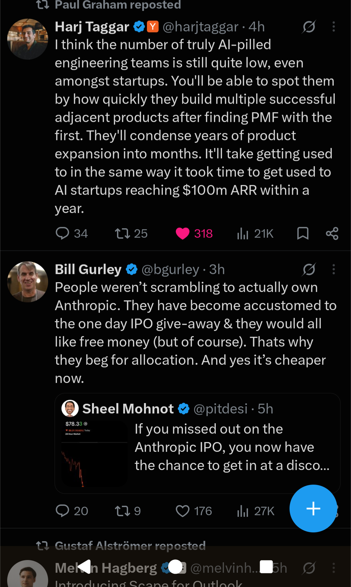

Related: ant/ folder (S-1 dilution and valuation model).

Tags: #ant #anthropic #ipo #allocation #sentiment

### 2026-11-24 19:30 — Niall Ferguson shares Manny Rincon-Cruz: "The Secret of Anthropic's IPO: You Bought the Top"

> "The Secret of Anthropic's IPO: You Bought the Top." Smart analysis from @mrinconcruz

— Niall Ferguson (@nfergus), 24 Nov 2026, about 19:30 London. [Source](https://x.com/nfergus/status/2125309568863654006). Essay by Manny Rincon-Cruz (historian, Ken Griffin Fellow at the Hoover Institution, Stanford; founder of @buttondefi and Four Winds Research). [Essay](https://prior-knowledge.ai/essays/the-secret-of-anthropics-ipo/)

Summary of the essay as shared by Luke (verbatim):

**Core Thesis & Market Timing**

- Anthropic's IPO signals the turn: Going public removes the ability to postpone scrutiny of how AI capabilities convert into sustainable value and profits, marking the start of the end of the AI trade.
- Market peak & pullback context: Rincon-Cruz notes the Nasdaq appears to have already peaked, with the S&P 500 down 12%, the Nasdaq down 18%, NVIDIA down nearly 50% from a nearly $6 trillion peak (before recovering somewhat after Jensen Huang returned as CEO), and Anthropic (ANT) IPO'ing at $83, rising to $111, and falling back toward its IPO price.
- Beware of "copium": Investors rationalize sharp drawdowns using narratives like oversold multiples, leadership changes, long-term transformational impact, or comparisons to Amazon's early losses—even as Anthropic's operating profits flipped from Q2 to a Q3 loss.

**Secrets, Sociology, and Bubble Dynamics**

- Secret and convention flip in bubbles: Drawing on Peter Thiel's Zero to One, Rincon-Cruz argues that during normal times ambitious plans rely on hidden truths, whereas inside a bubble the ambitious vision (such as a $10 trillion company curing cancer or automating all work) becomes convention, and the boring vision becomes the taboo secret.
- Why skepticism is penalized: Four sociological forces—incrementalism, risk-aversion (Keynes's "fail conventionally"), complacency, and egalitarianism—combine with FOMO and career/fund-flow pressures to keep market participants aligned with consensus hype.
- Status games & "priestly" jargon: Because many commentators lack deep technical grounding, they rely on dramatic frontier narratives and San Francisco social proximity to appear "in the know," making skepticism feel low-status—much like ignoring subprime mortgage risks before 2007.

**Curves, Historical Parallels, and Macro Fallout**

- Capabilities vs. profits ($10T vs. commoditization): Sustaining a $10 trillion valuation requires widening capability leads, compounding value from later adopters, and concentrated profit capture by the top player, rather than rivals catching up, diminishing marginal value, and profits splitting across competitors.
- The AT&T Wireless parallel: Like AT&T Wireless (AWE), which held a record $10.6 billion IPO on April 26, 2000 shortly after the Nasdaq peaked and later fell nearly 90% over two years before being acquired by Cingular for roughly half its IPO valuation, Anthropic could face post-IPO pressure, talent flight, or eventual acquisition by hyperscalers.
- Capex gap and recession risk: Citing David Cahn's estimates ($3 trillion needed to pay back capex to date and $1.5 trillion for 2026 alone) against roughly $100 billion in combined 2026 revenue for Anthropic and OpenAI—alongside Goldman Sachs (half of S&P 500 earnings growth) and Apollo Global Management (3% of GDP)—the essay warns that repricing across labs, neoclouds, data vendors, and startups could trigger a severe recession and leave retail buyers holding losses.

Context: ANT closed 24 Nov at $81.91 (Yahoo), below the essay's $83 IPO price, with an intraday low of $75.61. Compare with the Gurley clip above, the 1998–99 capex-boom analogue (23 Nov) and the ant/ folder.

Tags: #ant #anthropic #ipo #bubble #ai #capex #sentiment #analogue

### 2026-11-24 22:34 — Luke's thinking: on the Rincon-Cruz essay

> Seems like a bear declaring victory at the bottom of a correction. The demand for tokens will not abruptely end today, now. There're billions of AI users to onboard.

Tags: #ant #luke-thinking #ai #demand

### 2026-11-25 08:49 — LiveSquawk: Dell Q3 FY27 results beat, Q4 guide above estimates, extra $25B buyback

Source: LiveSquawk (@LiveSquawk), X, about 11 hours before posting (24 Nov 2026 evening UK). Posted by Luke as pasted text.

> DELL
> $298.10
>   | Dell Technologies Q3 27 Earnings:
>
> • Rev: $54.94B (est $49.32B)
> • Adj EPS: $9.45 (est $6.59)
> • Sees Q4 Rev: $56.3B (est $53.61B)
> • Sees Q4 Adj EPS: $8.40 (est $7.50)
> • Authorises Additional $25B Share Buyback

Claude: Dell's row in the 24 Nov screening table is a quarter behind: it uses the quarter to 31 Jul (revenue $47.0bn, +58% on a year earlier), so the $54.94B here would be the newer quarter. The $298.10 is a cashtag price from the post, which this repo treats as unreliable (see Known Gotchas), and I haven't checked either figure against the filing.

Tags: #LiveSquawk #DELL #earnings #guidance #buyback #ai-servers

### 2026-11-25 08:55 — Kobeissi Letter: CIA and ODNI hacked, per NYT

Source: The Kobeissi Letter (@KobeissiLetter), X, about 12 hours before posting (24 Nov 2026 evening UK). Posted by Luke as pasted text.

> BREAKING: The CIA and the Office of the Director of National Intelligence have been hacked, exposing unclassified intelligence information, per NYT.
>
> The incident follows reported breaches involving the FBI and USDA.
>
> It also follows several outages in US government systems.

Tags: #KobeissiLetter #cyber #hack #CIA #government #security

### 2026-11-24 19:19 — Ian Bremmer quoting Mitt Romney on AI regulation and chip sales to China

> mitt on the money:

— Ian Bremmer (@ianbremmer), 24 Nov 2026 19:19 London. [Source](https://x.com/ianbremmer/status/2125308260198854996)

> Let me get this straight: we rushed AI along without regulating safeguards in order to stay ahead of China and at the same time, we sold China the very chips they'd need to get ahead of us. Smells of profit, corruption and perhaps worse.

— Mitt Romney (@MittRomney), 24 Nov 2026 14:19 London. [Quoted post](https://x.com/MittRomney/status/2125232847396983273). About 1.95M views and 70k likes when filed.

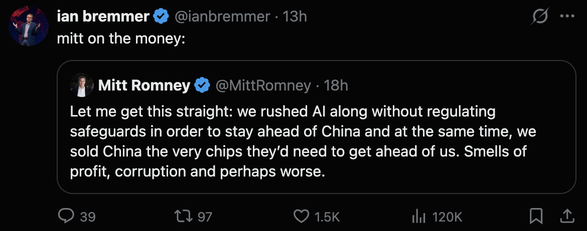

Tags: #politics #china #export-controls #NVDA #ai-regulation

#### Luke's thinking (25 Nov 2026, 09:13 London), on the Romney clip above

> So my issue with this is that there are two different takes. Is that one of them is that the Americans should be selling American chip technology to the Chinese because it keeps the Chinese dependent on American technology and not pressured to rapidly develop their own. the second thing of the cost is that there is the whole race thing is kind of made up. And thirdly, the actual thing that is the bottleneck is the energy. That if you're using a chip that's not quite so good you just need more of them, and they can do more of them because they have more energy.

Tags: #luke-thinking #china #export-controls #energy #NVDA

### 2026-11-25 13:47 — Charlie Bilello: core PCE 3.3% in October, highest in three years

> The Fed's preferred measure of inflation (Core PCE) moved up to 3.3% in October, its highest level in three years. This was the 68th consecutive month above the Fed's 2% target. Another 25 bps rate hike is coming on December 9, moving the Fed Funds Rate up to 4.00-4.25%.

— Charlie Bilello (@charliebilello), 25 Nov 2026 about 13:47 London. [Source](https://x.com/charliebilello/status/2125587042197238002)

Tags: #macro #inflation #PCE #fed #rates

### 2026-11-25 13:38 — Kobeissi: FinCEN cybersecurity breach

> BREAKING: The US Financial Crimes Enforcement Network (FinCEN) has suffered a cybersecurity breach, resulting in unauthorized access to a "limited subset" of its systems, per a US government official.
>
> FinCEN oversees some of the US government's most sensitive financial intelligence, including reports of suspicious banking activity.

— The Kobeissi Letter (@KobeissiLetter), 25 Nov 2026 13:38 London. [Source](https://x.com/KobeissiLetter/status/2125585039320646034)

Tags: #cybersecurity #FinCEN #treasury #banking

### 2026-11-25 ~13:34 — LiveSquawk: US data dump (core PCE, income/spending, Q3 GDP second estimate, jobless claims)

> US Core PCE Price Index (M/M) Oct: 0.3% (est 0.3%; prev 0.3%)
> - Core PCE Price Index (Y/Y): 3.3% (est 3.2%; prev 3.1%)
> - PCE Price Index (M/M): 0.3% (est 0.3%; prev 0.5%)
> - PCE Price Index (Y/Y): 3.8% (est 3.8%; prev 3.6%)

[Source](https://x.com/LiveSquawk/status/2125583787434397840)

> US Personal Income (M/M) Oct: 0.7% (est 0.4%; prev 0.2%; prev R 0.3%)
> - Personal Spending (M/M): 0.3% (est 0.4%; prev 0.5%; prev R 0.6%)
> - Real Personal Spending (M/M): 0.0% (est 0.1%; prev 0%; prev R 0.1%)

[Source](https://x.com/LiveSquawk/status/2125583803855073779)

> US GDP Annualised (Q/Q) Q3 S: 4.3% (est 3.5%; prev 3.4%)
> - Personal Consumption: 4.2% (est 3.9%; prev 3.8%)
> - GDP Price Index: 1.9% (est 2.3%; prev 2.3%)
> - Core PCE Price Index (Q/Q): 2.5% (est 2.5%; prev 2.5%)

[Source](https://x.com/LiveSquawk/status/2125583818568667443)

> US Initial Jobless Claims Nov 21: 189K (est 200K; prev 203K; prev R 202K)
> - Continuing Jobless Claims: 1697K (est 1740K; prev 1763K; prev R 1792K)

[Source](https://x.com/LiveSquawk/status/2125583837963112527)

— LiveSquawk (@LiveSquawk), 25 Nov 2026 about 13:34 London. See the Bilello core PCE clip above.

Tags: #macro #LiveSquawk #PCE #inflation #GDP #jobless-claims #consumer

### 2026-11-24 — unusual_whales: SpaceX and Tesla name five directors for merger talks (FT)

> BREAKING: SpaceX and Tesla have named five directors to lead their merger talks, per the FT.
>
> Morgan Stanley and Goldman Sachs are advising SpaceX, and Evercore is advising Tesla. Bloomberg reported a deal could come as soon as December.

— unusual_whales (@unusual_whales), 24 Nov 2026. [Source](https://x.com/unusual_whales/status/2125197624244687180)

Context: the coord board TSLA–SpaceX item (#59) notes the FT also called the all-stock deal "not close", with no 8-K, proxy or agreed exchange ratio yet. The next trigger is the SpaceX lock-up expiry on 8 Dec.

Tags: #TSLA #SpaceX #M&A #merger

### 2026-11-25 14:00 — 루팡 (@DrNHJ): memory comments from Dell's FY27 Q3 earnings call (translated from Korean)

Source: 루팡 (@DrNHJ), X, about 14 hours before posting, translated from Korean; reposted by Raging Capital Ventures. Posted by Luke as pasted text.

> Memory-related comments from Dell’s (DELL $278.63) FY27 Q3 earnings call
>
> MU $580.89, SKHY $104.62, Samsung, SNDK $579.69
>
> No signs of falling prices for server DRAM or enterprise NAND in 2027.
>
> Supply shortages driven by expanded HBM production and structural demand growth from the spread of agentic AI will continue.
>
> 1. 2027 memory price and supply outlook
>
> • Looking at the current supply situation and future outlook, there are no signs whatsoever that enterprise NAND or server DRAM prices will fall.
> • Demand for these memory products far outstrips supply.
> • As more DRAM wafer production capacity is allocated to HBM production for GPUs, supply of other types of memory is being sacrificed.
> • This supply shortage is expected to persist through 2027.
> • Memory price growth in 2027 will not be as high as in 2026, but it will still be a market where prices rise.
> • Because prices have already risen sharply, even if the rate of increase slows, the absolute increase in costs customers have to bear will be substantial.
>
> 2. Supply-demand imbalance to worsen further in 2027
> • AI demand is sustainable, and no slowdown has been observed.
> • We expect infrastructure demand to outstrip supply by an even wider margin in 2027 than in 2026.
> • AI server backlog of $132.3B, with $180B in new orders over the past four quarters.
> • No customers have changed their order schedules to date, and the backlog is very firm.
> • Most new AI server orders are based on NVIDIA Vera Rubin NVL72. NVDA $147.35
> • With supply constraints persisting, we are prioritizing supply for servers and storage over PCs.
>
> 3. Structural increase in DRAM and NAND per server
> • General server unit shipments declined, but the semiconductor capacity installed in each server increased significantly.
> • Total CPU cores shipped in the third quarter increased compared with both the previous quarter and the same period last year.
> • DRAM bits per server also increased compared with both the previous quarter and the same period last year.
> • Storage capacity installed in servers also increased compared with both the previous quarter and the same period last year.
> • This is not simply price inflation. The actual amount of semiconductors installed is increasing.
> • A 17th-generation server can replace roughly seven older servers, while an 18th-generation server can replace 12–14 14th-generation servers.
> • Even if server unit shipments decline, the shift toward high-performance servers with more CPU cores, DRAM, and NAND is expected to continue.
>
> 4. Strong server purchasing demand despite rising memory prices
> • Customers are still spending their budgets on server purchases. We are not aware of any customers waiting on the sidelines for server purchases.
> • Inflation has effectively wiped out the sub-$3,000 low-end server market. This market previously accounted for roughly 20% of total server unit shipments and about 2% of revenue.
> • Rising memory prices mean fewer servers can be purchased, but the performance and processing power of new servers have improved significantly.
> • Companies are deferring PC replacements while concentrating their budgets on servers and storage.
> • This trend is expected to continue into 2027.
>
> 5. Agentic AI, CPU servers, and expanding memory TAM
> • General server and networking revenue of $15B (+235% YoY).
> • Q1 $8.5B → Q2 $10.5B → Q3 $15B.
> • Q4 general server revenue growth guidance of +137%.
> • CPU servers for agentic AI and inference are the fastest-growing segment of the general server business by a wide margin.
> • The average selling price of servers for agentic AI and inference is roughly twice that of traditional enterprise servers.
> • Running AI agents’ harnesses—including containers, sandboxes, I/O management, and orchestration—is a CPU-centric task.
> • As agentic AI evolves into recursive learning, additional computing demand will emerge.
> • Most companies are still at the proof-of-concept and early AI adoption stages, so the opportunity for widespread adoption of agentic AI lies ahead.
>
> 6. Structural explosion in NAND and storage demand
> • Storage revenue of $4.9B (+24% YoY).
> • Demand for unstructured data storage for AI has grown by triple digits for three consecutive quarters.
> • Demand for Dell’s own IP storage has grown for seven consecutive quarters.
> • PowerStore has grown by double digits or more for 10 consecutive quarters.
> • The proportion of AI server sales bundled with storage is also increasing.
> Factors driving increased new storage demand:
> KV Cache
> Context Layer
> AI agent memory and state information
> Agent task records and logs
> Agent-generated outputs and data for retrieval
> Multimodal data such as images, video, audio, and sensor data
> Recursive Learning
>
> • As the data AI agents must generate and retain grows explosively, enormous storage demand will emerge.
> • Future storage demand will grow based on the number of bytes of data that must be retained, not the number of GPUs installed. This demand compounds over time.
>
> 7. Rising memory prices and profitability
> • Dell emphasized improved profitability through strong demand, economies of scale, pricing policies, and operating expense efficiency.
> • Infrastructure Solutions Group (ISG) revenue of $42B (+198%), operating income of $7.1B (+308%), and operating margin of 17% (+4.6 percentage points).
>
> 8. Long-term AI demand outlook maintained
> • Token demand is projected to increase 87-fold by 2030.
> • AI training demand is projected to increase fivefold.
> • Tracking plans to build more than 200GW of data center facilities and power infrastructure.
> • 100,000 AI agents are running within Dell every day, with plans to double that number within the next 90 days.
> • Demand is expanding across the entire infrastructure market, including not just AI servers but also general servers, memory, and storage.
>
> Key remarks
> “There are no signs whatsoever that server DRAM and enterprise NAND prices will fall.”
> “In 2027, demand will outstrip supply by an even wider margin than in 2026.”
> “This is not simply inflation; the actual amount of memory installed per server is increasing.”
> “More agents mean more computing.”
> “Storage demand will grow like compound interest based on the volume of data that must be retained.”

Claude: This is a customer's view of memory supply and demand, which bears on the open question in the Micron and SanDisk pages (how long prices hold), but it is a translated summary of management remarks, not a transcript, and a server maker has its own reasons to describe demand as firm. It also says price growth in 2027 will be smaller than in 2026, which is a slowing rate, not a fall. I haven't checked any of it against the call, and the cashtag prices (MU $580.89, SNDK $579.69, DELL $278.63, NVDA $147.35) are page artefacts the repo does not use.

See also: 2026-11-25 08:49 — LiveSquawk: Dell Q3 FY27 results beat, Q4 guide above estimates, extra $25B buyback

Tags: #DrNHJ #RagingCapitalVentures #DELL #MU #SNDK #SKHY #NVDA #memory #DRAM #NAND #HBM #earnings-call #agentic-ai

### 2026-11-25 14:53 — TV market board: broad sell-off, Nasdaq 100 −4.4%

Photo of a TV markets board, posted by Luke at 14:53 London:

- S&P 500 6,989.22, −2.94%
- Nasdaq 100 25,069.00, −4.37%
- Russell 2000 2,624.58, −2.25%
- Dow Jones 48,987.46, −2.06%
- US 10-year yield 4.8204, −0.1093 (as shown)
- Brent crude 93.25, +2.02%
- Nvidia tile partly hidden

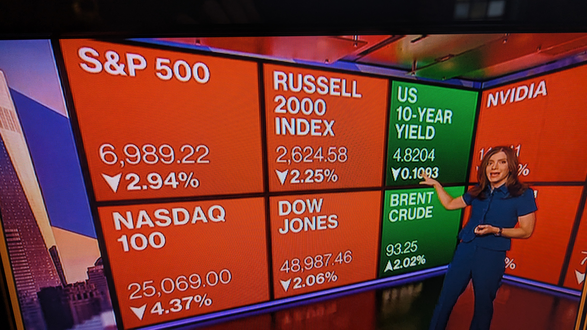

Context: this came the same day as the hot US data dump above (core PCE 3.3%, Q3 GDP 4.3%, claims 189K) and Bilello's call for a 9 Dec hike. It gives back much of the +5.3% S&P day on 23 Nov.

Tags: #markets #selloff #SPX #NDX #rates #oil

### 2026-11-25 17:03 — "The market is already hitting its limit" (speaker not yet identified)

> 'The market is already hitting its limit'
>
> Essentially credit markets are exhausting with AI spend, he thinks.

Posted by Luke at 17:03 London. Speaker and source not yet identified. Related: the CRWV 2032 notes at 75.5 (about 16.4% yield to worst) on 24 Nov, and the 1998–99 capex-boom analogue (23 Nov).

Tags: #credit #ai-capex #debt #bubble-watch

#### Luke's thinking (25 Nov 2026, 17:04 London), on the clip above

> At some point the spenders will need to spend from cashflow only, and the returns on spend so far may be needed.

Tags: #luke-thinking #ai-capex #credit #cashflow

### 2026-11-25 17:31 — Luke's thinking: most sanguine about any crash I've experienced, the AI bubble has time left to run

Dictated by Luke (voice transcription, so some words and punctuation may be off).

> So just want to say that it's interesting because the narrative right now is kind of like it's the end of the AI bubble. But It um, it feels to me like it's got Some time left to run and bubbles usually have a kind of blow off top Of course demand everything else is still through the roof There's this narrative around short of cash and But on the whole, what's interesting is I'm the most sanguine about any crash that I've experienced in my whole life. So I just want to record that because it's quite an interesting situation. Because it's so severe and the talk is so sort of bearish. But I guess by now I've seen so many of them. And for me, the data just shows the demand on my own usage. It shows to me that this is a wave that will take years to play out. and it feels to me that the cash flows will come to fund the spending.

See also: 2026-11-21 16:51 — Luke's thinking: the disbelief is stunning; 2026-11-24 22:34 — Luke's thinking: on the Rincon-Cruz essay; 2026-11-25 17:03 — "The market is already hitting its limit" (speaker not yet identified)

Tags: #luke-thinking #ai-bubble #sentiment #demand #cashflow #capex #crash

### 25 Nov 2026, 18:19 London: Luke's thinking on frontier-lab pricing

> So long as they have demand and great models I suspect the US frontier labs may stop cutting prices... Though I'm not sure if they can... Like... Google and Meta can afford to keep cutting but perhaps they can't either. Might need to build models for each of the model companies to see how low they can go.

Tags: #luke-thinking #ant #pricing #ai-labs #unit-economics

### 25 Nov 2026, 14:23 London: Niall Ferguson on the causes of financial cycles

Source: Niall Ferguson (@nfergus), https://x.com/nfergus/status/2125596285143249270

> "The great cycles of economic history are about much more than a few autocratic CEOs. ... Major financial events are global phenomena with multiple causes, combining (1) a technological novelty with (2) variations in monetary conditions, (3) the broader macroeconomic conjuncture, (4) political forces, and (5) the vagaries of geopolitics."

Tags: #macro #bubbles #ai-cycle #history

### 25 Nov 2026, 18:40 London: "Consider Cyberarmageddon" forecaster probabilities

Source: "Consider Cyberarmageddon" by Nuño Sempere, belikewater and Vidur Kapur (forecasting essay; Hacker News discussion: https://news.ycombinator.com/item?id=50577509). Screenshot shared by Luke.

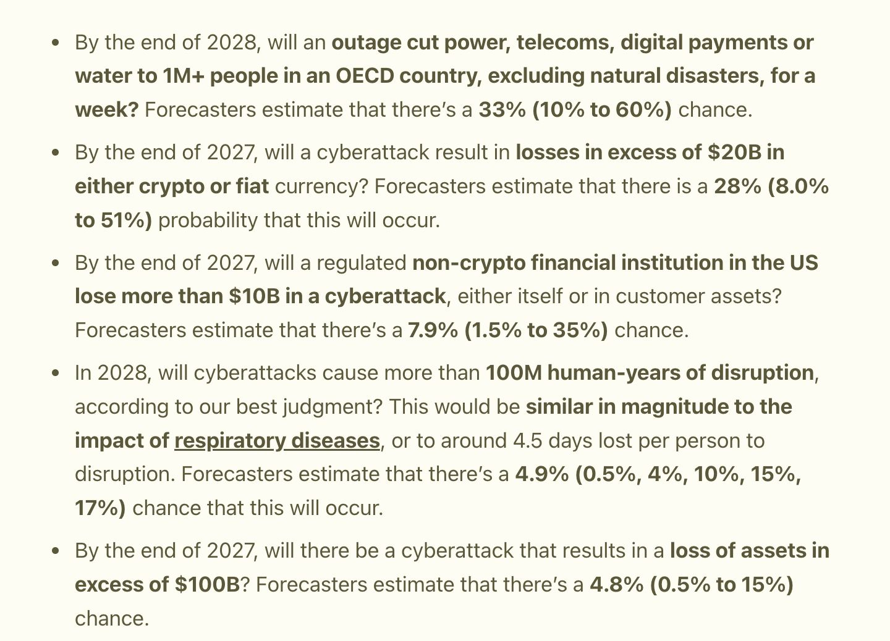

> - By the end of 2028, will an **outage cut power, telecoms, digital payments or water to 1M+ people in an OECD country, excluding natural disasters, for a week?** Forecasters estimate that there's a **33% (10% to 60%)** chance.
> - By the end of 2027, will a cyberattack result in **losses in excess of $20B in either crypto or fiat** currency? Forecasters estimate that there is a **28% (8.0% to 51%)** probability that this will occur.
> - By the end of 2027, will a regulated **non-crypto financial institution in the US lose more than $10B in a cyberattack**, either itself or in customer assets? Forecasters estimate that there's a **7.9% (1.5% to 35%)** chance.
> - In 2028, will cyberattacks cause more than **100M human-years of disruption**, according to our best judgment? This would be **similar in magnitude to the impact of respiratory diseases**, or to around 4.5 days lost per person to disruption. Forecasters estimate that there's a **4.9% (0.5%, 4%, 10%, 15%, 17%)** chance that this will occur.
> - By the end of 2027, will there be a cyberattack that results in a **loss of assets in excess of $100B**? Forecasters estimate that there's a **4.8% (0.5% to 15%)** chance.

Context: filed the same day as the FinCEN breach clip (Kobeissi, 13:38).

Tags: #cyber #tail-risk #forecasting #financials #crypto

### 25 Nov 2026, ~20:30 London: Kobeissi on gold's record oversold deviation

Source: The Kobeissi Letter (@KobeissiLetter), https://x.com/KobeissiLetter/status/2125686323818180737

> Gold has rarely been this oversold:
>
> Gold prices are trading -20% below their 200-day moving average, their largest negative deviation since June 2013.
>
> This marks a sharp reversal from the +45% deviation above the 200-day moving average recorded in January, the largest since the 1970s.
>
> This comes as gold prices have dropped -37% from their January intraday peak, their largest drawdown within a 12-month period since the early 1980s.
>
> By comparison, during the 2008 Financial Crisis, gold prices also declined -20% below their 200-day moving average.
>
> However, the largest such negative deviation was recorded in 1981, at -27%.
>
> Gold is experiencing one of its most severe declines in history.

Tags: #gold #commodities #technicals #macro

### 25 Nov 2026, ~18:40 London: Polymarket launches compute futures (Shayne Coplan)

Source: Shayne Coplan (@shayne_coplan), https://x.com/shayne_coplan/status/2125653367640805799 — market page: http://polymarket.com/compute

> Compute markets are finally here.
>
> @Polymarket now prices on-demand compute for @nvidia H100s, B200s, and B300s, out to 2028. More chips and terms soon. http://polymarket.com/compute
>
> Think of it as a yield curve for the cost of compute: the forecasted $/hour price of each chip at every expiry, and whether it's trending up or down. The whole AI economy rides on these prices, and until today there was no public market for where they're going. Which is nuts. So Polymarket built it.
>
> This will change how compute gets bought and financed. Every contract negotiation and every GPU loan will have a market price to check against.
>
> Hundreds of billions of dollars are being committed to compute years in advance. Many of those deals are essentially a levered bet on what GPUs will rent for in the future (what could go wrong lol)
>
> As AI financing sobers up, the labs buying compute, the providers selling it, and the lenders financing it will all need to hedge that risk.
>
> We think compute could become one of the largest financial markets in the world. This launch is Polymarket's first step toward building it.
>
> If you're buying, selling, or financing compute, DM us with what markets you'd like to see.

Context: a possible public cross-check for the H100 rental rates in compute-prices/gpu-prices.csv, and relevant to neocloud/GPU-backed debt (CRWV) and the ANT commitments analysis.

Tags: #compute #gpu-prices #polymarket #prediction-markets #ai-financing #crwv

### 25 Nov 2026, 21:45 London: Gene Munster on Nvidia after Jensen's return (summary)

Source: Gene Munster (Deepwater), condensed summary as shared by Luke; original post not linked.

> Core Thesis: Despite near-term volatility following Jensen Huang's return, Nvidia's full-stack AI leadership will likely drive CY27 and CY28 revenue growth above Wall Street expectations, though its massive scale may cap earnings multiple expansion.
>
> - Jensen 2.0: A potentially softer leadership style post-reinstatement could slightly slow execution, though he returns with renewed urgency to prove himself.
> - China Curbs: Tightened export restrictions are expected to shave 2%–5% off CY27 revenue, but strong global GPU demand should more than offset the loss.
> - Political Pushback: Newly elected governors opposing data center expansion could raise CY28 buildout costs by ~5%, though severe compute shortages keep demand intact.
> - Customer Financing: Nvidia's heavy use of equity commitments and guarantees to back data center partners works well—provided outside co-investors continue showing up.
> - Capitol Hill Hearings: Upcoming congressional testimony over chip diversion to China will likely generate headlines, though it is expected to yield minimal lasting impact.

Tags: #nvda #ai-capex #china #export-controls #vendor-financing

### 25 Nov 2026, ~19:45 London: Jack Farley on Burry going long

Source: Jack Farley (@JackFarley96), https://x.com/JackFarley96/status/2125662416789004288

> I can hear it in my head:
>
> "No we can't put Michael Burry going long on the frontpage. It's not news"
>
> "But it's moving the market."
>
> "Okay fine. Put it up"

Tags: #burry #sentiment #media

### 25 Nov 2026, ~15:45 London: Rumour that OpenAI or Anthropic can factor large numbers in polynomial time (Chubby, citing Scott Aaronson)

Source: Chubby (@kimmonismus), https://x.com/kimmonismus/status/2125602411540566221 (reposted by Raging Capital Ventures)

> If this rumors are true, it would explain why OpenAI and Anthropic are holding back their latest models:
>
> Scott Aaronson says he's heard OpenAI or Anthropic may have found a way to factor large numbers in polynomial time.
>
> Why this would be massive? RSA secures a huge chunk of the internet, and its whole security relies on factoring big numbers being impossible on normal computers. If an algorithm like this actually works on real key sizes, you wouldn't even need a quantum computer to break it. Fake software updates could pass signature checks, RSA-encrypted data could be read, and systems across the internet would have to migrate off RSA fast.
>
> So yeah, something we expected might now actually happening.

Note: unverified, second-hand rumour; Aaronson's original wording not checked. If ever confirmed it would be a major cyber/crypto event (see same-day Cyberarmageddon forecasts and FinCEN breach clips).

Tags: #rumour #cyber #cryptography #rsa #ant #openai #crypto

### 25 Nov 2026, 17:55 London: Dow erases losses, turns green (Kobeissi)

Source: The Kobeissi Letter (@KobeissiLetter), https://x.com/KobeissiLetter/status/2125649652917612803

> BREAKING: The Dow Jones Industrial Average erases all losses and turns green on the day.

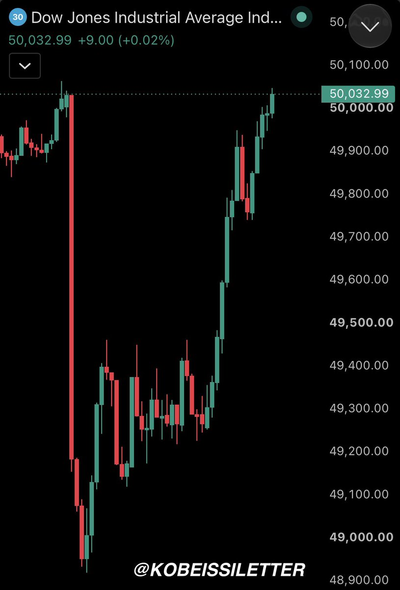

Context: the Dow was −2.06% at 48,987 on the 14:53 London market-board photo filed earlier today.

Tags: #dow #markets #reversal #intraday

### 25 Nov 2026, 22:05 London: S&P 500 trailing P/E falls to 20.49

Source: Bloomberg terminal chart (SPX Index > PE Ratio [LTM]), shared by Luke; original poster not identified.

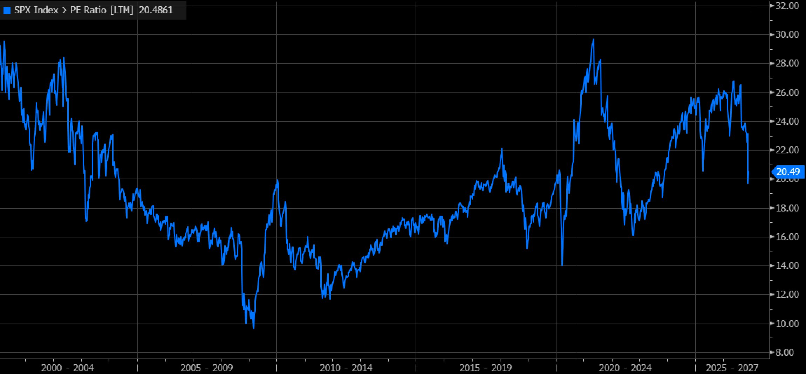

Chart reads SPX LTM P/E 20.4861 (2000–2027), a sharp drop from roughly 26–27 earlier in 2026, briefly touching below 20; now near its long-run 2015–2019 range.

Tags: #spx #valuation #pe #selloff

### 25 Nov 2026, 22:17 London: Burry "temporarily almost entirely long"

Source: newswire-style headline shared by Luke; original wire not identified.

> * BURRY: I AM TEMPORARILY ALMOST ENTIRELY LONG

Context: see Jack Farley's quip filed earlier today ("No we can't put Michael Burry going long on the frontpage…").

Tags: #burry #sentiment #positioning

### 25 Nov 2026, 15:18 London: Bitcoin below $57,500, ETH near $1,600 (Kobeissi)

Source: The Kobeissi Letter (@KobeissiLetter), https://x.com/KobeissiLetter/status/2125609956615573530

> BREAKING: Bitcoin falls below $57,500 and ETH nears $1,600 as the selloff in crypto gains momentum.
>
> Another -$500 million worth of levered positions have been liquidated over the last 24 hours.

Tags: #crypto #btc #eth #liquidations #selloff
