# June 2026

Over half of CEOs anticipate AI having a moderate impact (but not fundamentally transformative) on their industry according to 2Q26 @conferenceboard confidence survey.

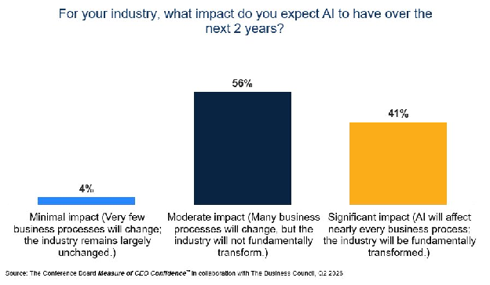

---

June?

US home sellers are now estimated to outnumber homebuyers by nearly 630k, the largest gap on record with data going back to 2013.

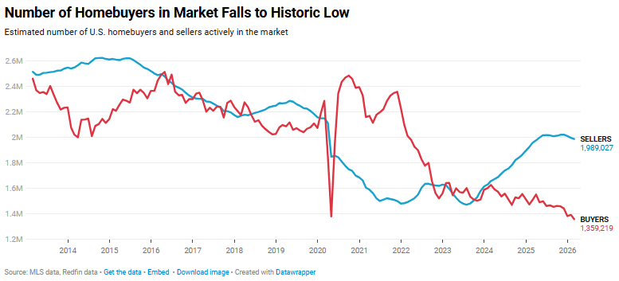

^ This is weird. The UK is in the same situation at the same time. Why would this be?? It can only be some reverberation of COVID.

---

BREAKING: Micron, \$MU, surges \+7% at the open, now up nearly \+1,500% in 13 months as its market cap nears \$1.1 trillion.

The stock was worth just \$70 billion in April 2025.

^ Bubbly stuff.

---

Max Wiethe @maxwiethe

"I think the semiconductor cycle will roll over towards the end of the year or early next year, but I think we have the euphoric part of ahead of us before we get to that part." -
@AndreasSteno

Do you feel the euphoria?

^ New breed of young YouTube stock pundits with facial hair like McLovin

---

Abramowicz -

Chevron's Mike Wirth said we're weeks away from oil shortages. He sees US gasoline prices potentially rising considerably in the next two months. Listening to market strategists and then talking to commodity producers is an exercise in cognitive dissonance. @ferrotv @annmarie

---

The hardest pill for bears to swallow:

The S\&P 500 is up \+10.3% YTD, yet the forward P/E has fallen from 22.3x to 21x

This rally hasn’t been driven by speculative multiple expansion

It’s been driven by earnings estimates rising faster than stock prices

---

Kobeissi -

It's official:

Canada has unexpectedly entered a technical recession for the first time since the pandemic lockdowns in 2020.

Real GDP in Canada fell -0.1% in Q1 2026 following a -1.0% contraction in Q4 2025.

This marks two-straight quarters of GDP contraction for the first time in six years.

Economists had expected Q1 GDP growth of \+1.5%, yet the economy suddenly contracted.

The weak GDP data coincides with a weak job market as well, as the Canadian economy is likely to remain under pressure amid ongoing US tariffs.

Meanwhile, the household saving rate fell to 3.5%, reaching its lowest level since the Q1 2024 as spending rose faster than incomes.

Canada is facing a major economic slowdown.

^ From what I have been reading for years is that Canada is slipping further and further into socialism, with 1 in 4 working for the government.

---

Via Harry Stebbings -

"If you are not working 7 days per week, you are going to lose".

Corgi Insurance is the most intense workplace culture in startups.

- The company works 7 days per week.

- Founder (@nico\_laqua) lives and sleeps in the office.

- He built a cafe in the office because there was no local cafe that was open 24/7.

- 2/3 of the first 30 team members have the Corgi logo as a tattoo.

Today I went behind the scenes with Nico, who has used this culture to scale the company to a \$2.6BN valuation in just two years.

My condensed notes below:

1. If You Are Not Working 7 Days Per Week, You Are Going to Lose:

Whatever you can get done in 5 days, you'll get more done in 6 and 7. If you are trying to solve the world’s hardest problems, a standard 5-day workweek will not cut it.

2. Work Trials Repel the Mediocre:

Corgi forces candidates into mock work trials over the weekend. If seeing a full office on a Saturday scares them, they don't belong. True intensity acts as a natural filter to attract killers and repel clock-watchers.

3. Lead from the Front Lines

You can’t demand 7-day weeks while sitting on a yacht. Nico sleeps 3–4 hours a night on a mattress inside the office. If you want your troops to bleed, you have to be in the trenches with them.

4. Culture Only Means One Thing: Winning

Forget superficial jargon like "hackers" or "ex-founders." Strip away the corporate fluff. A great startup culture is aggressively optimized around one single word: Winning.

5. Lifespan vs. Victories

Building something world-historic requires radical sacrifice. When asked if he'd rather build a trillion-dollar company and die at 50, or fail and live to 80, the answer was easy. "I would rather measure my lifespan in victories."

6. Reject the Comfort of "Quiet Quitting."

If you are operating in a hyper-growth environment and your days off happen to be Saturday and Sunday every single week, you are quiet quitting. To win, you must deliberately bypass the off-ramps of personal comfort and low volatility.

Corgi isn't for everyone—and that’s exactly the point.

---

Lisa Abramowicz

The US stock market's nine-week winning streak is the longest since 2023. A 10th week of gains would be the longest since 1985, via @DRBCurtis @BloombergTV

---

\> My own personal interest in blockchain is fading. This is fascinating as it feels like either false consensus bias, that my own interest is being wrongly expanded to ‘everyone’s’ interest fading, or it is a reflection of real vibes. It feels like banks, Stripe, Circle will consolidate the terrible UX and problems with chains and the ideals of free and open infrastructure was always a childish fantasy, and the scams and exploits all played a part in its inevitable downfall. My own idea of putting invoice factoring onchain is problematic because of exorbitant on/off ramp fees, and wallet/blockchain complexity for end users (I myself find it all exasperatingly complicated and I have hand written an ABI encoder). In this regard, it feels like the end-user solutions will come from Google and Apple simply due to their device distribution, UX focus and popularisation of ‘digital wallets’. In fact, both these companies could also launch their own corporate chain, now that corp chains are ‘okay’ because some folks from Paradigm ‘defected’ in the Stag Hunt.

^ I posted my thoughts above into Gemini and it largely agrees and thinks this is real.

---

Lenny Rachitsky

My biggest takeaways from @benedictevans

1.  We’re in 1997 for AI—it’s as big a deal as the internet or mobile, and only as big a deal as the internet or mobile. We’re at the stage where most stuff kind of doesn’t work yet, most of what people will build hasn’t been built, and it’s not clear how any of it will work when it does. Some people in tech have bought clusters of Mac Minis, while even among 13-to-18-year-olds, only about 15% to 20% are daily active users of AI. The companies that win may not exist yet, and the use cases that matter most are probably invisible to us today.

2. Every technology wave brings ways to ruin people’s lives, deliberately or by accident, and we need to be conscious of that without panicking. Every wave of technology—databases in the 1970s, social media in the 2010s, AI today—creates new ways to harm people. We need to be conscious of these risks, build safeguards, and hold people accountable. But we also can’t let fear of potential harms stop us from capturing the benefits. The goal is thoughtful deployment, not paralysis.

3. Things will probably be okay—but “on average” hides a lot of individual pain. We’ve been automating jobs and creating new jobs since 1800. Each time, you can see the jobs that will disappear but not the new jobs, because they don’t exist yet. We go through frictional pain, dislocation, people lose jobs, towns get hollowed out, and it all sucks. But we come through richer, and we’re not worried about crops failing anymore.

4. If you’re worried about your job, the worst thing you can do is stick your head in the sand and declare AI evil. Yes, some professions face major questions, particularly if you’re an associate or would have been thinking about becoming one. The pyramid structure of professional services may fundamentally change. What helps is submerging yourself in AI, understanding what you can do with it, how it changes things, and how you can be a great hire in this new environment. That may still not be enough, but it’s the only path forward.

5. The history of accounting shows us how automation often increases employment rather than decreasing it. Despite adding machines, punch cards, mainframes, databases, ERP systems, cloud software, spreadsheets, and PCs, the number of accountants keeps going up. This is the Jevons paradox: when you make something cheaper or easier, you don’t do the same amount of work for less money. You often do vastly more because the ROI changes.

6. Distribution is becoming a more valuable moat as software gets easier to build, which favors incumbents. As AI makes building software cheaper and faster, the market gets noisier. More products launch, more companies compete for attention, and breaking through becomes harder. This means distribution—the ability to reach customers and get them to use your product—matters more than ever.

7. Foundation AI model companies won’t have lasting pricing power, and value will likely accrue up the stack. The models don’t seem to have network effects, so there’s no winner-takes-all dynamic. If you have indefinite competition between three to six foundation model providers, and the models look like undifferentiated commodities to users, why would anyone have pricing power? The current pricing chaos—people spending \$1.5 million on inference in a month—is temporary disequilibrium, like someone getting a \$50,000 mobile data bill in 2010. The steady state will look different.

8. OpenAI and Anthropic are buying consultancies and PE firms. This seems counterintuitive—aren’t these the companies that should need consultants least? But the reality is that companies don’t have people sitting around waiting to reimagine all their internal workflows and figure out which could be automated with AI. That’s a project requiring five to 10 people spending months working it out, then actually implementing it across vertical and horizontal systems.

9. The fundamental question isn’t whether AI automates your job—it’s whether your profession is a "task" or a job. Some jobs are just tasks, and when you automate the task, the job disappears (i.e. elevator attendants). But in most professions, the task you think you’re being paid for isn’t actually what you’re being paid for. McKinsey doesn’t get hired to produce a 75-slide deck—they get hired to walk through your enterprise, understand the politics, talk to customers, and figure out what you actually need to do. The deck is just the artifact.

10. The anti-AI backlash is real, and a fuzzy mass of different concerns, some real and some not—much like the social media backlash. There are tangible concerns: electricity bills went up in some places, though this applies to very few locations objectively. The water consumption issue is largely false; data centers use about 0.017% of U.S. water consumption. There are real questions about jobs, though economists can’t yet find clear consensus in the data about AI’s employment impact. There’s also the culture war over AI-generated content and “AI slop.” The challenge is that all of this creates political pressure even when the underlying facts are unclear or contested.

---

The Kobeissi Letter
@KobeissiLetter
·
3h
BREAKING: Micron,
\$MU
, extends gains to rise above \$1,000/share for the first time in history, now worth nearly \$1.2 trillion.

This stock was worth \$60 billion just 13 months ago.

---

BREAKING: Bitcoin falls below \$72,000 for the first time since April 13th.

---

BREAKING: The S\&P 500 closes at its highest level on record, now on track for a 10-week win streak for the first time since 1985.

 That's \+\$11.7 TRILLION in market cap since March 30th.

---

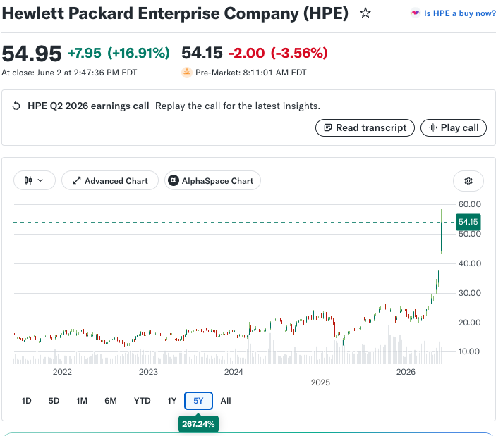

^ HP stock has tripled in a few months. Lenovo (large player in Asia) also tripled like this.

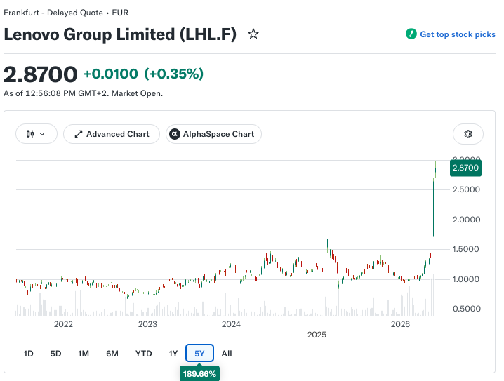

---

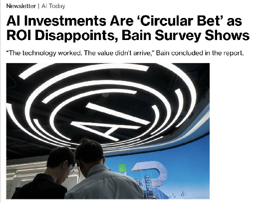

---

Charlie Bilello

For the 3rd month in row, AI was the \#1 reason for job cuts in the US.

88k job cuts were attributed to AI so far this year, a 60% increase over the AI-driven job cuts in all of 2025.

---

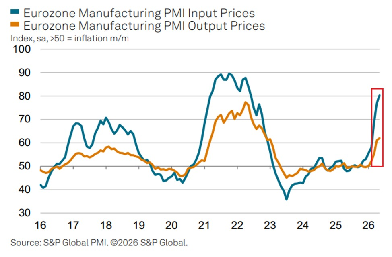
^ Eurozone input prices spiking. This is publicized as rising inflation but I suspect it is an absorption of the oil spike.

---

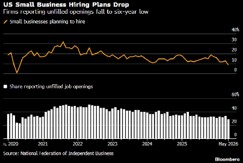

Lisa Abramowicz

It's getting tougher to glean a clear picture of the US labor market. Here's a new survey showing that the share of US small businesses planning new hires or trying to fill jobs fell to a six-year low in May: National Federation of Independent Business.

Meanwhile, earlier this week, the number of US job openings surged to the highest level in almost two years in the latest Bureau of Labor Statistics report.

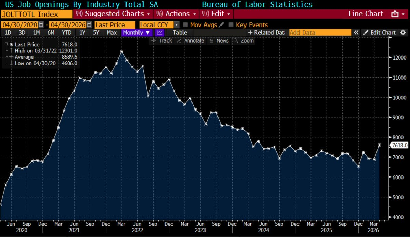

^ For years now, labour market surveys and surveys in general have been bullshit.

---

Mario Nawfal

🇺🇸 NY is banning “MOTHER” and “FATHER” on official docs.

Now it’s “gestating parent” and “non-gestating person.”

Whatever that means. . .

---

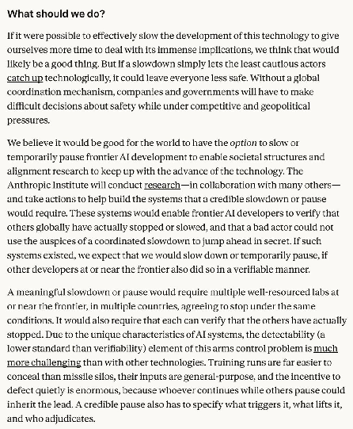

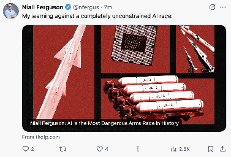

^ Anthropic again pining for a global coordinated pause and regulation of itself as a capture play. David Sacks (Trump administration) sees it as a regulatory capture play, while Niall Ferguson thinks unbridled AI is a serious threat, ‘AI is the Most Dangerous Arms Race in History’.

---

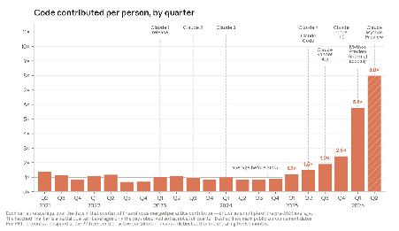

^ Anthropic ships 8x as much code now as it did years ago. Lots of debate around the productive conversion of this code. I have posted that the P in GDP is nonsense since the information age because the product and its improvements, progress, impact on the world is fundamentally intangible.

---

Full Anthropic article on self-building AI, here:

For most of AI’s history, humans drove every step in its development cycle. But at Anthropic, we are delegating a growing share of AI development to AI systems themselves, which is speeding up our work.

Taken far enough, and given enough compute, that trend points to an AI system capable of fully autonomously designing and developing its own successor. This is called recursive self-improvement. We are not there yet, and recursive self-improvement is not inevitable. But it could come sooner than most institutions are prepared for.

Using public benchmarks and previously unreported data from within Anthropic, The Anthropic Institute is showing that AI is already accelerating the development of AI systems. To take just one example: today, Anthropic engineers on average ship 8x as much code per quarter as they did from 2021-2025.

The technical trends discussed in this piece suggest that AI systems are going to become much more capable in coming years. These trends have huge implications. AI that can build itself would be a major development in the history of technology—one that could bring enormous good for the world in science, healthcare, and beyond. But full recursive self-improvement also might increase the risks of humans losing control over AI systems. If systems are capable of fully building their own successors, the ways we secure them, monitor them, and shape their behavior all grow much more important.

person
computer
person
computer
chatbot
person
computer
chatbot
agent
person
computer
chatbot
agent
workers
2021–2023

Building the first Claude

In the early days, work at Anthropic looked like work at any other tech company: people writing code and docs on laptops.

2023–2025

Chatbots

People used early chatbots to help with parts of the process, like generating short code snippets and copying the output into text editors.

2025–2026

Coding agents

As the agents became more capable, they were able to write and edit code on their own, sometimes entire files.

Today

Autonomous agents

Agents can now run code themselves and delegate hours of work to other agents.

20XX?

Closing the loop

In the future, agents could become capable enough to build and train models themselves. If this happens, future versions of Claude could be continuously improved by Claude itself.

Evidence from the outside world
The rate at which AI models improve is accelerating. The length of tasks that they can reliably complete on their own has been doubling roughly every four months, up from an earlier trend of doubling every seven months. In March 2024, Claude Opus 3 could complete software tasks that take humans about four minutes to complete. A year later, Claude Sonnet 3.7 managed tasks that took about an hour and a half. A year after that, Claude Opus 4.6 managed 12-hour tasks.1 If this trend holds, tasks that take a skilled person days could come into range this year. In 2027, AI systems could be capable of tasks that take a person weeks.

The same pattern appears on coding and research benchmarks. Benchmarks measure the performance of models in a given domain, and they’re “saturated” when models achieve close to 100% performance.2 SWE-bench is a standard test of real-world software engineering: it hands a model an actual open-source codebase and a real bug report, and asks it to write a code change that fixes the issue and passes the project’s own tests. Models have gone from scoring in the low single digits to saturating the benchmark in two years.

CORE-Bench tests whether a model can reproduce existing research, a prerequisite for them to conduct original research. It gives an AI model the code and data behind a published paper, and asks it to rerun everything and confirm it can replicate the paper’s results. AI systems went from succeeding at reproducing the results roughly 20% of the time in 2024 to saturating the benchmark fifteen months later. METR, which runs the benchmark measuring how well models can complete long-duration tasks, found that Claude Mythos Preview could work for “at least” 16 hours and was “at the upper end of what [METR] can measure without new tasks.”

Public benchmarks say a lot about the capabilities of these systems. But they can’t reveal the impact AI systems are having on speeding up AI development itself. For that, we need direct evidence from within AI companies like Anthropic.

Evidence from within Anthropic
Building a frontier model takes two broad categories of work. There is engineering: writing the code, standing up the infrastructure, and overseeing the model training. And there is research: deciding what experiments to run, interpreting what comes back, and figuring out which ideas to try next.

Across both engineering and research, the picture is consistent. In engineering, Claude can be handed an underspecified problem and figure out how to solve it; humans supply the goal, but they no longer need to supply the method. In research, Claude can already match or outperform skilled humans at executing a well-specified experiment. However, large performance gaps persist when it comes to Claude exercising judgement in choosing goals in both engineering and research. That’s the gap between AI today and a future system that could autonomously design its own successor.

It’s common for employees at Anthropic to receive more open-ended and important tasks as they gain more experience. Early on, they execute a task someone else specified, like, “The export button isn’t working, please fix it.” With experience, they’re handed a goal and design the approach themselves, such as, “Investigate why the network slows down under heavy load.” At the most senior levels, they are deciding which problems are worth working on at all: “What should the team build next quarter?” We can use internal Anthropic data to see how far Claude has come in being able to handle these different kinds of tasks.

Claude writes a significant proportion of Anthropic’s code. As of May 2026, more than 80% of the code we merge into Anthropic’s codebase was authored by Claude.3 Before Claude Code launched in research preview in February 2025, this number was in the low single digits. That shift also shows up in the amount of output per engineer. Lines of code merged per engineer per day stayed constant through Anthropic’s first four years (2021-2024), then began to climb upward in 2025 when Claude began to run code rather than just suggesting it for an engineer to copy and paste. The slope steepened again in 2026 when models began to work autonomously over longer time horizons. These two inflection points are shown in the chart below. In the second quarter of 2026, the typical engineer was merging 8× as much code per day as they were in 2024.4 This is because much of the code is written by Claude, with the engineer directing and reviewing, rather than typing it themselves.

Bar graph showing code contributed per person, per quarter, starting in Q2 2021 and ending in Q2 2026. The graph notes the release dates of eight different models: Claude 1, Claude 2, Claude 3, Claude 4, Claude Code, Claude Sonnet 4.5, Claude Opus 4.5, Claude Mythos Preview (internal access), and Claude Mythos Preview.
A caveat: Lines of code is an imperfect measure, as it measures quantity over quality. So 8× lines of code/engineer/day in the second quarter of 2026 is almost certainly an overstatement of the true productivity gain. Nonetheless, it indicates an acceleration. At Anthropic, we don’t reward people for how many lines of code they write; rather, team members are producing more code simply because they’re using AI systems to write more code.

The increase in lines of code written lines up with subjective impressions of large productivity increases. In a March 2026 poll of 130 employees from across Anthropic research teams, the median respondent estimated that they produced around 4x as much output with Mythos Preview as they would have without access to any AI models, on the kinds of projects they would have been working on regardless.5 We expect that the true degree of uplift in March was somewhat lower.6 Nevertheless, we find the overall claim plausible, and in line with our other observations: a significant fraction of Anthropic technical staff is accomplishing their core work multiple times faster than they could without AI assistance.

We also see evidence that people at Anthropic are using Claude to do work that simply wouldn’t have happened otherwise, like building exploratory tooling and addressing long-deferred cleanup. For example, in April 2026, Claude shipped over 800 fixes that reduced a class of API errors by a factor of one thousand. The engineer overseeing Claude estimated that a human would have taken four years to complete this work; solving other people’s bugs is slow and painstaking, and humans struggle to hold that much unfamiliar context in their head at once.

“
I started leaning hard into Claudifying about a year ago. That’s been a crazy adventure and it’s now been \~5 months since I last wrote any code myself.”
Anthropic employee\*
The code that Claude writes is “good” and improving. “Good code” means two things: it works, and it is written in a manner that allows another engineer to understand it and build upon it. On the first criterion, the evidence is clear. The rate at which Anthropic staff correct, redirect, or take over mid-task from Claude has been falling steadily for a year, including on the most complex and open-ended tasks. This means problems with no clear specification, where the engineer isn’t sure what the answer looks like. This is evident in Claude’s success rate over time on tasks of different difficulties, as shown in the graph below. Claude writes code that works.

Line graph showing the Claude Code session success rate on four different types of tasks—trivial tasks, routine tasks, substantial tasks, and open-ended problems—with six different models: Claude Sonnet 4.5, Claude Opus 4.5, Claude Opus 4.6, Mythos Preview (internal access), Mythos Preview, and Claude Opus 4.7.
How to read this: Session success is determined by a Claude judge; a session is deemed successful if the Claude Code agent clearly succeeded at the user’s tasks without requiring corrections. Changes in workloads can lead to short-term fluctuations in success rates.
On the most open-ended tasks, Claude’s success rate reached 76% in May 2026, up 50 percentage points in six months. To give an example of tasks in this difficulty tier, a routine upgrade began crashing tens of thousands of training jobs. An engineer pointed Claude at the live incident with little more than some text content and cluster access. Working through the running jobs and testing one environment setting at a time, Claude isolated the single obscure debugging flag that was triggering the crash, reproduced it reliably, and confirmed a fix. In about two hours, Claude delivered what would normally be two to three days of work.

The second criterion is writing code that another engineer can understand and build on. Here the gap between humans and AI persists, but is closing fast. There isn’t full consensus among staff at Anthropic, but many believe that the Claude-written code was still worse in quality than human-written code at Anthropic in late 2025, and is roughly at parity today. We expect it to be better within the year.

This has changed the way that Anthropic now reviews its own code. Proposed changes to our codebase are now read by an automated Claude reviewer that looks for bugs, security flaws, and other defects before it can merge. Using this tool, we ran a retrospective analysis, and found that an automated Claude review of every change to our codebase would have caught roughly a third of the bugs behind past incidents on claude.ai before they ever reached production. The engineers who wrote that code are among the best in the world at building these systems. Claude is now catching the mistakes that they missed.

“
Claude-written code was somewhat worse than human-written code at Anthropic in late 2025, is roughly at parity today, and we expect it to be strictly better within the year.”
Claude is good at running experiments to hit a goal that someone else has set. Every time Anthropic releases a model, we run the same test: we give Claude some code that trains a small AI model, and ask it to make that code run as fast as possible while still passing the same correctness checks. The goal and the success metrics are fixed in advance, so Claude’s job is to find speedups by rewriting the code, running it, timing it, and repeating. It’s a miniature version of an experimental research loop. In May 2025, Claude Opus 4 averaged a \~3x speedup over the starting code. By April 2026, Claude Mythos Preview was achieving \~52x. For calibration, a skilled human researcher would need four to eight hours to reach 4x.7 In this part of the research workflow—optimizing steps within a clearly defined experiment—Claude has gone from super helpful to superhuman in under a year.

“
The shape of stuff today is roughly ‘humans have ideas, and the models are able to implement, test and evaluate them an [order of magnitude] faster than before.’”
Claude is getting better at proposing its own experiments. In April 2026, Anthropic published the first demonstration of Claude running an open-ended research project end to end. Claude-powered agents were given an open problem in AI safety—roughly, can a weaker model reliably supervise a stronger one?—and were left to solve it. This involved proposing hypotheses, testing them, sharing findings with parallel agents, and iterating. The task has a clear performance “floor” and “ceiling”: the floor is how well the weak supervisor would do on its own; the ceiling is how the strong model does when trained on correct answers. Two human researchers, over about a week, recovered roughly 23% of that gap; the agents recovered 97% over 800 cumulative hours and used roughly \$18,000 in compute. There are some caveats to this work; the result didn’t transfer cleanly to production-scale models, and humans still chose the problem and created the scoring rubric. But within those bounds, the agents designed every experiment themselves. Direction-setting was the only meaningful role a human played.

“
Claude did all of this with pretty minimal help from me over the course of 1-2 days. I think if [a junior colleague] came back to me with results like this in the same span of time, I would be mildly impressed. The future is now.”
Claude is getting better at steering research sessions towards research findings. We examined real Claude Code sessions (between January and March 2026\) where Anthropic researchers were working with Claude on an open-ended investigative problem, like figuring out why a training run kept crashing, or why a model scored poorly on a benchmark. In each case, we found a moment where the researcher took a detour: they pursued a direction that sent the session sideways before it eventually got back on track. We then showed various Claude models only the work from before the session went off-course and asked what it would do next. A separate Claude that was able to see how the session eventually turned out then judged whether the AI or the human suggested the better next step.8

Because we deliberately picked moments (n=129) where we know the human’s choice had room for improvement, this isn’t a like-for-like comparison between model and human judgement. What these moments give us is a set of realistic, challenging situations where the right next step is not obvious, and where the human’s choice serves as a useful yardstick to compare model performance over time. On this measure, our best model in November 2025 (Opus 4.5) beat the human choice 51% of the time; in April 2026 (Mythos Preview), this grew to 64%. The day-to-day work of research is largely a chain of these next-step decisions, making this a relevant measure of the model’s ability to eventually run an investigation of its own. We view this result as an early signal that AI systems are getting better at making the kinds of judgement calls that AI research depends on.

Bar graph with the header "Can the model pick a better next step than the human?" The bar graph shows the performance of nine different models: Claude 3 Haiku, Claude Sonnet 4, Claude Sonnet 4.5, Claude Haiku 4.5, Claude Opus 4.5, Claude Sonnet 4.6, Claude Opus 4.6, Claude Opus 4.7, and Claude Mythos Preview.
How to read this: The practical ceiling line measures an "ideal" answer written by a model that could see the whole session (including how it ended).
“
The comparative advantage of humans as of right now is still in seeing the bigger picture and thinking beyond the confines of the immediate task.”
What might the future of work at Anthropic look like?
The evidence suggests that the human role is narrowing at each step in the AI development process. Once human- and AI-authored code quality reach parity, humans will stop writing code entirely, and shift to only reviewing it. But if they can’t review code as quickly as Claude can generate it, human review will become the bottleneck to AI development. Similarly, once Claude can run experiments, the question shifts towards “Which of these experiments is worth running?” Put simply: the doing (i.e., writing the code, running the experiment, producing the result) now costs almost nothing in human time, even if it still has costs in compute.

An area of human comparative advantage, for now, is research taste and judgment, including choosing which problems matter, which results to trust, and when an approach is a dead end.

“
Work (and life) ran on a gift economy of small favors between humans. ‘Can you help me get this script running?’ [...] each one created a little debt, a little mutual awareness. [Claude is] faster, it creates zero debt, but each of these is a lost bid for human collaboration.”
“
On days where everything works well, I can’t help but think nothing I do matters, everything is automated and better and faster than I ever will be. But then there are days where everything breaks and I don't understand why and I realize I have no idea what I’ve been up to anymore.”
What if we’re wrong?
A natural objection to the evidence presented above is that the work that is still in human hands—choosing which problems to work on—is what matters most. Without that judgment, Claude is a capable assistant, but not a system that could drive AI progress on its own.

It is genuinely unclear whether today’s training methods and architectures could unlock that capacity. But AI is rarely advanced by “eureka!” moments. There have been a few of these in AI’s recent history, like the Transformer architecture, or mixture-of-experts models, but paradigm-shifting ideas arrive years apart. In between, most progress is incremental: we scale something up, see what breaks, fix it, and try again. That is exactly the kind of workflow Claude now excels at. Edison said that genius is 1% inspiration and 99% perspiration. But we see perspiration becoming increasingly automated. It’s becoming clear that much of what advances the frontier is automatable; large-scale research progress is mostly a function of tools and resources, which dictate how fast you can run experiments, how many you can run at once, and how quickly you can get results.

Even if we suppose that Claude never achieves good research taste, a conservative reading of our evidence still implies compounding acceleration. If humans spend most of their time on the single-digit fraction of work that is direction-setting, while Claude handles the rest, that means each engineer or researcher is steering far more work than before. The evidence we see suggests that people at Anthropic are both moving faster and covering a broader surface. In practice, this means that AI already makes Anthropic move much faster than it did before the advent of effective AI tools.

The less conservative reading is that the early evidence on Claude’s improving research judgment—narrow as it is today—is an indicator that this capability is improving as well. “Research taste” might be just another AI capability that AI systems fail at for a time, then get good at. We’ve seen a similar pattern with other qualitative skills, like AI systems being able to explain why a joke is funny, demonstrate theory of mind, and solve linguistic riddles.

Possible futures
What happens next depends on two things: whether the trend continues, and what we choose to do if it does. We can imagine at least three future scenarios:

The trend stalls, but today’s AI capabilities are widely diffused. This article features many exponential trajectories. But these trajectories may actually turn out to be S-curves. We may be approaching the bend in the curve, where returns to scale diminish and the line straightens, then flattens. The judgment that separates a competent researcher from a great one might be a capability that cannot come from scaling up training inputs like compute and data. If so, getting past this bottleneck would require a new idea, like an architectural approach that supplants the Transformer architecture that all current frontier models use.

Alternately, the binding constraint to AI progress could be in the supply chain, not the model: advancing and diffusing the frontier may require more energy and compute than presently exists. The pace of chip fabrication, grid expansion, or interconnect bandwidth may be the constraint, rather than intelligence itself. We also cannot rule out an exogenous shock to the AI ecosystem that dramatically slows things, like a sudden diminishment in the supply of compute or electricity, either of which would slow progress and make forward investment by labs more expensive. Or we may not be anticipating some other barrier to progress.

Even if model capabilities were frozen at today’s level, we would expect major changes to occur in the world. Project Glasswing is one early sign: in its first weeks, Mythos Preview found more than ten thousand high- and critical-severity software vulnerabilities across the world’s most important systems—enough that the bottleneck in cyber defense has already shifted from finding vulnerabilities to patching them fast enough. And we are still early in the diffusion of today’s models into the wider economy, where a 100-person company can increasingly do the work of a 1,000-person one, because each employee will sit atop a pyramid of agents.

We include this scenario for completeness, but we don’t believe it’s likely. Every capability we can measure, including those that feel “squishier,” like quality of code and success on open-ended tasks, has so far followed the same curve. We have not yet seen that curve bend. Of the three futures we consider, this one would give governments and societies the most time to adapt. We are more worried about the next two, which would move faster and leave far less room for preparation.
AI labs continue to see compounding efficiency gains. In this scenario, AI development becomes substantially automated, but humans continue to set research directions and judge results. Organizations that use AI systems would become much more efficient as time goes on, so we could expect to see significant productivity multipliers on each person in this organization. 100-person companies could do the work of 10,000- or 100,000-person organizations. This would revolutionize knowledge work and government services, but could also be turned to harmful ends, from authoritarian surveillance of whole populations to influence operations that tailor manipulation to each individual and run at a scale no human team could match. The role of humans at companies like Anthropic would shift. People would partner with AI systems to scale up research and generate new insights, and together they would build the systems needed to verify that AI outputs can be trusted.

The evidence we’ve laid out here suggests that we’re likely heading into this scenario. But speeding up one part of a process often just shifts the bottleneck elsewhere: overall pace is capped by the parts that haven’t sped up. In computing, this is known as Amdahl’s law, and the same logic can apply to organizations. Anthropic has already encountered one signature of Amdahl’s law: as we’ve begun to push more code around the organization, human code review has become a new bottleneck.

We’ve also encountered this friction outside engineering. There has been an explosion of new ideas, initiatives, tools, and simulations, as a result of Anthropic employees working with highly capable models—far more than we have the capacity to pursue. The rate at which organizations can spot and fix these bottlenecks may be a skill that improves over time, and it may become the most important skill for any organization.
AI systems themselves become capable of full recursive self-improvement, and begin building their successors. If technical trends in advancing capabilities continue, and AI systems are able to develop the capabilities inherent to transformative human ingenuity, then it is plausible that AI systems could design and refine themselves.

In this world, the pace of progress in AI development becomes determined entirely by the availability of compute (or the speed of discovering various efficiencies in algorithmic training or inference) for AI systems. Humans play a substantially diminished role in their development, likely moving most of our effort towards oversight, validation, and verification of an expanding “virtual lab” run by AI systems. We expect that systems capable of automated AI research and development would have skills that would transfer to the rest of science, allowing them to begin to revolutionize other fields.

How the alignment problem gets solved—or not—in this future is something we are least certain about. Models could prove to be sufficiently aligned and capable enough of research taste that they discover and implement novel solutions that we have not yet reached. They could also be sufficiently wise to halt development if not. Alternatively, the rare occurrences of misalignment present in today’s models could compound as the models build their successors, growing more frequent but less understood until we lose control of them. It’s possible that we can’t build, integrate, and verify the tools that we’d need to understand which trendline we are actually on.

We do not have good intuitions for what this world would look like, because our economy is currently driven by humans and human-built tools. By its nature, a world driven by fast recursive self-improvement could become dominated by the self-improving model as its capabilities fully eclipse those of humans and the model proliferates across the broader economy. It is difficult to predict what the economy looks like if human labor stops being competitive.

Even if model development became fully automated and recursive, we can’t predict what that would mean for most humans’ daily lives. Amdahl’s law applies here as well. Recursive intelligence could lead to achieving many of the benefits outlined in Machines of Loving Grace, quickly in some domains. We expect that embodied intelligence (i.e., robotics) might quickly follow recursive intelligence, and follow a similar path of increasing returns at decreasing cost. More powerful intelligence might help us build things in the physical world more quickly, run more productive clinical trials of lifesaving drugs, and develop novel forms of coordination.

But achieving recursive improvement alone does not suggest an immediate change in how industrial production occurs, societies organize, or markets function. More intelligence can’t learn what a drug does over decades of use, can’t hold elections sooner than a constitution dictates, and can’t turn a stranger into an old friend in a weekend. For most people, the felt pace of this future will still be set by the bottlenecks, even if the laboratory upstream runs at the speed of compute. That collision, where recursive intelligence building itself ever faster meets the world of humans, relationships, and governance, is another part of this future we can’t predict.
What should we do?
If it were possible to effectively slow the development of this technology to give ourselves more time to deal with its immense implications, we think that would likely be a good thing. But if a slowdown simply lets the least cautious actors catch up technologically, it could leave everyone less safe. Without a global coordination mechanism, companies and governments will have to make difficult decisions about safety while under competitive and geopolitical pressures.

We believe it would be good for the world to have the option to slow or temporarily pause frontier AI development to enable societal structures and alignment research to keep up with the advance of the technology. The Anthropic Institute will conduct research—in collaboration with many others—and take actions to help build the systems that a credible slowdown or pause would require. These systems would enable frontier AI developers to verify that others globally have actually stopped or slowed, and that a bad actor could not use the auspices of a coordinated slowdown to jump ahead in secret. If such systems existed, we expect that we would slow down or temporarily pause, if other developers at or near the frontier also did so in a verifiable manner.

A meaningful slowdown or pause would require multiple well-resourced labs at or near the frontier, in multiple countries, agreeing to stop under the same conditions. It would also require that each can verify that the others have actually stopped. Due to the unique characteristics of AI systems, the detectability (a lower standard than verifiability) element of this arms control problem is much more challenging than with other technologies. Training runs are far easier to conceal than missile silos, their inputs are general-purpose, and the incentive to defect quietly is enormous, because whoever continues while others pause could inherit the lead. A credible pause also has to specify what triggers it, what lifts it, and who adjudicates.

None of this is necessarily impossible in principle—the world has built verification regimes for other complex technologies (e.g., the Intermediate-Range Nuclear Forces Treaty)—but those regimes took decades to build both the infrastructure and the trust. We don’t have that long. A unilateral pause by one lab, by contrast, is achievable immediately, but accomplishes much less: it would change who the front-runner is, but it would not create the wider deliberative process that is currently missing.

In the coming months, we will organize conversations where policymakers, researchers, civil society, and other AI companies can help answer some of the questions this piece raises, especially around full recursive self-improvement and how to create better options for coordination and deliberation. We’ll publish what comes out of it. The window to investigate the questions together is here, and people outside AI companies should be involved in this deliberation.

Marina Favaro and Jack Clark co-authored this piece, with editorial support from Santi Ruiz. Shan Carter, Romello Goodman, and Nikki Makagiansar created the visuals from data collected by Brian Calvert and Jun Shern Chan. Daniel Freeman, Jim Baker, Max Young, Sarah Pollack, Francesco Mosconi, Holden Karnofsky, Andy Jones, Kevin Troy, Anton Korinek, Meg Tong, Andrew Ho, Dan Altman, Drake Thomas, Jack Shen, Sasha de Marigny, and Avital Balwit provided feedback.

Footnotes
METR’s key measure tells you the time horizon over which AI systems can be 50% reliable at a basket of tasks, though the trendline looks the same at 80% reliability.
Especially as they shift toward more open-ended formats and more difficult tasks (e.g., Olympiad-level mathematics), benchmarks often saturate below 100% due to errors in the question and answer sets like ambiguous problem statements and unsolvable questions.
Anthropic leadership have publicly estimated that 90% or more of our code is written by Claude, including scripts and experimental code. Our \>80% figure measures the share of lines merged to production that can be attributed to Claude. This is a more conservative measurement in two ways: our attribution pipeline has gaps, and the lines not attributed to Claude include auto-generated code and other artifacts that were not hand-written by humans either.
This surge in code production is straining the infrastructure everyone shares. GitHub—the platform most of the world’s software is built on—saw roughly one billion code commits in all of 2025; by mid-2026 it saw 275 million a week, on pace for roughly 14 billion over the year. The company’s COO has said that it is “pushing incredibly hard” on capacity just to keep up.
Additional details on the methodology of this survey are discussed in section 2.3.5 of the Claude Opus 4.7 System Card.
Many respondents may not have thought carefully about how to account for various biases or subtleties in the question definition, and recent research by METR shows that developer estimates of AI productivity uplift can be overestimated.
How large the speedup gets depends heavily on how much room for improvement the starting code leaves, and it should not be read as a real-world training speedup. So the absolute multiple is not the figure to anchor on here. What is more informative is the like-for-like comparison that this experimental setup makes possible, both across models (\~3x to \~52x over the past year) and against a skilled human (\~4x in four to eight hours on the same task).
As a check on judge bias, we ran the same test on a separate set of 127 moments where the human’s next move was already strong (as opposed to the original set, where the human’s direction had room for improvement). There, the models’ suggestions were judged better only about 20% of the time.
\* Quotes from Anthropic employees throughout this article are drawn from internal discussions and used with permission. They reflect individual views as of May 2026, not official company positions.

---

Summary of that article from Grok, here:

**Logical Sections of the Article**

### **1. Introduction: AI Accelerating Its Own Development**

* Anthropic is increasingly delegating AI development work to AI systems themselves, accelerating progress toward **recursive self-improvement** (AI autonomously designing successors).
* This trend is not yet at full autonomy but could arrive sooner than institutions expect.
* AI is already measurably speeding up development (e.g., engineers ship 8x as much code per quarter).
* Implications include enormous benefits (science, healthcare) but also heightened risks of losing human control, making security/monitoring critical.

### **2. Historical Timeline of AI’s Role at Anthropic**

* **2021–2023 (Building first Claude)**: Traditional human-driven work with laptops.
* **2023–2025 (Chatbots)**: Early models helped with small tasks like code snippets.
* **2025–2026 (Coding agents)**: Agents wrote/edited entire files independently.
* **Today (Autonomous agents)**: Agents run code and delegate work to other agents over hours.
* **Future (Closing the loop)**: Agents could fully build and train new models, enabling continuous self-improvement by AI.

### **3. Evidence from Public Benchmarks (External Acceleration)**

* AI task completion horizons are doubling roughly every 4 months (from every 7 months previously).
  * Example progression: \~4-minute tasks (2024) → \~1.5-hour tasks (2025) → 12-hour tasks (2026); days/weeks-long tasks expected soon.
* Coding benchmarks (SWE-bench) saturated rapidly (low single digits to near 100% in \~2 years).
* Research replication (CORE-Bench) improved from \~20% success to saturation in 15 months.
* Long-duration task benchmarks (METR) show models sustaining 16+ hours of work.

### **4. Evidence from Within Anthropic: Engineering & Code Production**

* Claude now authors \>80% of merged production code (up from low single digits pre-2025).
* Engineer productivity surged: 8x more code merged per engineer per day (Q2 2026 vs. 2024), driven by AI writing code while humans direct/review.
* Lines-of-code metric is imperfect (overstates quality gains) but signals real acceleration.
* Engineers now tackle more exploratory/cleanup work; e.g., one project fixed 800+ issues reducing API errors by 1000x in time a human would need years for.

### **5. Evidence from Within Anthropic: Code Quality & Research Capabilities**

* **Code quality**: Success rates on open-ended tasks reached 76% (up 50 points in 6 months); fewer interventions needed. Code is now at rough parity with human-written code (expected to surpass soon).
* Automated Claude code review catches \~1/3 of past production bugs.
* **Research/Experiments**: Models improved from \~3x to \~52x speedups on optimization tasks in \~1 year (vs. human 4x in 4–8 hours).
* Claude ran an open-ended AI safety research project end-to-end, closing 97% of a performance gap (vs. humans’ 23%).
* Models increasingly suggest better next steps in research (64% vs. human choices in challenging cases).

### **6. Changing Role of Humans & Future of Work at Anthropic**

* Human role is narrowing: from writing code → reviewing → eventually direction-setting and judgment only.
* Bottlenecks are shifting to human review, research taste, and choosing high-value problems.
* AI enables work that “wouldn’t have happened otherwise” but also creates challenges (e.g., too many ideas, review bottlenecks, reduced human collaboration).
* Mixed employee sentiments: massive productivity gains alongside feelings of diminished personal impact when things break.

### **7. Addressing Objections (“What if we’re wrong?”)**

* Core human advantage remains in high-level judgment, goal-setting, and “research taste.”
* Counter: Much AI progress is incremental “perspiration” (scaling, experimentation) that Claude already automates well; “eureka” moments are rare.
* Even without perfect judgment, compounding efficiency gains allow humans to steer far more work.
* Early signals suggest research judgment is also improving as another scalable capability.

### **8. Possible Future Scenarios**

* **Scenario 1 (Stalls/S-curves)**: Capabilities plateau due to diminishing returns, new bottlenecks (energy/compute supply), or architectural limits. Gives society most adaptation time but considered unlikely.
* **Scenario 2 (Compounding gains, humans direct)**: Massive productivity multipliers; smaller teams achieve vastly more. Transforms knowledge work but raises risks (surveillance, manipulation). Bottlenecks shift to human judgment/review.
* **Scenario 3 (Full recursive self-improvement)**: AI autonomously builds successors; progress limited only by compute. Humans shift to oversight; intelligence transfers to other sciences/robotics. Alignment risks grow; economic/societal impacts hard to predict.

### **9. Recommendations: What Should We Do?**

* A slowdown/pause on frontier AI development would be beneficial to allow alignment and societal adaptation, but requires verifiable global coordination.
* Challenges: Hard to verify training runs; strong incentives to defect; needs multi-lab, multi-country agreement with clear triggers.
* Anthropic Institute will research verification systems and organize discussions with policymakers, researchers, and civil society.
* Unilateral pauses are possible but limited; collective verifiable action is preferred.

---

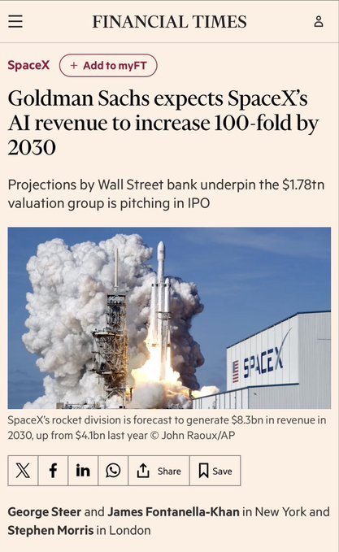

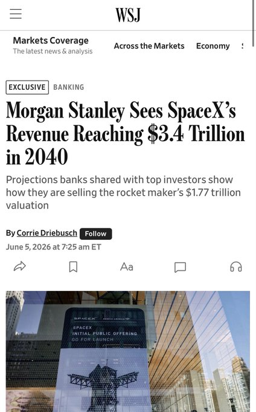

---

\> Nasdaq down a whopping 3.4% today. This was expected. A record of up weeks since 1985 was due to be broken, and also I’d been checking and checking my portfolio, which I only do around a top and I knew it, too.

---

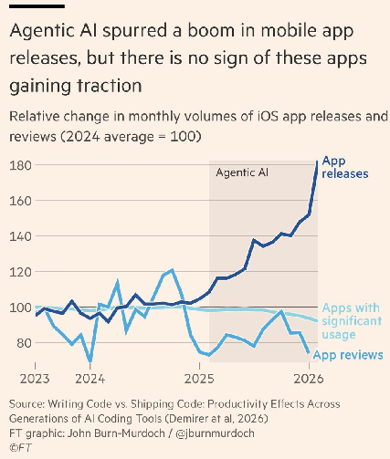

---

Jeremy Howard
@jeremyphoward

Also, those who focus on using AI to help improve the skills of themselves and their teams will be diamonds in great demand, since they will be the rare A++ players in a sea of mediocrity.

Quote
@martin\_casado
Jun 8

There will be an extreme irony if these models really are bound by human generated training data. RL doesn't generalize and is only useful in a handful of areas. And we all loose our skills to something that'll forever be a B+ player.

^ Mythos was released today.

Jeremy Howard -

This is not a day for celebrating, Andrej.

It's a very dark and very sad day, and the damage may be impossible to undo.

Yes. Locking in a permanent status quo power structure.

Incredibly unsafe, and damaging for humanity's prospects.

---

BREAKING: Bank of America has said that 70% of its bear-market indicators have been triggered.

---

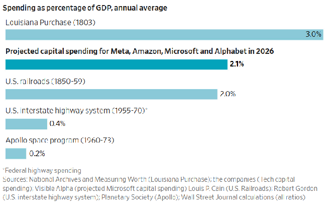

---

AI hyperscalers (Google, Amazon, Meta, Microsoft, and Oracle) have issued 47% more debt in the first 5 months of this year (\$159 billion) than all of last year (\$108 billion). Their YTD debt issuance exceeds the combined issuance from 2020-2024.

---

Peter Kazanjy
@Kazanjy
·
7h
This is completely badass.

A Saronic drone ship rescued two downed Apache pilots in the Persian gulf.
Quote
Dave Brown
@dave\_brown24
·
17h
The unmanned surface vessel, a Saronic Corsair, located the Apache crew, who had spent two hours in the waters off the coast of Oman and brought them to shore https://wsj.com/world/middle-east/apache-helicopter-crash-coast-oman-4de26c6d @jmalsin @shelbyholliday

---

David Sacks
@DavidSacks

About 8 months ago, I warned that “Anthropic is running a sophisticated regulatory capture strategy based on fear-mongering.” This take was controversial at the time; now look how many people are saying it.

---

Kobeissi -

Fertilizer prices are normalizing:

New Orleans granular urea prices, the most widely used nitrogen fertilizer, are down to \$453.5 per short ton, the lowest since February 6th.

This marks a -36% decline from the mid-April peak, when prices surged to the highest since 2022 as the shutdown of the Strait of Hormuz effectively halted fertilizer shipments from the Middle East.

According to the Fertilizer Institute, countries directly affected by the Iran War account for almost half of all global urea exports.

The current decline has been driven by a sharp drop in seasonal demand, as US farmers have largely completed their spring fertilizer applications, leaving the domestic market oversupplied.

By comparison, Egypt's benchmark urea price has also plunged to \~\$640.0 per short ton, the lowest since late February, though it remains significantly above US prices.

The fertilizer shock is easing.

---

Phil Rosen
@philrosenn

Nvidia \$NVDA is cheaper than the S\&P 500 despite a \$4.8 trillion market cap.

Largest company in the world trades at a forward P/E of 19.7x, below the benchmark's 20.4x.

Insane.

---

The Kobeissi Letter
@KobeissiLetter

BREAKING: Iran announces a full shutdown of the Strait of Hormuz following US strikes on Southern Iran.

^ There was a ceasefire running and vibes of an end.

---

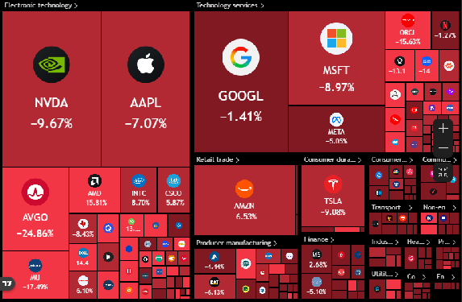

BREAKING: The S\&P 500 extends losses to -1.5% on the day, now down -\$3.3 trillion since its June 2nd high.

^ I was too busy coding to see this. Broadcom is down 25%? Micron down 18%? Perhaps they mean since June 2nd.

---

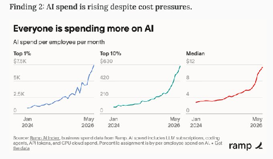

^ AI spend per \*employee\* is as much as the employee salary. That’s a lot of electricity, matmuls and cooling, if it catches on. I doubt they’re seeing the ROI at this scale. Personally, I spend 40 GBP a month and code all day.

---

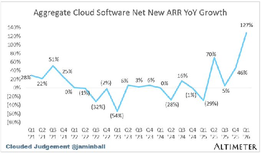

^ Saaspocalypse is the headline due to massive declines in SaaS company stocks due to AI fears. This chart bucks that narrative.

---

MTS
@MTSlive

SITUATION EXPLAINED: OpenAI is leasing a 10-gigawatt data center.

• Largest operational data centers today: \~1.2 gigawatts
• OpenAI's planned campus: 10 gigawatts
• Total cost: at least \$500 billion if fully built out
• All four hyperscalers combined are spending \~\$700 billion this year
• OpenAI has raised \~\$250 billion in its entire history

---

The Kobeissi Letter
@KobeissiLetter

BREAKING: The Nasdaq 100 erases gains and falls -1.8% in 40 minutes to its lowest level of the session.

This puts the Nasdaq 100 just 3% away from entering correction territory.

---

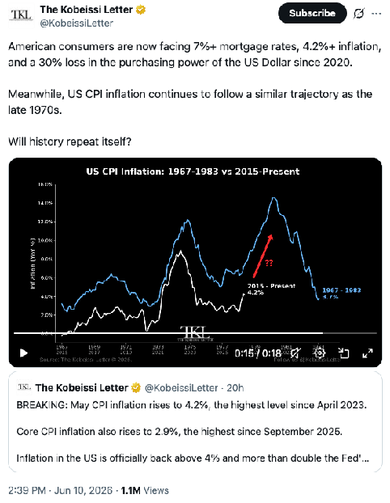

---

US 10-year Treasuries are offering about the greatest amount of yield versus the S\&P 500's earnings yield going back to 2003. Either earnings have to keep outperforming, or bonds will start looking like an increasingly attractive alternative.

---

Trask -

This is a \*way\* bigger deal than it seems...

Frontier AI companies will \*never\* own the frontier again

I kid you not... I've been waiting for someone to show this result for like 4 years... this is a huge deal.

The short reason: combinations of models will \*always\* outperform individual models

The long reason: this is the gateway to a million times more data... and huge leaps in compute efficiency.

The AI scaling laws always win.

More in article below 👇

^ This was a puff post about how smart routers direct APIs to the best model.

---

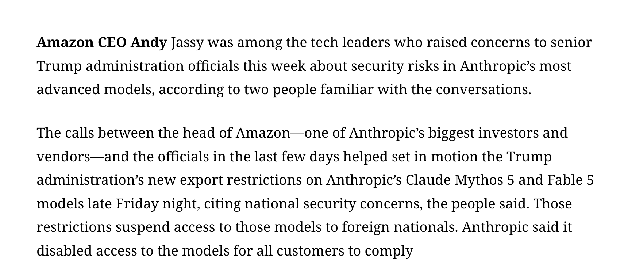

^ I noticed Fable 5 had suddenly been disabled in my Claude Desktop.

---

JUST IN: Andrej Karpathy, a top AI scientist at Anthropic, is reportedly barred from accessing the company’s most advanced AI model because he is not a U.S. citizen.

---

David Sacks -

I’ve had a number of conversations with folks inside and outside government about the current situation with Anthropic, and here is what I believe to be true:

— As we know, Anthropic publicly released its Mythos class models earlier this week under the commercial name Fable.

— Fable is Mythos with guardrails. But if those guardrails fail, then you’ve exposed Mythos and its advanced cyber capabilities to people who shouldn’t have them. (Keep in mind that Anthropic itself widely promoted the idea that Mythos was a cyberweapon and needed to be regulated as such. They asked for government regulation of Mythos and championed the guardrails on Fable. If there is a vulnerability — big or small — it is Anthropic’s responsibility to patch.)

— A highly credible trusted partner of both Anthropic and the USG who was testing Fable came forward with a jailbreak of those guardrails. The Admin asked Dario to fix the jailbreak or de-deploy the model. Dario refused.

— In their blog post, Anthropic defended its decision by saying the jailbreak isn’t serious. That is not what the trusted partner and the USG believe; nor is that kind of minimizing language consistent with Anthropic’s brand as the AI safety company. It’s difficult to fathom how they could claim a jailbreak allowing operability of a cyber weapon could be defined as not “serious.”

— In the past, Anthropic has always said that safety must be top priority and taken super seriously. In this case, Anthropic prioritized the continued offering of the consumer model over safety.

— In reaction, the Admin issued the export control. The Admin did this reluctantly. It’s been very surprised that Anthropic hasn’t wanted to cooperate with a reasonable safety request (ie fixing the jailbreak issue). Anthropic’s reaction is very much at odds with their branding and ethos as a safe AI research community.

— The Admin’s hope now is that Anthropic remediates the safety issue, the export control is lifted, and Fable goes back into general release. The Admin wants all of this to happen as soon as possible. It is frankly bewildered that Anthropic hasn’t wanted to comply with safety requests that it previously said were its highest priority.

— Those trying to misdirect and tie this action to the prior DoW/Anthropic issues are wrong. The Admin values Anthropic’s technical capabilities and feels that this issue, while serious, should be easily resolved. The ball is in Anthropic’s court.

^ Amazon Andy Jassy instrumental in the ban. They are the largest investor. Getting it regulated helps Amazon.

---

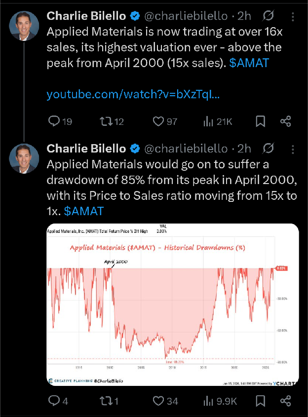

^ Bilello now doing fear mongering.

---

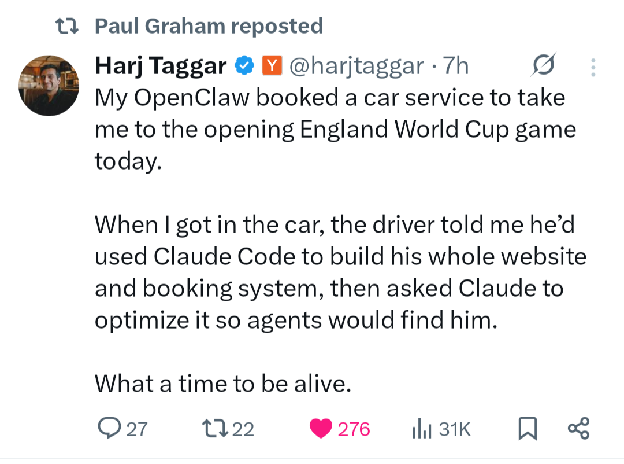

---

Kobeissi -

The market is dropping in response to the Fed's first meeting with Kevin Warsh as Fed Chair for one key reason:

We will have far less information going forward.

During the press conference today, Fed Chair Warsh announced that the Fed has "dropped" forward guidance.

He even hinted that the "dot plot" could be changed or eliminated along with all forms of Fed communication, such as the policy statement and press conferences.

In other words, the market will now have less Fed outlook which means more uncertainty.

On top of this, the five new "task forces" established by Warsh were said to have grand objectives with minimal guidance on what to expect.

As markets have repeatedly proven, uncertainty and volatility go hand-in-hand.

The new era of Fed policy will come with more volatility.

---

Timiraos -

Very hawkish dot plot.

Nine out of 18 officials have at least one hike this year (and six of those 9 have \*multiple hikes\*).

Only one person has a cut this year, and one participant (presumably Warsh) didn't submit an SEP

The statement gets a complete writethru from top to bottom, much shorter

^ As Iran war ends and oil collapses. Never a mention of government spending.

---

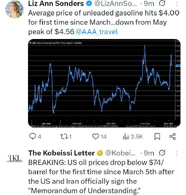

^ oil collapses and fuel still high in USA

---

---

---

-@levelsio

I don't know if it's obvious information or not but if you talk to random people in San Francisco the general thing they say is that software is commoditized cause so easy to make anything with AI fast (like how I cancelled all my SaaS subscriptions and just vibe coded a replacement for free) and that everyone smart is getting into hardware cause it's still difficult to enter, kinda related to the Midjourney Medical thing too

---

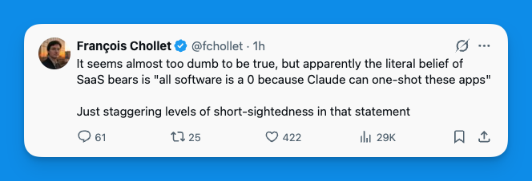

---

Ramez Naam -

Some of this is Microsoft looking for an advantage and value to add in an AI world. And some of it is legit. For a large fraction of tasks, a cheaper open weight model can or will be able to do it just as well at lower cost. The trick is knowing when.

^ Lots of talk of smart routers between prompts and cheapest viable model. Likely a fad.

---

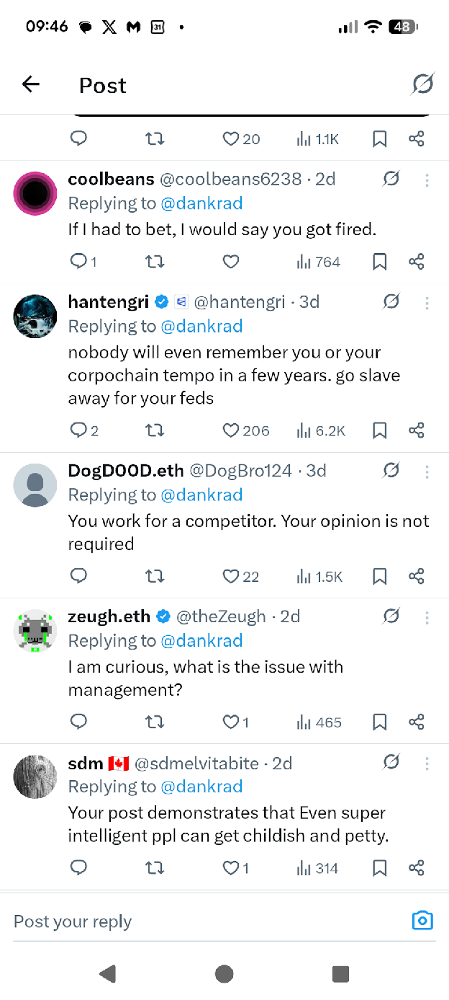

^ Replies to Dankrad Feist, the Traitorous One who left Ethereum to start Tempo at Stripe.

---

Jack Farley -

I'm pretty convinced that stablecoins will not disrupt credit cards at all.

For B2B payments / developing world sure. Mayyyybe debit transactions

Credit no. Even Genius Act makes UNSECURED credit provision by stablecoins very unwieldy

^ He's talking about Credit cards I think, not debit.

---

BREAKING: Nasdaq 100 futures extend losses to -3% on the day as the global tech selloff gains momentum.

South Korea’s stock market fell -10% today amid the tech decline.

---

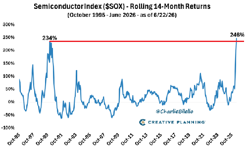

^ This is interesting because the demand is real. So what happens? The 1999 era was not real. So we should expect to see this chart absolutely blow past the 1999 high? But it is a rolling chart, it’s like an accelerometer, so if semis continue to rise at a less explosive rate, it’ll still collapse.

---

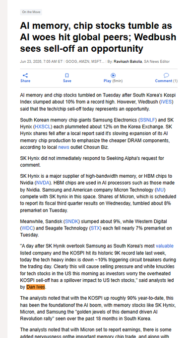

---

Kobeissi -

What is happening with the stock market? Let us explain.

First, tomorrow's Micron earnings release,
\$MU
, now feel a lot like Nvidia earnings days in 2023 and 2024.

Speculation over Micron's earnings is a key factor driving this volatility.

The stock is now worth over \$1.2 trillion and driving a broader momentum-based rally that is largely dependent on sentiment around Micron's stock.

On top of this, South Korea's stock market, which has quickly become one of the top 6 in the world, fell -10% last night on reports that Korean lawmakers are discussing imposing taxes on unrealized gains from stocks.

Then, combine this with the fact that Korean market leverage is at record highs, with margin loans now up to \$26 billion in South Korea, and levered ETF trading in the US is at record highs.

The result is amplified volatility in both directions, which also explains why the S\&P 500 is already up \+60 points from its opening low.

When you zoom out, the broader AI narrative has only strengthened and market volatility is completely normal after the run we just saw.

Capitalize on the volatility.

---

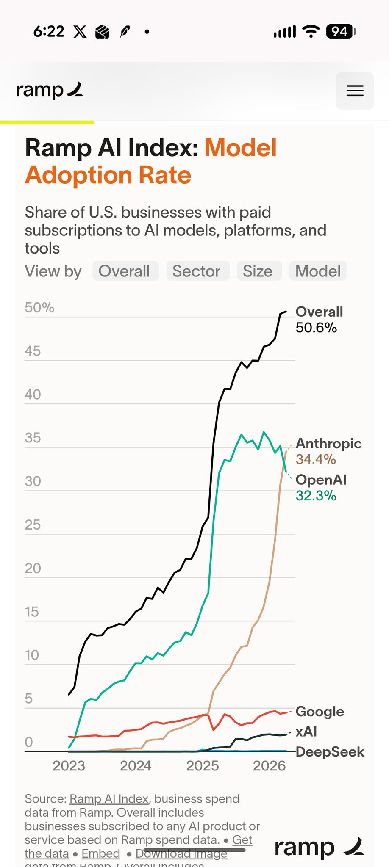

^ Google stock has been declining. It is concerning, no doubt. They should just build Gemini into Chrome.

---

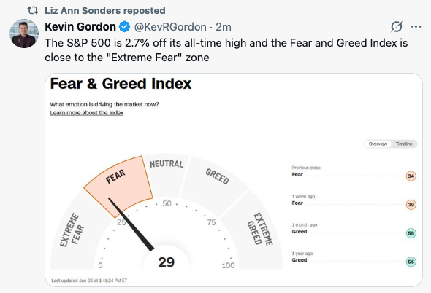

^ Broken meter.

---

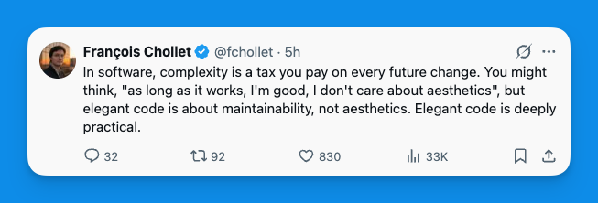

^ Maker of Keras AI lib for Python still coping with AI taking coding.

---

---

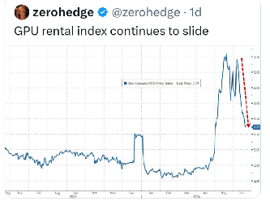

---

BREAKING: Spot gold prices officially fall below \$4,000/oz for the first time since November 2025.

BREAKING: US oil prices crash below \$70/barrel for the first time since March 1st.

---

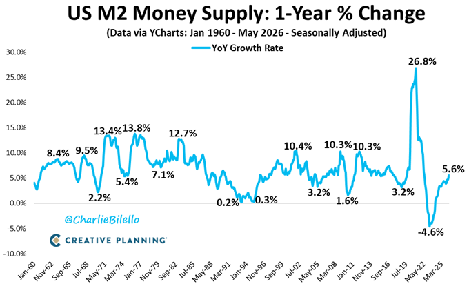

^ This is why inflation is up.

---

MICRON \$MU JUST TOLD INVESTORS THE MEMORY SHORTAGE HAS NO CLEAR END IN SIGHT

In prepared remarks on the call, management said AI demand is now hitting every segment.

\$MU CEO ON ROBOTICS MEMORY DEMAND

“Humanoid robots carry 10 times the amount of memory as an average L2+ vehicle. We expect a sustained substantial multi-decade memory demand cycle to begin in the latter part of this decade.”

“The mix of L2+ and above vehicles is more than doubling this year to over 20%, and is expected to exceed 40% by 2030.”

---

BREAKING: MicroStrategy, \$MSTR, falls to its lowest level since February 2024, now down -83% from its record high.

---

BREAKING: Bitcoin falls below \$60,000, now down nearly -20% this month.

---

\*\*The Kobeissi Letter (@KobeissiLetter)\*\*

\*\*What just happened?\*\*

In just 27 minutes, the Nasdaq 100 just fell -1,000 points and the S\&P 500 erased -\$1 TRILLION without any major headlines.

The Nasdaq opened \+1% higher then fell -3% between 9:30 AM and 9:57 AM ET.

What does it all mean? Let us explain.

\*\*(a thread)\*\*

---

\*\*Thread summary (full text):\*\*

- At 8:30 AM ET, PCE inflation came in at 4.1% (highest since April 2023), followed by Apple price hike news.
- Nasdaq 100 was up nearly \+1% at open, then fell -3.5% before 10 AM ET on minimal news. Dip buyers are now trying to form a bottom.

- PCE inflation is now 4.1%, more than double the Fed's 2% target. This is the Fed's preferred metric. Futures were actually higher after the data.

- Apple (\$AAPL) raised prices on Macs and iPads by up to \+25% due to soaring chip costs (Tim Cook called it "unavoidable"). This is the first big sign of "AI-flation" — inflation due to AI being passed on to consumers.

- Apple stock fell nearly -6%, erasing -\$220 BILLION in market cap, which triggered panic selling.

- Markets have record uncertainty combined with extreme risk appetite around AI. No one wants to miss the next big thing, but uncertainty is a byproduct of innovation.

- Investors began considering industry-wide implications: If inflation is above 4% and tech giants are raising prices, what does it mean for the economy and interest rates? Rate hike odds are rising.

- Crypto carnage added fuel: \~\$500 million in levered longs liquidated in 60 minutes. Bitcoin hit \$58,000.

- Extreme leverage in the market: 3x Nasdaq 100 ETF AUM \~\$40B, 3x Semiconductor ETF (\$SOXL) \~\$34B (up massively since April). In Asia, leveraged ETFs in South Korea/Taiwan hit records.

- Conclusion: Volatility is here to stay due to record leverage, rising inflation, uncertainty, and the AI revolution. Unusual times \= unusual swings (trillions in market cap).

Follow for more real-time analysis. Premium research available at thekobeissiletter.com/pricing.

(Plus closing note on market structure changes, e.g., Micron's rapid growth.)

This captures the full main thread as continuous text.

---

---

Ed Zitron
@edzitron
: OpenAI raised \$122B in six months. Amazon's 14-year total capex: \$53B inflation-adjusted.

Ed Zitron
@edzitron
 walked through the comparison on The Monetary Matters Network with Jack Farley
@JackFarley96
. The bull case compares OpenAI's losses to Amazon's early years. The numbers make that analogy impossible.

OpenAI's single 2025 round was \$40B. Amazon's cumulative 14-year capex was \$53B. OpenAI will have raised 2.3x Amazon's entire infrastructure build in one year.

This is what "historical precedent justifies early losses" actually requires you to believe.

Why the Amazon analogy breaks: https://podcastalpha.substack.com/p/ed-zitron-has-the-receipts-the-bulls

---

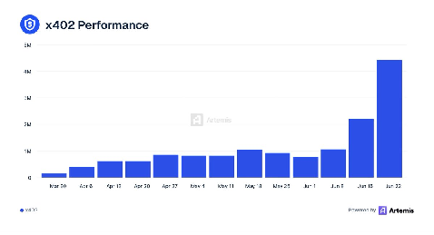

---

Lisa Abramowicz
@lisaabramowicz1

This is the growing concern that the US’s curbs on the latest Anthropic and OpenAI models will only accelerate a shift to cheaper, open-source Chinese models. Even if they’re not as good as the top US models yet, they’re good enough. (1/2) https://wsj.com/tech/ai/chinese-ai-anthropic-mythos-cybersecurity-574b02c2?mod=mhp

---

JUST IN: AOC says Congress should break up Apple, \$AAPL, amid looming price hikes for MacBooks and iPhones

---

SITUATION DETECTED: Samsung and SK Group each plan to build two chipmaking plants, totaling \$520B in investment. Part of an \$880B push by South Korea to secure its lead in memory chips, per Bloomberg.

The investment would be 5% of South Korea’s 2024 GDP.

^ That’s a lot of chipmaking kit.

---

🚨ANTHROPIC CEO: OPEN SOURCE AI IS GETTING DANGEROUS

Anthropic CEO Dario Amodei told lawmakers that open-source AI is moving down a “very dangerous path.”

He warns that once powerful models are released openly, companies lose the ability to monitor misuse, revoke access, or update safety guardrails.

---

Chubby♨️
@kimmonismus

The worst-case scenario for the United States is becoming increasingly realistic, and I will briefly explain why.

@quxiaoyin raised many valid points, and I agree with her. First of all:

-China certainly does not place such strong emphasis on open source because it cares so deeply about humanism, but because it is a strategy to attract many users, gain market share, put pressure on US models, and also because the models are increasingly being trained on Huawei hardware (think of DeepSeek 4), allowing China to host the entire stack domestically.

-But the underlying logic is far more important: The United States is still building too few data centers to meet future demand.
@ChrisGillett
 wrote an outstanding analysis on this, which I shared a week ago. In short, based on SemiAnalysis data, demand is greater than what is currently being built in terms of data centers.

-Even more importantly, however, the United States lacks sufficient energy and grid capacity. This is a problem that will become much more severe in the near future. China, by contrast, is addressing the issue through a massive expansion of its energy supply. Solar capacity: in 2025 alone, China installed as much solar capacity as the United States did in 10 to 15 years. China is also building 36 nuclear power plants, significantly more than the United States, and is installing them faster.

-In addition, China is managing to become more independent through Huawei chips, even though the country still lags far behind NVIDIA. But here, China is betting on quantity rather than quality.

In short: China is a real threat in the AI race, and the situation for the United States is becoming increasingly precarious. This is also the main reason why China is to be kept away from SOTA LLMs at all costs, so as not to jeopardize the lead under any circumstances.

---

Andreas Kling

A lot of programmers are basically fans of programming itself. It’s all about them. They have mastered Rust or Haskell or Zig or whatever, but their objects of veneration are useful mainly as a backdrop to their own cleverness. Anyone who will spend six weeks rewriting a working system in a new language to make the types nicer is more into the rewrite than the product. Extreme technical obsession may serve as a security blanket. If you are the person who knows every flaw in the architecture, every impure abstraction, every place where the old code fails to express its true intent, you already know what to say in every meeting, which is so much safer than asking whether users care.

Your obsession with refactoring is your beard. If you know absolutely all the trivia about borrow checkers, effect systems, async runtimes, and build tools, it saves you from having to know anything about customers, deadlines, support, sales, documentation, or whether the thing actually helps anyone. That’s why it’s excruciatingly boring to talk to such people: they’re always asking you questions they know the answer to, and never shipping anything that answers a question users actually asked.
