# July 2026

Let's kick off with a message from Jeremy Allaire about Circle after a consortium around Stripe launch Open USD.
Jeremy -
We’ve had lots of questions from our investor community looking for thoughts on OUSD, and so I thought I’d share my direct views here for anyone.

Stablecoin networks are platform and network effect businesses that are established over a long period of time, tend towards winner-take-most market structures, and resemble other internet platform utility markets.  There are several layers that drive this.

First, stablecoin networks effectively act as public protocols and software layers on the internet and their network strength is a matter of the number and range of applications and services that integrate to the network.  Every time a developer or service provider integrates to the network, it brings more network effects.  This attracts more developers and adds more utility and more network effects.  This then drives demand for the digital currency itself, which then reinforces these network effects through liquidity network effects.

We have realized this at a massive scale with the USDC network today — thousands upon thousands of services integrate with our network, which in turn provides immense utility not just to each application, but to users as a whole who benefit massively from the reach and interoperability that exists.  This drives user and developer preference further.  We’ve invested in building that ecosystem over nearly a decade, and now it’s accelerating as mainstream institutions come onto the network, connecting their customers and users.

We add to that utility by building software stacks that further expand and strengthen the network — protocols like CCTP and Gateway, which promote interoperability, safety and liquidity around the world.  This expands the target surface area for app builders and developers, making it easy for them to tap into the liquidity and network effects that already exist.  We are now seeing that stack get pulled into all kinds of chains, permissioned L2s, networks being built by governments, and so much more.

The second layer is that of liquidity network effects.  This is fundamental.  Liquidity begets liquidity.  For a stablecoin to achieve scale and utility, it needs to be highly liquid, both on a primary basis (e.g., through all the major financial market centers in the world, with world class direct banking liquidity) and on a secondary basis both by being available and tradeable for retail and institutional clients in every geography and against every fiat instrument in the world.  People who want to access and move value need to be able to easily get in and out of that digital currency.  Here, we’ve invested nearly a decade in building out that liquidity, and it is now entrenched in exchanges, DeFI venues, and with PSPs, payments firms, regional exchanges, and so many others.  Establishing these liquidity network effects also involves building global regulatory infrastructure and ensuring that the stablecoin is available under various regimes around the world.  Today, USDC is in the top 3 most liquid digital assets in the world, and it falls off sharply after that.  BTC, USDT and USDC have extraordinary liquidity.  The closest other dollar stables are like 10x smaller and that liquidity tends to be concentrated in promotional books in a single exchange, whereas USDC liquidity is dispersed widely across dozens and dozens of surfaces. Building this liquidity has been a nearly decade-long task that we continue.

A third layer of network strength comes from the deep integration with the policy and regulatory environment — in many cases, years of effort to build licensing (e.g., USDC is the only large global stablecoin currently available in all of Europe or Japan), and more regimes for stablecoins are coming online, with Circle leading the way in ensuring that USDC is officially recognized, registered, licensed and accepted in the most important markets in the world.  On the back of this is the work of building global banking, reserve management and treasury and liquidity management that can operate this on a nearly 24/7 basis in markets and banking systems globally.  This globalization effort is a massive investment that we have made over the years.

All of these investments by Circle and our global ecosystem of thousands of partners have delivered the net result of providing the world’s most trusted and available digital dollar infrastructure—a utility that any user, developer, or business can freely and easily tap into.  And we do not intend to slow down.

All of this compounds and shows in the numbers.  In Q1 2026, according to third-party analysts (Artemis) who track stablecoin adoption, USDC handled nearly \$30T in onchain transactions, representing 80% of all dollar stablecoin transactions on blockchains.  USDT handled the remaining 20% of transactions.  All of the combined remaining dollar stablecoins handled a total of 0% of transactions (i.e., \< 0.5%).  While other stablecoins may have some circulation, most of that is through promotions and incentives, the actual usage is extremely limited—because of the extremely limited liquidity and network utility that exists for these coins.

But my thoughts on the competitive landscape are not just about the strength of our network—there are also considerations around any new initiative.

Several perspectives and positioning have been shared about how something like OUSD improves on something like USDC.

1\) Free mint and burn.  The argument suggests that existing stablecoins charge burn fees, and payments firms should not need to pay these (despite the fact that the entire payment industry is built on small bps fees on various ingress and egress points on their networks).  There are structural market realities built around the fact that some stablecoins impose very large redemption fees and have limited redemption facilities – the impact of this is that stablecoins with strong redemption facilities, good liquidity and no fees become the offramp for their competitor stablecoins.  It may seem easy to say one will offer unlimited and free redeems, however market reality likely forces other behavior.  This can be addressed – and is addressed by Circle – through contractual mechanisms vs. a blanket fee exemption.

2\) Everybody wins and shares.  While this sounds good in principle, the reality of the market and market opportunity is quite different.  Today, Circle shares the majority of its income with its distribution partners, and we continue to lean hard into expanding those partnerships with leading companies across every sector of the market.  However, we also retain significant income that allows us to invest in the massive market infrastructure that makes this such a powerful and valuable utility for the world to build on.  Giving away all the income is a recipe for starving an infrastructure, systematically underinvesting and ensuring that your platform will remain limited in scope.

Furthermore, Circle believes that the future stablecoin market is likely several orders of magnitude larger than it is today.  We’re actively bringing partners into the USDC ecosystem through a diverse and growing set of partnership models that span our work with exchanges, custodians, payments firms, asset issuers and more.  We are excited to continue to build with a “big tent mentality” where the entire ecosystem can grow value together.

3\) A consortium where everybody has a voice.  Perhaps I have a cynical view, but the track record of consortium products achieving scale, P/M Fit or even basic product agility is absolutely dismal, and while there are examples of financial consortia that operate utilities, they are predictably slow moving.  Large groups of large companies coordinate poorly, have misaligned incentives, slow things down and rarely create the space for real durable innovation and competitiveness.  They also typically, out of their own self-interest, starve the consortium itself on an operating basis.  We actually tried this in the early days of USDC, and even with a very small group, ran into endless challenges and complexity.  Smaller, tighter strategic collaborations and commercial partnership arrangements with product and platform builders that can drive forward independently will almost always outcompete large consortiums.  But oftentimes when these get formed, everyone feels like they should put their logo on the list, kiss the ring, and make noise about openness.  But typically those same firms will turn to their operating units and make the best decisions for their customers, which often means partnering with the market leader and building durable win-win partnerships.

There’s also been a bunch of commentary on Circle's partnership with Coinbase and what this all means.  Our stablecoin partnership with Coinbase remains as strong as ever, and I think we both see that enormous opportunity ahead to expand the USDC network.

A final comment: Circle remains committed to supporting a wide range of different products and infrastructures, even when we might compete with different aspects of those partners’ products in other areas of our business.  With OUSD, we work closely with many of the founding members, and we expect that those same members will remain large USDC partners and customers.  At the same time, as Circle has diversified our product and platform stack, expanding across Arc, CCTP, CPN, StableFX, Agent Stack and many other areas, we continue to expand the partnerships and collaboration with many other stablecoin issuers — dozens of them — to help them launch on Arc, leverage our interoperability infrastructure, get supported in our Wallets and become settlement and FX options on CPN and StableFX.

We are huge believers in growth in the stablecoin ecosystem and welcome OUSD as a new member of the community!

---

François Chollet
@fchollet

The current wave of AI technology will not lead to mass unemployment. In fact, its impact on the labor market should be minimal, consisting mostly of increasing demand for software engineers.

---

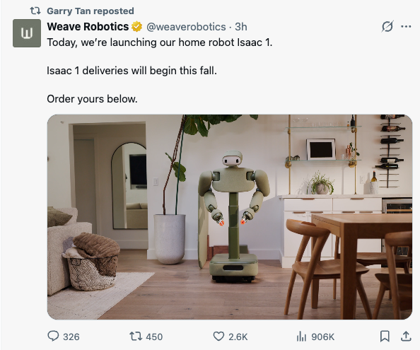

---

Will Marshall
@Will4Planet

Humanity does not have a strategy to navigate the existential risks of advanced AI. Within months, we may hit closed-loop recursive self-improvement, triggering an intelligence explosion for which there is no precedent and no map.

Read my full essay on Substack: https://substack.com/home/post/p-203585051

And my piece in @TheEconomist based on it:

https://economist.com/by-invitation/2026/06/15/humanity-isnt-ready-for-the-coming-intelligence-explosion

^ Will is from Tunbridge Wells, in the USA, founder of a satellite imaging company.

---

Burry -

Wrong direction. This is like Nordstrom’s opening up Nordstrom’s Rack. But Neiman Marcus opens up Neiman Marcus Rack, Bloomingdale’s opens up Bloomingdale’s Rack, Dillard’s opened up Dillard’s rack.

In the end all it proves is there are too many clothes for sale.

Meta pops 9% as company makes cloud push to sell excess AI compute power capacity

^ This is about Meta or Facebook selling excess compute. I am not surprised since Meta cannot build software. Of course the premise is that token demand will be huge, is huge right now, and everything we consume is matrix multiplied.

---

^ Ed Zitro wwed

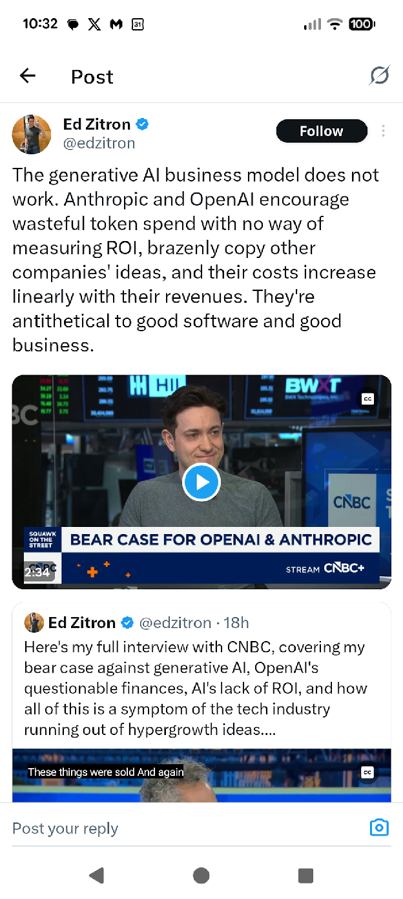
^ Ed Zitron on gen AI: there's not really a business there.

Reply by Dennis Hong -

Coding is most of the LLM TAM, and half of that TAM is inefficiency. The models burn tokens generating garbage code and redoing it. Nothing else burns tokens like this. Deflate the waste away and there's not much left to sell, until physical robots.

---

The Kobeissi Letter
@KobeissiLetter

Leverage in South Korean stocks is out of control:

Assets under management (AUM) in South Korea's leveraged ETFs are up to a record \~\$45 billion.

AUM has surged \+800% since the start of 2026.

As a result, leveraged exposure as a % of free float market capitalization, the portion of shares actually available for public trading, is up to a record \~2.9%, more than TRIPLING since January.

Meanwhile, the Hong Kong-listed 2x leveraged long SK Hynix ETF rose to \~\$15 billion in assets at its peak, the largest single-stock leveraged product in the world.

By comparison, four leading 2x leveraged long ETFs tracking Micron, \$MU, Nvidia, \$NVDA, Sandisk, \$SNDK, and Tesla, \$TSLA, have each never exceeded \$10 billion in assets.

Leverage in Korea is at extreme levels.

---

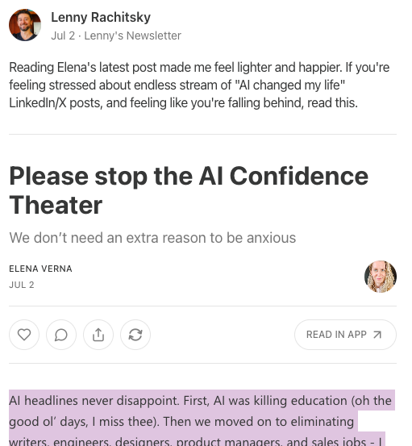

^ I agree with this. The hype is insane and highly discomfiting.

---

Yann LeCun -

Exactly. I've been disseminating a similar message for years.

The concentration of power in AI and the desire for control is by far the biggest danger of AI. It could lead to a few private companies and/or countries being in control of access to information, access to knowledge, and access to the tools of economic expansion.
It's a kind of medieval obscurantism akin to the Ottoman empire banning the use of the printing press for 200 years, in part to keep control of the dogma, but also to protect the corporation of the calligraphers and scribes.

Relevant historical bits about the Internet:
1. It took a deliberate decision by Al Gore and Bill Clinton to open up access of what was then ARPAnet to commercial entities and to the public, against the desires of the entrenched telecom industry. During a public roundtable about the "information superhighway" in 1993, the CEO of AT\&T told Gore and Clinton "leave it to us". Gore said no.
2. In the late 1980s, setting up an Internet presence required buying proprietary hardware with proprietary OS and software stack from Sun Microsystems, HP, IBM, or Dell. By the 2000s, all of this was wiped out by commodity hardware, Linux, Apache, and an entirely free/open software stack. This migration to open platforms was the result of market forces.

Infrastructure wants to be open.
Foundation models are becoming an infrastructure and will inevitably become commoditized.
Long term, the money is in the application layer, which is what I, Arthur Mensch, Alex Karp, and others have been saying.

---

Burry -

'Big Short' investor Michael Burry has said that stocks will crash and rallies won't last, with the end being "nigh.”

---

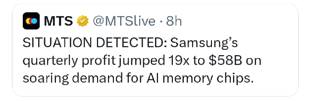

---

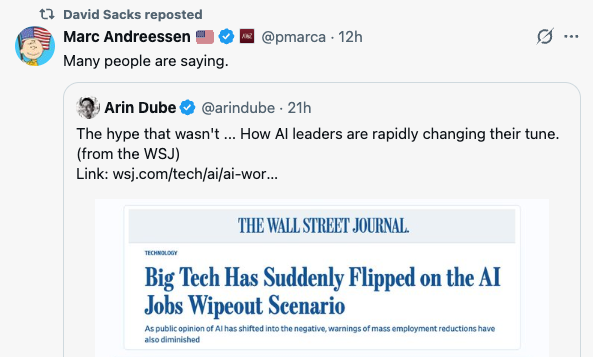
---

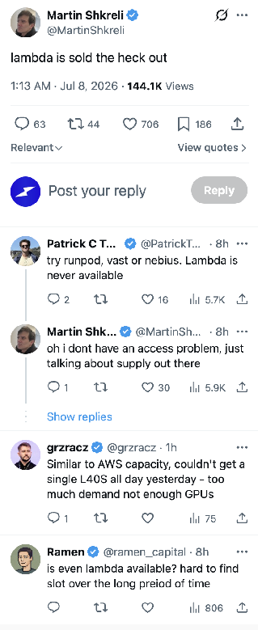

^ Chatter on X about scarcity of GPUs for rent.

---

BREAKING: Brent crude oil prices surge above \$76/barrel after the US revokes Iran's general license to export oil in response to Iran striking three commercial vessels in the Strait of Hormuz.

---

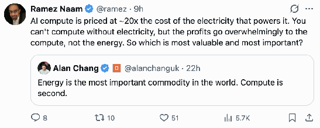

---

BREAKING: A source close to Iran's Ghalibaf says the conflict may escalate and extend to "the energy infrastructure of the countries" in the Gulf in the coming hours.

---

BREAKING: Anthropic has appointed former Fed Chair Ben Bernanke to its governance board.

^ Regulation man.

---

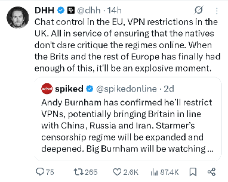

---

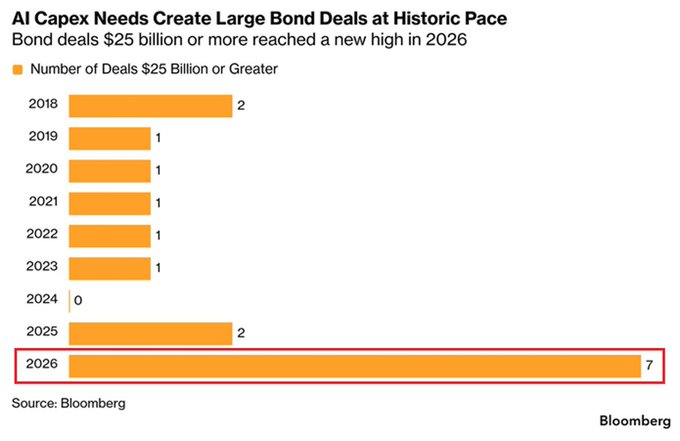

---

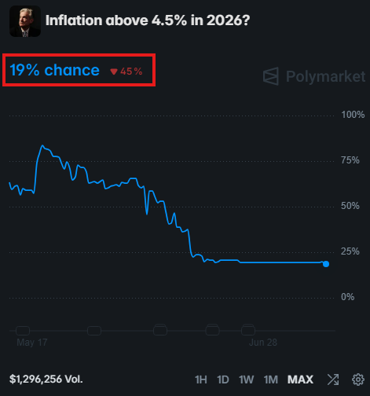

^ Prediction markets have odds of inflation rising above 4.5% in 2026 as dropped from 80% to 20%.

---

🇨🇳🌎 \#China blocks exports of \#helium, key for chipmaking, as war squeezes supply - Nikkei

---

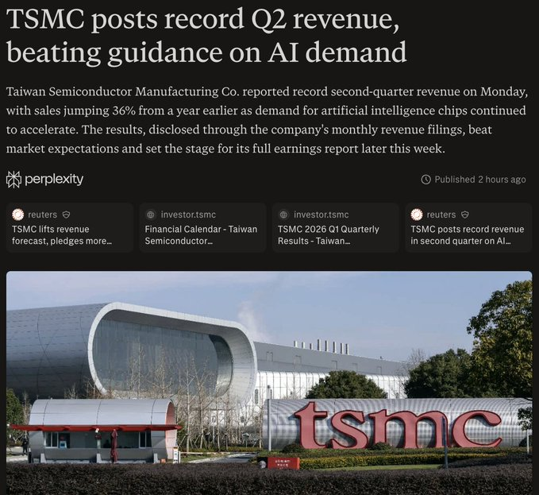

---

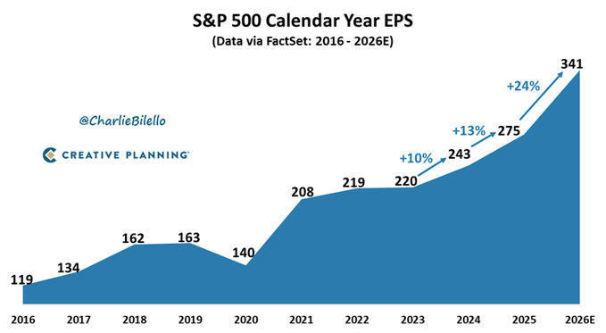

S\&P 500 earnings are now expected to increase by 24% this year. We've never seen earnings growth this high outside of post-recessionary rebounds. An unprecedented boom fueled by massive EPS gains in big tech.

---

François Chollet - @fchollet

The weak AI code gen we had until late last year was most useful to low-skill programmers -- it was raising the floor. It was essentially useless to high-skill programmers -- you could move faster and ship better code without.

This has been completely flipped: the strong AI code gen we have now is \*most\* useful to high-skill programmers, while low-skill programmers are vastly underutilizing it or sometimes drowning in it. It went from a crutch to a power tool.

---

Gavin Baker
@GavinSBaker
·
Jul 12
The mega bull case for AI infrastructure would be \*if\* market share shifted away from certain frontier labs with 90%+ inference margins toward cheaper models, whether open-source or closed.

It would increase the ROI on AI spend for end customers by increasing intelligence per dollar, which would drive incremental token demand. Margin dollars would effectively get redistributed from the frontier labs to AI infrastructure providers. The infra winners would be those with the lowest per token cost and the winners at the model layer would be those with the highest token efficiency.

There are many reasons Jensen is so focused on open source, but this is likely the most important one as I think he is probably less worried about a monopsony these days. Lower margin % at the model layer \= more margin \$ at the infra layer all else equal.

With SpaceX and Meta being vertically integrated and possessing the \#3 and \#4 models respectively it is more possible than ever. Note that Grok 4.5 is ahead of Fable for some useful tasks at a much lower cost, so ranking them \#3 is conservative.

This is not happening yet. Cheap, mostly open source tokens are likely the majority of volume today but the majority of economic value is still accruing to the most intelligent models. Might change though.

We will see.

---

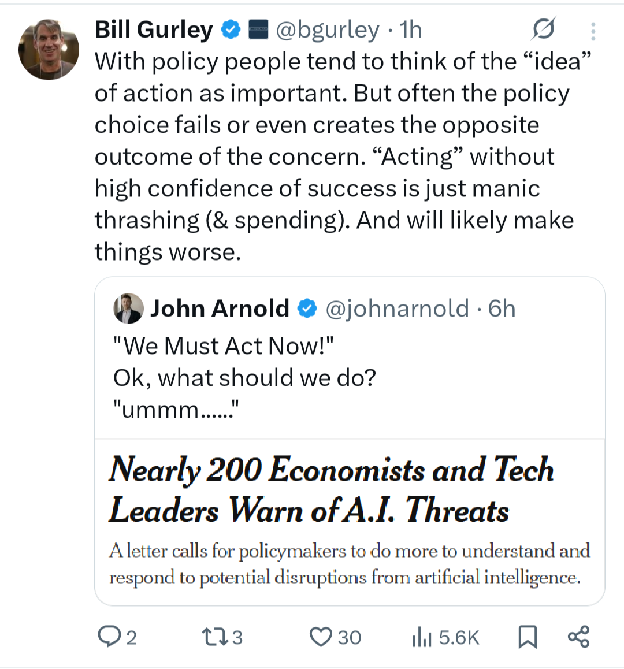

---

Lorenzo of ARK Invest -

The Robinhood Chain is the cleanest case study of what happened to ETH's economics over time.

Since inception, @RobinhoodApp Chain has grossed \~\$816K in revenue.

@Arbitrum, the middleware provider, takes 10%: \~\$80K.

Arbitrum then pays Ethereum for settlement: \$1,538.

The margin profile roughly:

Robinhood: 89%
Arbitrum: 10%
Ethereum: 0.15%

If your thesis is "ETH is money," Robinhood building here is ultra bullish. More activity, more ETH collateral, more lindyness.

If your thesis is "ETH is a revenue generating asset," this is the ultra-bear case.

And here's the uncomfortable truth: Robinhood was never going to build on Solana, Sui or any monolithic L1. They want the stack customization. They want to be landlords, not renters. Ethereum won this deal on merit.
It's just not pricing it right.

A healthy split to me looks more like:
Robinhood: 75%
Arbitrum: 10%
Ethereum: 15%

Ethereum sells the most valuable settlement layer in crypto at marginal cost. Things need to change. @ethlabs\_org

---

US CPI (M/M) Jun: -0.4% (est -0.1%; prev 0.5%)
- CPI (Y/Y): 3.5% (est 3.8%; prev 4.2%)
- Core CPI (M/M): 0.0% (est 0.2%; prev 0.2%)
- Core CPI (Y/Y): 2.6% (est 2.8%; prev 2.9%)

---

BREAKING: IBM stock, \$IBM, collapses nearly -20% after posting weaker than expected earnings due to “weakness in the software and infrastructure business.”

The stock just erased -\$55 billion in market cap.

---

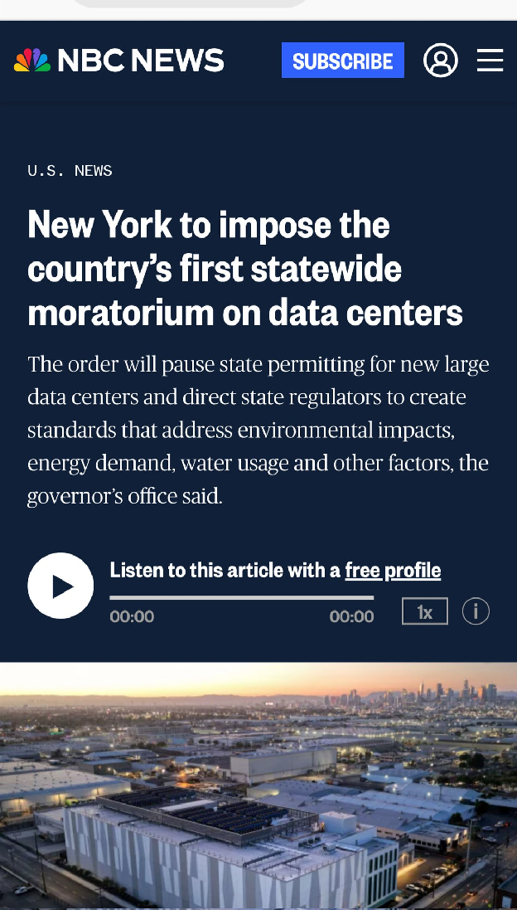

---

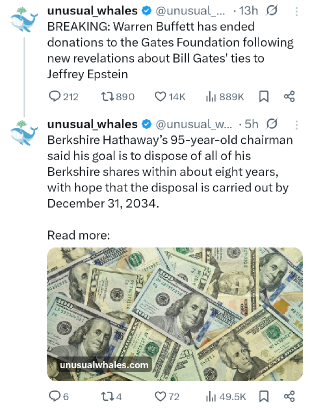

---

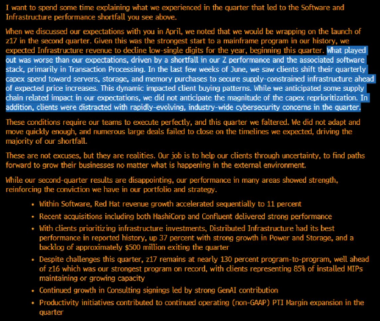

\$IBM CEO’s letter along with the pre-announcement might be the most bearish news for SAAAS yet. Companies are pulling back on software spending to prioritize AI capex and cybersecurity.

---

Starbucks announced (via a Bloomberg report around July 9, 2026\) that it's developing its own in-house AI-powered software tools to replace certain vendor applications, including one from IBM.012c90,2ddce6

Fortune \+1

Key Details

IBM-specific part: Starbucks is building an alternative to an IBM tool (likely TRIRIGA, used for facilities/maintenance management). AI-assisted coding is helping accelerate this internal development.b7f6b6

Fortune

Broader context: This is part of a larger push to cut its \~\$400 million annual software spend (as part of a \$2 billion overall cost-reduction plan under new CEO Brian Niccol). They're also targeting a Microsoft Dynamics 365 inventory-tracking system. Some replacements could roll out by the end of 2027 after testing.bbb510

---

Overwhelmingly bullish report from \$ASML, revenue guide now higher than literally all consensus estimates

I had suspected estimates were too low for ASML, this bodes well for Lam where I think estimates are also too low

ASML CEO Fouquet today: “we are pretty much already close to receive all the EUV orders we need for 2027”

Memory litho revenue up 75% this year, now half of system sales

Everyone is waiting for new fabs to break the DRAM squeeze

The fix is sold out

\$ASML

ASML says it plans to increase Low-NA EUV production capacity by 30% in 2027, from about 65 systems in 2026.

That implies roughly 85 EUV systems in 2027, BELOW Citi’s prior expectation of 90-100.

ASML is also evaluating another 30% capacity expansion in 2028, which would imply about 110 systems, slightly ahead of expectations.

---

BREAKING: Micron stock, \$MU, extends 2-day losses to -15% as the memory stock selloff accelerates.

Micron is now down over -30% since its June 22nd record high.

---

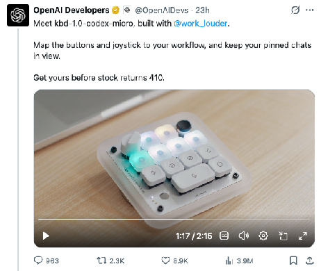

^ A company close to OpenAI makes a bespoke keyboard for controlling Codex.

---

Sam Altman via his weird finsta

the era of the chinese labs being far behind is over, Kimi is at least on par with the modern public frontier models. people have to think differently now without any competitive margin built in

---

Gavin Baker -

Kimi K3 may be an important inflection point for AI. Potentially negative for Anthropic and OpenAI while being net positive for essentially every other company in the world. I mean that very literally. Although the real “Sputnik moment” would be an open-source frontier model that was also token efficient unlike Kimi K3 which is 50-70% more expensive to run than GPT 5.6 per Artificial Analysis.

Rationale:

A world where there are only 2-3 dominant frontier labs with 90% inference margins is net negative for every other layer while being awesome for those 2-3 labs. Those labs would become monopsonies for power, data centers, semiconductors and hyperscalers and would obviously vertically integrate over time into all those layers while also completely subsuming the application/software layers.

Anything that lowers margins and increases competition at the model layer is good for every other AI layer: power, semiconductors, hyperscalers, neoclouds and yes even software.

This is why Jensen is so supportive of open-source. An open-source model requires the \*exact\* same amount of compute to run as a closed frontier model of similar size and architecture. Kimi K3 is roughly the same price as GPT 5.6 Terra on a per token basis, which actually suggests that it is less computationally efficient as I am sure that GPT 5.6 is priced to a higher margin than K3. And given that K3 is a token wastrel, i.e. token inefficient, it is significantly more expensive per task than GPT 5.6 and Grok 4.5, which are much more token efficient. Cost per token and token efficiency (i.e. intelligence density per token) are the drivers of intelligence per unit of cost. The winning AI companies will be those that offer the most intelligence per \$ over time.

Lower margin % at the model layer \= more margin \$ at every part of the infrastructure layer and is a godsend for software. This can happen either through open-source models like K3 at the frontier \*or\* having a vertically integrated model company like Meta, SpaceX or Google at the frontier. Both outcomes result in a lower margin % at the model layer as vertically integrated model companies don’t really care where the margin \$ come from. This is why it was so painful for OpenAI and Anthropic when Google was right there with them from a model competitiveness perspective and why Grok 4.5 and Muse 1.1 were just as important as Kimi K3.

The reason Kimi K3 is only \*potentially\* negative for Anthropic and OpenAI is 1\) the
@ericvishria
 point that the Claude and ChatGPT products and harnesses may be more important than their models today and 2\) the hypothesis that they have much more advanced model checkpoints internally that are already being used for RSI. In the latter scenario, reaching RSI even a few months ahead of other labs might be enough to cement a permanent lead.

Time will tell on both points. And likely fairly quickly.

Caveat would be that since Kimi K3 is not token efficient and thereby actually more expensive than ChatGPT 5.6, we may need to see a more token efficient open-source model at the frontier or see Grok 5/Composer 4/Muse 2 at multiple points on the Pareto frontier for this potential risk to Anthropic and OpenAI to play out. And I am sure they will both vertically integrate as quickly as possible while continuing the product/harness strength they have shown over the last 8 months.

---

Apple Surpasses Nvidia To Become World's Most Valuable Company

---

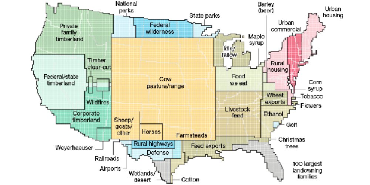

^ Datacentres projected to be 4 squares.

---

Gavin Baker says OS models great for GPU demand, but for NVIDIA it may not be as people expect Chinese OS models to move to Huawei GPUs. However, Huawei still needs equipment to make their GPUs.

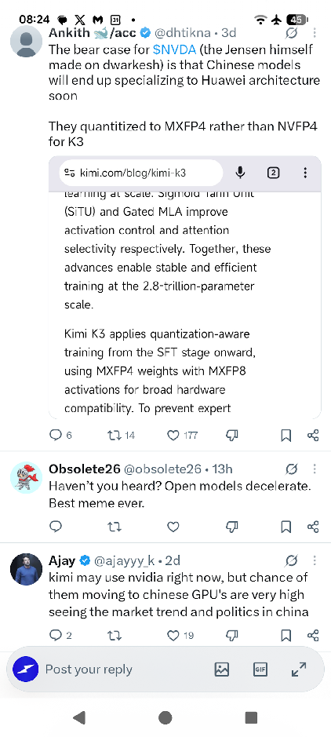

---

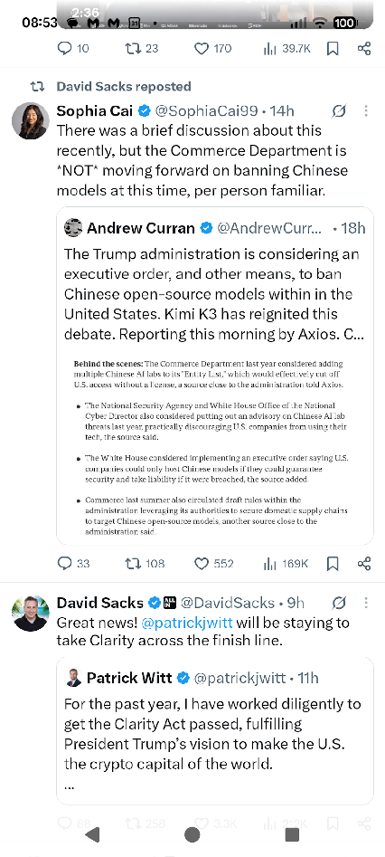

^ US smoke without fire to ban Chinese open source models.

---

Kobeissi -

The AI boom is creating a generational divide in software jobs:

US software developer employment for those aged 22-25 has declined -23% since November 2022, when ChatGPT was launched.

At the same time, the 26-30 age group has seen a decrease of -5%.

By comparison, employment among software developers aged 41-49 has risen \+18% over the same period.

This creates a 41 percentage point gap between the youngest and one of the most experienced groups within the same profession.

Meanwhile, early-career workers in the most AI-exposed jobs have experienced a -16% decline in employment relative to less-exposed occupations and more experienced peers since November 2022, even after adjusting for firm-specific shocks.

By contrast, employment among workers in less AI-exposed fields, as well as more experienced workers within the same occupations, has remained steady or continued to grow.

The AI revolution is wiping out entry-level tech jobs.

---

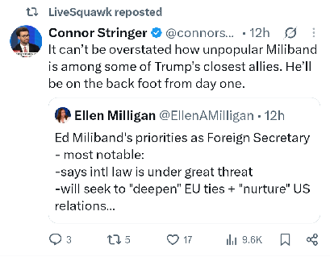

^ UK gov unpopular with USA

---

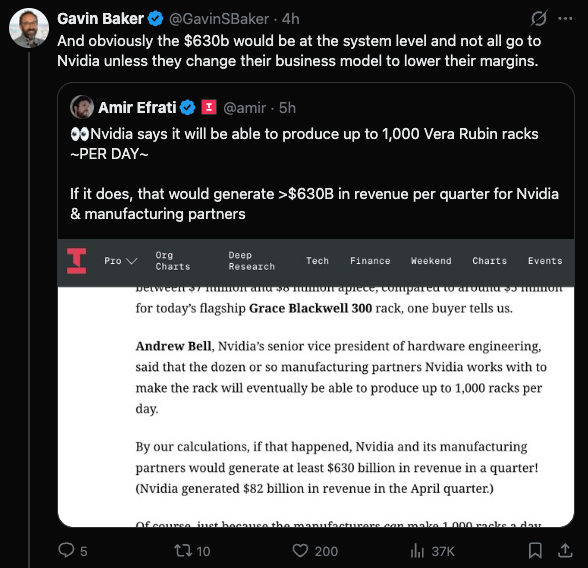

^ Nvidia reported to be able to make 1,000 racks a day, 630bn a quarter. I don’t believe it.

---

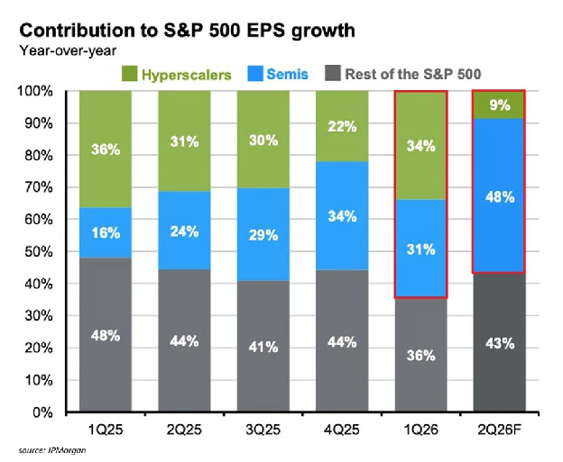

---

\$GOOGL
 Alphabet Q2 2026 Earnings
- Rev. \$119.80B (est \$117.02B)
- Rev. T-MAC \$103.62B (est \$101.07B)
- Google Cloud Rev. \$24.77B (est \$22.46B)
- CAPEX \$44.92B (est \$44.15B)
- Oper Income \$40.77B (est \$40.55B)
- Google Services Rev. \$94.54B (est \$94.32B)
- Gemini App Has 950M MAUs

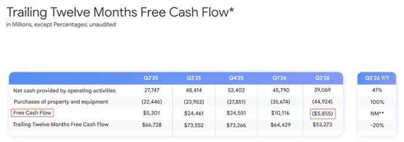
^ Negative FCF

Extreme operating leverage in Alphabet's Google Cloud Revenue... operating margin up from 21% last year to 36% now
\$GOOG

Gene Munster -

Cloud up 82% y/y vs Street at up 63% and the stock is flat because fractional misses Search and Margins

Search: Street was looking for 17.1% growth, came in at 16.8%.

Operating Margins: Came in at 34.0% vs. Street at 34.5%.

My take: Given what we now know, the stock should be up tomorrow. The Cloud number is the most important number and it was a massive beat. Now we have to wait for the call.

---

Tesla Q2 2026 Earnings
- Rev. \$28.24B (est \$26.32B)
- EPS 32C VS. 33C Y/Y
- Gross Margin 16.8% (est 19.4%)
- Adj EPS 33C (est 51C)
- Automotive Rev. \$20.52B (est \$18.68B)
- Active FSD Subscriptions 1.48M (est 1.40M)
- Services And Other Revenue \$4.58B (est \$3.12B)

---

Max Andersen, SaaS Entrepreneur -

As someone who has personally spent \$500k / mo+ on Google Ads for years, I can tell you with certainty:

This revenue growth in Search is artificial & extremely unhealthy for Google’s business long term

Search volumes are declining as legacy search is being increasingly cannibalized by non-monetized LLM queries

Google’s response?

Manufacture revenue growth via short-sighted, highly extractive, customer-hostile tactics. I.e. charge advertisers more for lower quality clicks, including clicks they do not want and explicitly did not approve Google to charge them for

A few examples to illustrate:

For all of its history until recently, Google operated on a 2nd price auction model

I.e. if you bid \$5 CPC and the next highest bidder bids \$1 CPC, Google charged you \$1.01 for the click (one penny more than the 2nd highest bidder) rather than the \$5 you bid

This was a genius move by Google early on as it incentivizes advertisers to input their true maximum willingness to pay rather than trying to play the game of bidding low and constantly adjusting to try to stay just ahead of the next highest bidder while still not paying too much

However recently, Google silently deprecated the 2nd price auction and began charging advertisers as much as their bid and budget caps allow, regardless of what anyone else is bidding

It’s a short-sighted cash grab at the expense of the long term health of the  advertiser ecosystem

Making thing worse, Google also recently nerfed keyword targeting precision

Google previously had precise keyword targeting settings that allowed advertisers pick individual search phrases to bid on, defined down to the character w/ exact match or phrase match targeting

This was one of the core features that made search advertising magic, enabling advertisers to run extremely precise campaigns based on exactly what their target customer typed

But now, even if you bid on a specific term or phrase using the strictest exact
-match targeting settings, Google will show your ad across 1000’s of unrelated keywords, labeling them as as “exact match (close variant)”

The definition of “close variant” means whatever they want it to and changes constantly. The result is advertisers get billed for clicks that are totally irrelevant to their business and that their targeting settings explicitly forbid Google from targeting. Google does it anyway and there’s no ability to turn this off

So now exact match is broad match, and broad match is just meaningless spam

This is all very bad for advertisers, but for Google, it allows them to show your ad and bill you for clicks across 1000x more searches that were previously going unmonetized (mainly because they’re garbage queries no one wants)

This is how you grow revenue atop declining search volumes

Lastly, and perhaps most egregiously, Google quietly stopped respecting budget caps by a factor of 2x. For example campaigns we’ve been running for years with \$1000 daily budget caps suddenly began spending \$2000+ per day

And the extra spend is entirely on the garbage keywords Google arbitrarily throws in as “exact match (close variants)” which have no value to our business, but can’t be turned off

Google offers no refunds nor any recourse for overspend or spend on keywords you explicitly did not target

These are not the actions of a healthy business. These are the actions of company whose core business is in decline but desperately needs to pump quarterly earnings so Wall Street will continue to fund insane capex while hopefully looking through their rapidly deteriorating negative free cash flow

Google operated a benevolent monopoly for the better part of 25 yrs

Meaning the value Google captured from Search was but a small fraction of the value it created, and that spread produced a potential energy that justified expectations of high earnings growth far, far into the future

This is now no longer the case

At the altar of AI capex, Google is sacrificing the golden goose

---

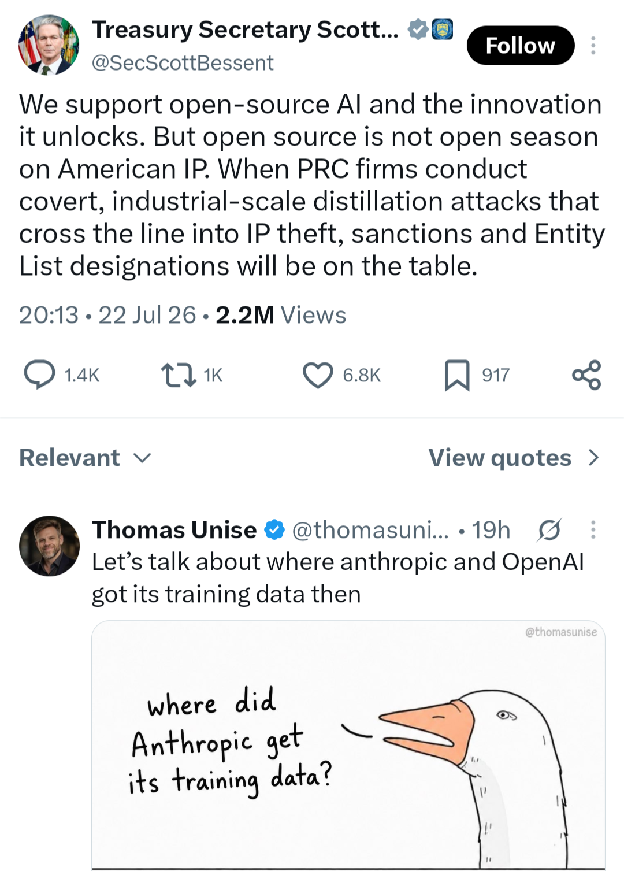

---

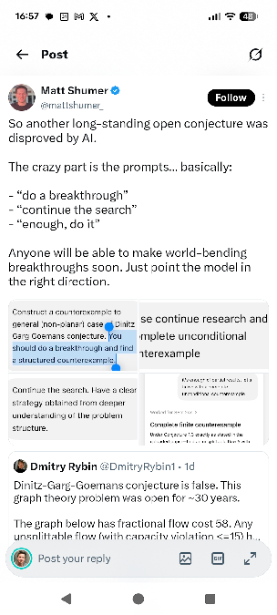

^ I admit I didn't expect this.

---

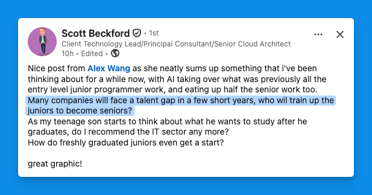

^ This is like worrying about code quality.

---

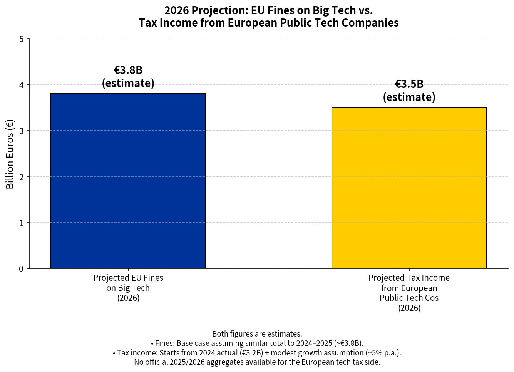

---

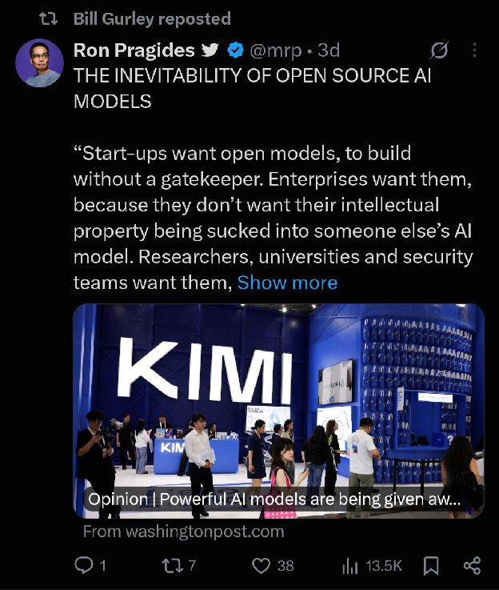

---

\~24 hours since Jensen joined X to post this, and the open-source wave feels unstoppable.

OpenAI signed.... Google and Elon came around. Anthropic is still holding out.

The labs face a tricky choice: protect their business models or align with a new definition of American leadership. Will be fascinating to watch 🍿

---

Aaron Levie -

Now with Google on board, this is a complete endorsement of open weights AI. Pretty big moment for the industry.

---

The “indie hacker” product type is dying and the reason are coding agents

The products you are building sit right in a spot that is not winnable anymore:

Your product is not valuable enough that Claude \+ MCP cannot replace it and you do not have the capacity to create a huge, vertically or horizontally integrated product scope that would drive value and retain people

On the other hand, everyone can now vibe code an 80% version of your product themselves

The only two remaining categories are the foundation model labs themselves entering the application layer and VC funded startups because they have the money to hire teams that can out engineer the vibe coders (for some time)

This is also only true for the years in which applications matter at all, afterwards everything will go to voice input into a model wrapper directly and then from there to agents which can do everything, so applications will then become fully irrelevant

---

Pieter Levels -

I'm seeing a trend here of declining revenue and traffic with indiehackers

On my own projects too

Maybe big VC products too but I wouldn't know cause they don't share revenue

To me it seems clear BigAI is cannibalizing everything that used to be apps

Not bad btw, just times are changing and we have to adapt

---

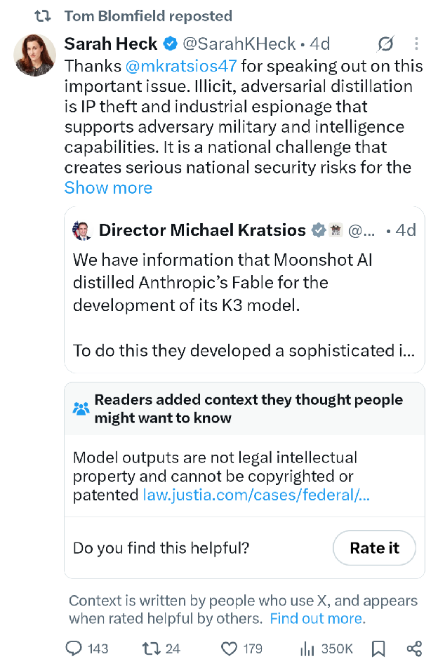

---

Noah Pinion - Summarised X post -

\*\*Main ideas:\*\*

- AI has recently solved major open math problems (the Jacobian Conjecture, quantum cryptography questions, Erdős problems), suggesting machine intelligence now genuinely exceeds human intelligence in some domains.
- Yet the economy and daily life look basically unchanged — no "singularity," no explosive takeoff, just steady productivity growth.
- One explanation: intelligence itself may have diminishing returns. Thinkers like Francois Chollet argue intelligence is a bounded "conversion ratio," not an unlimited stat — humans may already be near-optimal at fuzzy, real-world judgment tasks (like picking where to get lunch), even as AI blows past us at cleanly verifiable tasks (math, code).
- Smith offers three reasons AI could still drive huge productivity gains \*even if\* it's not "godlike" smarter than humans:
  1. \*\*Smart matter\*\* — AI can be replicated infinitely via compute/robots, unlike human intelligence (capped by fertility), boosting the capital-to-labor ratio.
  2. \*\*Distributed tacit knowledge\*\* — AI (via sensors, smart glasses, data) can capture and diffuse "tacit" know-how (like Zeiss's glassmaking or Chinese rare-earth refining) that's currently locked inside organizations and hard to steal or teach.
  3. \*\*Cloud laws\*\* — AI may uncover real causal patterns in the universe too complex for humans to ever intuit or articulate (as it effectively did with language/NLP), opening entirely new scientific frontiers.

\*\*Most surprising idea:\*\* That superintelligence may have \*already arrived\* — quietly — without the world transforming, because raw intelligence has a ceiling, and AI's real economic power comes not from being smarter than us but from being a \*computer\* (infinitely copyable, fast, data-hungry) fused with human-style reasoning.

\*\*Predictions:\*\*
- No dramatic "singularity" — productivity gains will be steady, not explosive.
- Capital-to-labor ratio rises as humans "leverage armies" of AI/robots.
- Laggard firms/countries could catch up to frontier tech faster (tacit knowledge diffuses), making the economy more competitive but possibly reducing firms' incentive to innovate.
- Possible new scientific revolution as AI uncovers "cloud laws" in economics, materials science, etc. — patterns too complex for any human or group of humans to detect.

---

“Money won’t matter in 2036,” claims @elonmusk on the latest episode of The Insider. He tells @zannymb, The Economist’s editor-in-chief, how people will live when AI and robots can do every job and why he expects deflation, not inflation: [bit.ly/4b9UPYK](http://bit.ly/4b9UPYK)

---

Jensen Huang tells Bloomberg that Nvidia is constrained by shortages of HBM and LPDDR memory, land, power, and construction workers. Basically, the chip maker is supply constrained versus demand.

"I think we have the ability as an industry to double each year, but we're going to have a hard time growing much faster than that"

IS DOUBLING REVENUE EACH YEAR IN YOUR MODELS?

---

Luke Puplett -

We'll run these open models on VMs in local datacentres and then on our PCs. A narrow model like Composer 2.5 ability is all I need to run locally.

The frontier will have saturated demand for 'intelligence' as it likely has already; the overhang, a surplus, is huge for most of society and business.

There's an innovators dilemma style risk of over serving on ability while open, narrow models running on a machine or machines in the building take over.

If you think about the classic chart in the book, it feels like it might be narrow on-device models that start out crap and cut across. You have to ask just how smart the average worker drone needs their tokens to be?

What are most people's real needs? What are most people actually producing?

Most people are following rote process, doing things that are 'beneath' some other egos, signalling, deflecting and comms and coordination, persuasion, charm, being the fall guy, and their vital knowledge is mostly their own company and its politics.

Going on a tangent, you can see how it might be that the small group of highly skilled get hollowed out while the adminisphere are the immovable object.

---

Nick Timiraos
@NickTimiraos
·
2m
With interest-rate futures markets pricing in a one-third chance of a Fed hike today, whatever the Fed does will be the largest "surprise" at a non-rate-cut meeting  since 1997, according to Goldman Sachs.

A hike would be "the largest meeting-day surprise outside of cuts since the Fed started releasing statements to announce policy-rate changes."

---

\> The South Korean stock market, which has exploded due to SK’s physical tech sector, is down 35% this month.

---

Kobeissi -

In an unprecedented move, South Korea's stock market just collapsed -44% in 40 days, erasing -\$2 trillion in market cap.

Now, South Korea's finance ministry has announced plans to "stabilize" the market.

Chipmakers SK Hynix and Samsung saw historic gains, rising \+1,900% and \+600% in one year, respectively.

These two stocks accounted for as much as 50% of South Korea's stock market last month.

Never in history has growth at this scale happened so quickly.

On top of this, record levels of leverage are being utilized in Korea's market.

Leveraged and inverse ETFs tracking SK Hynix held \~\$19 billion in total assets, 4X the stock's average daily trading volume of \~\$4.5 billion.

Samsung had\~\$12.4 billion in leveraged ETF assets.

In late-June, cracks in the market began to emerge.

Stock trade defaults reported by firms in Taiwan rose to \~\$70 million in June.

This is the highest monthly total since data began in 2019.

Trade defaults soared \+300% in 2 months and exceeded the 2021 record by \~20%.

---

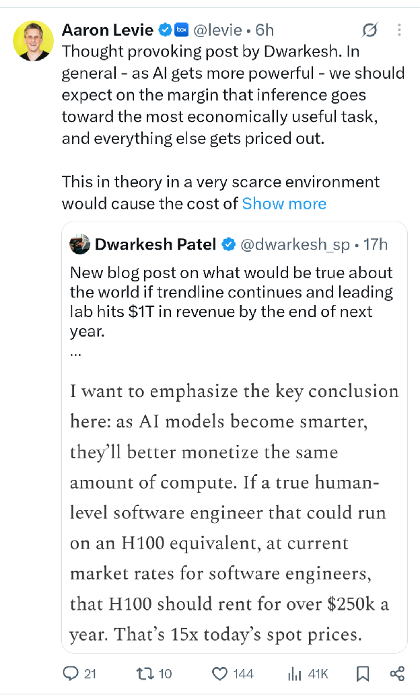

Dwarkesh—who would know—estimates that Anthropic will earn \$100-150 billion in revenue this year.

How much is that?

Well, Elon Musk is the richest person in the world. Last year his companies made in revenue:
- \$94B (Tesla)
- \$18B (SpaceX)
- \$3B (X)

In other words, it's not out of the question that Anthropic—which barely had any revenue before 2023—could make more in 2026 than all of Musk, Inc earned in 2025, and possibly surpass his companies' ARR in the next few months.

^ Everyone's talking about some dumb pie in sky blog post by celeb du jour Dwarkesh forgetting about OS models.

[https://www.dwarkesh.com/p/why-compute-might-get-10x-more-expensive](https://www.dwarkesh.com/p/why-compute-might-get-10x-more-expensive)

---

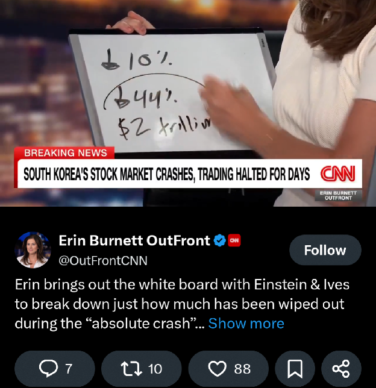

^ CNN discussing the 44% decline in SK stock market.

---

MICROSOFT \$MSFT CEO:

ADDED ANOTHER GIGAWATT OF CAPACITY THIS QTR; REMAIN ON TRACK TO ROUGHLY DOUBLE OVERALL CAPACITY IN TWO YEARS

ADDED 31 NEW DATA CENTERS ACROSS FIVE CONTINENTS THIS QTR, BRINGING THE TOTAL TO 88 THIS YEAR

---

BREAKING: Microsoft stock, \$MSFT, surges over \+8% after reporting stronger than expected earnings.

---

Welp. The news has finally hit the tape.

FT: "Situational Awareness, the \$20bn hedge fund founded by former OpenAI employee Leopold Aschenbrenner, has sought to raise fresh capital from investors after suffering heavy losses during the recent rout in AI stocks."

"Several people familiar with the matter said that Situational Awareness had used borrowing to magnify its returns, a popular hedge fund strategy that can also amplify losses in a downturn."

"The firm was up 439 per cent on a net basis for the year as of the end of June"

"Aschenbrenner pointed in the letter to the prospect of major AI developments in the second half of the year"

Probably RSI
[ft.com/content/280336…](http://ft.com/content/280336…)

---

BREAKING: Microsoft stock, \$MSFT, surges \+15% and is now on track for its biggest daily gain since 2020.

---

BREAKING: Sandisk, \$SNDK, and Micron, \$MU, surge \+25% and \+17% respectively as dip buyers pile back into chip stocks.

---

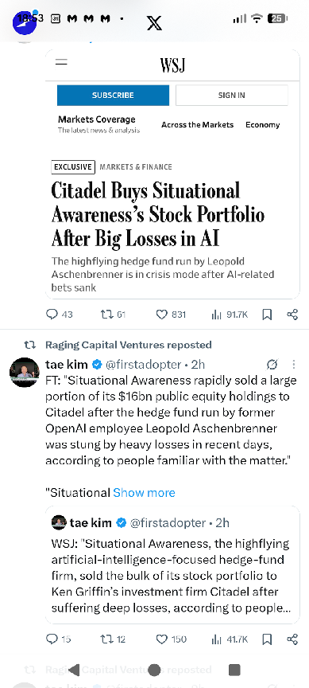

---

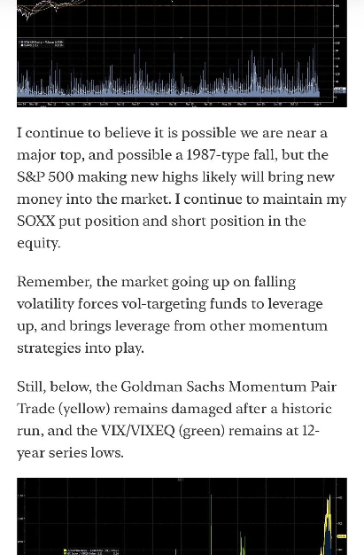

^ Michael Burry
