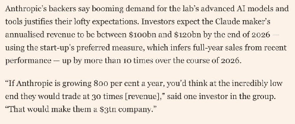
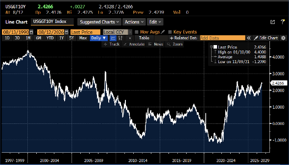
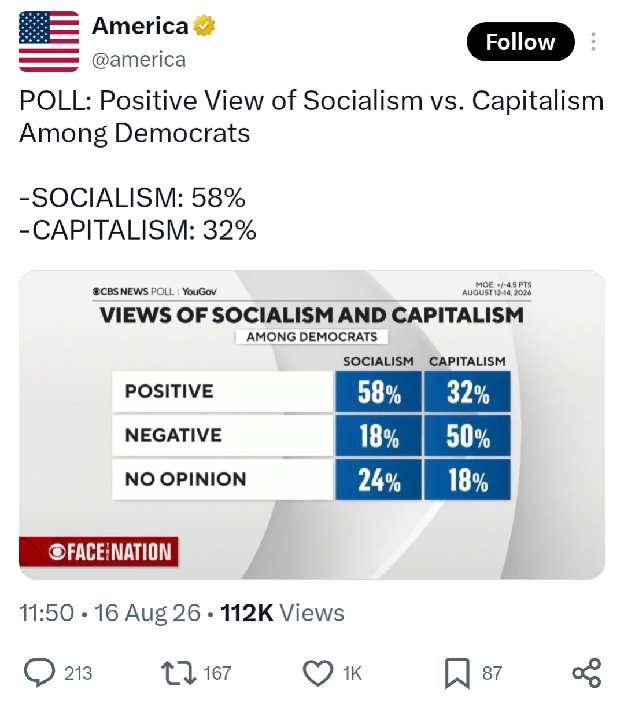
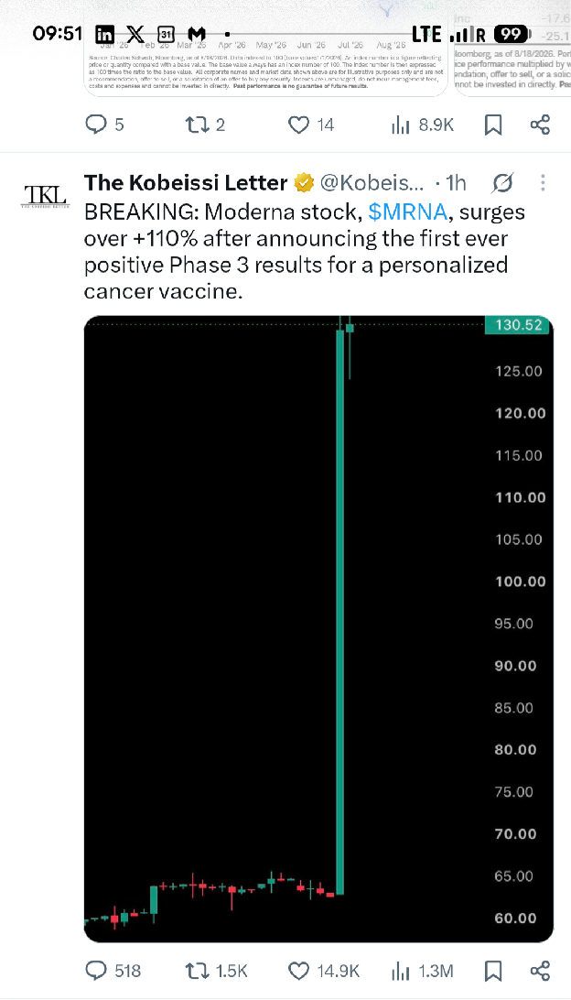
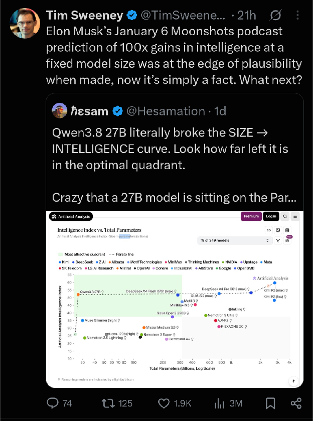
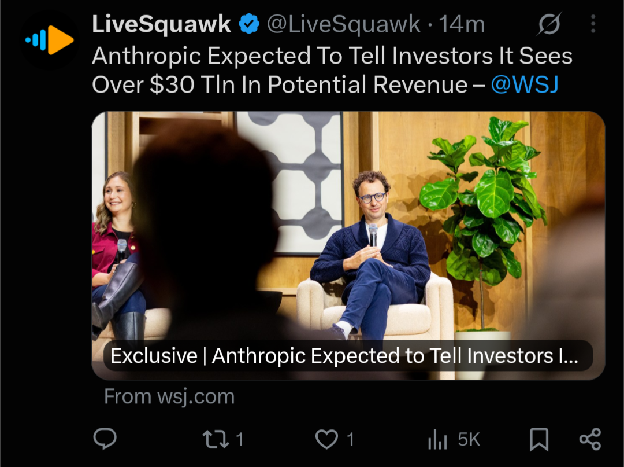

# August 2026

---

Lisa Abramowicz - @lisaabramowicz1

The US auctioned off 10-year bonds today at the highest yields since 2007. The yield move has been driven by real yields (adjusted for inflation), which are hovering near the highest levels since 2008. The key question: is this alarming or historically normal? (1/3)

---

---

Sholto Douglas, Anthropic ex. Deep mind

Awesome response - thank you for coming back with such good faith.

So much I agree with here. Also a lot of things I think the picture is more nuanced and I want to justify our takes more

A few quick ones, but I might post more here later.

I think that cyber is ultimately defence dominant, and if we put in the work over the next 2 years (tldr every financial institution and critical infrastructure provider trying to white hat hack themselves), then I have 0 concern for any open coding model. In the interim, a totally reasonable choice is ‘we’ll take substantially increased cyber attack risk for no imposition on our freedom’ - but the USG should be in a position to actively make that choice having measured and evaluated the risks for themselves.

Bio is offence dominant, and fixing that will probably take well into the 2030s - this means that we’re stuck with genuinely huge risks there which society needs to decide whether it wants to accept (I.e. world leading virologist in your pocket). It’s entirely possible that society says ‘yes those risks are worth it’, but I think society/the gov should have an arm stood up to take that seriously (e.g. run uplift trials where they see if AI helps them more than YouTube access, genuinely test what the worst thing someone could do with 200k and a garage is etc), evaluate it for themselves and make that call with each new capability level.

The second is why has Dario/us talked about risk so much? Fundamentally it’s because we’ve wanted to be honest with people. Employment risk is the classic here. I actually disagree with Dario on the pace - I think it’s most likely that compute shortages, diffusion complexity, policy and unmet demand for services mean that even for years after we have models which could automate 95% of computer facing jobs (models will get there in 28), people will work at them (well into 2030s) - but I do think we as a society should take the possibility far more seriously than we are now, and prepare contingency policies for what to do at various levels of unemployment (e.g. you could imagine not letting profitable companies lay off more than 5% per year), as well as METR style evals to measure progress on different job families so we have a clear picture. Our opinion has always been that we need to be straight up and honest with people.

Completely agree that as both a company and an industry we have utterly failed to present a positive picture of a future people want to fight for, and that this is actively decreasing our chance of getting to that future. So much we need to do better there.

One final half baked one - I don’t think the Mark essay engages with the actually hard part of the problem, which is that inequality of compute will matter far more than open models in having personal superintelligence. Will talk more about this later, but TLDR think the essay presents open models as a kind of panacea without getting into the heart of the issues I actually expect in the future

^ I address this in Envy Abhors a Vacuum. The mistake by the ultracrepidarians of Silicon Valley is that current jobs are the only possible jobs, and that jobs are not an incredibly ornate way to socially arrange society around story telling and perceived value exchange.

---

Gavin Baker -

From yours truly on Friday’s @theallinpod

“On the margin, Anthropic is losing share to OpenAI, to open source, and to Grok, and they're still growing so fast.”

If the \$65b is correct, then someone leaked it to help Anthropic on their forthcoming IPO roadshow. Basically, they are hoping will be able to say “we are now at a much higher ARR after bringing on capacity during July, August and September.”

And after the Anthropic commentary during their potential September/October IPO roadshow and given that OpenAI is almost certainly taking significant share given how aggressive they were securing compute capacity, we should then expect a leak from OpenAI showing they are still growing faster.

There is going to be so much gamesmanship into this IPO.

I read the \$65b as impressive both for Anthropic given their limited capacity and for AI overall given that Anthropic is likely losing some share. Reasonable minds can disagree.

We shall see!

Codex user numbers for reference; users have almost tripled over the last 5 weeks:

---

Sam Altman -

We have paused some frontier RL training to ensure that we can meet the appropriate alignment, security and monitoring standards for the new level of capabilities in front of us. Model progress is now extremely rapid, and we always said we would take action if we felt that model capabilities were outstripping the pace of safety and alignment.

We care very deeply about AI safety. We believe the entire field will have to coordinate on shared safety standards, but will act unilaterally in the meantime.

We expect confidence in safety to increasingly set the pace of AI progress. We are optimistic about the alignment work we are doing, and we remain committed to making frontier capabilities widely available.

openai.com/index/pacing-m…

---

---

---

Doctors read the DNA of your tumor, find what makes it unique, then make an mRNA shot that teaches your immune system, “Attack cells that look like this.”

They combine it with Keytruda, a drug that helps stop cancer from hiding from your immune system.

It just succeeded in a Phase 3 melanoma trial.

Not a cure for all cancer. But a pretty huge idea if it works for other cancers too.

---

Kobeissi -

China's economy is struggling:

China’s industrial production rose \+4.5% YoY in July, but posted its first monthly slowdown in 3 months.

At the same time, retail sales grew just \+0.6% YoY, the 3rd-lowest reading in at least 18 months.

This comes as passenger vehicle purchases, the largest component of retail sales, dropped -21.0% YoY.

Furthermore, fixed-asset investment fell -6.7% YoY in the first 7 months of 2026, worsening from the -5.7% decline in the first half.

Over the same period, real estate investment collapsed -19.2% YoY, the largest drop on record.

China's economic slowdown is deepening across every major sector.

---

Sacks -

David Sacks says an open-source AI ban is coming, disguised as holding open models to the same standard as closed

"I got bad news for you, Chamath. An open source ban is coming. They're not going to call it that."

"You know what they're going to say? They're going to say that we simply have to apply the same standards to open models that we apply to closed."

"Okay, here's how they do it step by step. Let me explain how regulatory capture actually works."

"So first of all, you got to get this regulatory apparatus. Okay, Dario wants an FDA for AI, but he doesn't have enough political support for that, so instead they do this Trojan horse of a FINRA for AI."

"They call it self-regulating, it's not really, but anyway that gets them off the ground. Now they've created the standard-setting organization. Now they've got pre-release model testing. Then the pressure grows to codify that in law."

---

Anthropic allegedly sees 30 trillion revenue.

---

Sam Altman admits he was wrong on AI's timeline and says society and the economy will adapt more slowly

"I thought when we got to GPT-4, which was back in 2023, that very quickly after that there was going to be much more disruption, software businesses up for grabs right away, than it turned out to be."

"I think I was wrong about a few things, but one in terms of the speed: the economy just has so much inertia."

"People keep doing the same things, buying from the same company, wanting to use their tools the same way. I think this is actually a positive in many ways, and it's going to make this big transition go smoother and slower. I'm grateful for it."

"But it means we've all been too ambitious on timelines. Even with this incredible technology, society and the economy will adapt more slowly.”

---

Shanu always brings the data. Observations:

1. \$50B / GW of datacenter power (all up, GPUs \+ other load) continues to be a good estimate of AI capex.

2. GPUs themselves continue to be 2/3 of that.

3. Payback time of \~3.5 years, even with expensive on-site gas.

4. Power continues to be 5-10% of overall AI costs. It's the bottleneck, not a main cost.

---

🇫🇷 🇮🇹🚨 France is starting to be perceived as a greater bond risk than Italy - FT

\*The French 10-year yield moved above the Italian 10-year and a genuine shift in market perception seems to lie.

📊 Markets look above all at the debt's trajectory and the political ability to correct it. Italy remains much more indebted, at around 139% of GDP versus 118% for France, but is now running a primary surplus and has sharply reduced its deficit. France, meanwhile, is still running a deficit of around 5% of GDP, continues to accumulate debt and is struggling politically to deliver any meaningful fiscal consolidation. Therefore, Italy gives the impression that it is stabilising its problem while France looks like it is allowing its own to drift.

🇯🇵 The shift can also be seen in investor flows. Japanese investors, historically large buyers of French government bonds, have reduced their exposure and it matters because France relies heavily on foreign investors to absorb its debt issuance. Less demand means higher yields have to be offered which means a heavier interest burden, which in turn makes the deficit even harder to reduce.

➡ France is not Italy in 2011 as there is still no funding crisis, no imminent default risk, and the ECB has far more powerful tools to limit extreme fragmentation across sovereign bond markets. However, the benefit of the doubt France has enjoyed for decades is gradually disappearing.

\*FT link: [ft.com/content/2b7807…](http://ft.com/content/2b7807…)

---

