# Predictive Tweets

Here are my tweets in support of predicting what would happen fighting inflation.

**2019**

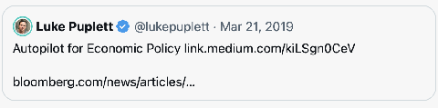

**2022**

**March**

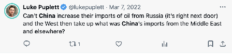

^ This is basically what happened.

[https://x.com/lukepuplett/status/1500862675307352066](https://x.com/lukepuplett/status/1500862675307352066)

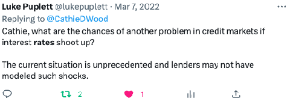

[https://twitter.com/lukepuplett/status/1500784958067167239?s=20](https://twitter.com/lukepuplett/status/1500784958067167239?s=20)

**May**

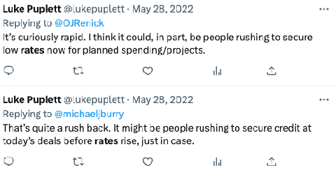

---

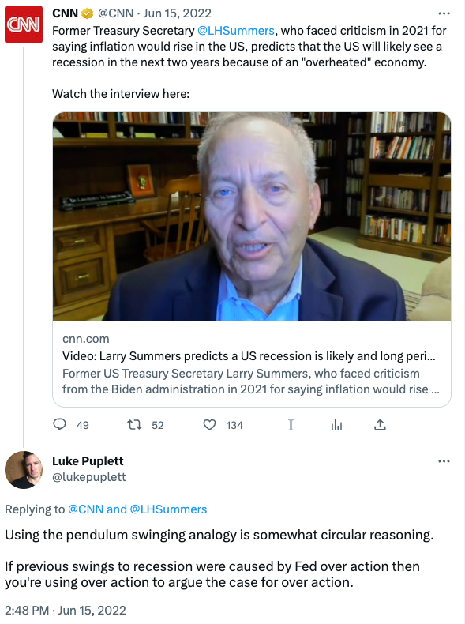

[https://twitter.com/lukepuplett/status/1537069635727769600?s=20](https://twitter.com/lukepuplett/status/1537069635727769600?s=20)

**July**

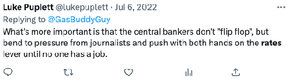

[https://twitter.com/lukepuplett/status/1544756101417033728?s=20](https://twitter.com/lukepuplett/status/1544756101417033728?s=20)

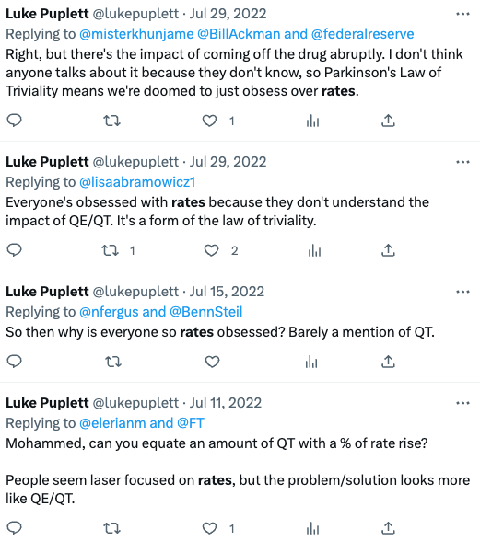

---

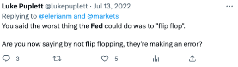

[https://twitter.com/lukepuplett/status/1547185525769097217?s=20](https://twitter.com/lukepuplett/status/1547185525769097217?s=20)

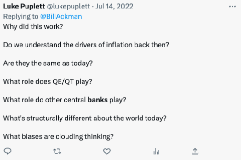

[https://twitter.com/lukepuplett/status/1547504590953881600?s=20](https://twitter.com/lukepuplett/status/1547504590953881600?s=20)

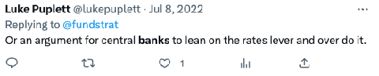

[https://twitter.com/lukepuplett/status/1545418549694455816?s=20](https://twitter.com/lukepuplett/status/1545418549694455816?s=20)

**August**

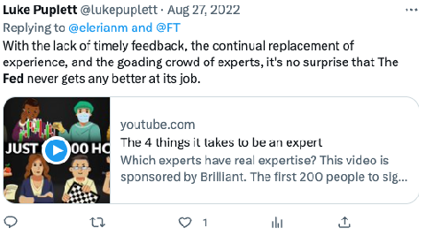

[https://twitter.com/lukepuplett/status/1563493242804776961?s=20](https://twitter.com/lukepuplett/status/1563493242804776961?s=20)

**October**

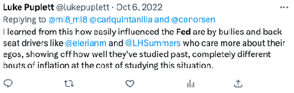

[https://twitter.com/lukepuplett/status/1578018086418284548?s=20](https://twitter.com/lukepuplett/status/1578018086418284548?s=20)

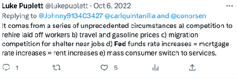

[https://twitter.com/lukepuplett/status/1578015831627284481?s=20](https://twitter.com/lukepuplett/status/1578015831627284481?s=20)

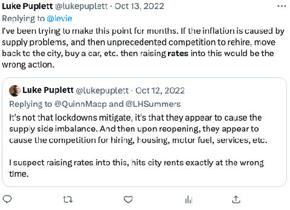

[https://twitter.com/lukepuplett/status/1580558442259181568?s=20](https://twitter.com/lukepuplett/status/1580558442259181568?s=20)

**November**

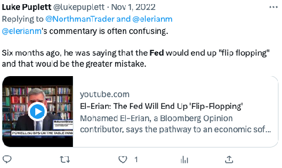

[https://twitter.com/lukepuplett/status/1587418245748985858?s=20](https://twitter.com/lukepuplett/status/1587418245748985858?s=20)

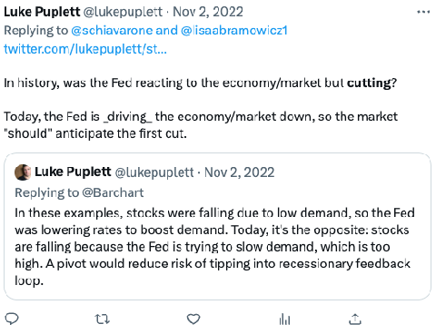

[https://twitter.com/lukepuplett/status/1587873628091301888?s=20](https://twitter.com/lukepuplett/status/1587873628091301888?s=20)

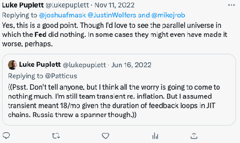

[https://twitter.com/lukepuplett/status/1591053062755713024?s=20](https://twitter.com/lukepuplett/status/1591053062755713024?s=20)

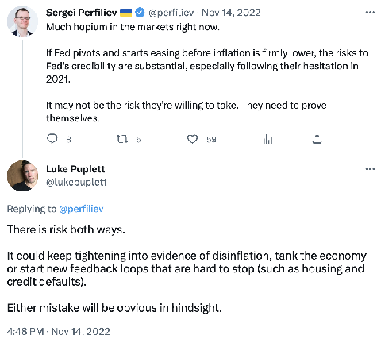

[https://twitter.com/lukepuplett/status/1592197678649090048?s=20](https://twitter.com/lukepuplett/status/1592197678649090048?s=20)

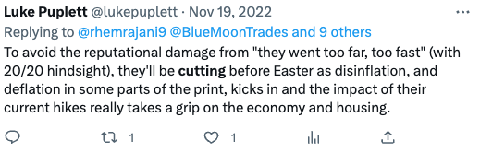

[https://twitter.com/lukepuplett/status/1594079399934300160?s=20](https://twitter.com/lukepuplett/status/1594079399934300160?s=20)

**December**

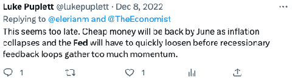

[https://twitter.com/lukepuplett/status/1600992105110937605?s=20](https://twitter.com/lukepuplett/status/1600992105110937605?s=20)

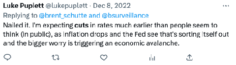

[https://twitter.com/lukepuplett/status/1600990593756299265?s=20](https://twitter.com/lukepuplett/status/1600990593756299265?s=20)

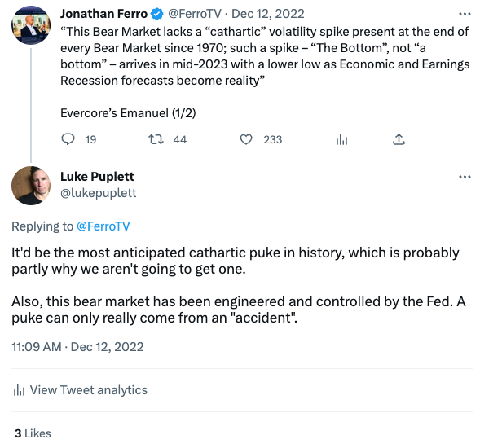

[https://twitter.com/lukepuplett/status/1602259380065517568](https://twitter.com/lukepuplett/status/1602259380065517568)

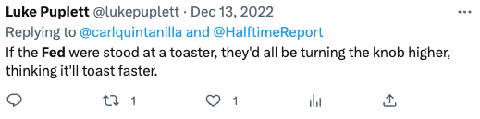

[https://twitter.com/lukepuplett/status/1602754555195707393?s=20](https://twitter.com/lukepuplett/status/1602754555195707393?s=20)

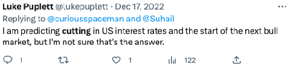

[https://twitter.com/lukepuplett/status/1604141509489598469?s=20](https://twitter.com/lukepuplett/status/1604141509489598469?s=20)

**2023**

**January**

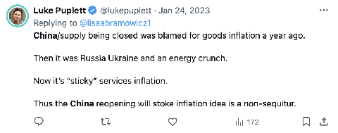

[https://x.com/lukepuplett/status/1617854582004277248](https://x.com/lukepuplett/status/1617854582004277248)

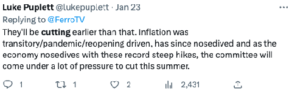

[https://twitter.com/lukepuplett/status/1617560866429304832?s=20](https://twitter.com/lukepuplett/status/1617560866429304832?s=20)

**February**

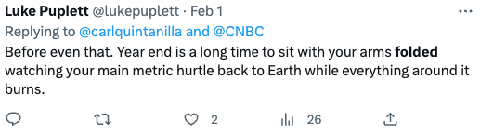

[https://twitter.com/lukepuplett/status/1620865713379344384?s=20](https://twitter.com/lukepuplett/status/1620865713379344384?s=20)

---

And my guess is that this will be the eventual summary post-mortem of this episode:

**March 13, 2023**

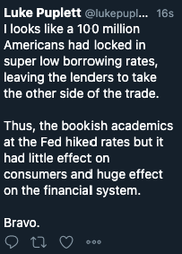

---

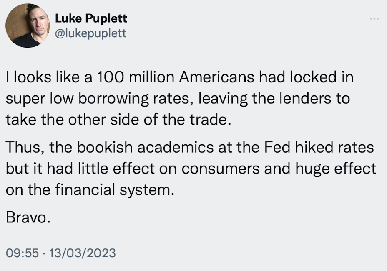

[https://twitter.com/lukepuplett/status/1635217929372602368?s=20](https://twitter.com/lukepuplett/status/1635217929372602368?s=20)

**March 14, 2023**

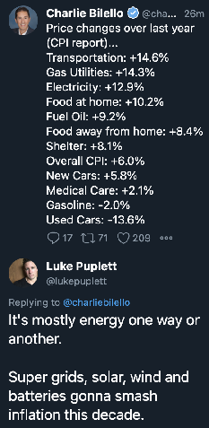

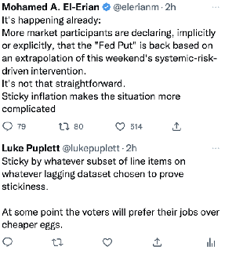

---

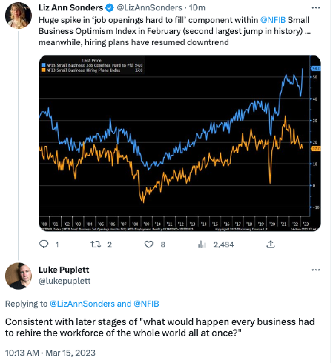
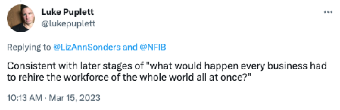

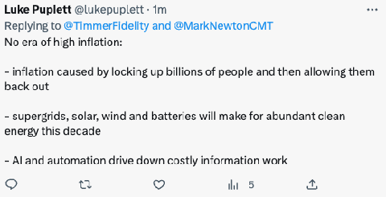

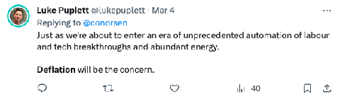

**Later in March 2023**

BlackRock CEO Larry Fink has raised the specter of a “slow rolling crisis” in the US financial system following the failure of Silicon Valley Bank, “with more seizures and shutdowns coming."

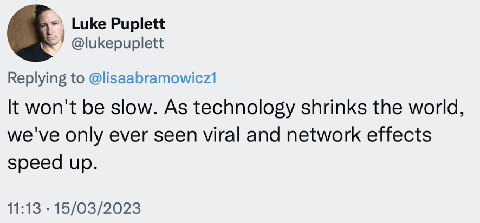

[https://twitter.com/lukepuplett/status/1635962355820507136?s=61\&t=pBMTcfwOeQDQKcsoNqkNAA](https://twitter.com/lukepuplett/status/1635962355820507136?s=61&t=pBMTcfwOeQDQKcsoNqkNAA)

---

**April 2023**

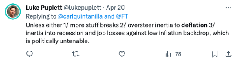

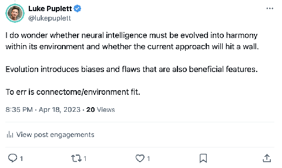
^ True. In October 2024, researchers found Anchoring Bias in models:

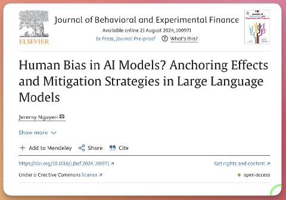

---

**May 2023**

**June and July**

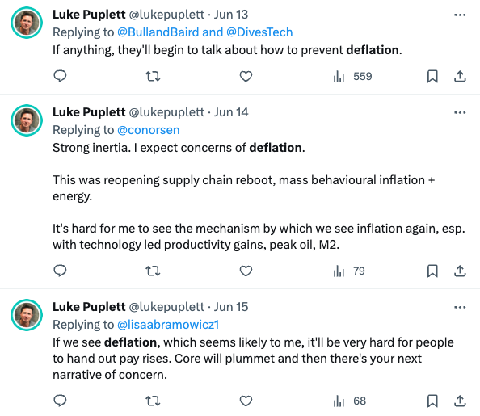

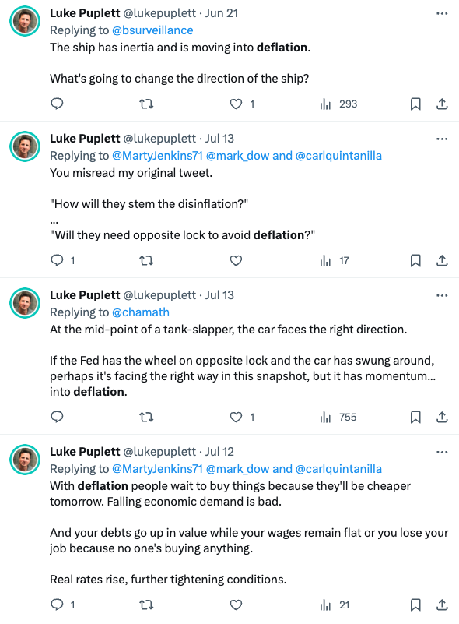

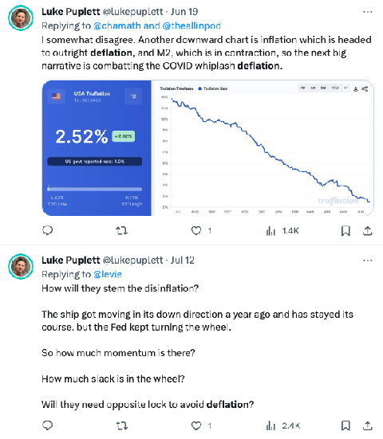

**November 2023**

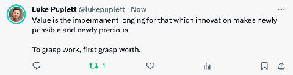

**December 2023**

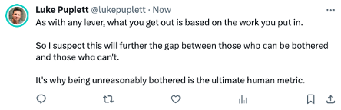
^ On AI

**February 2023**

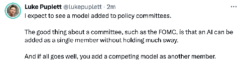

**March 2023**

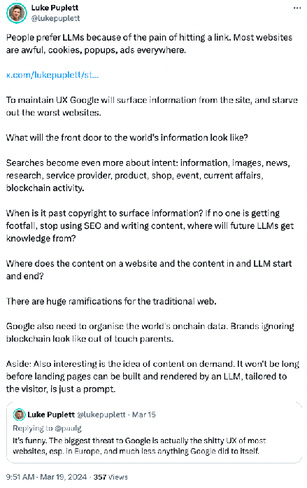

---

**May 12, 2023**

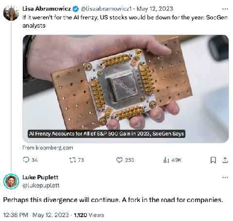

---

**March 2024**

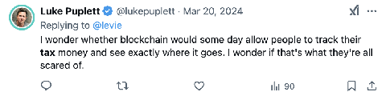

**June 2024**

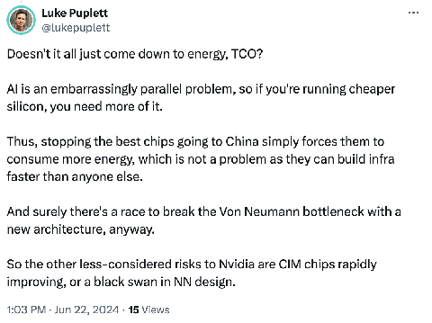

---

**July 2024**

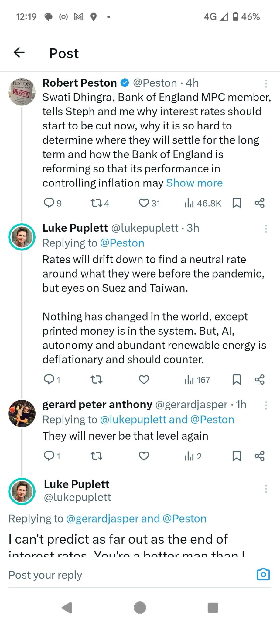

---

**August 2024**

---

---

Rates are 'probably not' going back to pre-pandemic levels says Dana Peterson of the Conference Board

---

This document is a speech given by Federal Reserve Chair Jerome Powell on August 23, 2024 at an economic symposium in Jackson Hole, Wyoming. The speech covers several key points:

1. Current economic situation:
   - Inflation has declined significantly, now at 2.5% over the past 12 months.
   - Labor market has cooled but remains strong, with unemployment at 4.3%.
   - The economy continues to grow at a solid pace.

2. Monetary policy outlook:
   - The Fed sees the time has come to adjust policy, likely meaning rate cuts.
   - The timing and pace of rate cuts will depend on incoming data and evolving outlook.

3. Review of inflation during and after the COVID-19 pandemic:
   - Explains why inflation rose to high levels not seen in decades.
   - Discusses why inflation has fallen significantly while unemployment remained low.

4. Lessons learned:
   - The importance of anchored inflation expectations in facilitating disinflation without economic slack.
   - The pandemic economy proved unique, with much still to be learned.

5. Future plans:
   - The Fed will begin a review of its monetary policy strategy later in the year.

Powell emphasizes the Fed's commitment to both price stability and maintaining a strong labor market. He also notes that while progress has been made in bringing down inflation, the task is not yet complete.

---

According to Powell's speech, there were several key factors that contributed to the high inflation experienced after the COVID-19 pandemic:

1. Collision between overheated demand and constrained supply: Powell attributes much of the inflation increase to this extraordinary collision.

2. Fiscal stimulus: Substantial fiscal support from Congress in late 2020 and early 2021 contributed to strong spending recovery.

3. Pent-up demand and changes in spending patterns: There was a historic surge in consumer spending on goods, partly due to constrained services spending during the pandemic.

4. Supply chain disruptions: The pandemic caused significant disruptions to global supply chains, creating shortages and bottlenecks.

5. Labor market distortions: Millions of people left the workforce, leading to labor shortages and tight labor market conditions.

6. Global factors: High inflation was a global phenomenon, reflecting common experiences across countries including increased demand for goods, strained supply chains, tight labor markets, and sharp hikes in commodity prices.

7. Energy and commodity price shocks: Russia's invasion of Ukraine led to sharp increases in energy and commodity prices.

8. Persistent COVID-19 effects: Continued waves of COVID-19 in the U.S. and lockdowns in other countries (like China) prolonged supply chain issues and delayed the expected rotation of demand from goods to services.

Powell notes that while many initially believed these inflationary pressures would be "transitory," they proved to be more persistent than expected, requiring a strong policy response from the Federal Reserve to bring inflation back under control.

^ Indexes on this:

**September 2024**

^ Finally gets picked up by Musk and Nawfal.

---

**January 2025**

^ Correctly predicted a leap in the design of the NN itself.

**February 2025**

^ On OpenAI getting ads.

^ No likes. I am pretty sure of this one.

**March 2025**

^ 21 March, Howard Lutnick says that this is a shift to consumption tax on All-in pod. He also says that Trump wants to cut taxes for low earners.

^ 22 March, Chamath P, who inverviewed Bessents, says “We should cut the waste, fraud and corruption in America. Once we do, we should immediately eliminate all income taxes for anyone earning \$150k or less.”

---

---

This was correct:

**June 2025**

**July 2025**

**September 2025**

**October 2025**

^ Correct. OpenAI released Atlas on 21 October 2025.

