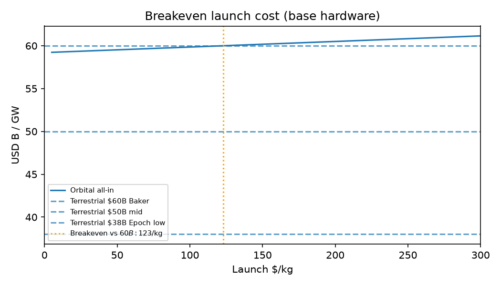
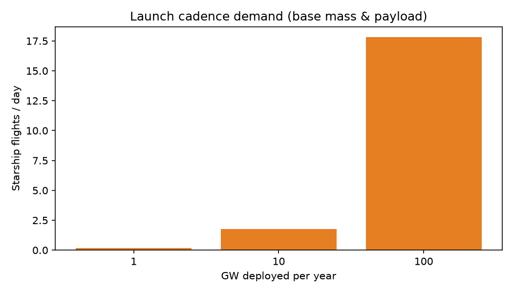
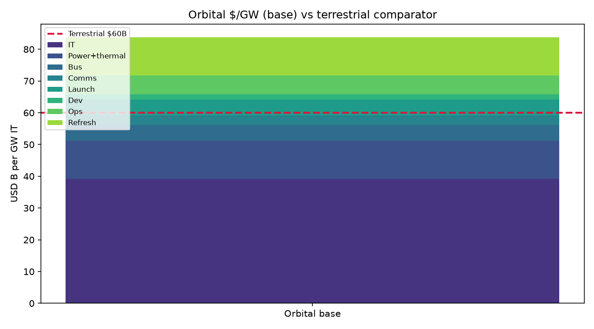
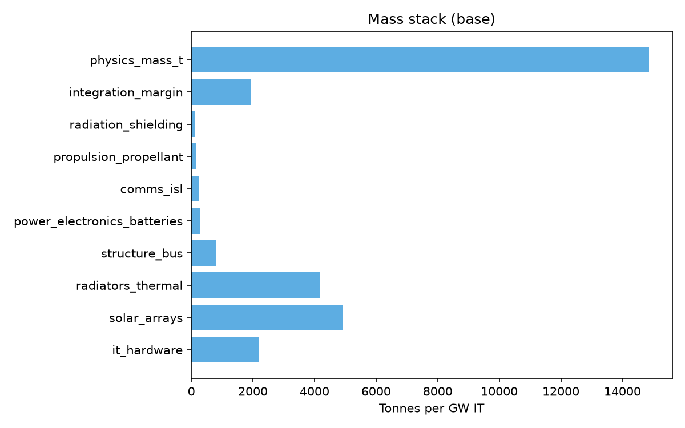
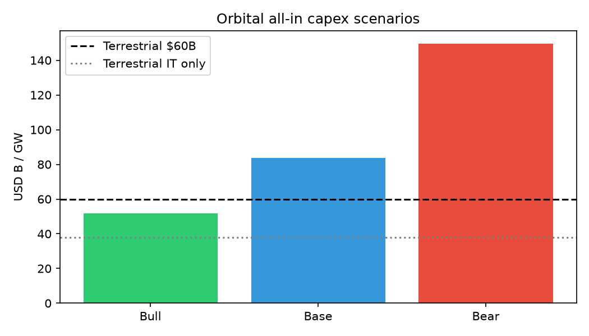
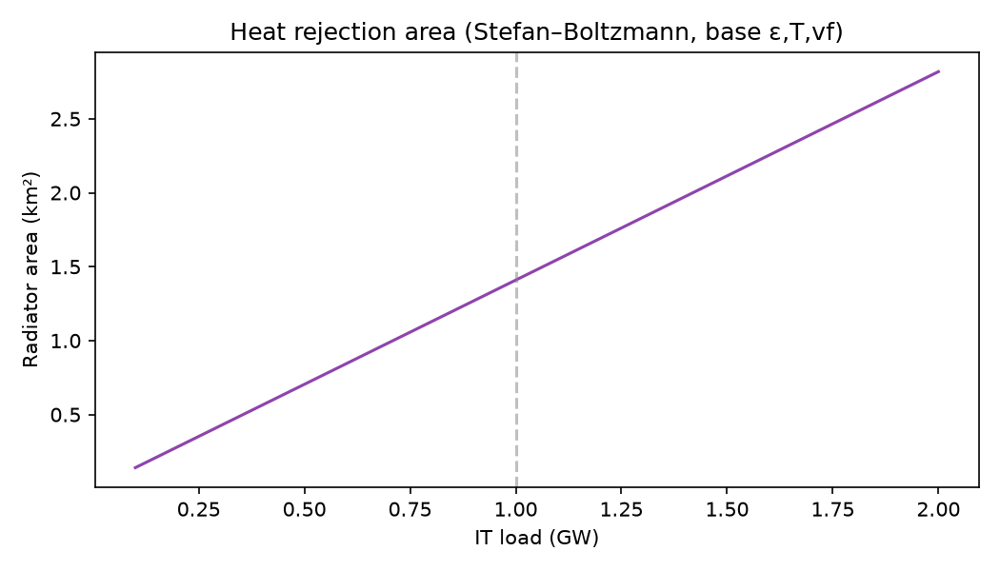

# Orbital AI data centre — model output

*Generated by `orbital_dc_model.py`. Starship reuse (Nov 2026): Super Heavy caught 3×; Ship splashdown until Flight 15 (target 13 Nov 2026) first ship catch attempt — SpaceX updates / Flight 15 page (PROXY).*

## BLUF

**At 1 GW IT load, all-in orbital capex is ~**$52B** (bull) / **$84B** (base) / **$150B** (bear) vs terrestrial **$50–60B/GW** (Baker/Orennia). Launch is **$5.0B** (6% of base) at **50 $/kg** and **6500 t/GW**.

First-install capex (ex-dev/ops/refresh): **$64.2B** (base).

Breakeven launch **$123/kg** (base install, vs **$60B** terrestrial all-in).

**65 Starship flights/GW** at **100 t** payload.

## $/GW summary (USD B)

| Component | Bull (low $) | Base | Bear (high $) |
|-----------|-------------:|-----:|--------------:|
| It Stack | 33.60 | 39.20 | 52.50 |
| Orbital Power Thermal | 6.00 | 12.00 | 22.00 |
| Spacecraft Bus | 2.00 | 5.00 | 10.00 |
| Comms Ground | 1.00 | 3.00 | 8.00 |
| Launch | 0.50 | 5.00 | 10.20 |
| Capex Install Usd B | 43.10 | 64.20 | 102.70 |
| Development Amort | 1.75 | 1.59 | 0.96 |
| Ops Lifecycle | 2.00 | 6.00 | 18.00 |
| Chip Refresh Lifecycle | 5.00 | 12.00 | 28.00 |
| Total Usd B | 51.85 | 83.79 | 149.66 |

## Mass & flights (per GW IT)

### Bull: **2800 t**
- solar_arrays: 2656 t
- radiators_thermal: 3629 t
- radiation_shielding: 54 t
- integration_margin: 857 t
- physics_mass_t: 9426 t
- radiator_area_km2: 2.135
- solar_array_area_km2: 6.655
- radiator_mass_t_physics: 4269 t
- solar_mass_t_physics: 3125 t
- waste_heat_mw: 1250.000
- bus_power_mw: 1250.000

### Base: **6500 t**
- solar_arrays: 4930 t
- radiators_thermal: 4193 t
- radiation_shielding: 108 t
- integration_margin: 1940 t
- physics_mass_t: 14870 t
- radiator_area_km2: 1.409
- solar_array_area_km2: 4.760
- radiator_mass_t_physics: 4933 t
- solar_mass_t_physics: 5800 t
- waste_heat_mw: 1450.000
- bus_power_mw: 1450.000

### Bear: **27612 t**
- solar_arrays: 10412 t
- radiators_thermal: 5361 t
- radiation_shielding: 216 t
- integration_margin: 5522 t
- physics_mass_t: 27612 t
- radiator_area_km2: 1.051
- solar_array_area_km2: 4.690
- radiator_mass_t_physics: 6307 t
- solar_mass_t_physics: 12250 t
- waste_heat_mw: 1750.000
- bus_power_mw: 1750.000

## Deployment cadence (base case)

| GW/yr | Mass/yr (kt) | Flights/yr | Flights/day | Implied pad load |
|------:|-------------:|-----------:|------------:|-----------------:|
| 1 | 6.5 | 65 | 0.18 | 0.1× max cadence |
| 10 | 65.0 | 650 | 1.78 | 0.6× max cadence |
| 100 | 650.0 | 6500 | 17.81 | 5.9× max cadence |

## Charts

